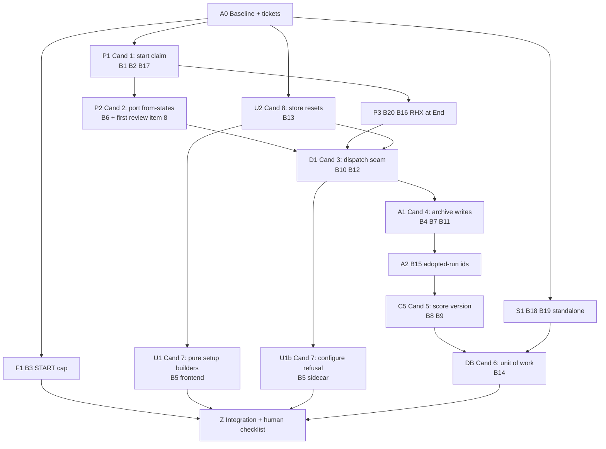

# Ephymeris — Part 2: Review II fix graph (overnight)

Part 1 has already set up the repo: `mattpocock/skills` installed and configured, `.claude/settings.json` guardrails in place, squash-only merging with branch auto-delete, CI as the required check, `main` protected behind a human review, and `review-ii/integration` as the branch all work lands on. Don't redo any of that. If something from it turns out to be missing, note `SETUP-GAP:` in the ledger and work around it; never loosen a guardrail.

You are the orchestrator for a multi-agent fix campaign on the Ephymeris repo. You plan, dispatch, gate and merge. Subagents investigate and implement. Work as a dependency graph: a node starts only when every node it depends on has merged into the integration branch.

## Source of truth

**Ephymeris Architecture Review II** (11 Oct 2026, main at `191ad9a`):
https://claude.ai/code/artifact/af56cef7-1305-4c59-b689-cbd653b061e6

Read the whole page before planning. Every node below cites bug IDs (B1–B20) and candidate numbers (1–9) from it; the page has the reproduction story, file:line anchors and the target interface for each. Treat line numbers as hints: main may have moved. Re-locate code by symbol, not by line.

## Skills

This campaign uses skills from `mattpocock/skills`, already installed and pointed at this repo's GitHub issues. Where a skill asks for `GLOSSARY.md` or ADRs, this repo's equivalents are `CLAUDE.md`, `ARCHITECTURE.md`, `DATA.md` and `RECORDING.md`; read those instead. Where `tdd` asks to confirm seams with the user, the node's ticket and the review's interface sketch are the confirmed seams; don't stop to re-ask.

| Skill | Who | When |
|---|---|---|
| `to-tickets` | orchestrator | A0: turn the graph below into tracer-bullet tickets, one per node, each declaring its blocking edges. Every later PR links its ticket, which is what `code-review`'s Spec axis reads. |
| `grill-me` | orchestrator | A0, once, on the ticket set. Ask only the questions whose answer would change the graph; everything else goes in the ticket as a stated assumption. |
| `diagnosing-bugs` | implementer | Reviewer-confidence bugs B13–B19 before any fix. Phase 1 (a feedback loop that fails specifically on the bug) is the reproduction the ground rules require. Skip Phase 1 only for Verified bugs whose failure mode you can already assert in a test. |
| `design-an-interface` | implementer | Nodes that introduce a new seam: P1 (`SessionClaim`), D1 (dispatch + `ERRORS` table), A1 (`CohortArchive` writers), DB (`db.write()`). The review's sketch is one of the candidate designs and sets the guarantees every alternative must keep; pick the alternative only if it keeps all of them with less surface. Write the choice and the rejected designs into the PR. |
| `implement` | implementer | Every node, with its ticket. It drives `tdd` at the agreed seams and `code-review` at the end; the node protocol below says what else it must do. |
| `tdd` | implementer (via `implement`) | Red-green-refactor, one behavior at a time, through public interfaces. The failing regression test for each bug is the first red. |
| `code-review` | verifier | Fixed point = the integration branch's merge-base. Standards axis against the repo's docs; Spec axis against the ticket and the review section. |
| `resolving-merge-conflicts` | orchestrator | Whenever a node merge conflicts. Keep both intents; never abort. |
| `pr` | implementer | Every PR body: Summary (diff sketch), Evidence (red-then-green test output), Merge Danger (one-way or two-way door), Blast Radius. |
| `handoff` | anyone | When a node's context grows long, or when pausing between nodes. The next agent continues from the handoff doc, not the chat. |
| `qa` | orchestrator | Node Z: file anything `not reproduced` or out of scope as issues in the project's domain language, so nothing found is lost. |

## Scope

**In scope**
- All 20 bugs, B1–B20, including B20 ("fix later" — now is later).
- Candidates **1, 2, 3, 4, 5, 6, 7, 8**, each as the full refactor the review describes. Bugs close *through* their candidate rather than with a parallel patch.

**Out of scope** — do not do these, even if convenient: candidate 9, the Housekeeping list, the "Where the first review's work leaks" list beyond what a candidate already touches, and everything under "Considered, not recommended now". If a fix genuinely requires touching one of these, stop and ask.

## Ground rules

1. **Verify before fixing.** B1–B12 and B20 are marked Verified. B13–B19 are reviewer findings with stated confidence. For those, run `diagnosing-bugs`: the bug must reproduce (a failing test, or a traced code path with evidence) before any fix. If it doesn't reproduce, mark it `not reproduced` with the evidence and move on; don't fix a bug that isn't there.
2. **Red first.** Every bug gets a regression test that fails on the base commit, committed before the fix. Exceptions (B9 event-loop blocking, B19 missing fsync) may assert on structure instead: e.g. scoring runs via `asyncio.to_thread`, `os.fsync` is called before `os.replace`. Say which.
3. **Real collaborators over fakes** where the review asks for it, especially candidate 1: test the runner against a real `PortManager` with an injected `open_serial`, not `FakePorts`.
4. **Minimal dependencies.** No new packages without asking.
5. **Small, logically separated changes.** One concern per commit. Prefer focused diffs over rewrites; don't reformat files you're only passing through.
6. **Preserve the hot path.** In candidate 1, the handshake thread and the loop hand-offs must stay exactly as they are. Note any deviation in the PR.
7. **Docs follow code.** Where a fix turns an ARCHITECTURE.md, DATA.md or RECORDING.md CAUTION into code, update the doc in the same node.
8. **No hardware.** You cannot run boards or RHX. Anything that needs the bench goes on the human checklist (node Z).

## The graph

| Node | Closes | Owns (write lock) | Depends on | Done when |
|---|---|---|---|---|
| **A0** Baseline | — | none (read-only) | — | `review-ii/integration` confirmed to match `main` (it was cut in Part 1); full Python, vitest and firmware build results recorded; each bug re-located by symbol with current file:line; tickets filed with `to-tickets`, blocking edges matching this graph; `grill-me` run; ledger created (see Deliverables). |
| **P1** Candidate 1 | B1 B2 B17 | `sessions/runner.py`, `sessions/lifecycle.py` (start paths), `ports/handler.py`, `ports/manager.py`, `app.py` state hook | A0 | `claim_session` / `request_stop` / `release` / `on_lost` per the review (or the `design-an-interface` winner with the same guarantees); runner records a run only after holding a claim; `start_all` records the group run as soon as any box holds a claim, then raises; End works after a partial start; app.py's IN_SESSION→ERROR sniffing removed; FakePorts retired where the review says. |
| **P2** Candidate 2 | B6, first review's item 8 | `ports/states.py`, `ports/handler.py`, `ports/manager.py`, `ports/flashing.py`, `utility.py` | P1 | Each port verb declares the states it may start from; `TRANSITIONS` stays as the superset `assert_transition` checks; `close_passthrough` from `{PASSTHROUGH}` only; `acknowledge_error` is the only exit from ERROR; `release_for(target, from_=…)` with baseline jobs passing `{IDLE}`; `end_session` from `{IN_SESSION}` only; the "only an IDLE port" baseline rule holds by the verb's signature, not by await placement; `useHandshakeTest.ts` close checked; the two ARCHITECTURE.md CAUTIONs this makes code are rewritten to point at the code. |
| **P3** RHX at End | B20 B16 | `sessions/lifecycle.py` (end paths), `intan/service.py` | P1 | A session ending with RHX unreachable still applies the grace period, attempts `stop_recording`, writes the run to the session, and leaves state a reconnect can recover; a per-box Start after RHX drops gets an accurate message. |
| **F1** START cap | B3 | `tasks/start_command.py`, `BehaviorBox.h`, `test_task_profiles.py` | A0 | Host and firmware agree on the limit; test at exactly 640 and 641; firmware compiles. |
| **S1** Standalone data | B18 B19 | `cohorts/relocate.py` resume path, `cohorts/move_apply.py` resume path, `strobes/store.py` | A0 | Unreachable-source resume leaves the journal retryable; strobe vocabulary fsyncs before replace. |
| **U2** Candidate 8 | B13 | `src/lib/sessions/store.ts`, `MissionControl.tsx`, `SessionMapping.tsx` (reset call only), `NodeDetail.tsx`, `AllBoxesPanel.tsx` | A0 | Store resets on the three events in the review; public `reset*` removed; refused Debug start keeps previous live data; profile load no longer drops task defaults. First confirm re-confirming the same group appears in the lifecycle payload (the review's open risk); if it doesn't, stop and ask. |
| **U1** Candidate 7 (frontend) | B5 | `src/routes/SessionRecording.tsx`, `src/routes/SessionMapping.tsx`, new `src/lib/intan/recordingSetup.ts`, new `src/lib/sessions/placementWalk.ts` | U2 | `reconcileRows`, `recordingReadiness`, `configurePayload`, `walkReducer`, `mappingReadiness`, `confirmPayload` are pure and vitest-tested, following `flow.ts` and `flashCards.ts`; `reconcileRows` keys to the current boxes (drops and adds), so the move-box-3-to-5 case passes; the placement walk's phase / index / resumed-ref state lives in the reducer; both routes go back to rendering. |
| **D1** Candidate 3 | B10 B12 | `server.py`, `app.py` registration / replay / error mappers, `rig/definition.py`, affected tests | P2 P3 U2 | Schema validation before dispatch; one `ERRORS` table; snapshot providers drive replay (incl. `port.telemetry`); `dispatch()` test helper goes through `_on_message` with reply validation; RigDefinition stops importing `CommandError`; vocabulary editor and sketch discovery moved out of `app.py` as the review suggests. Before tightening args, grep the frontend for branches on `TASK_INVALID` / `RIG_INVALID` and list any behavior change. |
| **U1b** Candidate 7 (sidecar) | B5 | `intan.configure` handler | D1 | Configure refuses a box absent from the held mapping, with a code in D1's `ERRORS` table; asks the lifecycle for box configs instead of reading `runner.box_configs()` directly. |
| **A1** Candidate 4 | B4 B7 B11 | `analytics/archive.py`, archive handlers in `app.py`, `analytics/service.py` rescan/tidy, `sessions/writer.py`, `recovery.py`, `analytics/reader.py` | D1 | relocate / move / tidy / recover / rescan go through `CohortArchive`, re-check the rig under the lock and raise `RigInUse` (mapped in D1's table); `write_atomic` used for `.json` and `.mat`; orphan walk treats an unparseable `.json` as missing; `on_changed` replaces per-handler follow-ups; archive view de-duplicates. |
| **A2** B15 | B15 | `analytics/service.py` adopted-id, `analytics/repository.py` `store_adopted` | A1 | Adopted ids are unique per path, not stem; overlapping cohorts no longer flip. Include a migration note if existing ids change. |
| **C5** Candidate 5 | B8 B9 | `analytics/service.py` scoring region → new scorer module, `derive.py`, `infer.py` | A2 | `RunScorer` owns scoring; one `SCORE_VERSION` covers derive + infer + recorded config + profile parsing, pinned by one test; `series` decodes off the event loop; `persist=False` honored; tests pass `sketch_lookup` instead of patching. |
| **DB** Candidate 6 | B14 | `cohorts/db.py`, every repository, `move_apply.py`, `relocate.py` | C5 S1 | `db.write()` / `db.read()` with `on_commit`; repositories take `tx`; only outermost caller commits; move and relocate reuse repository methods; tidy atomic; backup debounce still fires correctly. |
| **Z** Integration | — | ledger, PR descriptions | all | Full suites green; ledger complete; human checklist written; `qa` run for leftovers. |

Write locks are the conflict rule: two nodes that own the same file never run at the same time. If a node discovers it must edit a file another running node owns, it pauses and reports to you instead of editing.

## Node protocol

Each node runs as one implementer subagent in its own git worktree on `review-ii/<node>`, branched from `review-ii/integration` as it stands when the node starts, with its ticket as the brief. Nothing ever targets `main`.

1. **Investigate.** Read the review's section for the node, then the current code. Confirm each bug still exists on this base. For reviewer-confidence bugs, run `diagnosing-bugs` to reproduce or mark `not reproduced`.
2. **Design** (P1, D1, A1, DB only). Run `design-an-interface` with the review's sketch as one candidate. Record the choice.
3. **Implement** with `implement` → `tdd`. Red: commit the failing regression tests. Green: implement to the agreed interface. Refactor only while green. If the code argues for a different shape than the review's, keep the review's guarantees and explain the deviation.
4. **Suites.** Touched suites during work; full suites once at the end.
5. **Independent check.** A separate verifier subagent that did not see the implementation runs `code-review` against the merge-base, with the ticket and review section as the Spec. It also answers: does each test fail on base and pass on head; does the fix close the stated failure mode, not only the test; anything outside the node's ownership changed; any new dependency. Fix or justify each finding.
6. **PR** to `review-ii/integration` with the `pr` skill's body, linking the ticket (`Closes #n`).
7. **Merge** with `gh pr merge --squash --auto`; CI is the gate. If the PR goes stale against the integration branch, rebase the node branch (`resolving-merge-conflicts` if needed) and push; never force-push the integration branch. Confirm the squash commit landed and the node branch was auto-deleted, then update the ledger.

Run independent nodes concurrently: after A0, P1, F1, S1 and U2 can all start at once.

## Stop and ask

- Any change to wire error codes or argument strictness that the frontend relies on (D1).
- Any change to handshake timing or thread hand-offs (P1, P2).
- Anything that would change commit cadence the backup debounce depends on (DB).
- Adopted-run id changes that would orphan existing database rows (A2).
- The lifecycle payload doesn't show a re-confirmed group (U2).
- A `design-an-interface` winner that drops one of the review's guarantees.
- A bug whose correct fix contradicts the review's proposed design.
- Two consecutive verifier rejections on the same node.

## Unattended run

Nobody is watching. A question with no answer is a stall, so no node may block on one. Instead:

- **Stop-and-ask becomes park-and-flag.** When a Stop-and-ask condition fires, finish the node's investigation, red tests and design write-up, then leave the branch unmerged with a `PARKED:` row in the ledger stating the decision needed and your recommended answer. Dependents of a parked node also park; every other lane keeps going. Never merge a parked node overnight.
- **Reversible choices get made, not asked.** If a decision is two-way-door (the `pr` skill's Merge Danger test), take the most reasonable reading, write `ASSUMED:` and the alternative in the ticket and PR, and continue. Only one-way doors park.
- **Interactive skills read from the review instead of asking.** `grill-me` writes its questions and the assumptions it adopted into the ticket rather than waiting; `design-an-interface` takes its requirements from the review's Problem/Solution text; `tdd`'s seam confirmation is the ticket. If a skill cannot proceed without a human (a tracker that isn't configured, a login), skip the skill, note `SKIPPED:` in the ledger, and do the step by hand.
- **Hardware is never a gate.** Anything that needs a board or RHX goes on node Z's checklist. A node's tests must pass with no hardware attached, or the node isn't done.
- **Budget.** If a node exceeds three verifier rounds or roughly two hours, park it with a `handoff` document and move on.
- **Morning report.** Z writes `OVERNIGHT.md`: merged nodes, parked nodes with the decision each needs, skipped skills, and the bench checklist, so the first thing to do in the morning is answer questions, not read logs.

## Deliverables

1. **Ledger** (`FIX_LEDGER.md` at repo root, updated as nodes merge): one row per bug B1–B20 with status (`fixed` / `not reproduced` / `blocked`), node, ticket, regression test name, commit, and one line on what changed. Add a row per candidate 1–8 with its PR.
2. **PRs**: one per node into `review-ii/integration`, squash-merged in graph order, `pr`-skill bodies, each naming the bugs and candidate it closes and listing any deviation from the review. Parked nodes stay as open draft PRs. At the end, open one draft PR `review-ii/integration` → `main` titled "Review II fixes" whose body is `OVERNIGHT.md`; I merge that one.
3. **Human checklist** (node Z): bench steps for what tests can't reach — at minimum: Start a box that's in ERROR and confirm nothing is recorded (B1); force a failure part-way through Start All and confirm End/Abandon work (B2); flash firmware and send a 640-character START (B3); pull RHX's network mid-recording, End the session, reconnect (B20); a stale console close during a flash (B6); a baseline restore attempted while a port is in PASSTHROUGH (candidate 2).
4. **Final summary**: what closed, what didn't and why, and any doc CAUTION that now holds in code.
