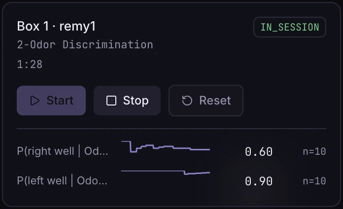

# Ephymeris

Ephymeris is the Hart Lab's desktop app for rodent behaviour sessions. It runs up to six behaviour boxes,
each driven by an Arduino Mega2560 board, and records what every animal does into that animal's own file
as it happens. It also keeps the lab's records, analyses the results, and can run an Intan RHX
electrophysiology recording alongside.

This page is for someone deciding whether to trust it with an experiment: what it does, how it protects
data, what has been tested, and what has not.



*One box mid-session: each condition's rolling accuracy and the trials behind it.*

## What it does for an experiment

- **Loads the task.** You set a task's trial types, odors, rewards and timing on screen, and Ephymeris
  loads it onto each box.
- **Records every event.** A box reports each event (a poke, an odor, a reward) as a **strobe**: an event
  code and the time in milliseconds since that animal's run began. Each is saved exactly as sent.
- **Shows the session live**: each box's trials, accuracy per condition and event stream.
- **Keeps the lab's records**: cohorts, animals, sessions, weights and session notes.
- **Analyses afterwards**: learning curves and accuracy per condition, each with its sample size and a
  95% interval.
- **Records electrophysiology alongside**, starting and stopping Intan RHX with the behaviour and
  checking that each box's sync pulses arrive.
- **Rehearses a task without animals.** The task simulator runs the box's real program on the computer
  against a simulated animal.

## How a session's data is protected

1. **A box starts on the settings you chose, or not at all.** Ephymeris sends the task's parameters; the
   box answers with a count and a checksum of what it received (a number computed from the text, which
   changes if any character does). If either differs, or the box would have to alter a value to fit its
   limits, the box does not start ([TASKS.md](docs/TASKS.md#confirming-the-parameters)).
2. **Each event is on the disk before the next is handled.** A strobe is added to the animal's `.tsv`
   file, a plain-text table, and the computer is told to put it on the disk at once, not hold it in
   memory. If the app or the PC stops, every event through the last complete line is in the file
   ([DATA.md](docs/DATA.md#crash-safety)).
3. **A file is never overwritten.** If a run's file name is taken, the box refuses to start; running an
   animal again makes another file.
4. **The analysis files are built from that record.** At a clean end Ephymeris writes a `.json` and a
   MATLAB `.mat` of the same events, each under a temporary name until it is complete. After a crash,
   **Recover** rebuilds both from the `.tsv`.
5. **Boxes fail separately.** A board that drops ends its own run, the reason written in its file; the
   others carry on.
6. **Numbers come from the raw events.** Accuracy is derived from the strobes by one set of rules, the
   same during the session and afterwards ([ANALYTICS.md](sidecar/ephymeris_sidecar/analytics/ANALYTICS.md#start-here)).
7. **Copies.** With a backup folder set, files are copied there during and after a session, and a slow
   or missing drive never delays one. When a cohort's data moves to another drive, each copy is compared
   with its original by SHA-256 checksum before the original is removed.

## Verification

Measured on 2026-11-23 on version 2.0.0-beta.19 (source revision `6309738`) with the project's own
automated tests: small programs that exercise the app and fail on a wrong result. A test shows what
happened in the cases it tried, not a proof for every case.

| | What was tested | Result |
|---|---|---|
| A | **A crash loses no recorded event.** A recorder wrote 8 events and was killed outright, 100 times over | 100 of 100: all 8 events in the file |
| B | **A power cut while finishing leaves nothing half-written**: cut during the `.json`, during the `.mat`, and during a recovery | 3 of 3: every file whole or absent |
| C | **A box refuses settings that differ**: a line cut short, a value cut short, an unknown setting, a value the box would alter, an older box program | 5 of 5 refused |
| D | **Stored runs score as they did**: 37 real run files and 2 deliberately damaged ones re-scored; 122 more cases compared with the scoring code this version replaced | 39 of 39 and 122 of 122 identical |
| E | **Live numbers equal stored numbers**: the same events scored one at a time, as in a session, and all at once, as in Analytics | 3 of 3 equal |
| F | **The lab's archive, re-scored** and compared with a fingerprint taken from the earlier scoring code | 680 runs (1,334,156 events, 107,292 trials), 12 of 13 task groups: identical |
| G | **A moved file is checked before its original goes**, including 8 crashes staged mid-move | 99 of 99 tests passed |
| H | **The simulator repeats itself**: one random seed twice, then another seed | Same events; different with the other seed |
| I | **The whole suite**: the app's engine on macOS, Windows and Linux; the screen's calculations; the box programs | 2,874, 2,862 and 2,870 passed; 576 passed; 3 of 3 scripts passed |

To repeat them, set up as in [DEVELOPING.md](docs/DEVELOPING.md#setup) and run from `sidecar/`, where
`pytest` stands for `.venv/bin/python -m pytest`:

```bash
for i in $(seq 100); do pytest -q tests/test_writer.py -k hard_kill || break; done   # A
pytest tests/test_recovery.py -k power_cut                                           # B
pytest ephymeris_sidecar/ports/tests/test_params_handshake.py -k "refuses or refused" # C
pytest tests/test_golden.py tests/test_legacy_pin.py                                 # D
pytest ephymeris_sidecar/analytics/tests -k "live_and_offline or offline_scoring"    # E
EPHYMERIS_CORPUS=<your archive> pytest tests/test_legacy_corpus.py                   # F
pytest ephymeris_sidecar/cohorts/tests/test_{transfer,relocate,cohort_move}.py       # G
pytest ephymeris_sidecar/simulation -k one_seed                                      # H
pytest -n 4 --dist worksteal; (cd .. && npm run test)                                # I
```

Row I's box-program scripts are `run*.sh` in `firmware/libraries/BehaviorBox/extras/host_test/`;
its Windows and Linux figures are from the automatic run on that revision. Tests that need hardware,
Intan RHX or the lab's files skip themselves: 19 on macOS.

### What has not been verified

- **A full-length recording from a real animal.** Connecting, recording, the sync line and the end have
  run against a real RHX and real boxes ([RECORDING.md](docs/RECORDING.md#not-yet-verified)).
- **Dimmed lights, tones and pulse trains** measured on a real box ([TASKS.md](docs/TASKS.md#driven-outputs)).
- **The task simulator** run from an installed copy, and its trial order for a seed compared with a real
  board's ([TASKS.md](docs/TASKS.md#simulating-a-task)).
- **Tests A and B stop the program; none cuts power to a real PC**, so the disk itself is not tested.
- **D, E and F show the scoring has not changed, not that it suits your task.** The rules are in
  [ANALYTICS.md](sidecar/ephymeris_sidecar/analytics/ANALYTICS.md#how-a-strobe-stream-is-scored).
- **F covers the archive as it stood at 732 runs.** It has since gained 72: one task group grew and one
  is new, so those two await a new fingerprint and test F reports them as failures.

The maintained list is in [DEVELOPING.md](docs/DEVELOPING.md#not-yet-done).

## Install

You need a Windows 10 or 11 PC (no administrator account, Python or internet connection) and one to six
Arduino Mega2560 R3 boards, each wired into a box and connected by USB. Genuine boards need no driver;
CH340 clones need the CH340 driver. Intan RHX on the same PC is optional.

1. Download `Ephymeris-<version>-setup.exe` from the newest
   [release](https://github.com/Chase-NJ/Ephymeris/releases) and run it. It installs for your Windows
   user only, into `%LOCALAPPDATA%\Programs\Ephymeris`.
2. The installer is not code-signed, so Windows shows **"Windows protected your PC"**: click **More
   info**, then **Run anyway**.

**On an Apple silicon Mac**, for reading data away from the rig, install `Ephymeris-<version>-arm64.dmg`
and allow its refused first launch under **System Settings → Privacy & Security → Open Anyway**. A Mac
copy does not update itself.

Installing, updating and uninstalling never touch your data. Ephymeris keeps its own records in
`%APPDATA%\edu.hartlab.ephymeris` and session files in the data directory you choose.
[Updates](docs/USER-GUIDE.md#updating-ephymeris) install from **Settings**.

### Set up the rig (once)

1. **Rig → Boxes**: **Add box** for each box and pick its **Bound board**. Boxes go by number, never by
   USB port.
2. **Rig → Wiring**: check each channel's pin against the box, and confirm.
3. **Settings**: choose the **Data directory**, and a **Backup directory** on another drive.
4. **Task**: save a task. **Cohorts**: create a cohort and add its animals.

## Documentation

- [USER-GUIDE.md](docs/USER-GUIDE.md): running sessions and fixing common problems
- [RECORDING.md](docs/RECORDING.md): recording with Intan RHX
- [ANALYTICS.md](sidecar/ephymeris_sidecar/analytics/ANALYTICS.md): how events become trials and accuracies
- [DATA.md](docs/DATA.md): the file layout, crash safety and backup
- [TASKS.md](docs/TASKS.md): tasks, wiring and event codes
- [ARCHITECTURE.md](docs/ARCHITECTURE.md): how the app works, for maintainers
- [DEVELOPING.md](docs/DEVELOPING.md): building, testing and releasing
- [PROTOCOL.md](docs/PROTOCOL.md): every command and event
- [GLOSSARY.md](GLOSSARY.md): the exact meaning of each term
- [DECISIONS.md](docs/adr/DECISIONS.md): why each decision was made
- [LESSONS.md](docs/LESSONS.md): the principles and lessons
