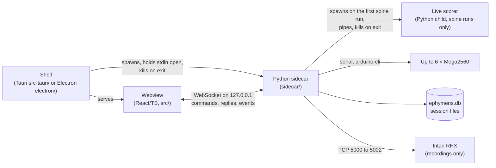
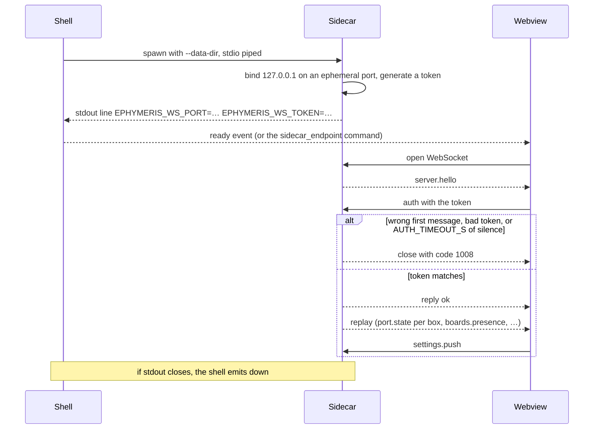
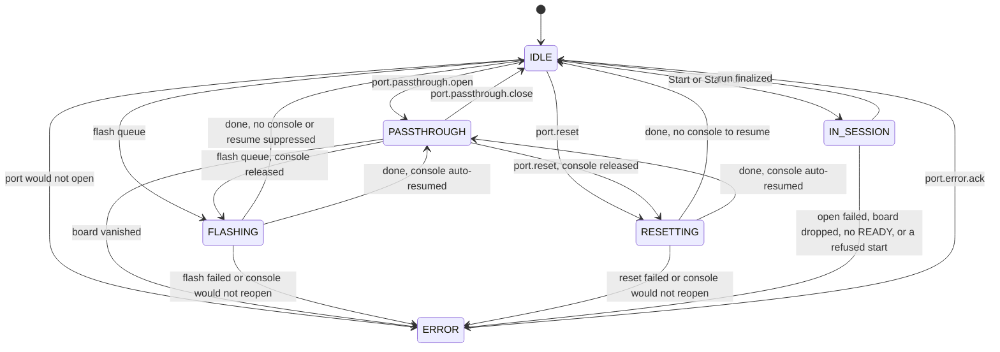
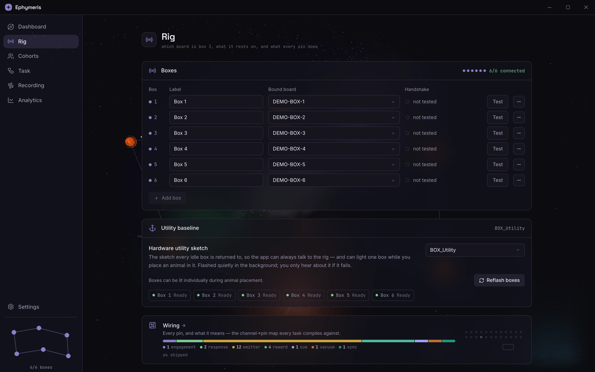
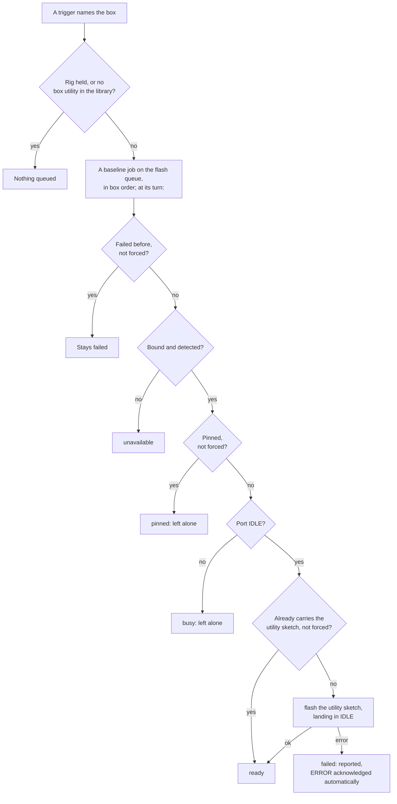
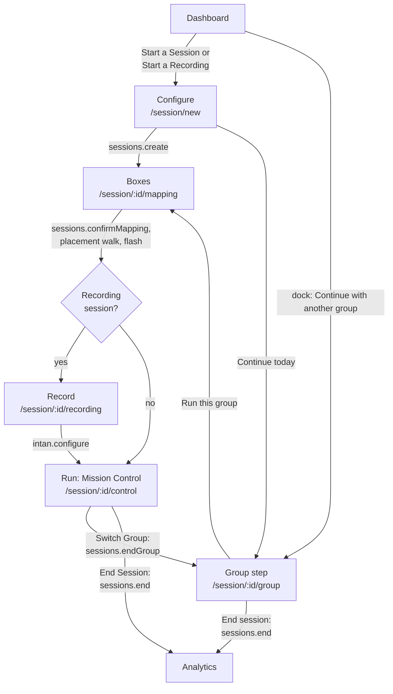
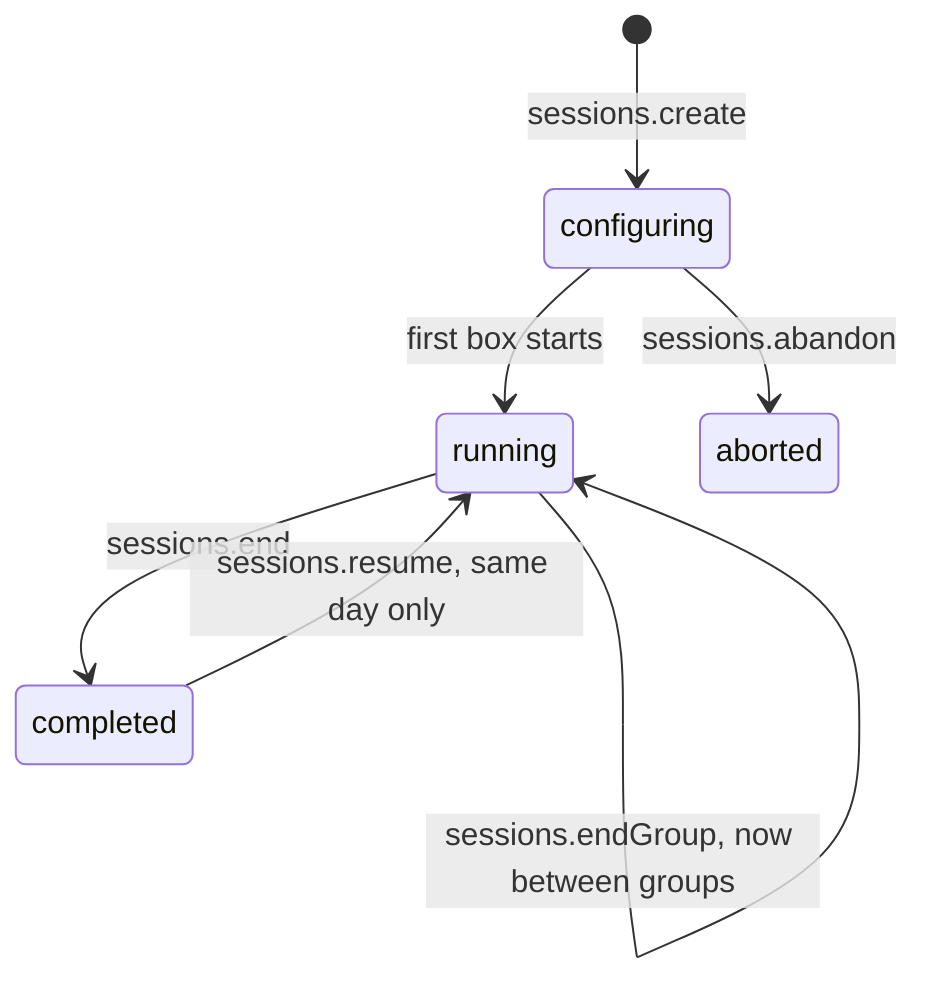
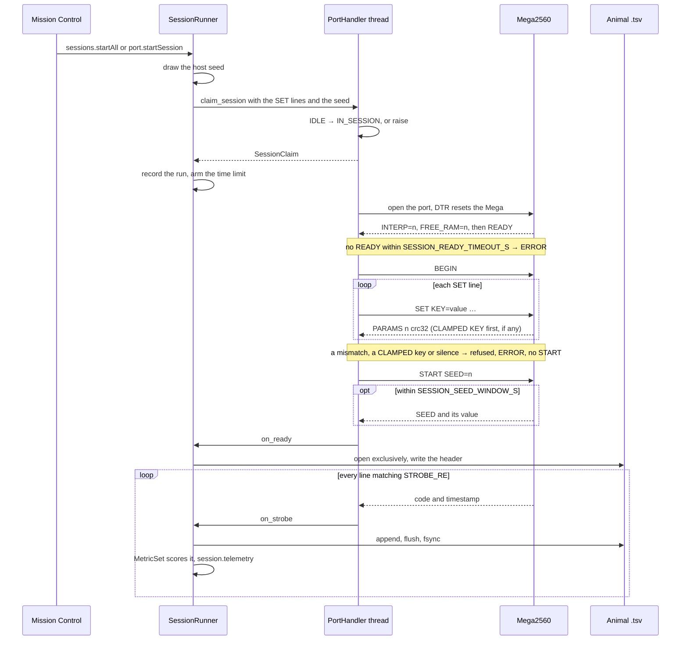
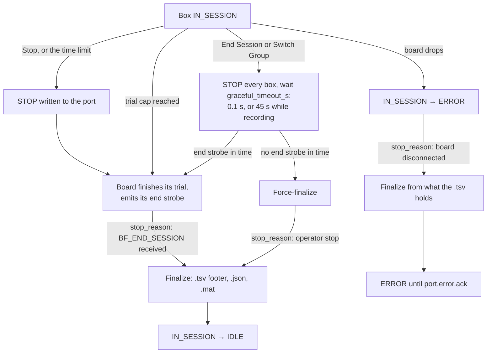
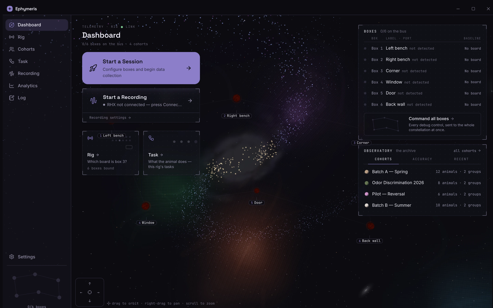

# Architecture

How Ephymeris is put together and the rules that keep it honest. Messages: [PROTOCOL.md](PROTOCOL.md);
tasks and firmware: [TASKS.md](TASKS.md); files, database and analytics: [DATA.md](DATA.md); Intan:
[RECORDING.md](RECORDING.md).

## Contents

- [Overview](#overview)
- [Process lifecycle](#process-lifecycle): [Startup handshake](#startup-handshake), [The live scorer](#the-live-scorer), [Which sidecar runs](#which-sidecar-runs), [The Electron shell](#the-electron-shell), [Updates](#updates)
- [Wire protocol](#wire-protocol): [Dispatch](#dispatch), [Replay on connect](#replay-on-connect), [Invariants](#invariants)
- [Settings](#settings): [Settings keys](#settings-keys)
- [Boxes and boards](#boxes-and-boards): [Box bindings](#box-bindings), [Board discovery](#board-discovery), [Handshake test](#handshake-test)
- [Port state machine](#port-state-machine): [States](#states), [Transitions](#transitions), [Port verbs](#port-verbs), [Exclusivity](#exclusivity)
- [Flashing reset and passthrough](#flashing-reset-and-passthrough): [Flashing](#flashing), [The flash queue](#the-flash-queue), [What a board carries](#what-a-board-carries), [Reset](#reset)
- [Hardware utility baseline](#hardware-utility-baseline): [When a restore happens](#when-a-restore-happens), [Three rules it never breaks](#three-rules-it-never-breaks), [Unloaded wiring holds it](#unloaded-wiring-holds-it), [Running a task from Debug Mode](#running-a-task-from-debug-mode)
- [Session lifecycle](#session-lifecycle): [The flow](#the-flow), [Configuration](#configuration), [Mapping and the placement walk](#mapping-and-the-placement-walk), [Group step](#group-step), [Running boxes](#running-boxes), [Entering IN_SESSION](#entering-in_session), [Clean exit](#clean-exit), [Board drop](#board-drop), [Stop reasons](#stop-reasons)
- [Frontend](#frontend): [Routes](#routes), [The shell module](#the-shell-module), [Scope windows](#scope-windows), [One sky](#one-sky), [Cohort browser](#cohort-browser), [Shaders and lights](#shaders-and-lights), [Live session views](#live-session-views), [Export progress](#export-progress)
- [Theme](#theme): [Telemetry panels](#telemetry-panels), [Printed documents](#printed-documents)
- [Module map](#module-map)

## Overview



The **sidecar** (`sidecar/ephymeris_sidecar/`) owns all state: serial ports, `arduino-cli`, SQLite, session
files, RHX and the port state machine. The **shell** spawns it, persists settings and owns OS dialogs and
windows. The **webview** (`src/`) renders what the sidecar reports and edits settings; it never touches a
port or predicts a transition. The **live scorer** scores spine runs and touches no port, file or database.

1. **The sidecar owns all state** and refuses an illegal operation with a typed error code; a disabled button
   is a courtesy.
2. **A serial port has exactly one owner** ([Port state machine](#port-state-machine)).
3. **Box number 1–6 is the key, never a COM address**, which Windows renumbers ([Box bindings](#box-bindings)).
4. **Nothing slow or optional may stall a session**: the backup mirror ([DATA.md](DATA.md#backup-mirroring)),
   RHX ([RECORDING.md](RECORDING.md#the-rule)) and the live scorer may be slow or dead.
5. **Every strobe is fsync'd to the `.tsv` on arrival** ([DATA.md](DATA.md#crash-safety)).

## Process lifecycle

### Startup handshake

The shell (`src-tauri/src/sidecar.rs`, `electron/sidecar.ts`) spawns the sidecar with piped stdio and
`--data-dir`. The sidecar binds an ephemeral port on `127.0.0.1`, makes a per-launch token, and prints exactly
one stdout line, `EPHYMERIS_WS_PORT=<port> EPHYMERIS_WS_TOKEN=<token>`; everything else goes to stderr and the
app log. The shell parses it (`parse_handshake`, `parseHandshake`) and emits ready, or down when stdout closes.



With no shell (a browser dev preview), `src/lib/ws/client.ts` reads the endpoint from `localStorage` key
`ephymeris:endpoint`, for a sidecar run with `--token` and `--no-parent-watch`.

> [!IMPORTANT]
> **Orphan protection is load-bearing.** The shell holds the sidecar's stdin open, the sidecar exits on EOF,
> and the shell kills it on exit; an orphan would hold the serial ports. **Nothing auto-respawns**: a new
> sidecar would lack the old one's ports and session state, so the operator restarts the app.

### The live scorer

A spine run's live numbers replay its whole stream so far
([ANALYTICS.md](../sidecar/ephymeris_sidecar/analytics/ANALYTICS.md#live-scoring)). On a sidecar thread that
would hold the GIL the session threads need to fsync strobes, so one child, `sessions/scorer.py`, scores
every box.

> [!IMPORTANT]
> **The scorer dies with the sidecar, is never respawned and is never waited on.** It is a `multiprocessing`
> `spawn` child started when a mapping with a spine run is confirmed. It runs at lower priority, rests as long
> as each score took, and exits when its pipe closes; `Application.stop` kills it unjoined. The frozen build
> needs `multiprocessing.freeze_support()` first in `packaging/entry.py`, or the sidecar starts a copy of
> itself. If it dies, live numbers read `unavailable`; strobes and files are untouched.

Requests carry only new strobes, one per run in flight, merged while waiting, and are written and read on
their own threads, so the session path never waits on the child.

### Which sidecar runs

`EPHYMERIS_SIDECAR_PYTHON` wins; otherwise a dev build prefers `sidecar/.venv` and an installed one the frozen
`ephymeris-sidecar`, each falling back to the other (`resolve_launch`, `resolveLaunch`). Bundled copies get
`EPHYMERIS_BUNDLED_ARDUINO_CLI`, `EPHYMERIS_BUNDLED_ARDUINO_DATA_SEED` and `EPHYMERIS_BUNDLED_SKETCHES`.
Packaging: [DEVELOPING.md](DEVELOPING.md#building-the-installer).

> [!CAUTION]
> **Under Tauri, every path built from `resource_dir()` goes through `simplified()`.** Windows returns
> `\\?\C:\…`, `arduino-cli` given such a `--libraries` silently finds nothing, and the compile fails on
> `#include <BehaviorBox.h>`. `discovery._plain()` strips the prefix in Python.

### The Electron shell

[ADR 0006](adr/DECISIONS.md#0006-the-shell-is-electron-not-tauri) replaces Tauri with Electron (`npm run electron:dev`,
`npm run package:electron`); lab copies move over through [the crossover](#updates), then `src-tauri/` goes.
`electron/` owns what `src-tauri/` owns:

| File | Does |
|---|---|
| `main.ts` | Starts everything; kills the sidecar on `will-quit` |
| `sidecar.ts`, `launch.ts`, `handshake.ts` | Port of `sidecar.rs` |
| `window.ts`, `geometry.ts` | The frameless main window; closing it closes every pop-up |
| `ipc.ts`, `bridge.ts`, `preload.cts` | One IPC channel per `Shell` method, exposed as `window.ephymeris` |
| `settingsFile.ts` | `settings.json`, written to a temporary file and renamed |
| `updater.ts`, `installer.nsh` | [Updates](#updates) and removing the Tauri copy |

> [!CAUTION]
> **The sidecar's `--data-dir` is `<appData>/edu.hartlab.ephymeris`, Tauri's `app_data_dir`, never
> Electron's `userData`.** Anywhere else, every setting and the whole cohort database look missing, with no
> error.

IPC handlers answer only the top frame of the app's own pages; a `scope-*` pop-up gets only the endpoint, its
frame and opening a pop-up. Pages are sandboxed, context-isolated and Node-less. `saveFile` writes only the
path its dialog just returned; `openPath` opens folders only. Windows load Vite when `EPHYMERIS_DEV_URL` is
set (never installed), else `dist/` from `app://ephymeris/`, because `fetch` refuses `file://`.

### Updates

| Part | Does |
|---|---|
| `release.yml`, `ship-main.yml` | Build both installers and put up a release: Tauri's `*_x64-setup.exe` and `.sig`, Electron's `*-setup.exe`, `.blockmap` and `latest.yml`. `release.yml` drafts from a tag; `ship-main.yml`, run by hand only, publishes `main` as `<version>.<commit count>` |
| `publish-update.yml` | On publish, writes the feed to the `updates` branch: `latest.json` (Tauri), `latest.yml` (Electron) |
| `updater.rs`, `electron/updater.ts` | Check the feed; download, verify (Tauri signature, Electron sha512), stop the sidecar, run the installer |

A draft is invisible to the feed: publishing is shipping. **The crossover**: the Electron installer is also
signed with the Tauri key and named in `latest.json`, so Tauri copies take it as an ordinary update
([README](../README.md#moving-a-lab-pc-to-the-electron-shell)); `installer.nsh` silently uninstalls the Tauri
copy, keeping app data.

Before installing, the shell closes the sidecar's stdin and waits up to 12 s so it stops the `arduino-cli`
daemon, which would otherwise lock `arduino-cli.exe`. Install is offered only with no session, no recording
and every box `IDLE` or `ERROR` (`lib/updates/blocker.ts`; a down sidecar blocks nothing), always on the
operator's click. Checks run at launch and every 6 hours, never in dev. No downgrades: fix forward.

> [!CAUTION]
> **Losing `TAURI_SIGNING_PRIVATE_KEY` or its password cuts every installed Tauri copy off from updates.**
> Keep both backed up outside this machine and outside GitHub.

## Wire protocol

`protocol/schema.py` is the one authority. `npm run gen:protocol` writes `sidecar/ephymeris_sidecar/protocol.py`,
`src/lib/ws/protocol.ts` and `docs/PROTOCOL.md`, committed with the schema and never hand-edited;
`tests/test_protocol_contract.py` fails on stale output or an undocumented name. The frontend re-exports the
generated shapes and never casts a reply or event. `EPHYMERIS_WIRE_VALIDATE=1` (on in tests) checks every
reply and event against the schema, `tests/test_wire_shapes.py` pins the real emitters, and startup refuses
a declared command without a handler or a handler the schema doesn't declare.

The client's first message must be `auth`, token in the body (never a URL), within `AUTH_TIMEOUT_S`, or the
socket closes `1008`. After every auth, reconnects included, the client re-sends `settings.push`.

```jsonc
{ "v": 1, "id": "c7", "cmd": "port.reset", "args": { "box": 1 } }                          // command
{ "v": 1, "corr": "c7", "ok": true,  "result": { … } }                                     // reply
{ "v": 1, "corr": "c7", "ok": false, "error": { "code": "…", "message": "…", "detail": null } }
{ "v": 1, "evt": "port.output", "ts": 1721600000.123, "data": { … } }                      // event
```

Every command gets exactly one reply; work outlasting it (a flash, a restore) is queued and reported through
replayed events.

### Dispatch

`SidecarServer` (`server.py`) validates arguments against the schema (`BAD_MESSAGE`, `detail.problems`), runs
`handler(args) -> result`, and maps an exception to its code through one table, `ERRORS` in `wire_errors.py`
(unmapped: `INTERNAL`). **One exception type, one code**: never catch a domain exception to recode it, since
the frontend branches on codes; a new refusal gets a new exception and a row. Generic types map only
narrowly: `OSError` only on a command naming a box (never a socket error), `KeyError` only as a
`BoxRefused`'s cause. Tests dispatch through `tests/wire.py`.

### Replay on connect

After `auth`, every registered snapshot goes to the new client: `port.state` per box, `boards.presence`,
`flash.queue`, `utility.updated`, `session.replay` and the rest. `server.publish` broadcasts the same
provider, so a reconnecting client hears what the others heard; a snapshot that raises is skipped. State
belongs in a snapshot, a change (`port.output`, a transition) in a broadcast. **Live session state is not replayed**: a
client asks `sessions.active` or `sessions.status`, and `SessionStore` keeps a `session.lifecycle` broadcast
that lands mid-request and asks again.

### Invariants

- **`box` is the key, never a port address.** An unbound box reports `IDLE` and refuses with `PORT_NOT_BOUND`.
- **No optimistic port state**, and **a client timeout cancels nothing** (`CALL_TIMEOUT_OVERRIDES`).
- **`port.output` is batched** per `FLUSH_INTERVAL_S`; passthrough text never leaves the ring buffer.
- **`PROTOCOL_VERSION`** is bumped on any breaking change; a mismatch is `PROTOCOL_VERSION_MISMATCH`.

## Settings

<a id="who-owns-settings"></a>
<a id="persistence-and-push"></a>

**The shell owns settings**, because a bad `arduino-cli` path or save directory is what stops a sidecar
starting, and the screen that fixes it must still work. `settings.json` (one `"settings"` key) is saved via
`shell.settings` after every change; a failed save shows a persistent note.

> [!IMPORTANT]
> **Settings flow one way, shell to sidecar**: the full payload on every connect and change. Scope windows
> never push.

<a id="where-each-setting-is-edited"></a>

Screens split by subject: **Settings** holds directories and motion; **Rig** (`/config`) what a box is
(bindings, handshake test, baseline, baud, wiring at `/config/wiring`, [TASKS.md](TASKS.md#rig-wiring));
**Recording** RHX and each box's sync input ([RECORDING.md](RECORDING.md#recording-walkthrough)); **Task**
tasks and the vocabulary ([TASKS.md](TASKS.md#the-task-tab)).

### Settings keys

| Key | Screen | Sidecar reads |
|---|---|---|
| `dataDirectory`, `backupDirectory` | Settings | yes |
| `reducedMotion` | Settings | no |
| `arduinoCliPath`, `defaultBaud`, `boxes` | Rig | yes |
| `constellation`, `constellationSlots` | Rig | no |
| `intan` | Recording | yes |
| `recordingDefaults` | Recording, Record step | no |
| `taskDefaults` | none ([TASKS.md](TASKS.md#the-start-line)) | no |

Defaults are `src/lib/settings/schema.ts`. The sidecar's `settings.py` is lenient: unknown keys are ignored
and bad values fall back to defaults. A key naming a sketch holds its folder name, never a path.

## Boxes and boards

### Box bindings

```ts
BoxBinding = { box: number; hardwareId: string | null; label: string; intanDigitalIn: number | null }
```

**Bound** means `hardwareId`, the board's USB serial, is set; every "is there a box" check gates on bound,
never on detected. A cohort's `boxNumber` is checked against 1–6 only, so it stays editable on the other
lab machine. Two boxes can't share an `intanDigitalIn` ([RECORDING.md](RECORDING.md#the-sync-line)).

> [!WARNING]
> **A stale handler must never survive a rebind**: rebind only in `IDLE`.

### Board discovery

**Presence is polled without opening a port** (the daemon's board list, every `POLL_INTERVAL_S`), outside the
state machine. Vendor ids are not allow-listed: CH340 and FTDI clones are common.

### Handshake test

The Rig tab's test (`useHandshakeTest.ts`) opens passthrough, so DTR resets the Mega, listens for `READY`, and
closes in a `finally`, closing an open console first. It reads `ready`, `output` (not an Ephymeris sketch), `silent` (**wrong baud** or mute)
or `failed` (the port never opened). **It never uses `port.reset`**, whose boot output nobody reads.

## Port state machine

`ports/states.py` (`TRANSITIONS`) is the authority; an illegal move is `ILLEGAL_TRANSITION`.

### States

| State | Meaning |
|---|---|
| `IDLE` | Port closed, no owner |
| `PASSTHROUGH` | Port open, raw text to the GUI; no parsing, no storage |
| `FLASHING`, `RESETTING` | An upload or DTR toggle owns the port |
| `IN_SESSION` | The session runner owns it; strict strobe parsing |
| `ERROR` | An open, the board or an operation failed |

### Transitions



**Only `IDLE` reaches `IN_SESSION`. `IN_SESSION` leads only to `IDLE` or `ERROR`**, so a running box can't be
flashed or reset. **`ERROR` waits for `port.error.ack`**; only a failed baseline restore is acknowledged
automatically.

### Port verbs

Each `PortHandler` verb names the states it may leave (the `*_FROM` sets, checked by `assert_leaves` before
the table): `open_passthrough`, `close_passthrough`, `release_for(target, from_)` for flashes and resets,
`finish_to_idle`, `resume_passthrough`, `claim_session`, `SessionClaim.release`, `acknowledge_error`,
`force_error`. `from_` is `IDLE_ONLY` for the baseline and `IDLE_OR_CONSOLE` for a flash or reset a person
asked for (`TAKES`); its refusal, `TakeRefused`, means nothing ran. Acknowledging an `IDLE` port is a no-op,
so a second window's ack is harmless; a console close reaching a flashing or `ERROR` port is refused.

### Exclusivity

- A flash or reset force-releases a console the caller may take and **auto-resumes** it after, except
  session and baseline flashes, which land in `IDLE`. A Debug flash from `IDLE` lands in `IDLE`, then the
  queue opens a console at the dialog's baud, rebooting the board into `READY`.
- **A port is closed before the next state is announced.** A reader thread never blocks on the handler lock:
  it takes it in `READ_TIMEOUT_S` slices and stops when told (`_acquire_unless_stopped`); a stopped reader
  changes no state.

## Flashing reset and passthrough

### Flashing

`arduino-cli` compiles and uploads (`arduino:avr:mega`) a sketch from the current library
([TASKS.md](TASKS.md#sketch-library)), else `SKETCH_UNKNOWN`. A failure moves the port to `ERROR` with the
tool's own error line, never silently to `IDLE`. The backend is a long-lived `arduino-cli daemon` over gRPC
when `grpcio` imports, else a subprocess (`create_board_tool`; `EPHYMERIS_NO_GRPC_DAEMON=1` forces it).

> [!CAUTION]
> **Never drop the upload's verify**: without it an upload whose writes never landed exits 0, and the app
> believes the board carries the sketch.

> [!IMPORTANT]
> **Spawn the daemon with a held-open stdin**: it exits on EOF, so `stdin=DEVNULL` kills it silently.

> [!CAUTION]
> **Echo each flash command from the arguments actually used** (`_command_echo`), or don't echo.

### The flash queue

`FlashQueue` (`ports/flashing.py`) runs every flash, starting the first job whose port is free. One compile
and one upload run at a time rig-wide (`SharedBuilds`,
[ADR 0004](adr/DECISIONS.md#0004-restores-share-one-compile-and-upload-in-turn)); restores share one compile; a session or Debug flash
runs alone; one job per box.

| Origin | Asked by | Sketch | Lands in | Pinned |
|---|---|---|---|---|
| `session` | `sessions.flash` | the mapping's, read **when the job runs** | `IDLE` | no |
| `debug` | `flash.enqueue` | the one asked for | a console | yes |
| `baseline` | the baseline | the box utility, `IDLE` ports only | `IDLE` | — |

Each job holds the rig definition's read side until what the board carries is recorded
([TASKS.md](TASKS.md#the-rig-definition)). A waiting job gives up after `PORT_WAIT_S`; one failure never stops
the rest. `flash.cancel`, a new mapping, an end or an abandon drop queued jobs, but a flash under way always
finishes, since a half-written board carries nothing nameable. The state is `flash.queue`, replayed on
connect, so the commands reply at once and pages only ask and render.

> [!CAUTION]
> **Nothing else may call `PortManager.flash`.** A second caller races a compile against an upload of the
> same build and takes consoles it shouldn't.

### What a board carries

`PortManager` remembers, in memory, each box's last successfully flashed folder and a fingerprint of its
files (`CarriedSketch`), forgetting it when a flash starts or fails or the board changes.

> [!CAUTION]
> **A box starts only on the current build of its mapped sketch.** Every sketch prints `READY`, so a box on
> the wrong one records plausible wrong data. Start refuses with `SESSION_INVALID` (`detail.boxes`) before RHX
> or any box starts unless each box carries its mapped folder at a matching fingerprint, which a wiring,
> vocabulary or task save in between changes. Mission Control then offers **Back to Boxes** to re-flash.

### Reset

<a id="passthrough-read"></a>
<a id="passthrough-send"></a>
<a id="baud"></a>

**Reset** is a DTR pulse (`_dtr_pulse`). **Passthrough** text is opaque, never parsed as strobes, kept only in
a per-port ring buffer (`RING_CAPACITY`), batched per tick, and force-flushed past `MAX_PARTIAL_BYTES`.
`port.send` works only in `PASSTHROUGH` (`SEND_NOT_PASSTHROUGH`). **Baud** is per box from `defaultBaud`.

> [!WARNING]
> **A baud mismatch reads as a dead board.** `DEFAULT_BAUD` (`schema.ts`, `settings.py`) moves only with the
> bundled sketches, and binds fresh installs only: an existing machine keeps its stored `defaultBaud` until
> changed on the Rig tab.

## Hardware utility baseline

`utility.py`. **Every bound box not flashing, in a console or in a session carries the box utility**
([TASKS.md](TASKS.md#the-box-utility)), so the app can light a box or prime a line without a flash.
Rebuilding the utility forgets what every box carries and restores the idle, unpinned ones.



### When a restore happens

**A box becoming free, never a clock**: startup, a board appearing, a port falling to `IDLE`, a session
letting go, or `utility.ensure` (Rig's **Reflash boxes**, the only `force`; the placement walk; Debug's
**Return to baseline**).



### Three rules it never breaks

> [!CAUTION]
> **Only an `IDLE` port is touched** (`IDLE_ONLY`); a box with an open console reads `busy`.

> [!CAUTION]
> **A confirmed mapping holds the whole rig** from `sessions.confirmMapping` until the session lets go; a
> restore inside would erase a task sketch.

> [!CAUTION]
> **A Debug flash is pinned** (`note_flashed(..., pin=origin == "debug")`), or the baseline would re-flash
> over it; only a person's act unpins it.

### Unloaded wiring holds it

While the wiring is unloaded or [held](../GLOSSARY.md#held-wiring)
([TASKS.md](TASKS.md#the-channel-set-and-the-pin-map)), restores and **Reflash boxes** read `held`, and `utility.identify` and
Debug flashes refuse with `RIG_WIRING_UNLOADED`, since the utility would drive the shipped pins.

**Identify** lights a box with its profile's `identify` commands ([TASKS.md](TASKS.md#task-profile)) and
waits for the sketch's telemetry line, which catches a wrong baud.

> [!CAUTION]
> **A baseline sketch reacts to the app and nothing else**: animals nose-poke while being placed.

### Running a task from Debug Mode

**Send START** (`port.sendStart`) has the sidecar build and confirm the `SET` lines as a session does
([TASKS.md](TASKS.md#confirming-the-parameters)) and arm `debug_run.py`, which scores with **the same
`MetricSet`** and feeds Mission Control's own panels; never write a second scorer. **End** sends `STOP`. A
Debug run records nothing. Send START waits for the sketch's Task Profile, without which `taskDefaults`
can't be merged. **Prime** opens fluid lines with the utility's own commands.


## Session lifecycle

The operator's view is [USER-GUIDE.md](USER-GUIDE.md#running-a-session); records and files are
[DATA.md](DATA.md#sessions-and-runs).

`SessionLifecycle` (`sessions/lifecycle.py`) owns the [held session](../GLOSSARY.md#held-session) and its
order, one transition at a time: hold the rig at confirmation, start RHX before any box, stop boxes before
RHX, then end, clear and release. A run records against the session it started under
(`ActiveRun.session_id`). It answers `held` (a session holds the rig), `in_use` (held, or a box running; gates rig writes and
moving data) and `writing` (a run not yet fully recorded; gates recovery and rescans).

### The flow

<a id="leaving-set-up"></a>
<a id="recording-step"></a>





Every step reads its session through `useSessionFlow` and the pure `sessionFlow` (`lib/sessions/flow.ts`);
routes never derive their own answers. The Record step, for recording sessions only, picks each box's
headstage port ([RECORDING.md](RECORDING.md#recording-walkthrough)). Any set-up step can be left and resumed
(`lib/sessions/setupResume.ts`, memory only); a Record draft follows the mapping, so no animal keeps another's
box or probe map. A Boxes draft keeps the operator's overrides, never the merged config
([TASKS.md](TASKS.md#three-layer-merge)), so a default changed meanwhile is followed.

### Configuration

`sessions.create` needs a cohort group holding an animal with a box. The operator picks **which group runs
first** (groups have no run order), a prefix, a number and an optional time limit, **enforced per box by the
sidecar**, from that box's start, by sending `STOP`; a box ending early cancels its pending stop.

### Mapping and the placement walk

<a id="flash-sequence"></a>

Mapping changes are session-local. `sessions.confirmMapping` holds the baseline; the **placement walk** then
lights each box with `utility.identify`, and closing an enclosure calls `sessions.flash`, which the
[flash queue](#the-flash-queue) runs in the order closed.

> [!CAUTION]
> **The walk goes in box-number order, not animal order.** A mis-placed animal yields a plausible, silently
> mislabelled data file.

### Group step

`sessions.endGroup` ends the group and leaves the session `running` between groups; any group may run next,
or again. `sessions.resume` continues one of today's sessions, **same day only**.

### Running boxes


**Start All** and **Start** (`sessions.startAll`, `port.startSession`) refuse first if any box doesn't
[carry its sketch](#what-a-board-carries); a recording starts RHX first
([RECORDING.md](RECORDING.md#start-and-end)). **Stop** writes `STOP`. **End Session** (`sessions.end`) stops
every box, waits `graceful_timeout_s`, force-finalizes the rest and releases the baseline. Run clocks and
"finished" come from the runner, never the client, so a reload resumes mid-run. **A box that has started is
a run**: a Start All refused at box *k* still records the group run for the boxes it started.

### Entering IN_SESSION

The board must carry the mapped build; the runner records nothing until it holds a `SessionClaim`. A refused
parameter check ([TASKS.md](TASKS.md#confirming-the-parameters)) sends no `START` and leaves `ERROR`. **The
seed is drawn at the click** ([TASKS.md](TASKS.md#seed)). Only lines matching `^\d{1,3}\t\d+$` (`STROBE_RE`)
are data.



### Clean exit

`STOP` is only a nudge: the board finishes its trial and emits its end strobe, and the sidecar finalizes and
releases the port.

> [!IMPORTANT]
> **The end strobe is found by name**: the first profile strobe whose name contains `END_SESSION`. A sketch
> without one ends only when stopped by the operator or a dropped board.

### Board drop

A board dropping in `IN_SESSION` is **always a hard stop into `ERROR`**, cleared only by `port.error.ack`; the
run is finalized from the `.tsv`, losing nothing ([USER-GUIDE.md](USER-GUIDE.md#when-a-box-shows-error-or-a-board-disconnects)).



### Stop reasons

Besides the three in the diagram: `"start refused: <reason>"` (no file written), `"sidecar error: <cause>"`
(files couldn't be opened) and `"recovered after crash"` ([DATA.md](DATA.md#crash-recovery)). The set is
open; treat any other string as a reason, not an error.

## Frontend

### Routes

All routes are children of `components/chrome/AppShell.tsx` in `src/App.tsx`, files in `src/routes/`: `/`
(Dashboard), `/debug` and `/debug/all`, `/cohorts`, `/task` (with `/task/strobes`), `/analytics`, `/log`,
`/config` (Rig, with `/config/wiring`), `/recording`, `/settings`, and the
[session flow](#the-flow) under `/session/`.

Each domain in `src/lib/` has one Provider and store over `SidecarPort` (`lib/ws/port.ts`), whose adapters are
`SidecarClient` (the socket) and `FakeSidecar` (tests). `HardwareProvider` sits at the root, since the sidebar
needs box health everywhere. **Unit tests cover `src/lib/**` only**, so logic lives in pure modules there.

> [!CAUTION]
> **Every drag-and-drop depends on `dragDropEnabled: false` in `src-tauri/tauri.conf.json`**; otherwise
> Windows swallows the HTML5 `drop`, which looks like a React bug.

### The shell module

The webview reaches the shell only through `shell` from `src/lib/shell/`: the sidecar endpoint, dialogs and
`saveFile`, `openPath`, `settings`, the window `frame`, `openWindow` and `updates`. `index.ts` picks
`tauri.ts`, `electron.ts` or `none.ts` once; `boundary.test.ts` fails on any other file naming
`@tauri-apps/*`, `window.ephymeris` or `electron`. The interface stays as narrow as the shell's permissions.

### Scope windows

The recording pop-ups (`routes/scope/`) are real windows that `main.tsx` mounts with only `SidecarProvider`
and `IntanProvider`: **no `SettingsProvider`**, which would push stale settings over the main window's.
Closing the main window closes them all, or the sidecar would not exit. Under Electron a drag region
swallows clicks, so `styles/index.css` makes everything interactive inside one `no-drag`.

<a id="status-constellation"></a>

The sidebar's status constellation (`ConstellationStatus.tsx`) shows bound boxes **pinned to their stars**,
never reflowing; it shares only its look with the 3D sky.

### One sky

There is **one app-wide WebGL canvas** (`constellation3d/SharedCanvas.tsx`) that views adopt in turn, and
**one camera** (`CameraRig`) that views steer by publishing a subject (`sceneIntent.ts`).



> [!CAUTION]
> **Every route mounts a constellation** (`SkyBackdrop` at `opacity: 0` if need be); a route with none
> releases the shared shader programs and blanks the canvas.

> [!CAUTION]
> **The rig's sky is built only in `useRigSky`.** A second placement puts stars elsewhere, and the shared
> camera can then only cut.

A star is the box, not the animal. A focused star is framed by a projection shift (`setViewOffset`), not by
aiming past it. Cage ships are keyed by cohort and cage, since cage numbers restart per
cohort.

> [!CAUTION]
> **`DRIFT_CLEARANCE` must stay above `OrbitControls`' `maxDistance`**, or a drifting star can cover the data
> (`skyDrift.test.ts`).

> [!WARNING]
> **Pass a shader's uniforms to the material as an object, not a JSX `uniforms` prop**: r3f copies the prop,
> so a per-frame `uniform.value = …` never reaches the GPU.

### Cohort browser

`components/cohorts/CohortSky.tsx` draws each cohort as a procedural planet on the Cohorts tab; Analytics and
Log choose from `CohortManifest`, a list sorted by last run. **Search dims in place, never filters**, so
nothing moves.

> [!CAUTION]
> **The `rand()` call order in `derivedAppearance` is a contract**: reordering it re-rolls every cohort's
> world. Add draws at the end. `radiusFor` is tuned against `cohortSky.ts`'s span: change both or neither.

### Shaders and lights

The theme forbids gradients and glow except **two bounded exceptions** whose look is data: the **star**
(colour and size are pooled accuracy) and the **cohort planet**. A third must make the same argument.

> [!CAUTION]
> **The scene has no lights, and the planet must not use `meshStandardMaterial`**: lights relink every program
> whenever a fleet changes.

> [!CAUTION]
> **Opening the cohort browser must not link a shader**: `ProgramWarmth.tsx` pre-links the planet and hull
> programs and never disposes them. Change material flags only in `planetMaterials.ts`, or warm and drawn
> programs diverge.

### Live session views

Mission Control's star panel and Debug Mode's live tile share `MetricStrip` and `LivePanels`.

> [!IMPORTANT]
> **Legacy live panels read one derived record** (`lib/sessions/liveTrials.ts`), decoded by **strobe name,
> never code**, from the store's own per-box strobe log, never the capped console ring.

**A spine task's panel is the sidecar's live replay and only that** (`session.replay`): the board's state and
phase, trial rows and P(correct | row), drawn by `LiveSpine`. A state left without a strobe is shown
`provisional` until a strobe confirms it. With the scorer down the numbers read `unavailable`, never wrong;
a `diverged` run shows no numbers. The store forgets a run only when the sidecar reports the next one
began, never on a click, so a refused start leaves the last run on screen. `test_live_replay_load.py` bounds what scoring costs six boxes' fsyncs.

> [!CAUTION]
> **A new group run is detected by the `confirmations` counter, never by comparing payloads**: re-confirming a
> group can repeat every other field byte for byte, leaving the last run's trials on screen.

Elapsed time and the log's T+ offsets read the session clock ([DATA.md](DATA.md#the-session-clock)).

### Export progress

Every file written for the operator reports to one module-level store, `lib/exports/jobs.ts`
(`trackExport`), drawn by `ExportProgress.tsx`; module-level because an export outlives its route. A job
declares its steps up front, a failure stays until dismissed, and a cancelled save removes the card.

## Theme

Every token is declared once in `src/styles/index.css`'s `@theme` block. **Dark mode only.** **Void**
(background), **Nebula** (surfaces), **Halo** (hairlines), **Pulsar** (matte purple accent), **Ion**
("connected / nominal" only), **Starlight** (text); `status-*` carry state and are never decorative.

> [!IMPORTANT]
> **No gradients, glossy highlights or glow.** The only exceptions are the fenced shaders in
> [Shaders and lights](#shaders-and-lights).

Space Grotesk is for headers only, Inter for UI, JetBrains Mono for all data. Motion is Framer Motion springs;
reduced motion stills things rather than removing them. Icons are Lucide outline.

### Telemetry panels

Analytics, and in the same idiom most data screens, is one translucent display: `.telemetry` panels with
corner brackets and a dot reticle, titled by `PanelTitle`.

> [!IMPORTANT]
> **Every mark is an SVG data URI; nothing glows.** The brackets carry Static's hex, so change them with the token.

### Printed documents

The PDF exporter ([DATA.md](DATA.md#exporting-a-log)) prints **Void ink on paper**, each token darkened on its
own hue for WCAG AA (`components/logbook/pdf/theme.ts`).

<a id="dependency-policy"></a>
The dependency policy lives in [DEVELOPING.md](DEVELOPING.md#dependency-policy).

## Module map

| Path | Holds |
|---|---|
| `sidecar/ephymeris_sidecar/` | `server.py` (socket, auth, dispatch), `app.py` (registers every handler: start here), `utility.py`, `debug_run.py`, `discovery.py`, `settings.py` |
| `…/ports/`, `…/boards/` | State machine, per-port handler, manager, flash queue; `arduino-cli` backends |
| `…/sessions/` | Lifecycle, runner, writers, scorer, recovery ([DATA.md](DATA.md#per-animal-files)) |
| `…/cohorts/`, `…/analytics/`, `…/backup/`, `…/logbook/` | [DATA.md](DATA.md#cohorts-animals-and-groups), [ANALYTICS.md](../sidecar/ephymeris_sidecar/analytics/ANALYTICS.md#the-folder-at-a-glance) |
| `…/tasks/`, `…/taskdef/`, `…/rig/`, `…/strobes/`, `…/hardware/` | [TASKS.md](TASKS.md#the-rig-definition) |
| `…/intan/` | [RECORDING.md](RECORDING.md) |
| `src/lib/`, `src/components/`, `src/routes/` | Pure logic and stores; UI by domain; routes |
| `src-tauri/`, `electron/` | The two shells |
| `protocol/`, `scripts/` | Wire schema and generator; npm helpers |
