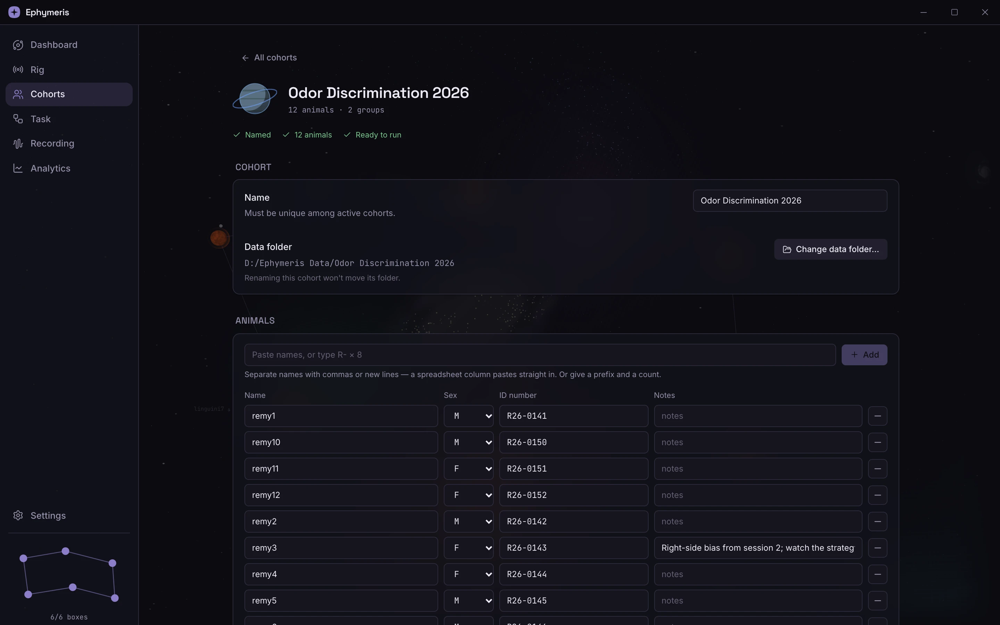
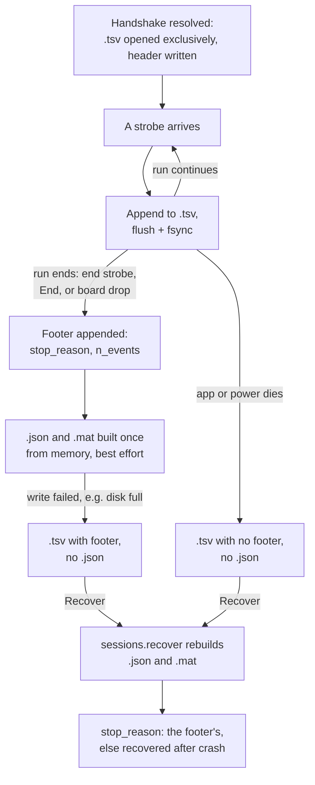
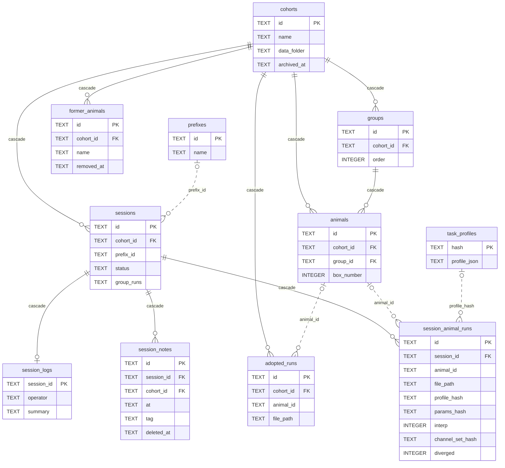
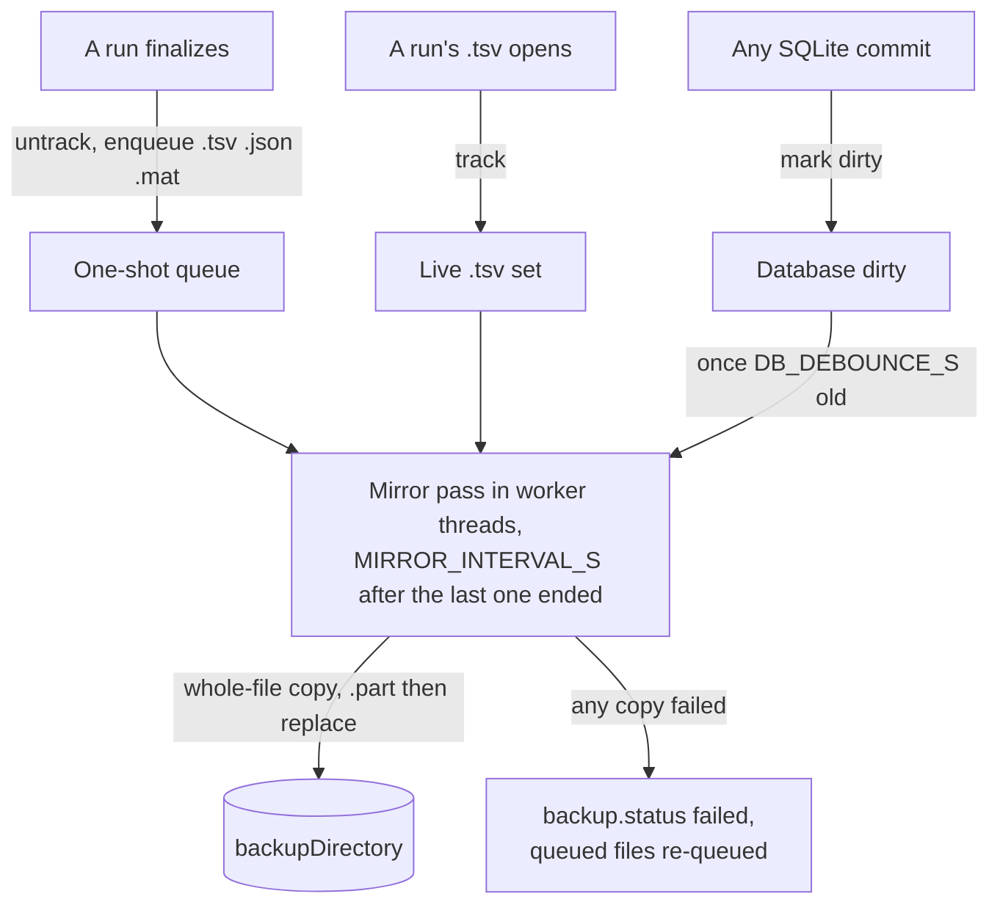
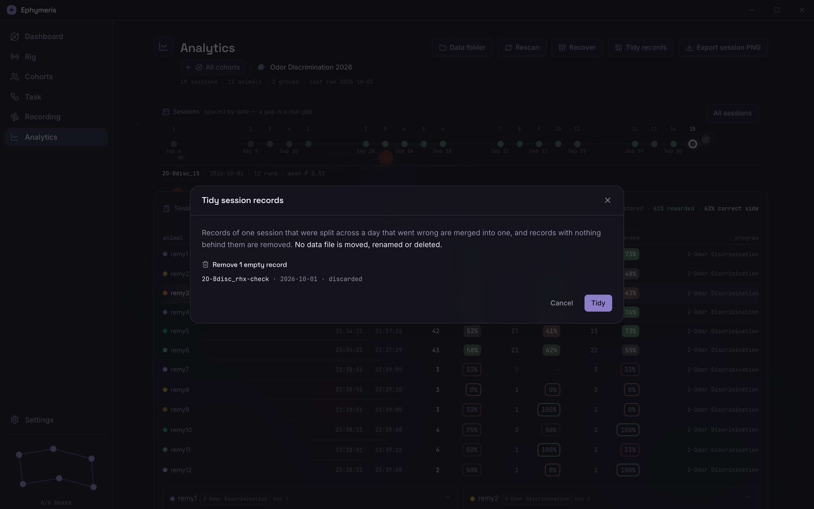

# Data

Everything that lands on disk, everything in the database, and everything read back out of them: the session folder layout, the per-animal files, crash safety and recovery, the SQLite schema, backup mirroring, the archive walk, and the cohort model. The derived-metric definitions are in [ANALYTICS.md](../sidecar/ephymeris_sidecar/analytics/ANALYTICS.md).

Read with [TASKS.md](TASKS.md) (the profile that decodes a run) and [ARCHITECTURE.md](ARCHITECTURE.md#session-lifecycle) (what triggers these writes). Every command named here is specified in [PROTOCOL.md](PROTOCOL.md).

> [!IMPORTANT]
> **`.tsv` is not an export format.** It is the write-ahead log that makes the crash-durability guarantee real. Every strobe is `flush()`+`fsync()`'d to it the instant it arrives; `.json` and `.mat` are built once, at clean finalization. Read [Crash safety](#crash-safety) before treating `.tsv` as redundant with the other two.

## Contents

- [Directory layout and naming](#directory-layout-and-naming)
  - [Layout](#layout)
  - [Names](#names)
  - [Why the date is hyphenated](#why-the-date-is-hyphenated)
  - [Reading names other software wrote](#reading-names-other-software-wrote)
- [Cohorts animals and groups](#cohorts-animals-and-groups)
  - [Data model](#data-model)
  - [Validation](#validation)
  - [Former members](#former-members)
  - [Auto-Balance](#auto-balance)
  - [Data folder](#data-folder)
  - [Moving animals between cohorts](#moving-animals-between-cohorts)
  - [Verified transfer](#verified-transfer)
  - [Archive and delete](#archive-and-delete)
- [Sessions and runs](#sessions-and-runs)
  - [Prefixes](#prefixes)
  - [Session records](#session-records)
  - [Run records](#run-records)
  - [Continuing between groups](#continuing-between-groups)
- [The session log](#the-session-log)
  - [The session clock](#the-session-clock)
  - [Notes](#notes)
  - [Carry-forward flags](#carry-forward-flags)
  - [What changed](#what-changed)
  - [The notes.md mirror](#the-notesmd-mirror)
  - [Exporting a log](#exporting-a-log)
- [Per-animal files](#per-animal-files)
  - [The JSON document](#the-json-document)
  - [The tsv log](#the-tsv-log)
  - [The mat mirror](#the-mat-mirror)
  - [The embedded task profile](#the-embedded-task-profile)
- [Crash safety](#crash-safety)
  - [Written live](#written-live)
  - [Built once at the end](#built-once-at-the-end)
  - [What is guaranteed](#what-is-guaranteed)
- [Crash recovery](#crash-recovery)
- [SQLite database](#sqlite-database)
  - [Tables](#tables)
  - [Indexes](#indexes)
  - [Transactions](#transactions)
  - [Machine marks](#machine-marks)
  - [Changing the schema](#changing-the-schema)
- [Backup mirroring](#backup-mirroring)
  - [Mirror layout](#mirror-layout)
  - [Session files](#session-files)
  - [The database copy](#the-database-copy)
  - [No automatic backfill](#no-automatic-backfill)
  - [Failures](#failures)
- [Reading the archive](#reading-the-archive)
  - [Database first](#database-first)
  - [The cohort archive](#the-cohort-archive)
  - [Orphan adoption](#orphan-adoption)
  - [Caching](#caching)
  - [Never at the expense of a session](#never-at-the-expense-of-a-session)
  - [Pruning](#pruning)
  - [Carrying adoptions forward](#carrying-adoptions-forward)
  - [Tidy records](#tidy-records)
- [Analytics views](#analytics-views)
  - [Pooling across tasks](#pooling-across-tasks)
  - [Session order](#session-order)
  - [Strategy plane](#strategy-plane)
  - [Learning curves](#learning-curves)
  - [Colour palette](#colour-palette)
  - [Drawing lines](#drawing-lines)
  - [Exporting a sheet](#exporting-a-sheet)
  - [Recover and Tidy](#recover-and-tidy)

## Directory layout and naming

### Layout

```
<dataDirectory>/
└── <cohort name>/                                     ← Cohort.dataFolder
    └── <prefix>/                                      ← session prefix
        └── <prefix>_<sessionNumber>_<YYYY-MM-DD>/     ← one per (prefix, number, date)
            ├── notes.md                               ← the session log, when there is one
            ├── behavior.tsv/                          ← written live
            │   └── remy1_<prefix>_<number>_<date>_<HHMMSS>.tsv
            ├── behavior.json/                         ← built once, at run end
            │   └── remy1_<prefix>_<number>_<date>_<HHMMSS>.json
            └── behavior.mat/
                └── remy1_<prefix>_<number>_<date>_<HHMMSS>.mat
```

Built by `sessions/paths.py` (`resolve_session_folder`, `resolve_animal_files`). `notes.md` is derived from the database ([The notes.md mirror](#the-notesmd-mirror)). Example: `Batch A/2O-Bdisc/2O-Bdisc_25_2026-07-22/behavior.json/remy1_2O-Bdisc_25_2026-07-22_113123.json`.

**A session folder is keyed by `(prefix, sessionNumber, date)`.** A second session with the same prefix and a different number the same day gets its own folder; reusing prefix **and** number the same day (unusual, not blocked — `sessions.suggestNumber` returns `sameDayNumbers` for a soft warning) lands in the same folder with new files beside the old. The per-animal `HHMMSS` suffix means same-day reruns never collide, so there is no "already exists" logic. The writer still opens its `.tsv` exclusively ([Written live](#written-live)): the naming makes a collision unreachable; the exclusive open makes an unreachable collision fail loudly instead of truncating data.

### Names

| Element | Format | Example |
|---|---|---|
| Date | ISO `YYYY-MM-DD` | `2026-07-22` |
| Time | `HHMMSS`, 24-hour | `113123` |
| Session folder | `<prefix>_<sessionNumber>_<YYYY-MM-DD>` | `2O-Bdisc_25_2026-07-22` |
| Per-animal file | `<animal>_<prefix>_<number>_<date>_<HHMMSS>.<ext>` | `remy1_2O-Bdisc_25_2026-07-22_113123.json` |

The per-animal timestamp is the moment **that animal's run starts**, not session-config time, so animals starting minutes apart get distinct, honest stamps. Cohort, prefix, session-number and animal names all pass through `cohorts/folders.py`'s `sanitize_name`.

### Why the date is hyphenated

The lab's original convention was `MM_DD_YY`, which does not sort across a year boundary (`12_31_26` sorts after `01_01_27`). The replacement is hyphenated ISO, **not** underscored ISO, because both underscored forms split into the same number of `_` tokens:

```
remy1_2O-Bdisc_25_07_22_26_113123      →  7 tokens   (legacy)
remy1_2O-Bdisc_25_2026_07_22_113123    →  7 tokens   (underscored ISO — rejected)
remy1_2O-Bdisc_25_2026-07-22_113123    →  6 tokens   (used)
```

A script parsing these names positionally would survive the underscored form and read every date wrong. The hyphenated form changes the token count, so such a script breaks visibly.

**Nothing on disk is ever renamed.** Old folders keep `MM_DD_YY`, so a prefix folder holds both spellings for as long as its history spans the change.

> [!CAUTION]
> **Never sort these names as strings.** Both formats coexist on disk indefinitely, so lexical order over a real archive is wrong whichever format you assume. Call `sessions/paths.py`'s **`parse_name_date`**, which reads both, anchored at the end of the name. The anchoring is what disambiguates the legacy form: an unanchored `NN_NN_NN` search in `2O-Bdisc_25_07_22_26` matches `25_07_22` — the session number plus two thirds of the date.

### Reading names other software wrote

What the app *reads* is wider than what it writes, because the archive walk meets folders named by other programs, and those names are read as they are, permanently.

- **The session number can lead** (`00_01_shaping_gr_06_17_26`). `parse_session_folder` finds the number by *being numeric*, not by position: trailing first (so every name this app wrote reads as before), then leading.
- **Separators vary within one archive.** A separator variant is reported **as written**, never normalized: folding `-` into `_` would tidy one stray folder and also merge `2O-Bdisc` with `2O_bdisc`, which are distinct prefixes in a real archive. Renaming a folder belongs to whoever owns the data.

## Cohorts animals and groups

### Data model

Defined in `cohorts/models.py`, stored in the `cohorts`, `groups` and `animals` tables.

| Entity | Fields |
|---|---|
| **Cohort** | `id`, `name` (unique among active cohorts), `dataFolder` (absolute, resolved once at creation), `createdAt`, `updatedAt`, `archivedAt` (null = active), `appearance` (null = derived from `id`; see [ARCHITECTURE.md](ARCHITECTURE.md#frontend)), plus its `animals` and `groups` |
| **Animal** | `id`, `name` (unique within the cohort, case-insensitive), `groupId` (exactly one group), `boxNumber` (1–6 or null — the standing box), `cage` (home-cage number ≥ 1, or null = unknown), `sex` (`M` / `F` / `unknown` / null — an enum because sex-balanced grouping needs it), `idNumber` (free text; ID schemes vary), `notes` |
| **Group** | `id`, `name`, `order` — **display order only**; groups have no run order |

A cohort can be created with zero animals and filled in over the following days.

**Groups always exist.** A cohort whose operator never makes one gets a single default group (`Group 1`), so grouped and ungrouped cohorts share one code path. Groups exist to split a roster larger than the rig into consecutive runs; which group runs next is chosen by the operator each time ([ARCHITECTURE.md](ARCHITECTURE.md#session-lifecycle)).

**`cage` changes what the sky draws, never what a session may do.** Housing and grouping are independent facts, so cagemates can sit in different groups; the 3D views draw one ship per cage.

### Validation

Enforced by `cohorts/repository.py`'s `_validate` (per-field errors, so the editor can show them inline) and, for cohort names, by the partial unique index `idx_cohorts_active_name`.

| Rule | Detail |
|---|---|
| Cohort name | Unique among **active** cohorts; archived ones release the name |
| Animal name | Required; unique within its cohort's roster, case-insensitively, not globally. A [former member](#former-members)'s name may be reused |
| Animal id | One cohort's: an id another cohort holds, on its roster or as a former member, is refused by name. Moving an animal is [its own operation](#moving-animals-between-cohorts) |
| `boxNumber` | `1`–`6` (`MIN_BOX`/`MAX_BOX`), validated against that range **and nothing else** |
| `boxNumber` uniqueness | Scoped to the **group**: groups run consecutively, so one physical box is legitimately reused across groups. `null` collides with nothing |
| `cage` | Integer ≥ 1, no upper bound, no occupancy limit, no interaction with groups |
| `groupId` | Must name one of the cohort's groups |

> [!IMPORTANT]
> **The box rule is split across two places on purpose.** The sidecar validates only the range, because two lab machines with independent bindings share one data directory, and a cohort set up on one must stay editable on the other. The editor is opinionated: it offers only boxes bound on *this* machine (`src/lib/cohorts/boxAvailability.ts`), because offering a box that does not exist produced an assignment discovered to be impossible halfway through the flash sequence. Don't fold either half into the other.

> [!CAUTION]
> **A stored assignment this machine can't honour is kept and reported, never rewritten.** A box that is merely unplugged is still the box that animal belongs in; clearing it would turn a loose USB hub into data loss. The editor names the affected animals and the browser flags the cohort — and both stay silent while the sidecar is disconnected, because reporting blindness as a fault is worse than saying nothing.

### Former members

Run records, adoptions and notes keep an `animal_id` with no foreign key ([why](#indexes)), so history outlives an animal's place on the roster. Every view names animals through the roster, though, so an animal taken off it used to come back as a bare id — or, in the Analytics rail, not at all. A **former member** is what keeps the name (`cohorts/members.py`).

| Source | What it is |
|---|---|
| `removed` | Taken off the roster by `cohorts.update` while it had history here — any run, adoption or note. Kept in `former_animals` with its name, biography and group *name*. An animal with no history is a typo or a placeholder and is still deleted outright |
| `files` | An id this cohort's history names with no row anywhere: a removal from before former members existed. Named at read time from its runs' **stored paths** — the stem's animal token ([Names](#names)), majority across its runs, no file opened — and never written back, so it works with the archive unplugged and heals the moment the animal is restored or moved |

- **On the wire** as `Cohort.formerAnimals`, filled only when one cohort is loaded on its own; a listing never pays for the pass over history. `Cohort.animals` stays the roster, so nothing that schedules, flashes or places animals sees a former member.
- **Restoring** is posting the id in `animals` again. Its history rejoins it because nothing about the history ever changed.
- **In Analytics** the summary lists former members with runs in it **after** the roster (`AnalyticsAnimal.former`), so a removal never shifts another animal's colour; the rail gives them a bucket of their own. The Log, `notes.md` and the PDFs name them the same way.
- **Adoption** may match a stray file to a `removed` former member, never to one whose name an animal on the roster now holds ([Orphan adoption](#orphan-adoption)).

> [!IMPORTANT]
> **`former_animals` is a table of its own, not a column on `animals`.** `animals.group_id` cascades from `groups`, and every roster edit deletes and re-inserts every group — so a former member kept in `animals` would be deleted with its old group at the next save.

### Auto-Balance

Proposes a complete grouping instead of animal-by-animal placement (`cohorts.suggestGroups`). It is a **preview the operator reviews and can hand-edit**, applied as an ordinary `cohorts.update` — never a silent bulk change.

Implemented twice: `cohorts/grouping.py` in the sidecar and `src/lib/cohorts/grouping.ts` in the client (so it runs on a roster not yet saved). **The two are kept in sync by hand**; there is no contract test, and `sidecar/tests/test_grouping.py` is the behavioural spec both must satisfy.

- **Inputs.** Either a group count or a max group size; the other is derived. *Balance by sex* is offered only when at least one animal is `M` or `F`. Group size pre-fills with the number of boxes **bound** on this machine (not detected — a default that moved as USB re-enumerated would be useless); a roster that outgrew the rig pre-fills the count with `ceil(animals / boxes)`.
- **The hard constraint.** No group may exceed 6 animals (`MAX_GROUP_SIZE`): box numbers span 1–6, so a larger group can never be uniquely assigned. Such a request is **rejected** with `minimumGroups = ceil(animals / 6)`.
- **The algorithm** is a balanced round-robin, not an optimization: partition by sex into `M`, `F`, then `unknown`/null (one bucket when balancing is off); walk the buckets in that order assigning groups `0, 1, … N−1, 0, …` with **one cursor carried across buckets** (restarting it per bucket would pile each bucket's first animals onto the low groups); then number boxes `1, 2, 3 …` within each group in landing order. Sizes stay within one of each other.
- **Always a full re-proposal.** It ignores the existing grouping entirely; the preview makes the change unambiguous.

### Data folder

Resolved by `cohorts/folders.py`. On creation, unless overridden: `dataFolder = <dataDirectory>/<sanitized name>`, suffixed `-2`, `-3`, … until the path is unused. **The resolved path is stored verbatim**, never re-derived from the name.

> [!IMPORTANT]
> **Renaming a cohort does not move its data folder.** An automatic move-on-rename is exactly the kind of implicit file operation this project avoids; the detail view shows the real path instead.



Relocating is a separate action, `cohorts.setDataFolder` (`relocate`), with two intents chosen by `moveExisting` and **opposite** requirements for the destination:

| `moveExisting` | Meaning | Destination |
|---|---|---|
| `true` | Move this cohort's data there | **Must be empty** — refuses rather than merging or overwriting |
| `false` | Point the cohort at data already there | **Expected to be full**; nothing is moved or written |

> [!WARNING]
> **`moveExisting: false` is how a cohort attaches to an archive written before this app existed** — the reason [orphan adoption](#orphan-adoption) exists. Requiring an empty destination in both cases made that intent impossible to express. The empty rule protects against merge collisions, and there are none when nothing is written.

**Moving the contents moves the records with them** (`cohorts/relocate.py`). Session records, run records and recovered runs store **absolute** paths, so a move that only repointed the cohort left every one of them at the old folder — and the next Rescan, finding those files gone with the storage reachable, [pruned](#pruning) the records, losing the box, stop reason and parameters only a recorded run carries. The stored paths (and the cache rows keyed by them) now move in the same operation, journalled in `folder_moves`:

| Destination | How | A crash in between |
|---|---|---|
| Same volume | One atomic `rename` of the folder, then the records in one transaction | The folder is demonstrably at the target, so the records are rolled forward at the next start |
| Another volume | A [verified copy](#verified-transfer) of every file, then the records, then each original whose copy is in place | Undone while copying; finished after the commit, by the first start that can reach the old folder |

The cache and adoption rows [carry their freshness keys](#caching) to the moved files, so nothing that was fresh is re-read. Where each recorded group run told RHX to save (`recording_json`) moves too when it lies inside the folder, as the default `<session folder>/ephys` does, whichever cohort the session now belongs to: [a move of animals](#moving-animals-between-cohorts) leaves a recording in the source's folder. A save location elsewhere is left alone. Every column that stores such a path is listed once, in `cohorts/db.py`'s `DATA_PATHS`; a test fails when a column that could hold a path is in neither it nor `OTHER_PATHS`, or when a relocate leaves one behind.

It runs under the [archive lock](#the-cohort-archive), so no rescan or summary reads the records mid-move. It is refused while a session is set up or running anywhere, or while any session of the cohort is still open (`configuring` or `running`): a session writing into the folder would be writing into one that moves. Pointing without moving rewrites nothing.

> [!CAUTION]
> **A session recorded during a copy keeps its files at the old place.** Its runner was given a folder below the old one, and the copy has already passed it. Moving its records anyway points them at files that are not there, and the next Rescan [prunes](#pruning) them. So `sessions.create` is refused while the cohort's relocate runs, through the delete of the originals (a session set up from the cohort as read just before the commit would make its folder under the old one), though not for a relocate an earlier run of the app left `committed`, which the next start finishes; and the copy checks again inside its commit: an open session, or any session or run recorded since it started, abandons the move with nothing moved. A rename is over before anyone could set a session up.

**Rescan repairs a relocate from before this.** Before it prunes, it re-points (`rehomed`) records left at a folder the cohort was moved out of: a stale path is one outside the cohort's folder with nothing there; the old folder is the root most stale paths agree on, found by which tail of each exists under the cohort's folder; and only paths whose files (or, for a run, its write-ahead `.tsv`) are actually there are rewritten, a recording's save location among them. Anything else is left to the prune's own rules.

### Moving animals between cohorts

Splitting a cohort — two slow learners out of twelve into a cohort of their own — moves animals **and their history** (`cohorts.moveAnimals`; planned by `cohorts/move.py`, carried out by `cohorts/move_apply.py`). The two lab machines keep separate databases over one shared archive, so the files are the only fact both agree on: a move takes the animals' **files** into the destination's data folder, and their run records, recovered runs and notes follow. Afterwards the history is the destination's and none of it is the source's.

Like [Tidy records](#tidy-records), it previews first (`apply: false`), and an apply re-plans rather than trusting the preview.

**Who the animal becomes**, by case-folded name:

| The destination has… | Outcome |
|---|---|
| An animal on its roster with that name | **Joins** it: the history becomes that animal's. This is the split done by hand — the new cohort was given a new animal with the old name |
| A [former member](#former-members) with that name | Joins that one |
| Neither | **Carried** under its own id: onto the roster in the chosen group (its box kept only if free there), or as a former member if it was one — or known only [from files](#former-members) |

**What moves.** Every file of every run — recorded and [adopted](#orphan-adoption) — found by **run identity** ([the stem](#orphan-adoption)) in its session folder's format folders: `.json`, `.tsv` and `.mat`, in the current or the legacy spelling, including a crash's lone `.tsv`. Then any file in the source no record points at whose stem names a moved animal — unless an animal staying on the source's roster now holds that name. The path below the cohort folder is kept. **Never** `notes.md` (derived, and re-rendered at both ends), an RHX recording or AppleDouble files. A recording in its default place, `<session folder>/ephys`, stays in the source's folder, where a moved record's recording still points, and follows a [relocate](#data-folder) of that folder.

**Sessions.** A session only moved animals ran in is **whole**: the record itself moves, with its notes, its log and its recording. One that animals staying behind ran in too is **split**: the destination gets a record of its own — the same prefix, number, date, times and status; no recording, because an RHX entry belongs to a group run both halves shared — or joins the destination's record of that day if it has one. Group runs follow the moved animals into their destination groups; the source drops a group run only the moved animals ran, unless the session is a recording.

**Notes.** Notes are the operator's words, so none is ever lost or duplicated by accident:

| Note about | On a split session |
|---|---|
| A moved animal | Moves |
| An animal staying behind | Stays |
| The whole session | **Copied** — it describes a session both cohorts ran |
| A box only moved animals used | Moves |
| A box both used (one box, two groups), or one no recorded run names | Copied |
| A box only staying animals used | Stays |

The session's operator and summary are copied too. A copied carry-forward flag is open in both cohorts, and resolving one does not resolve the other.

**Caches follow.** `run_metrics_cache`, adoption and strobe-scan rows take the new path (all but an adoption that joins a run the destination already holds, below) and [carry their freshness keys](#caching): the content is hash-verified identical, so a summary that was right for the original is right for the copy. Copied files are queued for [backup](#backup-mirroring); the mirror is additive, so the old copies stay in the source's mirror folder.

**A run the destination already holds.** One run copied into both cohorts, at different places, is [adopted](#orphan-adoption) by each. A moved adoption whose run identity the destination already holds **joins that row** rather than becoming a second: the held row keeps its id, which its cached scores and any [ruling](../sidecar/ephymeris_sidecar/analytics/ANALYTICS.md#false-starts) are keyed by; the moved row's ruling is carried onto it unless the held row has one of its own; and the moved row goes, with its cached scores. Its file is still copied, so the destination's folder holds two copies of the run, which a [rescan](#orphan-adoption) reads as one.

**Refused**, with nothing touched, when: a session is held or a box runs anywhere in the app (copying competes with the write-ahead log's fsync); either cohort has an open (`configuring`/`running`) session; either data folder is unreachable; the folders are the same or one is inside the other; a destination file exists **with different content**; a run file lies outside the source's folder (left by a data-folder move from before records followed one; a rescan [re-points it](#data-folder)); two moved animals share a name; or the destination is archived. An identical file already at the destination is not a refusal.

**Crash safety** — the order, and every step idempotent:

1. **Journal**: the plan's file list goes into `animal_moves` as `copying`.
2. **Copy** each file, [verified](#verified-transfer). No record has changed.
3. **Commit**, in one transaction: re-plan the record half, abandon the move if it no longer matches what was copied, move every record, mark the journal `committed`.
4. **Clean up**: delete each original whose copy is in place, `rmdir` emptied folders bottom-up (never `rmtree`), and a session folder no source record points at once all it holds is its derived `notes.md`. Mark the journal `done`.

At start-up, before anything reads the archive, `move_apply.resume` undoes a `copying` move and finishes a `committed` one once it can [reach the originals](#verified-transfer). So a crash leaves each run in exactly one cohort, and no record pointing at a file that isn't there — the two states a [rescan](#pruning) would otherwise act on.

> [!CAUTION]
> **The other lab machine has its own records.** After a move, its database still points the moved runs at the source folder, where the files no longer are — and a rescan of the source there would [prune](#pruning) those records, losing the box, stop reason and parameters only a recorded run carries. **Run the same move on the other machine before rescanning there.** Its planner finds the files already at the destination (`already`, no copy) and simply re-points its records.

### Verified transfer

Both transfers that copy a cohort's files to another place, a [relocate](#data-folder) onto another volume and a [move of animals](#moving-animals-between-cohorts), copy them the same way (`cohorts/transfer.py`). Each wraps it in its own journal and its own commit of the records.

| Step | What it does |
|---|---|
| Copy | Each file through `<name>.part`: `copy2`, fsync, renamed into place, then re-read and SHA-256-checked against the original. A destination already holding the same content is left as it is; one holding anything else stops the transfer |
| Undo, before the records commit | Removes any `.part`, and each copy whose original is still there **with the same content** |
| Delete originals, after the commit | Removes each original whose copy is there **with the same content**; one changed since it was copied is left in place |

An original that can't be seen at all, a share that stopped answering or a drive not plugged in, is never read as deleted. Its transfer deletes nothing and leaves its journal `committed`, and the next start that can reach it finishes. `relocate.out_of_reach` decides: a `stat` that fails other than not-found is out of reach, and a missing original counts as gone only when, walking up its folders, one answers before any errors. That is how the [prune](#pruning) reads absence too.

> [!CAUTION]
> **Neither step that deletes trusts a remembered hash alone.** Both read the file they keep as well as the one they remove, so a file whose content exists nowhere else is never deleted: not a copy of an original edited since, and not an original whose copy has gone. A crash can leave only a `.part`, never a partial file under its real name, so a retry is never blocked by debris the undo kept.

A move knows each file's hash from its plan; a relocate reads each original just before copying it, and a restart compares the two files.

### Archive and delete

| Action | Meaning |
|---|---|
| **Archive** (`cohorts.archive`) | The everyday "delete". Hides the cohort, keeps the record and folder intact, reversible with `cohorts.restore`. No confirmation, deliberately — it is reversible |
| **Permanent delete** (`cohorts.delete`) | Only on an already-archived cohort (`COHORT_NOT_ARCHIVED` otherwise) — a two-step guard. Removes the cohort's rows, and by cascade its groups, animals, sessions, run records and adoptions |

> [!IMPORTANT]
> **Deleting a cohort record never touches its `dataFolder` on disk.** The app removes its own bookkeeping, never a user's data files.

## Sessions and runs

### Prefixes

A **prefix** (`id`, `name`, unique case-insensitively) names a task or paradigm, not a cohort, so prefixes are **global** — shared by every cohort. Operator-managed (`prefixes.*`), offered in the session config step. Deleting one only removes it from the dropdown; nothing on disk changes, and a session keeps its own `prefix_name` copy (so `sessions.prefix_id` deliberately has no foreign key).

### Session records

One row in `sessions` per session-flow invocation (`sessions/models.py`'s `Session`):

| Field | Notes |
|---|---|
| `cohortId`, `prefixId`, `prefixName` | |
| `sessionNumber` | Free text, not strictly numeric — never sort by it |
| `date` | The calendar day the folder belongs to (ISO) |
| `startedAt`, `endedAt` | When the record was created (Step 1) and closed — **not** when boxes ran; see [The session clock](#the-session-clock) |
| `status` | `configuring` → `running` → `completed`, or `aborted` |
| `folderPath` | The session folder |
| `groupRuns` | JSON list of `{groupId, order, startedAt, endedAt}` — one per group run, `order` its position in this session's sequence. A group may appear more than once |
| `durationMinutes` | Optional per-box time limit; null = none |
| `recording` | Null for behavior only; otherwise one entry per group run, or on an `aborted` session the run its abandon stopped ([RECORDING.md](RECORDING.md#what-is-written)) |

Every session listing is ordered by `(date, startedAt)` and carries an `ordinal` from that order — never from `sessionNumber`, which would sort `10` before `9`.

### Run records

One row in `session_animal_runs` per animal per session — the unit Analytics scores (`SessionAnimalRun`): `sessionId`, `animalId`, `boxNumber`, `sketchPath`, `filePath` (the finalized `.json`; null if the writer never opened), `startedAt`, `endedAt`, `stopReason`, `profileHash`, `config` (stored as `config_json`, the merged parameter values), `paramsHash`, `interp`, `channelSetHash` (stored as `channel_set_hash`) and `diverged`.

- **`interp` and `channel_set_hash`** are written at finalization: the interpreter the board announced as `INTERP=<n>`, and the channel set its sketch was generated against. They are the same values as the run's [`.tsv` header](#the-tsv-log). Null on a run recorded before they existed, and `interp` on a board that announced none.
- **`diverged`** is written by the Analytics pass that reads the run's file, never at finalization:
  - 1 when replay could not predict the run's recorded outputs;
  - 0 when replay scored it;
  - null when replay has not scored it: a legacy run, an unreplayable one, or one not read since the column existed.

  A missing or stale file leaves it as it was ([how a spine run is scored](../sidecar/ephymeris_sidecar/analytics/ANALYTICS.md#how-a-spine-run-is-scored)).

> [!IMPORTANT]
> **`profileHash` records which Task Profile this run used.** A `task.json` lives beside its sketch, outside the data directory, and can be edited or deleted long after the session; without a snapshot, an old run would be silently re-read with today's codes and metrics. Null means the run predates snapshotting, which is exactly what Analytics needs in order to flag it. How the hashes are computed: [TASKS.md](TASKS.md#profile-and-params-hashes).

### Continuing between groups

Resuming a group **mid-run** after a crash is out of scope by decision (reconnecting boards, restoring trial state, deciding whether the animal kept running). What is built is continuing **between** groups: `sessions.resume` re-holds one of *today's* sessions that already ran a group — a crash-orphaned `running` one or a `completed` one ended too early — closes any group run the crash left open, and leaves it between groups so the operator can run any group. The new files land in the same folder beside the earlier ones. Same day only, because the folder is named for its date. Flow: [ARCHITECTURE.md](ARCHITECTURE.md#session-lifecycle).

## The session log

The **Log** tab's lab notebook: timestamped notes and a few free fields per session, plus what the app can say on its own — when the session ran and what changed since each animal's previous run. Owned by `logbook/` in the sidecar; the commands are `logbook.*` ([PROTOCOL.md](PROTOCOL.md#session-log)). What the operator sees: [USER-GUIDE.md](USER-GUIDE.md#keeping-the-log).

> [!IMPORTANT]
> **Notes are user data, not bookkeeping.** Every other table here can be rebuilt from the archive or is the app's own record; a note is the operator's words and exists nowhere else. So a session carrying one is **never** judged empty by [Tidy records](#tidy-records) and never [pruned](#pruning), and a delete is soft (`deleted_at`) — hidden, never erased.

### The session clock

`sessions.started_at` is stamped when Step 1 creates the record, which can be many minutes of set-up before a box runs. The **session clock** is what the operator means by "the session":

| Field | Definition (`Session.clock_started_at`, `clock_ended_at`) |
|---|---|
| `clockStartedAt` | The earliest group run's `startedAt`; the record's `startedAt` if no group ran |
| `clockEndedAt` | The latest group run's `endedAt` once every run is closed, else the record's `endedAt`; null while the session is `configuring` or `running` |

Both are derived, never stored, and ride on `Session` and `SessionListItem`. Elapsed time everywhere — the Log header, Mission Control, the PDF — is `clockEndedAt − clockStartedAt`, or `now − clockStartedAt` while open.

A session recovered from files (`adopted:…`, [Orphan adoption](#orphan-adoption)) has no record and no group runs. Its `clockStartedAt` is its earliest file's start, and its `clockEndedAt` the latest of its runs' **stream ends** — a run's start plus its `durationMs`, the span of the recorded stream — read from the [metrics cache](#caching) once the index has read the files (`analytics/archive.py`'s `_stream_ends`), and null until then. Nothing recorded when such a run stopped, so the Log and the PDF mark the end and elapsed `~`, as the session table marks a recovered run's end.

A note's **T+ offset** (`offsetMs`) is its `at` minus `clockStartedAt`, derived on every read so a tidy merge or an edited `at` can never leave a stale one. A note whose `at` falls outside `[clockStartedAt, clockEndedAt or now]` — one written the next morning about the session — has no offset rather than a misleading one.

> [!CAUTION]
> **The session clock is not a run's clock.** Each animal's stream `t = 0` is its own first strobe, which trails its run's `started_at` (stamped before the board handshake, to the second). Placing a note on a run's [trial tape](../sidecar/ephymeris_sidecar/analytics/ANALYTICS.md#per-trial-tape) is therefore approximate to a few seconds, and is drawn as approximate.

### Notes

`session_notes`, one row per entry: `at` (the moment it is about, UTC with milliseconds, editable), a **tag** (`observation`, `intervention`, `hardware`, `animal-health`, `protocol-deviation`), a **scope** (the whole session, one animal, or one box), and free text. Editing stamps `edited_at`; there is no revision history.

A session's **operator** and **summary** live in `session_logs`, one row per session, a table of its own so the `sessions` row and its wire shape stay untouched.

A recovered-files session (`adopted:…`, [Orphan adoption](#orphan-adoption)) takes no notes: it has no record to hang one on, and fabricating one would corrupt session-number suggestion.

### Carry-forward flags

A note flagged **carry forward** stays open until resolved, and every open flag for the cohort is shown in Step 1 of the next set-up and on Mission Control (`logbook.openFlags`). Resolving records when and, if during a session, which one (`resolved_in_session`). If tidy later deletes that session, the flag stays resolved and only loses the reference; if tidy merges it, the reference follows to the kept record.

### What changed

For every run — recorded, and [adopted](#orphan-adoption) from files this machine never recorded — `logbook/diff.py` compares the same animal's previous run, in one history per animal ordered by `(date, started_at)` — never by session number:

- **Task**: two profile hashes compare exactly, so the same name under a different hash reads as *definition revised*. Anything weaker — a snapshotless recorded run's `sketch_path`, a legacy file's sketch name — compares by task name, so an old file is not "revised" merely for lacking a snapshot.
- **Box**, only between two runs that both know theirs. A file records the OS port it ran on, never the box, and ports renumber (`ARCHITECTURE.md#wire-protocol`), so a recovered run's box is **unknown** (`box: null`), never guessed.
- **Parameters**: equal `params_hash` is no change; otherwise a key-level diff of the values. A recorded run's come from `config_json`; a recovered run's from what its own file records — the flat task fields the [embedded profile](#the-embedded-task-profile) names — cached as `run_metrics_cache.config_json` the first time the index reads the file. A run with none (recorded before parameters were, a file too old to carry them, or a recovered file the index has not read yet) reports `paramsKnown: false` — **unknown, never "changed"** — said once per session rather than on every row. A value that changed prints in full; a setting only one of the two runs has is counted ("19 settings new"), not listed — across a task change most settings are of that kind, and listing each would bury the few that moved.

Recorded runs' entries appear as each run is recorded at finalization; recovered runs' once the next summary has read their files (the Log refetches when one arrives). The log itself still reads the database only.

### The notes.md mirror

Each session folder that has a log gets a `notes.md` beside its format folders: header times, operator, summary, what changed, and the notes in time order. The database is the source of truth; the file is **derived**, rewritten whole, never read back. It exists so the log travels with the data — to the backup mirror, a colleague's copy, whoever opens the folder without Ephymeris.

- **One file per folder, not per record.** Split records share a folder ([Tidy records](#tidy-records)), so the file covers every record pointing at it.
- **Written about a second after the last change** (debounced per session), in a worker thread, via `notes.md.part` and an atomic replace, then queued for [backup](#session-files). Folder-mates debounce separately, so writes to one folder hold a per-folder lock across render and replace: Windows refuses a replace while another is in flight, and an earlier render must never land last. A command reply never waits on it and the runner never calls it, so a slow share costs only a stale copy.
- **A missing session folder is created; a missing parent is not.** A missing prefix folder means an unmounted or moved archive, and recreating its path would scatter notes away from their data. Any failure is logged; the database copy is intact.
- **Invisible to the archive walk**, which only reads inside the format folders.

### Exporting a log

**Session PDF** and **Logbook PDF** (the Log header) write a vector PDF with selectable text: one session's page, or the whole cohort oldest-first behind a cover that lists the open flags. Rendered in the webview by `@react-pdf/renderer` (`components/logbook/pdf/`), loaded by dynamic `import()` on the first export only, and saved through the shell like the [PNG sheet](#exporting-a-sheet), reporting to the same export card. Every string comes from `lib/logbook/document.ts`, built from the same helpers as the screen — the performance table from `sessionRunsOf` and `conditionColumns`, what changed from `changeParts` — and is unit-tested there; the renderer only lays it out. Printed in the paper palette ([ARCHITECTURE.md](ARCHITECTURE.md#printed-documents)).

> [!CAUTION]
> Each of these, done wrong, yields a **plausible-looking wrong PDF**, or none:
>
> - **Ligatures are off on every page** (`fontFeatureSettings`). The faces are `@fontsource` latin subsets, and a ligature — JetBrains Mono's `...`, `//`, `==`, `--`; Inter's `->` — maps to a glyph the subset dropped. That does not misprint; it throws inside the font engine and loses the export, on text people type in notes all the time.
> - **A character no embedded face covers prints as `?`** (`printable`). Left alone, the engine falls through to a built-in face and draws *another* glyph — `≥ 3` printed as `ꞓ3`. Inter's latin-ext and Greek subsets are registered as fallbacks, so accented names and `ΔF/F` print correctly; common symbols (`→ ≥ ≤ ≠`) are spelled out.
> - **Fonts are `.woff`, inlined with `?inline`**, for the PNG sheet's reason: a fetch over the packaged app's custom scheme fails silently, and the fallback is Helvetica.
> - **Titles have a pinned height.** The engine measures Space Grotesk's line box short and draws the next line through the title.
> - **The page footer is pinned from the top, with its own height and line height.** A `fixed` element is laid out again on every page; pinned by `bottom` it grew roughly fortyfold per page until, around page seven, the writer refused a coordinate of −2.6e21 and the whole logbook export failed — while every short export worked. The page number is the exception that proves the care needed: a `render` text given an explicit height prints nothing, so it spans the margins instead. `lib/logbook/pdf.test.ts` renders a forty-session logbook to keep this honest.
> - **A recovered session reads as one.** Its run ends are derived from the recorded stream, marked `~`, as on screen; what changed says its runs are not compared rather than that there were none.

## Per-animal files

### The JSON document

```jsonc
{
  "rat": "remy1",
  "serial_port": "COM6",
  "session_id": "2O-Bdisc_25",
  "sketch": "GRGL",
  "correction_left": 0,          // ← task fields, flat, from the Task Profile
  "lazy_escalation": true,
  "task_profile": { /* the serialized Task Profile */ },
  "stop_reason": "BF_END_SESSION received",
  "trial_seed": 288577176,
  "host_seed": 288577176,
  "interp": 1,
  "free_ram": 6000,              // ← illustrative; no Mega figure is recorded here
  "channel_set_hash": "3f0c9a17b2d4e588",
  "channel_set_hash_version": 2,
  "n_events": 2392,
  "ts_data": [[221, 0], [222, 1000], [223, 5001], /* … */ [246, 3523555]]
}
```

| Field | Source |
|---|---|
| `rat` | `Animal.name` |
| `serial_port` | The literal OS port the run used — *which physical port*, distinct from the abstract box number |
| `session_id` | `<prefix>_<sessionNumber>` |
| `sketch` | The sketch chosen at mapping |
| task fields | The run's merged parameter values, one top-level key per declared `metadataKey`. Absent for a profile-less sketch |
| `task_profile` | The profile snapshot ([below](#the-embedded-task-profile)). **The only nested value.** Absent for a profile-less sketch |
| `stop_reason` | Set by the sidecar at run end. Open set: `BF_END_SESSION received` (clean), `board disconnected`, `sidecar error: <cause>`, `recovered after crash`, … |
| `trial_seed` | What the **board** reported on its `SEED` line; absent if it never sent one |
| `host_seed` | What the **app** put on the `START` line. Differs from `trial_seed` only if the firmware ignored it |
| `interp` | The firmware interpreter the board announced as `INTERP=<n>` before `READY` ([TASKS.md](TASKS.md#confirming-the-parameters)), which says which number is which. Absent when it announced none. Describes the build, not the tuning, so it is never hashed |
| `free_ram` | The bytes of RAM the board reported free with its tables loaded, announced as `FREE_RAM=<n>` beside `interp`. Every sketch built on `BehaviorBox.h` announces it, GRGL included, so new GRGL runs carry it too; runs recorded before it existed lack it. A header line like the rest: recovery reads it back like any `# key: value`, and nothing that scores or groups a run reads it. Never hashed, for the same reason |
| `channel_set_hash` | `ChannelSet.content_hash()` of the channel set the run's sketch was generated against ([TASKS.md](TASKS.md#registry-rules)), read at mapping inside the rig definition's read hold: no wiring or vocabulary write lands between it and the end of the session. Always a string, even when every digit is numeric. Describes the rig, not the tuning, so it is never hashed |
| `channel_set_hash_version` | Which rule made `channel_set_hash` ([TASKS.md](TASKS.md#registry-rules)): 2 covers the channels' declaration order, 1 ignored it. **A run with `channel_set_hash` and no version was recorded by version 1**, so two such hashes agreeing says nothing about the odor table's order |
| `intan_*` | Present only inside a recording ([RECORDING.md](RECORDING.md#what-is-written)) |
| `n_events` | `len(ts_data)` |
| `ts_data` | `[code, timestamp_ms]` pairs exactly as the board sent them — ms since **that animal's own** session start, never re-based to wall clock |

> [!CAUTION]
> **Task fields are merged flat at the top level**, not under a `config` key. A profile whose `metadataKey` matched a core field would silently overwrite it, so `parse_profile` rejects any `metadataKey` in `tasks/profile.py`'s `CORE_METADATA_KEYS`. The set includes `task_profile` (the writer sets the snapshot after the task fields) and the `intan_*` fields; add any new core field to it.

### The tsv log

A live append-only log, not a serialization of the document:

```
# rat: remy1
# serial_port: COM6
# session_id: 2O-Bdisc_25
# sketch: GRGL
# interp: 1
# free_ram: 6000
# channel_set_hash: 3f0c9a17b2d4e588
# channel_set_hash_version: 2
# correction_left: 0
# task_profile: {"config":[…],"liveMetrics":[…],"strobes":{…},"taskName":"GRGL"}
221	0
222	1000
…
# stop_reason: BF_END_SESSION received      ← footer, at finalization
# n_events: 2392
```

The `# key: value` header is written by `AnimalWriter.open_files` after the parameter handshake and `SEED` resolve, and before the first strobe. The **profile snapshot rides in the header as one compact JSON line, always last**, so a `.tsv` rebuilt by [crash recovery](#crash-recovery) yields a `.json` as self-describing as a finalized one — and the recovered file is exactly the one someone carries to another machine. `stop_reason` and `n_events` are unknown until the end, so they form a **footer**. **A `.tsv` cut off mid-session lacks only that footer.**

A [spine task](TASKS.md#spine-tasks)'s header reads `# interp: 2`, and its snapshot carries a `spine` key: the state table as lowered, which channel and edge codes each bit is, and which wire key each parameter is. With the parameter values and `trial_seed` beside it, that header is everything replay needs, so a spine run cut off mid-session still replays up to its last strobe ([TASKS.md](TASKS.md#the-snapshot)).

### The mat mirror

Same field names, written from the same in-memory dict as the JSON — one source serialized twice. `ts_data` becomes an `N×2` double array; `task_profile` becomes a **char array holding JSON** (`jsondecode(task_profile)` in MATLAB), since a profile is a deep ragged tree nobody reads as a struct.

Every number is a `double` and every bool a `logical`; an empty `ts_data` is still `0×2`. `sessions/matwriter.py` writes it with `scipy.io.savemat` (uncompressed Level 5) and owns the conversion from Python values, because `savemat` unaided would keep an int as `int64` and an empty list as `0×0`. `tests/test_matwriter.py` pins each class and shape through `scipy.io.loadmat`.

scipy is imported on first use, never at module scope, so a broken install costs the `.mat` and nothing else. The sidecar's entry point pays that first import at startup (`matwriter.preload` in `__main__._run`), **on the main thread, before any other thread exists** — in particular before the parent watch parks a thread in a blocking read of stdin.

> [!CAUTION]
> **Importing numpy while another thread is blocked reading stdin deadlocks the frozen sidecar.** Loading numpy's OpenBLAS extension with the parent-watch thread sitting in `sys.stdin.buffer.read` hangs inside the DLL load, before the handshake line is printed, so the app waits for a backend forever. It happens only under the shell's launch (stdin is a pipe held open for the app's life); a sidecar run by hand, with stdin at EOF or `--no-parent-watch`, never shows it. Keep the preload ahead of the watch, and never move the first import of scipy or numpy onto a thread or later into startup.

> [!CAUTION]
> **A `.mat` is refused rather than written wrong.** `savemat` sizes a char array in code points where MATLAB counts UTF-16 code units, so a character outside the BMP (an emoji) would yield a string whose dimensions disagree with its data; it also drops a variable whose name starts with `_` with only a warning. Both raise instead, the `.mat` is skipped and logged, and the `.tsv` and `.json` carry the run. `task_profile` is ASCII-escaped JSON, so labels in it never trip this; a top-level string such as an animal name can.

### The embedded task profile

**A run is only as readable as the declaration that decodes it.** A `task.json` and the database snapshot both live on the machine that ran the session, but sessions in this lab are routinely copied to another machine for analysis. Carrying the declaration inside the file makes the copy decode exactly as the original, anywhere, with **the same `profile_hash`** — so it lands in the same profile group and comparability set as its origin.

- **The hash identity depends on `TaskProfile.to_json` round-tripping byte-for-byte through `parse_profile`.** A test pins it across every shipped profile; anything added to `TaskProfile` must keep it true, or a copied run leaves its origin's group.
- **The snapshot names which fields are parameters.** The values are already flat in the document, but only the profile says which keys are declared fields (`recorded_config`). With it, a copied run recomputes the same `params_hash` its own rig did; without it, two differently-tuned runs of one task would pool silently. `trial_seed`/`host_seed` describe the run, not its tuning, and are never hashed.
- **It costs roughly 10–15 KB per file**, a fraction of `ts_data`, and buys independence from the machine that wrote it.

- **Its `strobes` map is the record, not a copy.** A loaded profile's map is the machine's whole [strobe vocabulary](TASKS.md#strobe-vocabulary) at the moment the run started; the snapshot keeps it verbatim, so an edit to the vocabulary afterwards never changes how this file decodes. `profile_hash` does not cover the map ([TASKS.md](TASKS.md#profile-and-params-hashes)), so two files whose maps differ only because a code was added between them still share a group.

A profile-less sketch writes no snapshot: an empty one would claim a declaration that never existed.

## Crash safety

The goal is recoverable data up to the moment of a power loss, not eventual consistency.

One animal's files from the first strobe to the last, and the two ways a run can be left with a `.tsv` and
no `.json` (`sessions/writer.py`, `sessions/recovery.py`):



### Written live

Every parsed strobe is appended to the `.tsv` **the instant it arrives**, with `flush()` + `fsync()` on every line (`AnimalWriter.record`). A real session averages under one event per second, so a few-millisecond fsync per line costs nothing. Lines are written **exactly as the board sent them** (`<code>\t<timestamp>`), so no formatting bug can corrupt the one file that must be bulletproof.

> [!IMPORTANT]
> **The file is opened exclusively (`"x"`), never truncating.** The `HHMMSS` suffix makes a collision practically unreachable, but this is the file carrying the durability guarantee. If it ever fires, the box refuses to start with an error naming the file in the way. **Refusing to start is recoverable; a truncated write-ahead log is not.**

**If a write fails mid-session** (disk full, permissions), the runner logs it and broadcasts `sidecar.error` naming the box — the one failure with no command to attribute it to — which Mission Control shows on that box. The strobe is dropped, not retried, and the run continues: the operator is told at once that data is no longer being saved. A failure to *open* the file takes the same route and records `stop_reason: "sidecar error: <cause>"`.

### Built once at the end

`.json` and `.mat` are not append-friendly and don't need to be; they are built once in `AnimalWriter.finalize`. Finalization is **idempotent** (the first `stop_reason` wins, so a board-drop racing an operator stop cannot rewrite history), and the two structured writes are **best-effort**: an `OSError` is logged, not raised. The `.tsv` is already closed and durable by then, so failing to produce a convenience format must never look like failing to save data.

Each is written **whole or not at all** (`write_atomic`): into a `.part` beside it named for the writing process and thread, fsync'd, then renamed over the real name, as a [verified transfer](#verified-transfer) copies. Two writers of one file each land whole, and the last rename wins. A power cut while finalizing leaves at most a `.part`, which no walk reads, so the run is a `.tsv` with no `.json` that [Recover](#crash-recovery) rebuilds, never a torn document under the name every reader opens. Recovery writes the same way.

### What is guaranteed

- **Guaranteed:** if the PC loses power mid-session, every strobe through the last completed line is on disk in the `.tsv`, human-readable, with at most the in-flight line at risk.
- **Guaranteed:** a board dropping mid-run finalizes with `stop_reason: "board disconnected"`; the file is complete up to the drop.
- **Not guaranteed, by decision:** resuming an interrupted group mid-run. See [Continuing between groups](#continuing-between-groups) and [Crash recovery](#crash-recovery).

## Crash recovery

`sessions/recovery.py` (`sessions.recover`, the **Recover** button in Analytics) finds a cohort's orphaned `.tsv` files — logs with no `.json` sibling, or one that does not parse — and rebuilds `.json` and `.mat` from them. A `.json` that does not parse, torn by a power cut or by a copy someone made by hand, counts as missing, so the run is offered until a whole document replaces it. A sibling that can't be read at all counts as present: recovery fails toward writing nothing. It is a pure file transformation, the inverse of `AnimalWriter`: **not** session resumption, and it never talks to a board.

- **It shares the archive walker** (`analytics/reader.py`'s `walk_orphaned_tsvs`, over `_walk_format_dirs`), so every legacy layout [adoption](#orphan-adoption) reads, recovery reads too, and it backfills in the same layout (a `recovery_tsv/` orphan gets `behavior_json/` and `behavior_mat/`).
- **A footer wins.** A `.tsv` with a footer finalized cleanly and only its best-effort `.json` write failed (the disk-full case); it keeps its recorded `stop_reason`. Only a footer-less log gets `stop_reason: "recovered after crash"` (`RECOVERED_STOP_REASON`).
- **`n_events` is recomputed** from the lines actually parsed, never copied from a footer.
- **Header values are coerced** to numbers and bools except the always-string fields (`_STRING_FIELDS`: names, port, `intan_*` text). `task_profile` is decoded as JSON; a line torn by the crash is **dropped**, not kept as text — half a snapshot every reader must defend against is worse than none.
- Strobe lines must match the live parser's strict `^\d{1,3}\t\d+$`, and **a last line without its newline is dropped unread**, so a torn final line costs only itself. `AnimalWriter` ends every line with a newline before its fsync, so a complete line always has one; a strobe cut mid-timestamp (`127\t2` of `127\t200`) or a header line cut mid-value would otherwise read as real. A pre-Ephymeris log's unterminated last line is still read: that software may not have ended it.
- **The lab's pre-Ephymeris logs are a second dialect**, recognised by their first line, `event_code\tevent_ms\tevent_name` (`LEGACY_HEADER`). After it come `# key\tvalue` comments (the run's parameters, read in flat and coerced as above), strobe lines with a third column naming the code (`code\tms\tBF_NAME` — the name is dropped; the [strobe vocabulary](TASKS.md#strobe-vocabulary) decodes the number) and CRLF line endings. The third column is admitted **only** in such a file; this app's own logs keep the strict rule.
- **A legacy log never had a footer**, so its absence says nothing about how the run ended: a recovered legacy run records `stop_reason: "recovered from a legacy log"` (`RECOVERED_LEGACY_STOP_REASON`), never "after crash". It names no animal or sketch either, and recovery adds neither — adoption reads the animal from the filename ([below](#orphan-adoption)) and Analytics infers the conditions from the strobes. A legacy log that is only its header line — the old software opened one for every run, started or not — is refused rather than recovered as an empty run.
- **Rejected while any box is running:** a live run's `.tsv` legitimately has no `.json` yet. It is an [archive write](#the-cohort-archive), so it also waits for no other, and the files it writes are queued for backup.

The Recover button chains an `analytics.rescan`, so recovered files are adopted in the same click. It is a `sessions.*` command because it **writes** session files; analytics never writes the archive.

## SQLite database

`ephymeris.db` lives in the **app data directory**, not in `dataDirectory`: that folder is where lab members browse session output, and an opaque database file does not belong among session files. Owned by `cohorts/db.py`: one connection behind a lock, reached only through [units of work](#transactions), called through `asyncio.to_thread` so the event loop never blocks on disk. The current version is `SCHEMA_VERSION` in that file.

### Tables

The relations between the tables, with key columns only. Dotted lines are references **without** a foreign
key, each deliberate (see the notes below). `run_metrics_cache` is left out: it is a pure cache whose
`run_id` names either a run record or an adopted run.



| Table | Columns | Notes |
|---|---|---|
| `cohorts` | `id`, `name`, `data_folder`, `created_at`, `updated_at`, `archived_at`, `appearance_json` | |
| `groups` | `id`, `cohort_id`, `name`, `"order"` | Cascades from `cohorts` |
| `animals` | `id`, `cohort_id`, `group_id`, `name`, `box_number`, `cage`, `sex`, `id_number`, `notes` | Cascades from `cohorts` and `groups` |
| `former_animals` | `id`, `cohort_id`, `name`, `cage`, `sex`, `id_number`, `notes`, `group_name`, `removed_at` | [Former members](#former-members). Cascades from `cohorts` only — never from `groups` |
| `animal_moves` | `id`, `source_cohort_id`, `dest_cohort_id`, `state`, `plan_json`, `created_at`, `updated_at`, `error` | The journal of a [move between cohorts](#moving-animals-between-cohorts). No foreign keys: the record of a move outlives either cohort |
| `folder_moves` | `id`, `cohort_id`, `source`, `target`, `state`, `created_at`, `updated_at`, `error` | The journal of a [data-folder move](#data-folder) that carries the records' paths with it |
| `prefixes` | `id`, `name` (`UNIQUE COLLATE NOCASE`) | Hard delete; nothing on disk depends on it |
| `sessions` | `id`, `cohort_id`, `prefix_id`, `prefix_name`, `session_number`, `date`, `started_at`, `ended_at`, `status`, `folder_path`, `group_runs` (JSON), `duration_minutes`, `recording_json` | No FK on `prefix_id` |
| `session_animal_runs` | `id`, `session_id`, `animal_id`, `box_number`, `sketch_path`, `file_path`, `started_at`, `ended_at`, `stop_reason`, `profile_hash`, `config_json`, `params_hash`, `interp`, `channel_set_hash`, `diverged` | Cascades from `sessions`; **no FK on `animal_id`**. `diverged` is the one column Analytics writes ([run records](#run-records)) |
| `machine_marks` | `name`, `at` | [Machine marks](#machine-marks). Never deleted |
| `task_profiles` | `hash`, `task_name`, `kind`, `profile_json`, `first_seen_at` | **Content-addressed** snapshots: identical profiles store once, and comparability is an indexed equality test |
| `run_metrics_cache` | `run_id`, `file_path`, `file_mtime_ns`, `file_size`, `profile_hash`, `profile_source`, `scored_profile_hash`, `params_hash`, `config_json`, `codec_version`, `computed_at`, `status`, `detail`, `summary_json` | A pure cache. **No FK on `run_id`** — adopted runs have no run record. `profile_hash` is what *resolution* reached; `scored_profile_hash` what the run was *scored* with ([why both](../sidecar/ephymeris_sidecar/analytics/ANALYTICS.md#which-profile-decodes-a-run)). `codec_version` holds the [cache version](#caching) |
| `adopted_runs` | `id`, `cohort_id`, `animal_id`, `file_path`, `prefix_name`, `session_number`, `date`, `started_at`, `sketch_name`, `sketch_path`, `adopted_at`, `file_mtime_ns`, `file_size` | Files the archive walk matched to an animal. Deliberately separate from `sessions`/`session_animal_runs` |
| `session_notes` | `id`, `session_id`, `cohort_id`, `at`, `created_at`, `edited_at`, `deleted_at`, `tag`, `scope_kind`, `animal_id`, `box_number`, `body`, `carry_forward`, `resolved_at`, `resolved_in_session` | [The session log](#notes). Cascades from `sessions` and `cohorts`; **no FK on `animal_id`** (the caution below) or `resolved_in_session` |
| `session_logs` | `session_id`, `operator`, `summary`, `updated_at` | One per session that has one. Cascades from `sessions` |
| `strobe_scan_cache` | `file_path`, `file_mtime_ns`, `file_size`, `codes_json` | A pure cache: the distinct strobe codes each recorded file contains, for the scan that decides whether a code may be removed ([TASKS.md](TASKS.md#editing-the-vocabulary)). Keyed on the same freshness triple as `run_metrics_cache` |

### Indexes

Indexes live in their own `INDEXES` block, applied **after** migrations: an index on a column a migration is adding would otherwise fail on exactly the databases that migration exists for.

| Index | Why |
|---|---|
| `idx_cohorts_active_name` | **Partial** unique index on `name COLLATE NOCASE WHERE archived_at IS NULL` — the database enforces "unique among active cohorts" rather than every code path remembering it |
| `idx_runs_animal` | Per-animal cross-session history |
| `idx_runs_profile`, `idx_runs_params` | Comparability is the pair `(profile_hash, params_hash)` |
| `idx_sessions_cohort_dt` | The chronological session axis, index-ordered |
| `idx_adopted_file` | Unique `(cohort_id, file_path)`: one adoption per file |
| `idx_notes_open_flags` | **Partial** on `cohort_id` for open carry-forward flags — asked on every Step 1 |

Plus plain lookup indexes on each table's parent id.

> [!CAUTION]
> **An index on `animal_id`, never a foreign key.** `cohorts.update` deletes and re-inserts the cohort's entire animal set on every roster edit. With `ON DELETE CASCADE`, a single rename would destroy every historical run in the cohort. **The missing foreign key is load-bearing.** The same holds for `adopted_runs.animal_id` and `session_notes.animal_id`; storing the *id* is what lets an adopted run survive a rename — and what lets history outlive the animal's place on the roster as a [former member](#former-members).

### Transactions

Every caller shares the one connection, so an uncommitted write is everyone's: another writer's `rollback()` discards it, and another writer's `commit()` makes it durable. Writes that must land together therefore go in **one unit of work**, `Database.write()`:

```python
with db.write() as tx:                 # the lock, then BEGIN IMMEDIATE
    digest = profiles.remember_profile(profile, tx=tx)
    sessions.record_animal_run(run, tx=tx)
# COMMIT here; ROLLBACK instead if the block raised
```

- **Join or own.** A repository method given `tx=` runs inside that unit and commits nothing; given none, it is its own unit. Only the unit's opener commits.
- **No nesting.** Opening a second unit on the thread that holds one raises `NestedWrite`, as does joining a unit from another thread or after it ended. Pass the open unit instead.
- **No transaction is ever open while the lock is free.** Only a unit begins one: the connection begins none implicitly, and nothing outside `cohorts/db.py` can reach it. So a rollback undoes only its own unit's work, and no commit makes another writer's half-done work durable. A unit that finds a transaction already open, which only a bug could leave, refuses with `WriteInProgress` rather than adopt it.
- **A unit SQLite rolled back writes nothing more.** A statement SQLite answers by rolling the whole transaction back (a full disk, an I/O error, an interrupt) ends the unit: any later statement in it, the error once caught, raises `TransactionAborted` instead of committing on its own, and the unit commits and announces nothing. A finalization whose profile snapshot does this records the run again on its own, without the snapshot.
- **`db.read()`** holds the lock for reading, with the connection `query_only`, so a read cannot write; one that begins a transaction is rolled back and refused. Inside the thread's own unit it is that unit, so a read sees the unit's own rows.
- **What a commit announces.** The database hook ([backup](#the-database-copy)) fires once per committed unit that changed a row, under the lock right after `COMMIT`. A unit that rolled back, or changed nothing, announces nothing. `tx.on_commit(fn)` runs `fn` once after the commit, with the lock free.

A finalization snapshots the run's [profile](../sidecar/ephymeris_sidecar/analytics/ANALYTICS.md#which-profile-decodes-a-run) and records the run in one unit. Apart, a rollback by any other writer between the two would leave the run naming a profile hash with no `task_profiles` row. The analytics indexing pass writes nothing until its end: it collects the profiles it scored with and writes them with its cache rows in one unit ([one transaction per job](#never-at-the-expense-of-a-session)), so no cached row names a scored profile hash without its `task_profiles` row, and a pass that changed nothing announces nothing. A [tidy](#tidy-records) is one unit, so a merge the database refuses undoes the ones before it; a [relocate](#data-folder) and a [move](#moving-animals-between-cohorts) write each journal step, and their records with their `committed` step, as units of their own.

### Machine marks

`machine_marks` (`name`, `at`) holds facts about this machine that must outlive any file beside the database: a row's presence is the fact, and nothing ever removes one. `has_mark` reads one **before** `connect`, read-only, because a decision taken while the app is constructed needs it; no file or no table is no mark, and a database that will not read answers "marked", the side that does nothing twice.

| Mark | Set | Means |
|---|---|---|
| `wiring_record` | Once the first start connects | That start, the only one that may seed the wiring record, has happened ([TASKS.md](TASKS.md#the-channel-set-and-the-pin-map)). A restored database can lack it, so the data dir keeps a witness of its own |

### Changing the schema

> [!CAUTION]
> **Adding a table needs only a `CREATE TABLE IF NOT EXISTS` in `SCHEMA`** — that covers fresh and existing databases alike.
>
> **Adding a column does not.** The same statement leaves an existing table untouched, so the column would appear only on new databases — while `user_version` is stamped to the new number anyway. The database then *claims* the new version without the column, and the next query raises `OperationalError`, on a lab machine, at session finalization.
>
> **Do all three:** bump `SCHEMA_VERSION`, update `SCHEMA` to the final shape, **and** add a `MIGRATIONS` entry (keyed by the version it upgrades *to*). Either half alone leaves one class of database wrong.

- **Freshness is decided by whether `cohorts` exists, not by `user_version`.** A file from a build that predates versioning reports 0 while holding real tables; it is treated as v1 so every migration applies.
- **`add_column` is idempotent** (it checks `PRAGMA table_info`), so a migration interrupted by a power loss re-runs safely. New columns must be nullable or have a constant default.
- **Startup commits once**, because every commit marks the database dirty for [backup](#the-database-copy).
- **A newer database still opens**, with a loud error rather than a refusal: every change is additive, and refusing would strand a machine that merely ran an older installer.
- **A migration may re-key, never reinterpret.** v13 recomputed every stored `profile_hash` once `strobes` left the hash: each `task_profiles` row is re-parsed and re-hashed, and `session_animal_runs.profile_hash`, `run_metrics_cache.profile_hash` and `.scored_profile_hash` follow it. Profiles that differed only in their strobe maps collapse into one row (the earlier `first_seen_at` wins) — they were one task split by a map. Unparseable rows are left as they were.
- **A migration may repair a cache**, never data: the v8 step deletes `inferred` cache rows that would otherwise never recompute ([which profile decodes a run](../sidecar/ephymeris_sidecar/analytics/ANALYTICS.md#which-profile-decodes-a-run)), and the v12 step deletes adopted runs' rows so their recorded parameters are read into the new `config_json` ([What changed](#what-changed)).

> [!TIP]
> `tests/test_migrations.py` pins old schemas as **literal fixtures**: hand-written ones for v1 to v9, and from v4 on the `SCHEMA` and `INDEXES` each version shipped, copied out of git history into `tests/fixtures/schemas/`. Every one is upgraded and compared with a fresh database, table by table and column by column, so a column missing its migration fails there. **When you bump `SCHEMA_VERSION`, add the version you are leaving** as `vN.sql`, copied from the last commit before the bump. Never import the current schema into a fixture: that tests today's code against itself.

## Backup mirroring

Two complementary protections:

| Mechanism | Protects against | Where |
|---|---|---|
| The `.tsv` write-ahead log | The app or power dying mid-session | The same disk |
| Backup Directory mirroring (`backup/`) | Losing the whole `dataDirectory` | A different disk or share (`backupDirectory`) |

> [!IMPORTANT]
> **The backup target may be slow, networked, or dead, and none of that may ever slow, stall, or fail a session.** Finalization *queues* copies rather than waiting, `.tsv` mirroring is a periodic whole-file pass rather than per line, and every filesystem operation runs in a worker thread. Don't "optimize" any of it into the critical path: a mirror that blocks finalization is worse than no mirror.

Everything the session side does is mark or queue and return; the copying happens in the manager's own
passes (`backup/manager.py`):



### Mirror layout

```
<backupDirectory>/
├── <cohort folder basename>/       ← that cohort's folder, contents unchanged
├── ephymeris.db                    ← current mirror of the database
└── db-snapshots/
    └── ephymeris_<YYYY-MM-DD>.db   ← one per day, newest DB_SNAPSHOT_KEEP kept
```

> [!IMPORTANT]
> **Mirror paths are anchored on the cohort folder, not on `dataDirectory`.** `cohorts.setDataFolder` can put a cohort anywhere, so subtracting `dataDirectory` from a path doesn't generalize. In the normal case this reproduces the familiar layout, which is the point: a last-resort archive nobody can navigate is worth much less.

Two relocated cohort folders sharing a basename both get a short path-derived suffix (`backup/paths.py`'s `mirror_segments`), so the layout does not depend on enumeration order.

**The mirror is additive.** Nothing is deleted from it because it disappeared from the source — a mirror that reproduces a deletion protects against nothing.

### Session files

- **`.json`/`.mat` at finalization are queued**, never copied inline. `backup.status` reports the queue depth, so "not yet mirrored" is visible.
- **A running `.tsv` is mirrored every `MIRROR_INTERVAL_S` (10 s)**, measured from the end of the previous pass, so a slow target stretches the cadence instead of overlapping passes. That leaves at most a few strobes unmirrored, against a local file already fsync'd per line.
- **`notes.md` is queued whenever it is rewritten** ([The notes.md mirror](#the-notesmd-mirror)).
- **Every copy is whole-file** via a `.part` file plus an atomic replace, so a crash mid-copy never leaves a torn file where a good one was.

### The database copy

`ephymeris.db` is mirrored on **every committed unit of work that changed a row** ([Transactions](#transactions)), debounced by `DB_DEBOUNCE_S` (5 s) because a roster edit commits many times in quick succession.

> [!NOTE]
> **The trigger hangs off the commit itself**, each [unit of work](#transactions)'s `COMMIT` and startup's one, not a call in each repository method: no write path can forget to announce itself, and the trigger is truly "the database changed" — `session_animal_runs` is written during unattended overnight runs.

**The snapshot never runs with a write open.** SQLite's online backup answers busy to an open write on its source, and Python retries busy forever — here holding the lock that every way out of the write needs, which would stall every database call in the app. The snapshot takes the lock, so it waits for any unit of work to end, and [no transaction is open while the lock is free](#transactions). Were one open anyway — a bug — `snapshot_to` raises `WriteInProgress` instead of waiting: the pass leaves the database marked dirty and a later pass copies it, a copy still deferred after `DB_DEFER_WARN_S` (60 s) is logged as a warning once per stretch, and a "Sync now" that meets one reports the database copy as not done.

**The copy is two-step.** `Database.snapshot_to` uses SQLite's online backup API (a plain copy of a live database can capture a torn page), but that holds the lock, so it writes to a **local** temp file first and the slow copy to the mirror happens with nothing locked. Pointing it straight at a network share would let the share's latency block every database read.

**Dated snapshots** exist because a single live mirror would faithfully propagate an accidental cohort deletion within seconds. One per day, **first-of-day wins** (a later one would overwrite the state someone is trying to undo), newest `DB_SNAPSHOT_KEEP` retained.

### No automatic backfill

Setting a backup directory mirrors from then on; it does **not** copy what is already on disk. An automatic copy could mean an unannounced multi-gigabyte transfer the moment someone picks a folder, repeated on every repoint. The explicit version is `backup.syncNow`, which walks every cohort folder and copies anything missing or stale — and doubles as a way to prove a target works.

### Failures

Mirroring failures surface as `state: "failed"` on `backup.status` with the underlying error, shown persistently in Settings and compactly in Mission Control. They are deliberately **not** `sidecar.error` toasts: a dead share fails every pass, and a notification every 10 s teaches people to ignore notifications. Retries continue on the normal cadence and success clears the state. **A failed mirror never affects the session.**

## Reading the archive

`analytics/` reads runs back, and [ANALYTICS.md](../sidecar/ephymeris_sidecar/analytics/ANALYTICS.md#the-folder-at-a-glance) maps every file in it. The parts this document covers: `reader.py` (walking and reading files), `archive.py` ([the cohort archive](#the-cohort-archive)), `scoring.py` (`RunScorer`: [which profile decodes a run](../sidecar/ephymeris_sidecar/analytics/ANALYTICS.md#which-profile-decodes-a-run), scoring, and the [cache](#caching) and its version), `service.py` (the commands, adoption, pruning, tidy) and `repository.py` (the cache and adoptions tables).

### Database first

Run records carry a file path, and that is the primary path: the record also carries `animal_id` (immune to renames), the box, timings and stop reason, none of which a filename gives. But it is not complete — files exist that no record points at: crashes between the file write and the commit, files restored from the mirror, sessions copied from the other lab machine, and every pre-Ephymeris archive.

So a **walk exists, but only on an explicit user action** — `analytics.rescan` (the Rescan button). An adopted run keeps one id per cohort across rescans ([Orphan adoption](#orphan-adoption)) so rescanning is idempotent, and they **never** get fabricated `sessions` rows, which would corrupt session-number suggestion and the same-day warning. In summaries they are grouped under synthetic `adopted:<prefix>_<number>_<date>` sessions.

### The cohort archive

`analytics/archive.py`'s `CohortArchive` is the one read of a cohort's sessions and runs: the ones this database recorded and the ones a rescan recovered from files. Every reader takes its `view`: `analytics.summary`, `sessions.list`, the session log's [what changed](#what-changed), [tidy](#tidy-records) and the Dashboard's recent sessions. So no two of them can file a recovered run under different sessions, close its session's clock differently, or disagree about which runs are false starts.

- A recovered run counts under the recorded session that owns its folder ([Tidy records](#tidy-records)), else under its synthetic session, and a session's run count includes the recovered runs filed under it.
- A recovered run whose file a run record also names is left out: [the record wins](#database-first). A box finalizing while a rescan walks leaves exactly that pair, and the next rescan's [prune](#pruning) deletes the adoption. The comparison is of the stored path strings, so the view still opens nothing.
- A recovered session's clock closes from the metrics cache ([The session clock](#the-session-clock)), and a summary closes it again from what it has just read. A run the summary did not select keeps its cached end, so a summary narrowed to some animals never moves a session's end.
- [False starts](../sidecar/ephymeris_sidecar/analytics/ANALYTICS.md#false-starts) are judged from the summaries a pass has just scored, or from the cache for a reader that opens no file.

The view reads the database only, so `sessions.list` and the log never wait on a file or on the lock.

**Every write goes through the archive** (`CohortArchive.write`): a rescan, a tidy, a [recover](#crash-recovery), a [data-folder relocate](#data-folder) and a [move of animals](#moving-animals-between-cohorts). Each holds the archive lock end to end and is refused (`ArchiveBusy`) while anything else holds it. A summary waits for the lock, then reads its records and indexes them under it. Records read before the wait could be ones that a relocate, a move or a tidy had just rewritten.

**The rig is asked once the lock is held**, never before, so a session set up or a box started while a caller decided cannot slip past:

| Write | While a session is set up or a box runs | While a box runs |
|---|---|---|
| Relocate, moving the contents | Refused, `RIG_IN_USE` | Refused, `RIG_IN_USE` |
| Move of animals | A refusal in its plan (`busy`) | A refusal in its plan (`busy`) |
| Tidy | Leaves the held session alone | Leaves the held session alone |
| Rescan | Runs | Refused, `RIG_IN_USE`: a run finishing during the walk would be adopted as well as recorded |
| Recover | Runs | Refused, `RIG_IN_USE`: a live run's `.tsv` has no `.json` yet |

A box counts as running until its run is recorded: its `.json` written and its run record committed (`SessionLifecycle.writing`).

**One place hears a write.** Once a write is done and the lock released, `on_changed` is told what it changed (`ArchiveChange`), and that is the only follow-up: the app queues the files it wrote for [backup](#backup-mirroring), publishes `cohorts.updated` and `session.lifecycle`, and refreshes the [session log](#the-session-log) of each cohort it touched. A preview, or a rescan that found nothing new, changed nothing and tells no one.

> [!CAUTION]
> **The walk finds format folders by name, at any depth — don't reintroduce an assumption about a prefix level.** One real archive nests session folders under a prefix, another puts them straight under the cohort, and nothing stops a per-year level appearing next. A fixed two-level glob found **zero** of the second archive's 444 files. `session_folder_of` stays correct because it is defined relative to the *format* folder, not the cohort root.
>
> The scoping rule is what makes that safe: **a file is data only if it sits directly inside a format folder.** That is all that keeps every stray `.json` on a shared drive out of the archive, and it disposes of report folders (`00_session_analytics/`, `behavior_json/analytics/`) as a consequence rather than a list of names.

### Orphan adoption

An `adopted_runs` row carries only what a name can honestly supply: the matched `animal_id`, the path, prefix/number/date from the folder, and the start time from `HHMMSS`. **Box, stop reason and end time stay unknown** — `boxNumber` is `null` on the wire, not a plausible default.

This is the **only** path by which a pre-Ephymeris archive reaches Analytics, and every shape below is one a real archive has:

| Legacy shape | Handling |
|---|---|
| Format folders `behavior_json` / `recovery_tsv` / `behavior_mat` | Both spellings read (`reader.FORMAT_DIRS`); siblings follow the layout found |
| Session folders dated `MM_DD_YY` | Read and normalized to ISO at adoption |
| A hand-made grouping level, or none at all | Format folders found by name at any depth |
| Non-data folders beside and inside format folders | A format folder's data is exactly its direct children |
| **Session number written first** | `parse_session_folder` looks for a *numeric* token; reading positionally reported the prefix as `00_01_shaping` and the number as `gr` |
| A folder typed with hyphens among underscored siblings | Reported as written ([above](#reading-names-other-software-wrote)) |
| `sketch` recorded as a human label | Resolved through a task's declared `legacyNames` ([TASKS.md](TASKS.md#task-definitions)) |
| A typo in one document's `rat` (`HmM103` beside a filename `HM103`) | Falls back to the animal the filename names — below |
| **AppleDouble files** (`._name.json`) | Skipped (`is_sidecar_file`). One real archive held 454 of them against 586 real files |
| A consolidated copy of every session beside the originals | Deduplicated by run identity — below |

**The animal is recorded twice; use both.** When the document's `rat` matches no animal, the file stem is tried (`_animal_from_filename`) — but only if the stem has exactly the shape [Names](#names) prescribes, checked against the folder on disk, and the surviving token must still match a roster name exactly (case-folded). The document wins wherever it matches. A run silently missing from an animal's history reads as *the animal didn't run that day*, which is worse than the typo.

**The roster first, then former members.** A file written while an animal was on the roster is still that animal's after it comes off, so a `removed` [former member](#former-members) is a candidate too — unless an animal on the roster now holds the name, because then the name means that animal. A former member derived from files alone is never a candidate: its name is itself a reading of the files.

**Duplicate copies are one run.** Identity is the case-folded **file stem** (`reader.run_identity`): animal + session + start time. In one real archive 290 of 296 runs exist twice; adopting both would double every animal. The surviving copy is chosen **by content, not walk order** (`_prefer`): a copy whose document names its `sketch` can be decoded and one that doesn't cannot, with the path breaking ties. In that archive 30 runs carry `sketch` only in the consolidated copy.

> [!WARNING]
> **The synthetic run id is keyed on the cohort and the run identity, never on the path** (`_orphan_run_id`). Which copy wins can change between scans, so a path-keyed id would mint a second row for the same run and reintroduce the double-counting deduplication prevents. Two cohorts whose folders overlap find the same file at the same path, so without the cohort in the key one cohort's rescan would take the other's row, and the run would leave one cohort's history at every rescan of the other.

**An adopted run keeps the id it was stored under.** A rescan that reads a run its cohort already holds stores it under that row's id, whatever `_orphan_run_id` now gives, because a person's [false-start](../sidecar/ephymeris_sidecar/analytics/ANALYTICS.md#false-starts) ruling and the [cache](#caching) are keyed by it. `store_adopted` never writes over a row another cohort holds: moving a run between cohorts is a [move](#moving-animals-between-cohorts)'s job.

**A missing data folder is reported, not treated as empty.** `analytics.rescan` returns `folderMissing`, and `analytics.summary` emits a `data-folder-missing` warning — otherwise an unplugged drive reads as "this cohort has no data". **An unreadable directory** costs a warning and its own contents, never the cohort.

### Caching

**Persist summaries; never persist series.** Summaries go in `run_metrics_cache` and survive a sidecar restart (every app launch). Series (`analytics.series`), and a spine run's trial table with them, are computed from the file on each request: persisted, a cohort's floats would bloat a database the backup copies wholesale on a 5 s debounce.

The cache key (`repository.CacheKey`) is file path, mtime, size, profile hash and the **cache version**. **Every part is answerable without opening the file, so a cache hit opens nothing**: `stat_run` settles the key and `parse_run` runs only on a miss. On a networked 444-run archive that is the difference between reading 30 MB per dashboard open and reading nothing.

The version (`scoring.current_version`) covers everything else a row depends on, and moves by itself when any of it changes:

- **`SCORE_VERSION`** (`analytics/scoring.py`), set by hand, in the high bits (`version >> 32`).
- **The canary**: a hash of what the scoring code answers for a fixed set of runs, one per rung of the [ladder](../sidecar/ephymeris_sidecar/analytics/ANALYTICS.md#which-profile-decodes-a-run) and a few more (`canary_fingerprint`). Each goes through the function a real pass scores with, and every field a row keeps is hashed, keys included. So a change to the maths, the payload's shape, inference, the recorded parameters or the parsing of an embedded profile moves it.
- **This machine's [strobe vocabulary](TASKS.md#strobe-vocabulary)**, read once per pass and handed to inference, so the key and the decode agree.

The canary is scored once per process (about 2 ms); the vocabulary half is hashed on every pass. A version moves for every row at once: the first summary after an upgrade or a vocabulary edit (adding, retiring or reinstating a code) re-reads the cohort.

> [!CAUTION]
> **A cache hit is served verbatim, so the version must move whenever what a row would hold does.** It does by itself for any change the canary can see. `tests/test_analytics_scoring.py` pins the canary's answer as a literal: when it fails, every machine re-reads its archive once, so update it deliberately. If you change scoring and the pin does **not** fail, the canary is blind to your change: add a case to `scoring._canary_runs` that shows it, or bump `SCORE_VERSION`. It is blind by construction to what happens before a document is in memory or after resolution gives up — reading a file (`reader.stat_run`, `reader.parse_run`: what reads as `missing` or `unreadable`, and its detail), the `missing` and `unreadable` rows `RunScorer._score_one` builds, and resolution's reason texts. **A change to any of those needs a `SCORE_VERSION` bump.** "The numbers didn't move" is not an exemption: when `answerSide` was added to the payload without a version change, every warm-cache run answered without it, and the strategy plane concluded "no condition says which well it rewards" on an archive whose profiles say exactly that.

- **A relocate or a move carries a key only if it was fresh for the original** (`cohorts/freshness.py`). The copy's stat need not be the original's: a volume that keeps mtimes coarser than NTFS rounds them (exFAT to 10 ms, FAT32 to 1 s). So each row in `run_metrics_cache`, `adopted_runs` and `strobe_scan_cache` whose key matched the original's stat takes the copy's, and any other row keeps its key and is re-read.

> [!CAUTION]
> **A key left at the original's is not only a re-read.** An adopted run that misses is [matched to an animal by name](#orphan-adoption) again. If the animal was renamed since adoption, the run turns into an unattributed orphan on every rescan; if its old name now belongs to another animal, the run silently changes animal. Carrying a key that was already stale is wrong the other way: the copy would vouch for a summary of content the file no longer has.

- **Profile resolution is memoized per indexing pass, never across passes**, so an edited `task.json` takes effect on the next summary.
- **Nothing in the cache depends on `minCountedTrials`.** `lowConfidence` is judged against each request's threshold on every row served (`stream.with_threshold`), hit or miss.
- **A pass writes once.** The profiles it decoded with and the rows it recomputed go in one [unit of work](#transactions) at its end; `analytics.series` writes nothing.
- **A reader that opens no file reads only rows of the current version** (`load_cached(…, version=…)`): the [archive](#the-cohort-archive)'s session clocks, its false-start verdicts and the session log's [what changed](#what-changed). Another version's row is one the next summary recomputes; until then the run counts as unread.
- **Never delete a cache entry because a file vanished** on the read path — mark it stale and keep serving it. The read path cannot tell a deletion from an unplugged drive; only [pruning](#pruning) can. The kept row is re-keyed at the **current** version with no stat: readers that open no file keep seeing it, and the file's return is always a miss.
- **A corrupt file caches its negative result** (`unreadable`) under the same key and surfaces as a warning. One bad `.json` must never blank a year of history.

### Never at the expense of a session

> [!IMPORTANT]
> **No analytics operation may slow, stall, or fail a running session.**

- **One indexing job at a time** behind the [archive lock](#the-cohort-archive); a second rescan is refused (`ArchiveBusy`), so a double-click cannot launch two walks.
- **Reads are sequential in one worker thread, not a pool** — six boxes are fsyncing per strobe, and a pool would multiply disk contention against the write-ahead log.
- **Runs go to that worker in chunks** (`INDEX_CHUNK`), still read one after another, small enough that a batch of misses cannot hold the event loop off a live `port.output` flush.
- **`analytics.series` takes one worker hop per run**, sequentially, and does everything in it: the read, the ladder, the series, the trail and the trial tape.
- **Cache writes go in one transaction per job**; per-run commits would trigger a whole-file backup copy each time.

### Pruning

Adoption fixes files with no record. The other direction — **a record with no file** — is more misleading: delete a session folder and the keep-the-last-summary rule serves its numbers forever. So `analytics.rescan` (unless `adoptOrphans: false`, which makes it read-only) **prunes as well as adopts** (`_prune`). The rescan is the right place: it is an explicit request to reconcile against what is actually there.

> [!CAUTION]
> **Absence is evidence only when the storage is reachable.** `exists() == False` means both *the operator deleted this* and *this volume isn't mounted today*. Acting on the second would let one rescan with the archive drive unplugged erase a cohort's history. So a path counts as gone only when **some ancestor of it is readable** (`_is_gone`, `_storage_is_reachable`): a deleted tree always leaves one, an unmounted volume leaves none.

Also never pruned, preferring a stale record to a wrong deletion: a run with **no recorded path** (nothing was observed; it reports `missing`); a path whose `stat` fails **for any reason but absence**; a `.json` whose **`.tsv` survives** ([recovery](#crash-recovery) will rebuild it, and the record's `animal_id`/`profile_hash`/`config_json` are worth more than adoption could reconstruct); and a path that exists but is **the wrong kind of thing**.

Before anything is removed, records a [data-folder move](#data-folder) left at the old folder are re-pointed to their files under the cohort's own — otherwise they would read as deleted.

Order of removal:

1. **Run records** and **adoptions** whose file is gone — and adoptions whose file a *run record* now claims (otherwise the file counts twice: the record wins).
2. **Their cache rows**, which are what was actually still serving numbers.
3. **Sessions** only where the folder is gone, no run of the session survived, **and** it carries no [session log](#the-session-log) entry. Folder-gone alone would delete sessions whose runs were written elsewhere (a cohort relocated with `moveExisting: false`); no-runs alone would delete every aborted session.

A session that is `configuring` or `running` is never deleted (enforced in the repository). The result reports `pruned: {runs, sessions, adopted}`. **Records only** — the rescan never writes to the archive.

Files the other lab machine [moved to another cohort](#moving-animals-between-cohorts) are gone from this cohort's folder, so a rescan here prunes their records. Run the same move here first; it re-points them instead.

### Carrying adoptions forward

Re-adopting every file on every rescan re-reads and rewrites the whole archive (and each commit triggers a backup copy). So a file is **carried forward** — not read, not written (`_carry_over`) — when an adopted row exists for its **run identity**, that row names **this same path**, and the file's **mtime and size** match the row's. The stat check, the same freshness key the cache uses, keeps this a cache rather than a do-once flag: an edited or recovered file is read again.

> [!CAUTION]
> **Same run is not the same file — the path condition is load-bearing.** Which duplicate wins is a *content* decision (`_prefer`), so a second copy must still be read and judged; carrying by identity alone would let whichever copy was adopted first keep the row forever (30 runs in the real archive decode or don't on this). Conversely, a carried row **holds its slot** in the scan, so a later, poorer copy cannot replace a good row by default.

A row with no recorded stat is never fresh: it is re-read once and carried from then on. `adopted` in the result counts what *this* scan decided, so an unchanged archive reports `0`.

### Tidy records

A day that goes wrong leaves two kinds of leftover; **Tidy records** (`sessions.tidy`, `sessions/tidy.py`) clears both. It previews first (`apply: false`) and the apply re-plans from scratch rather than trusting the preview.

- **Split records are merged.** Records sharing prefix, number and date (compared through `sanitize_name`, case-folded, exactly as the folder name is built) share one folder, so they are one session: they fold into **the earliest one holding data** — runs re-parented, group and recording runs concatenated in start order, earliest `started_at`, latest `ended_at`, status `completed`.
- **Empty records are deleted** — no run, no recording run, no file in the folder, no [note or log field](#the-session-log) — with the folder itself when it contains no file at all.
- **The session log follows a merge.** Notes are re-parented, a flag resolved during an absorbed record names the kept one, and operators and summaries merge (the kept record's operator, else the first; summaries joined in record order).

> [!IMPORTANT]
> **Only the database changes.** Records merge only when they share a number, which is exactly when they share a folder, so no file ever ends up belonging to a session whose folder it is not in. Nothing on disk is moved, renamed or rewritten. Run ids don't change, so the cache follows them. A folder is removed bottom-up with `rmdir`, which the OS refuses for anything non-empty — never `rmtree`.



**Never touched:** the session the runner holds and every record sharing its folder; a `configuring` record from today (it may be under an operator's hands); and any record whose folder is unreachable (the same rule as [pruning](#pruning)). The first two are listed in the preview with the reason.

**A recovered file counts under its recorded session without a tidy.** The rescan adopts a recovered `.json` under a synthetic session; when the database also recorded that session, the adopted run is attributed to the recorded one (the earliest, as a tidy would keep) at read time (`archive._adoption_owners`), for [every reader](#the-cohort-archive), and it counts as data, so its record is never judged empty.

## Analytics views

`/analytics` (`routes/Analytics.tsx`, `components/analytics/`, pure helpers in `src/lib/analytics/view.ts`). Its cold landing is the 3D cohort browser ([ARCHITECTURE.md](ARCHITECTURE.md#frontend)). Selecting a session **narrows** every panel rather than navigating; per-animal identity colour is what ties the panels together. Only the rules a change could break are recorded here.

**Layout.** Across sessions (`CohortTrends`, shared with the PNG sheet): the animal rail, the [strategy plane](#strategy-plane) and the accuracy trend in one row — the plane square at a fixed width, the trend taking the rest with the task strip directly above it — then effort and outcome mix side by side. Within a session: the session summary, then the rail, the strategy walk and the rolling [learning curve](#learning-curves) in the same proportions. The panels are [telemetry panels](ARCHITECTURE.md#telemetry-panels).

> [!CAUTION]
> **The task strip and the accuracy trend are one column.** They share x slots (`sessionOutcomePoints`), so a session's segment sits directly above its point; anything placed between them, or a strip and a trend of different widths, misaligns every boundary with no error.

### Pooling across tasks

There is no task filter. The **outcome tallies and engagement ladder are vocabulary-defined** — the same measurement on every task — so the trend panels show every run and **disclose** the task instead: the task strip (one segment per run of sessions sharing a dominant task, on the trends' own session slots), a dashed rule where the dominant task changes, and the mix in hover titles. What changes across tasks is difficulty, and the disclosure keeps a cliff at a boundary reading as a task change rather than forgetting. **Declared metrics stay incomparable**, so views of them scope to one profile.

- **Accuracy across sessions** draws response and rewarded accuracy on one plot, cohort-pooled per session by **summed trials**, each with its own Wilson ribbon; the band between them is the hold-failure rate. On one real archive response accuracy climbs 0.55 → 0.99 while rewarded stays flat — read on the rewarded line alone, a cohort that learned the discrimination looks like one that never did.
- **Outcome mix** is normalised to each session's own `administered`; a session that administered nothing leaves its slot empty.
- **Session summary** is a roll call: **every animal that ran is listed**, numeric-aware name order. A run that can't be scored appears muted **with its reason**, never as zeroes; a condition a run's task doesn't declare is dashed, not zeroed; headline pooled percentages appear only when every scored run shares one profile. **One column per condition**, each cell the rewarded share as a chip over the trials sampled, with the run's clock and program folded under the animal's name — so the table grows by one narrow column per condition and fits ten before it scrolls, in Analytics and in the Log alike (`tableTemplate` in `lib/analytics/session.ts`; a test pins the ten). The chip is `pRewarded` (stricter than response accuracy) and the key under the table says so. The program is what the run **recorded**, with its provenance mark (none, `†`, `≈`).

> [!CAUTION]
> **The effort panel's total is the trial light (`presented`), not the odor onset.** Counting `trials` drew a session the cohort largely ignored as a **short** bar rather than a mostly-hollow one, hiding exactly the collapse the panel exists to show. A profile with no trial light falls back to `trials` — an undercount, knowingly.


*The trend panels pool every task and disclose it in the task strip. In the session rail the numbers restart
(1–4 under one prefix, then 1–14 under the next), which is why sessions are placed by date, never by number.*

### Session order

> [!CAUTION]
> **Order sessions by `(date, started_at)` — use the sidecar's `ordinal`. Never by `session_number`** (free text), and never by sorting folder names as strings ([why](#why-the-date-is-hyphenated)). "Last session ran" is the highest ordinal, not the last list item. The session rail places sessions on a real date axis, because a gap in training often explains the dip after it.

After a session ends, the landing on Analytics **always refetches, keyed on the navigation** — the client cache predates the run that just finished. It does not rescan: for a session this app ran, the record and file exist by the time `sessions.end` returns.

### Strategy plane

Separates *learning* from *picking a side*: one point per run, x = accuracy at one well, y at the other. Top-right is discrimination, the centre is chance, **the anti-diagonal `x + y ≈ 1` is pure side bias**, bottom-left is a reversed contingency.

> [!IMPORTANT]
> **The axes are SIDES, not conditions** (`stream.strategy_axes`, `view.strategyAxes`, `view.sideAccuracy`). x pools every condition answered at one well, y every condition answered at the other — **over integers** (sum hits, sum counted) — so a four-odor task reads on the same two axes as a two-odor one. Taking `liveMetrics[0]` against `[1]` silently blanked the plane for every task with more than two conditions.
>
> - **A condition's side comes from its own `successCode` only** (`answer_side_of`), never from `alternateCode`: a no-go metric's alternates are every response port, and the fallback prints "left well" for a condition whose answer is to poke nothing. Unprovable → `null` → no axis.
> - **A withhold condition and `__overall__` never count toward a side.**
> - **A profile that cannot be split into two opposing answers has no plane**, and is listed in the panel's picker **disabled, with its reason** (`view.strategyProfiles`), never silently omitted.

- **Across sessions** the plane is task-agnostic: x = left well, y = right well (`SIDE_AXES`), read from each run's own `answerSide` — a side is a physical well, comparable across tasks when conditions are not. It plots the cohort's 30 most recent sessions with a scored run (`view.recentSessions`), points only. A run with no answers at one well has no position and is counted, not placed.
- **Within a session** it walks the same plane at trial resolution, scoped to one profile with a picker; x takes the side of the first declared metric. Coordinates are the **rolling** figures, never the running whole-session average (which would flatten the transition the walk exists to show). A point needs both sides scored and both windows holding `minCountedTrials` — a rolling proportion over one trial is exactly 0 or 1 and would thrash between corners. Its `n` is the smaller window. The clock is counted trials across both conditions, which is why the walk is computed sidecar-side (`strategy_trail`, sent as `trail`): each metric's series is indexed by its own trials, so index *k* of one is not the same moment as index *k* of another.
- A session point and a trial point never share a frame.


*Across sessions the axes are the two wells, whatever the task. Every number in the Animals rail is
[pooled accuracy](../sidecar/ephymeris_sidecar/analytics/ANALYTICS.md#pooled-accuracy). (This screenshot predates the current layout, which drops the Overall
accuracy chart and sets the plane beside the accuracy trend — [Analytics views](#analytics-views).)*

**Not a signal-detection ROC.** Hit rate against false-alarm rate needs one metric's `successCode` and another's `alternateCode` to be the same physical response — a fact about the rig that no profile states. The plane as built needs no such inference. Folding conditions onto sides doesn't reintroduce it: each side comes from the metric's own code, through the profile's own `strobes` map.

### Learning curves

| Scope | x axis | y |
|---|---|---|
| One session | Counted trial index | Rolling P(hit) at the authored window, one condition chosen from a picker |

Session scope only. Across sessions, each animal's history is the accuracy trend (pooled per session, with the animal picked out on hover) and its rail sparkline, and its strategy is the plane beside them; a third per-animal accuracy chart only repeated those at a lower resolution, so there is none.

> [!IMPORTANT]
> **The x axis is trial index, never time.** `timestamp_ms` is elapsed since that animal's own start, animals in a session start minutes apart, and stream `t=0` trails `started_at`. Any plot aligning animals on a shared time axis is quietly wrong.


*The one-session views: the strategy walk (here x is the first declared metric's side, the right well) and
the rolling learning curve, both on counted-trial clocks.*

### Colour palette

Per-animal identity uses a six-colour series ramp (`--color-series-1`…`6` in `src/styles/index.css`, assigned stably by roster position, repeating past six); proportions centred on chance use a seven-bin diverging ramp (`view.HEAT_BINS`), so a rate means the same colour wherever it appears. Colour is never the only channel: a highlighted series also gains stroke weight. Pulsar stays the primary accent ([ARCHITECTURE.md](ARCHITECTURE.md#theme)).

> [!CAUTION]
> **Don't "fix" the series ramp's lightness spread.** An iso-lightness ramp gives equal visual weight, but two of its pairs collapse to ΔE ≈ 0.9 under deuteranopia — indistinguishable. Lightness is the only channel that survives dichromacy, so the uneven contrast against Void is the price of a colour-blind-safe ramp. Re-simulate under deuteranopia and protanopia before changing any value.

### Drawing lines

> [!WARNING]
> **A line draws on by being wiped, never with Framer Motion's `pathLength`** (`components/charts/DrawOn.tsx`). `pathLength` animates `stroke-dasharray` in user space while `vector-effect="non-scaling-stroke"`, which every chart here uses, paints the dash in screen space; an upscaled chart finishes holding a dash far shorter than the line, settling as disconnected chunks. The within-session strategy walk fades instead, because a left-to-right wipe would assert a chronology its x axis (a probability) doesn't have.

### Exporting a sheet

**Export PNG** saves the panels in scope as one image. The sheets (`components/analytics/report/`) **mount the existing panel components with their existing props** — there is no second chart implementation to drift from the screen. Both carry a masthead and `summary.warnings`: a sheet made while the data folder was unreachable shows the last good read and must say so. Saving is shell-side (`plugin-dialog` + `plugin-fs`). Progress, the saved path and any failure are on the export card ([ARCHITECTURE.md](ARCHITECTURE.md#export-progress)); the rasterizer's own progress fills its Rendering step.

> [!CAUTION]
> Each of these, done wrong, yields a **plausible-looking wrong picture**, not an error:
>
> - **The sheet renders off-screen, not hidden.** `display: none` has no layout and `visibility: hidden` is copied onto the rasterizer's clone; both capture as nothing.
> - **`useRevealOnView` is forced true inside a sheet** (`report/context.ts`). Panels gate their *data* on it, so an honest off-screen answer exports empty panels.
> - **`MotionConfig skipAnimations`, never a `transition` default** — inline transitions win that merge, so only `skipAnimations` makes the sheet settle.
> - **A pinned animal is cleared during export and restored after**; otherwise every other animal exports at low opacity.
> - **Rasterize at 1×.** Scaling the raster is exactly what makes screen and user space disagree for non-scaling strokes.
> - **Scroll containers are captured as whatever is visible**, so a sheet turns scrolling off (`AnimalRail scroll={false}`) and passes explicit layout props (`SessionSummary columns`) instead of relying on viewport breakpoints, which an export from a narrow window would hit.

Fonts are inlined as data URLs at build time (`report/fonts.ts`): a font the rasterizer cannot fetch is silently dropped, and neither the macOS dev loop nor the Windows build exercises the failing direction. The settle wait races each frame against a timer, because `requestAnimationFrame` stops while the window is hidden.

### Recover and Tidy

The Analytics header carries the three reconciliation actions, each explicit and never a side effect of opening a view:

- **Rescan** — `analytics.rescan`: [adopt](#orphan-adoption) and [prune](#pruning).
- **Recover** — `sessions.recover`, then a rescan: [crash recovery](#crash-recovery).
- **Tidy records** — `sessions.tidy` with a preview: [tidy records](#tidy-records).
