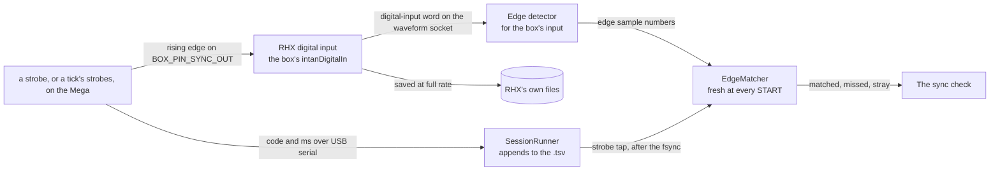
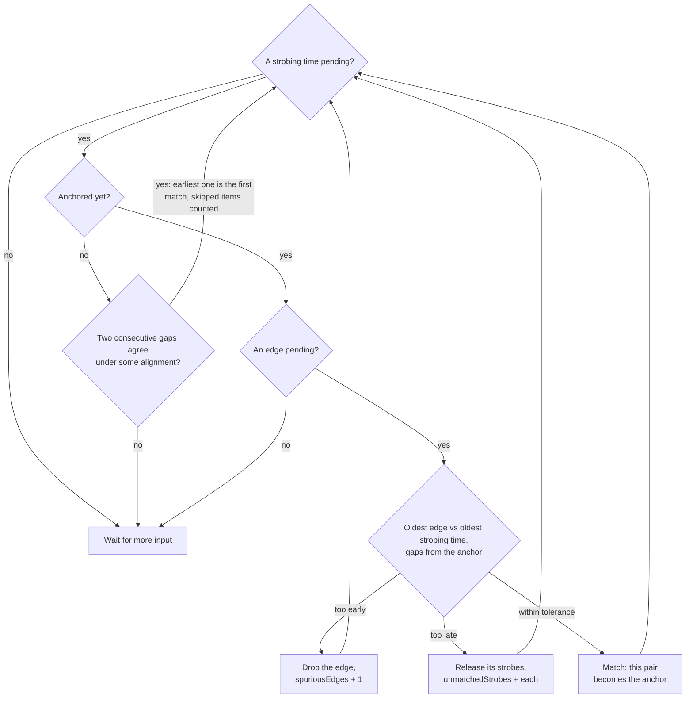
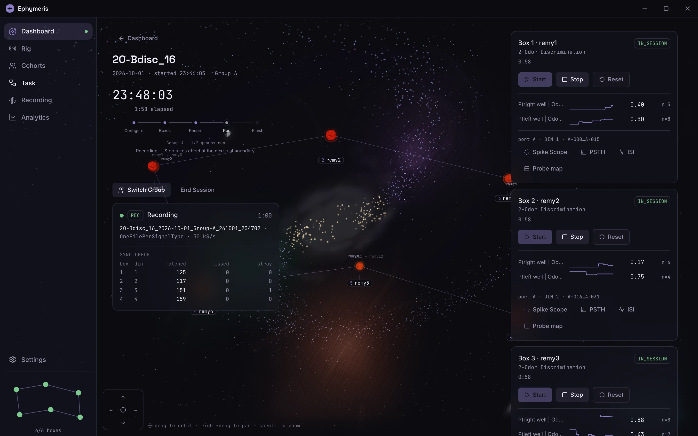
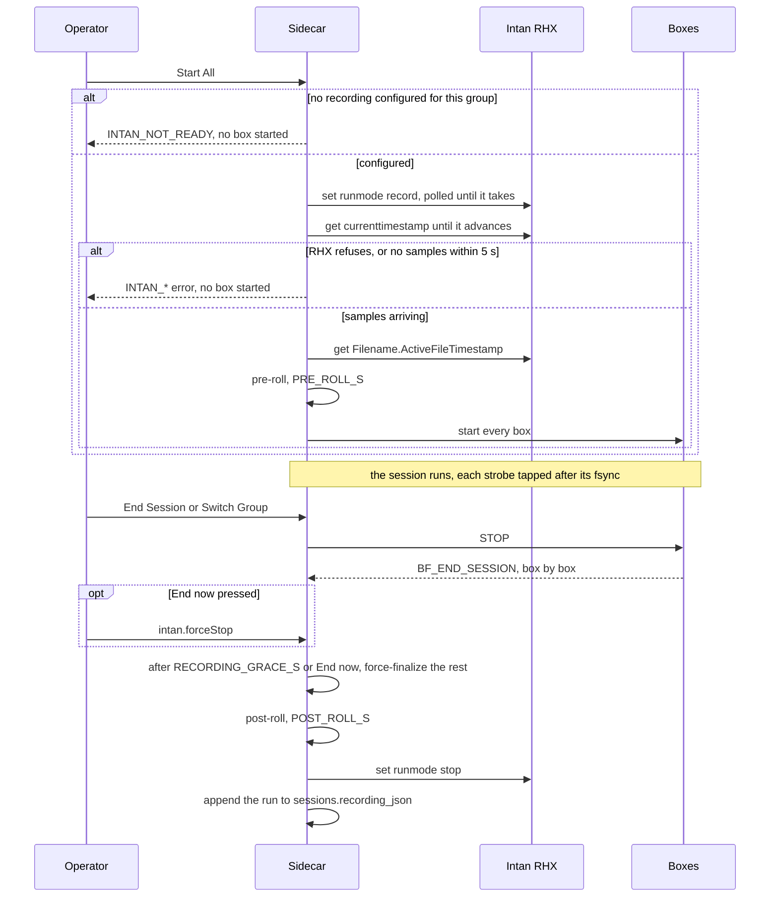

# Recording with Intan RHX

A session can also be an electrophysiology recording: Ephymeris drives a locally running **Intan RHX**
over its TCP protocol. The code is `sidecar/ephymeris_sidecar/intan/` (stdlib only), the wire is
[PROTOCOL.md](PROTOCOL.md#intan-recording), and the operator's steps are
[USER-GUIDE.md](USER-GUIDE.md#recording-with-intan). A full-length recording from a real animal has not
yet been made ([Not yet verified](#not-yet-verified)).

## Contents

- [The rule](#the-rule)
- [Talking to RHX](#talking-to-rhx)
  - [Data sockets](#data-sockets)
- [The sync line](#the-sync-line)
  - [Firmware pulse](#firmware-pulse)
    - [The alignment bound](#the-alignment-bound)
  - [Wiring and binding](#wiring-and-binding)
  - [Edge matcher](#edge-matcher)
- [Recording walkthrough](#recording-walkthrough)
  - [Recording tab](#recording-tab)
  - [Record step](#record-step)
  - [Impedance tracking](#impedance-tracking)
  - [Active-site yield](#active-site-yield)
- [Start and end](#start-and-end)
  - [Start](#start)
  - [Graceful end](#graceful-end)
  - [When RHX goes away](#when-rhx-goes-away)
- [What is written](#what-is-written)
- [Live firing map](#live-firing-map)
- [Tether alarm](#tether-alarm)
- [Event PSTH](#event-psth)
- [Not yet verified](#not-yet-verified)

## The rule

> **RHX may be slow, absent or dead, and none of that may stall or fail a behavior session.**

The [Backup mirror's](DATA.md#backup-mirroring) rule, applied to a second external system.

| Rule | Reason |
|---|---|
| Nothing on the session path awaits RHX, **except starting** | `sessions.startAll` and `port.startSession` on a recording session begin the RHX recording *first* and refuse with an `INTAN_*` code, **before any box is started**, if they cannot. A session missing its electrophysiology cannot be re-run, so this failure must be loud |
| `IntanService.stop_recording` never raises, and is bounded | The animals are done by then; a raise could only strand the session as `running`. With RHX unreachable the run is still recorded and the stop is owed ([When RHX goes away](#when-rhx-goes-away)) |
| The data sockets are a convenience | Losing them costs the sync check and the live firing map, never the recording: RHX writes to disk on its own |
| Closing our sockets never stops RHX | Neither a reconnect nor the sidecar exiting ends a recording; `IntanService.stop()` closes *our* sockets only |
| Runner taps cannot hurt the run | `SessionRunner`'s `recording_fields`, `on_box_started` and `on_strobe_tap` (and `IntanService.box_ended`) run on the port's session thread, hop to the loop with `call_soon_threadsafe`, and are each wrapped so a throwing tap costs nothing. **The strobe tap runs after the fsync** |

It runs **locally only**: `client.py`'s `HOST` is `127.0.0.1`, with no host setting.

## Talking to RHX

RHX's **Network → Remote TCP Control** dialog serves commands on 5000, waveforms on 5001 and spikes on
5002 by default; the Recording tab's TCP ports (`settings.intan`) must match. The operator presses
**Connect** on RHX's Commands tab, and the sidecar opens the data sockets over the command socket
(`set tcpwaveformdatasocket.status pending`).

> [!NOTE]
> **That click is needed after every disconnect**: RHX's command server returns to *Disconnected*, not
> *Pending*, so the once-a-second reconnect (`service.py`'s `POLL_S`) succeeds only after it.
> `INTAN_UNAVAILABLE`'s message names the click.

The protocol has no command to open RHX's Spike Scope, ISI, PSTH or Probe Map windows, or to load a probe
map: the operator opens those in RHX itself, which also sets thresholds there. Ephymeris adds what RHX
cannot show, the [live firing map](#live-firing-map) of every recorded box at once; `intan/probemap.py`
parses the probe XML itself, and "a digital input per box" is a [binding](#wiring-and-binding).

**Confirmed writes.** A `get` answers `Return: <Name> <value>`; a `set` or `execute` answers nothing on
success and an error sentence on failure, and two unanswered writes in one TCP segment read as one
command. So every write from `intan/client.py` is **one transmission ending in a `get`**, the sentinel
(`_SENTINEL`): `;`-separated commands are answered in order, so whatever precedes the sentinel's reply is
that transmission's error text. One transmission is in flight at a time (`_lock`).

> [!CAUTION]
> **The sentinel is an assumption about RHX, and it is fenced.** If a build does not answer a `get` riding
> a batch, the first write times out and the client falls back to one command per transmission with a
> fixed `SETTLE_S`, reporting `confirmsWrites: false` on the Recording tab: slower and blind to refusals,
> but correct ([dependency policy](ARCHITECTURE.md#dependency-policy)).

**`FileFormat`, `Filename.Path` and `Filename.BaseFilename` are always read back** (`set(..., verify=True)`,
case-insensitive since RHX lowercases notes and custom channel names): the only defence against RHX
accepting a value and storing another.

> [!CAUTION]
> **A save location with a space.** A build that split `Filename.Path` on whitespace would accept
> `C:/Hart Lab/x` and record into `C:/Hart`. The read-back catches it and `intan.configure` refuses; the
> Record step warns before anything reaches RHX. RHX 3.5.0 keeps the space.

**Run mode.** `set runmode` is not immediate: `set_run_mode` checks `UploadInProgress` (RHX silently
refuses a change during an upload), then polls `get runmode` until it takes.

> [!CAUTION]
> **`set runmode` is the one write with no sentinel.** Whatever follows `set runmode run` in a batch is
> not processed until acquisition *stops*, so its reply arrives later answering another question.
> `_write_confirmed` raises on a batch containing one, and `tests/fake_rhx.py` defers the same way.

`CurrentTimestamp` and `CurrentTimeSeconds` answer namelessly (`Return: 704383`), so `get()` treats a lone
token as the value.

### Data sockets

`intan/streams.py` is pure: bytes in, records out.

| Socket | Framing |
|---|---|
| Waveform | Blocks of `FRAMES_PER_BLOCK` (128) frames, each led by `WAVEFORM_MAGIC`. A frame is an `int32` timestamp, then one `uint16` per enabled output **in RHX's order**: each amplifier channel's enabled bands (wide, low, high), aux, board ADCs, and last one word holding all sixteen digital inputs. Amplifier samples are offset binary at 0.195 µV/bit |
| Spike | 14-byte chunks: `SPIKE_MAGIC`, a 5-character native channel name, `uint32` timestamp, `uint8` id |

**The waveform stream does not describe itself**, and a wrong `FrameLayout` parses garbage silently. So:

- **A block is believed only when the next block's magic sits exactly one block-length later**, costing
  one block of latency. Partial reads accumulate.
- **The layout is sorted the way RHX writes** (`native_sort_key`, `BAND_ORDER`), not in enable order,
  which would swap two channels and still pass every magic check.
- **A layout change mid-run** parses with the old layout until it stops confirming, then the pending
  one. `WaveformParser.discarded` counts bytes thrown away; a climbing count means a wrong layout.

Streaming stays small, since TCP stops keeping up around ten channels at 30 kS/s: spikes for every
recorded channel and the digital-input word, a layout fixed at `intan.configure` for the whole recording.

## The sync line

Behavioral timestamps must be on the **recording's** clock. One wire per box carries no code: the pulse
says *when*, the serial strobe says *what*, and the [edge matcher](#edge-matcher) pairs them.



### Firmware pulse

The board announces its scheme before `READY`, since a spine board flashed before the tick pulse existed
still pulses per strobe:

| Runner | Pulses | Announces |
|---|---|---|
| Trial runner (`emitStrobe()` in `BehaviorBox.h`: GRGL, trial-loop sketches, `GRGL_Sim`) | Once per strobe | Nothing |
| Spine runner (`BoxSpine.h`) | Once per **tick** that strobes; the tick's strobes share its edge | `SYNC=TICK` |

The runner writes `SYNC=TICK` into the header as `# sync: tick` ([DATA.md](DATA.md#the-tsv-log)), which
offline alignment reads, and builds the box's matcher to pair by tick.

**Per strobe.** `emitStrobe()` waits out the LOW gap **first**, stamps, drives HIGH at once (**the rising
edge is what the controller timestamps**), prints while high, then holds out the width and goes LOW. Each
strobe costs about 0.7 ms, so the k-th strobe of a burst rises about (k−1) × 0.7 ms after the first.

**Per tick.** The runner raises the line right after the tick's output pins are written, before any
print, and lowers it on a later `loop()` pass once `BOX_SYNC_PULSE_US` has run; the next rise waits for
`BOX_SYNC_GAP_US` of LOW (`syncStep`). Nothing blocks. A tick that strobes before the line is ready (two
ticks in one pass when AVR `millis()` skips a value) is **owed** its rise, raised on the first pass the gap
allows, so every strobing tick gets its own edge. At session end `shutdownOutputs()` spares the sync line
so its last pulse is not cut too narrow.

| Macro (`BoxPins.h`, `#ifndef`-guarded) | Meaning |
|---|---|
| `BOX_PIN_SYNC_OUT` | Default **49**. Not 13 (the bootloader blinks it on reset), 0/1 (serial) or 50–53 (SPI). **`-1` compiles the pulse out** |
| `BOX_SYNC_PULSE_US` | Pulse width (per tick: at least this, up to one `loop()` pass longer) |
| `BOX_SYNC_GAP_US` | Minimum LOW before the next pulse |

> [!CAUTION]
> **Two pulses with no LOW between them are one edge**, and a fused pair makes every later event match one
> strobe late, which looks like plausible data. The gap is enforced in firmware and pinned by the host
> tests (`libraries/BehaviorBox/extras/host_test/`; `run_spine.sh`'s `sync_tick` and `sync_close` check
> one rise per strobing tick, its width and its gap).

`shutdownHardware()` (from `initBoxHardware()`) holds the line LOW, since a floating input reads as
events. The line can be proven with no animal: a task started on an empty box from Debug Mode strobes on
its timeouts. Firmware structure: [TASKS.md](TASKS.md#firmware).

#### The alignment bound

What a matched per-tick edge says about when an event happened:

- **The edge is the outputs' edge**: same `loop()` pass, after the output writes, within a few
  microseconds (5 µs in the host test).
- **Outputs are written on the first pass of the tick's `millis()` value**: within a pass of the
  millisecond boundary, or the 1.024 ms AVR `millis()` period when a value is skipped.
- **An owed rise lags its tick** by about 0.75 ms (pulse, gap and a pass) per rise owed ahead of it, and
  then marks no output edge. One is owed when `millis()` skips (about every 42 ms) a value whose tick and
  the next both strobe.
- **An input's edge is when the board read it** (first pass of the next tick, after `debounce_ms`), not
  when the beam broke.

A per-strobe board (GRGL) has the burst lag above instead.

### Wiring and binding

- **Which Mega pin pulses** is *wiring*: a channel of kind **`sync`** (`sync_out`, pin 49 as shipped),
  edited on `/config/wiring` and compiled into `TaskPins.h` ([TASKS.md](TASKS.md#rig-wiring)). `RIG105`
  (`ChannelMap.sync_problems`) refuses a second sync channel, which would carry nothing.
- **Which controller input it reaches** is a *binding*: `BoxBinding.intanDigitalIn`, 1–16, edited in the
  Recording tab's Sync inputs table (`SyncInputsTable.tsx`) and stored in `settings.boxes`
  ([ARCHITECTURE.md](ARCHITECTURE.md#boxes-and-boards)): a cable between instruments, like `hardwareId`.
  Two boxes may not share an input; `settings.py` keeps the first claim, so the later box reads as unwired
  and the Record step refuses it.

> [!CAUTION]
> **`BOX_PIN_SYNC_OUT` is the one pin always emitted** (`taskdef/generate.py`'s `_sync_lines`): with no sync
> channel declared it is `-1`, never `BoxPins.h`'s 49, which might drive whatever the operator put there.
> **A saved rig wiring (`<data_dir>/hardware/`) replaces the shipped one** rather than merging, so a rig
> saved before the `sync` kind existed has no `sync_out`; the Record step checks `intan.status.rigHasSync`
> and `intan.configure` refuses without it.

### Edge matcher

`intan/analysis.py`'s `EdgeMatcher`. Each edge is one **strobing time**: a strobe, or a tick
(`EdgeMatcher(tick_pulsed=True)`) whose strobes all take its edge. Pairing by count alone lets **one**
extra edge (the line twitching as the Mega resets through DTR) shift every later event onto its
neighbour while every count still looks healthy. So order proposes and **time disposes**: an edge is
accepted only where the strobing time's own millisecond timestamp puts it, measured from the last
accepted pair.

| Head edge is | Meaning | Action |
|---|---|---|
| within tolerance | this time's pulse | match each of its strobes; the new anchor |
| too early | spurious | drop it, count `spuriousEdges` |
| too late | this time's pulse never came | release its strobes, each counted in `unmatchedStrobes` |



- **The tolerance is relative**: the larger of `ABS_TOLERANCE_MS` and `REL_TOLERANCE` of the gap, since
  the Mega's resonator drifts about half a percent. Measuring from the *last* pair stops error accumulating.
- **The first pair** is the earliest alignment under which two consecutive gaps agree. At most `MAX_LEAD`
  leading strobing times may be skipped but any number of leading edges, which discards the reset twitch.
- **A tick's strobes can straddle its edge** (edges and strobes arrive on different sockets); a late
  strobe of the tick takes the tick's answer. An owed rise is well inside `ABS_TOLERANCE_MS`.
- **A fresh matcher at every START** (`IntanService._box_started`), because the Mega's clock restarts;
  `SessionRunner.on_box_started` passes the board's `SYNC=TICK`.
- Past `MAX_PENDING` queued strobes, the oldest is given up on.
- **Synthetic RHX** (`synthetic: true`, no controller) generates digital inputs no box drives, so the
  matcher is bypassed and `sync` is published empty.

`intan.status.sync` publishes `matched`/`spuriousEdges`/`unmatchedStrobes` per box (counting strobes in
either scheme), shown in Mission Control as the **sync check**, *matched*, *missed* and *stray*: **the
wiring check**. `unmatchedStrobes` climbing with `matched` at zero reads "no pulses arriving — check the
sync line" (`RecordingStatus.tsx`).



The matcher serves the **sync check only**: RHX saves the digital input at full rate and the `.tsv`
holds the strobes, so offline alignment can rerun it, or better, on complete data.

## Recording walkthrough

The operator's steps are in [USER-GUIDE.md](USER-GUIDE.md#recording-with-intan); this is what each
surface owns.

### Recording tab

`/recording` (`routes/Recording.tsx`), a [telemetry display](ARCHITECTURE.md#telemetry-panels) fitting one
screen. Link (left) and Defaults (right) use `SettingRow` at **compact** density
(`SettingRowDensityContext`); the Record step renders the same rows at full density.

| Part | Holds |
|---|---|
| Readout strip | Link state, controller (and `synthetic`), RHX version, sample rate, headstage ports, boxes wired, whether the wiring has a sync channel |
| Live (while recording) | `RecordingStatus`, as in Mission Control's rail |
| Link — Connection | `IntanConnectionPanel`: Connect/Disconnect, `confirmsWrites`, the RHX click as a disclosure, the three TCP ports |
| Link — Sync inputs | `SyncInputsTable`: box → `DIN n` |
| Defaults | `settings.recordingDefaults` (`lib/intan/defaults.ts`) via `RecordingConfigRows` |


### Record step

Start Recording opens `/session/new?mode=recording`, creating the session with `recording: true`; the flow
then reads the flag from the session record (`SessionFlow.isRecording`, `lib/sessions/flow.ts`), not the
URL, because it is re-entered from the dock, between rounds and after a reload.

```
/session/new → /session/:id/mapping → /session/:id/recording → /session/:id/control
                                       (SessionRecording.tsx)
```

It comes **after mapping** (it asks for each *mapped* box's headstage port), runs **once per [round](../GLOSSARY.md#round)**, and
opens prefilled from `settings.recordingDefaults`, which it writes back on Continue. Whether a box records,
its port and channel range are remembered **by box**. **A probe map is never entered here**: each row
shows its animal's [implant](DATA.md#implants)'s (`implantProbeMaps`, `followImplantMaps`), the one place
a probe map is entered, so the two can never disagree.

- **Readiness**: RHX connected and not recording, a headstage present, a sync channel in the wiring, a
  digital input for every recorded box. Each failing line links to its fix.
- **Saving**: `<session folder>/ephys` by default, or the session's folder name under a chosen root.
- **Boxes**: Record or Behavior only, DIN, port, channel range, and the implant's probe-map XML (parsed by
  `intan.parseProbeMap`; a parse cut off by a lost connection reruns on reconnect). Boxes may share a
  port on disjoint ranges only. A box not in the round's confirmed mapping is refused before RHX is
  touched (`SessionLifecycle.mapped_boxes`).

The setup belongs to the mapping confirmed when **Continue** was pressed (`SessionLifecycle.confirmations`):
confirming the mapping again, even unchanged, makes Start refuse until the Record step runs again.


**Wideband defaults on**: everything else RHX saves derives from it, and a bad threshold cannot be
re-picked without it. **A spike snapshot defaults to 1 ms before and 1 ms after the crossing** (30
samples each side at 30 kS/s), and snapshots are on whenever spikes are. A machine's saved defaults are
kept as the operator set them.

> [!CAUTION]
> **Spikes saved without snapshots cannot be sorted**: `spike.dat` then holds timestamps only. Such a
> setup is refused, with that reason, by the Record step and by `IntanService.configure`
> (`refuse_unsortable`) before RHX is touched.

On **Continue**, `intan.configure` (`IntanService.configure`) applies the plan in one pass. An RHX in `Run`
is stopped (it ignores saving parameters while running); one in `Record` is refused. **Unclaimed channels
are switched off.** RHX's three notes carry the session, the cohort, and the box→animal→port map;
`livenotes` stamps each box's start and end.

### Impedance tracking

The Record step's **Electrodes** tile measures every electrode site and keeps each animal's values, so a
site is judged against that animal's last measurement as well as fixed bounds. RHX shows only the
measurement in front of it; the history across sessions is what Ephymeris adds. Optional: nothing waits
on it.

`intan.measureImpedance` (`IntanService.measure_impedance`):

1. Refuse while recording; stop an RHX left in Run, as `intan.configure` does.
2. `set DesiredImpedanceFreqHertz` to `IMPEDANCE_FREQ_HZ` (1 kHz), point `ImpedanceFilename` at the save
   location (read back), and delete any file of that name first.
3. `execute MeasureImpedance`, with `MEASURE_TIMEOUT_S`: RHX measures every channel of every headstage
   **before it reads on**, so the sentinel answers when it is done (4.9 s for 64 demo channels, RHX's
   own progress bar).
4. `execute SaveImpedance`, then read RHX's CSV (`intan/impedance.py`), which stays beside the
   recording as `impedance_<UTC stamp>.csv`.
5. Keep each box's channels under the animal the confirmed mapping puts there, in
   `electrode_impedances` ([DATA.md](DATA.md#tables)), and answer each with the measurement before it.

> [!CAUTION]
> **RHX's CSV has the native name in "Channel Number"** and the custom name in "Channel Name". Read by
> the second column, a renamed channel would be filed under its label.

`intan.impedanceHistory` gives each animal's latest on arrival. The webview judges them
(`lib/intan/impedance.ts`) with the impedance bounds under **Electrode checks**, a recording default: **open** above 5 MΩ,
**short** below 20 kΩ, **changed** by more than 2× either way since the animal's previous measurement.
Open and short win over changed. Flagged sites are outlined on the probe-map preview.

| Unverified | If the answer is the bad one |
|---|---|
| A real headstage's measurement time | Over `MEASURE_TIMEOUT_S` (180 s) the step reports RHX unavailable; raise it |
| RHX in demo mode measures 100 kΩ, −70° on every site | Nothing can be judged from a demo measurement; it proves the plumbing only |

### Active-site yield

How many of an animal's electrode sites carry signal, run by run, so a failing implant shows on the
Record step before the next recording rather than in the analysis after it. RHX detects **threshold
crossings, not sorted units**, so the honest count is *active sites*: a recorded site whose **mean
crossing rate over the run** reaches `activeSiteHz` (0.5 Hz, under **Electrode checks**).

- **Counted live** from the spike socket (`IntanService._count_spike`), per box from its START
  (`_box_started`) to its finalization (`box_ended`, which returns the counts), for every site the box
  records, silent ones included.
- **Coverage is measured, not assumed**: `counted_seconds` is the samples RHX's waveform socket delivered
  during the run, the rate's denominator. A gap in the streams lowers it rather than making every site
  read quieter. A run under 90% coverage is marked partial; under 10 s, left out.
- **Kept with the run record** (`run_spike_counts`, [DATA.md](DATA.md#tables)), written by
  `SessionLifecycle.animal_ended` after the run's own row. The run carries the animal through cohort
  moves and tidy, and a [prune](DATA.md#pruning) takes the counts with it.
- **Raw counts only**, with the recording's threshold setup beside them: the webview judges
  (`lib/intan/yield.ts`), so a new `activeSiteHz` re-judges history, and a run whose spike detection
  differs from the latest one is marked, since crossings under two thresholds do not compare.

`intan.yieldHistory` gives each animal's recent runs to the Record step's **Electrodes** tile, oldest to
newest (`12/16 · 11/16 · 9/16`). Mission Control's [firing map](#live-firing-map) counts the same way
live, since the map opened (`FiringModel.activeCount`), after its first 10 s.

> [!NOTE]
> **Artifacts count as crossings.** Chewing or a loose connector can make a dead site look active; the
> yield says a site carries threshold crossings, not that they are neurons.

## Start and end

Context: [ARCHITECTURE.md](ARCHITECTURE.md#session-lifecycle). One round's recording
(`SessionLifecycle` in `sessions/lifecycle.py`, `IntanService.start_recording`/`stop_recording`):



**A recording counts from its start to its stop, not by the link** (`IntanService.run_open_for`): with RHX
unreachable or stopped by hand, End still attempts the stop and records the run. Only a run RHX is known
to be writing is stopped outright; any other goes through the owed-stop check.

**One recording per round**: another round is different animals, possibly on different ports.

### Start

`sessions.startAll`, or the first `port.startSession`, via `SessionLifecycle.start_all`/`start_box` and
`IntanService.start_recording`:

1. `set runmode record`, polled until it takes.
2. **Wait for samples** (`currenttimestamp` advancing): "Record" is a request, samples are the fact.
3. Read `Filename.ActiveFileTimestamp`, RHX's stamp naming the files it created.
4. Pre-roll (`PRE_ROLL_S`), so every channel has a baseline.
5. Start the boxes.

A failure in 1–2 is an `INTAN_*` error with no box started. First, `IntanService.refuse_unless_ready`
refuses with `INTAN_NOT_READY` (no recording set up for this round, or set up before its mapping was last
confirmed, or Stop pressed in RHX) or `INTAN_UNAVAILABLE` (RHX out of reach, including a box started
while the round's recording has lost its link).

A box refused after step 5 leaves RHX recording, so a retry starts its boxes inside the same recording.
`sessions.abandon` stops it and keeps the run on the aborted session, its only run without a round.

### Graceful end

`sessions.end` and `sessions.endRound` via `SessionLifecycle.end`/`end_round`:

1. `STOP` to every box.
2. **Wait for each box's `BF_END_SESSION`**, up to `RECORDING_GRACE_S` (longer than any trial the lab
   runs). `intan.status.waitingOn` names who is out, and the state stays `stopping` throughout, through a
   lost link or reconnect (`IntanService._trouble`), with End now (`intan.forceStop`) offered. The grace
   is skipped **only** when RHX is seen out of Record (`IntanService.may_still_record_for`); when unsure,
   it is kept.
3. Post-roll (`POST_ROLL_S`), then `set runmode stop`.
4. Append the run to `sessions.recording_json`.

> [!IMPORTANT]
> **Behavior-only sessions keep their 100 ms.** `SessionRunner.end_all` waits `graceful_timeout_s`
> (0.1 s) and cuts the trial in flight. A recording waits longer because electrophysiology with no
> behavioral outcome to align to is the expensive half of the experiment without the cheap half.


### When RHX goes away

| Event | What happens |
|---|---|
| RHX hangs up | EOF is seen within `WATCH_S` (`RhxCommandClient.peer_closed`); `connected: false` at once; reconnects after Connect is pressed in RHX |
| RHX silent, socket open | After `SILENT_POLLS` unanswered polls the link is lost **and our end closed** (`_lost`), so `connected` cannot go on reading true |
| Command socket lost mid-recording | `state: error`, "RHX keeps recording on its own; reconnecting"; the session is untouched and the run kept. On reconnect, RHX in `Record` **on this run's file** (`Filename.ActiveFileTimestamp` from the start) is picked back up and the streams reopened. Any other file, or no stamp read at start, is a recording restarted by hand: reported, never adopted or stopped. A failed stamp read retries each poll; an End racing it wins (`IntanService._try_adopt`). A box started meanwhile gets `INTAN_UNAVAILABLE` |
| Stop pressed in RHX | The poll sees `runmode ≠ record` → `error`; the run is kept for End, without the grace |
| RHX unreachable at End | The boxes still get the grace. `stop_recording` tries `set runmode stop` within `STOP_TIMEOUT_S`, records the run and **owes** the stop, said in `intan.status.message`. When RHX answers again still recording **that run's file**, it is stopped (`_send_owed_stop`); stopped by hand, nothing is sent; on another file (or with no stamp), it is left alone and the message says to stop it in RHX |
| Data sockets fail | `liveStreams: false`; the sync check and the firing map are unavailable, the recording unaffected |
| The sidecar exits | Its sockets close; RHX keeps recording |

## What is written

**By RHX**: its own files under `Filename.Path`, in a directory it timestamps (`createnewdirectory
true`), named `<prefix>_<number>_<date>_<animal>-<animal>…`: the animals recorded, in box order. Ephymeris never reads them and moves them only with a [relocated](DATA.md#data-folder) cohort
folder. Probe-map XMLs are copied beside them as `box<n>_<name>.xml`.

**`sessions.recording_json`** ([DATA.md](DATA.md#sqlite-database)): `{"runs": [...]}`, one per round
(path, base filename, RHX's file timestamp, format, sample rate, start/end, and per box its DIN, port,
channels and probe-map file). `NULL` means behavior only. A save location inside a cohort folder follows
a relocate of that folder.

**Each recorded animal's document** ([DATA.md](DATA.md#the-json-document)) gains three blocks. All three are in the `.tsv` header, so a crash-recovered file keeps them.

**`recording`**: which recording the run is inside. In the `.tsv` header each field is the `intan_*` line named beside it; a version-1 document has them flat under those names, and is read into this block:

| Field | `.tsv` line | |
|---|---|---|
| `name` | `intan_recording` | base filename + RHX's timestamp: the name to look for |
| `path` | `intan_path` | where RHX was told to save |
| `digital_in`, `port`, `channels` | `intan_digital_in`, `intan_port`, `intan_channels` | this box's input, port and `A-016:A-031` range |
| `sample_rate` | `intan_sample_rate` | for converting sample numbers |

**`implant`**: the animal's [implant](DATA.md#implants) as it stood on the session's date (`implants.on_date`); `null` for an animal with none.

```jsonc
"implant": {"device": "custom 32-channel electrode", "surgery_date": "2026-11-30", "probe_map": null,
            "targets": [{"name": "OFC", "region": "orbitofrontal cortex", "hemisphere": "left",
                         "ap_mm": 3.2, "ml_mm": 2.4, "dv_mm": 4.85, "depth_set_on": "2026-12-14", "channels": "0-15"}]}
```

- `dv_mm` is the depth in force that day and `depth_set_on` the date of the lowering that set it (the surgery date before any). A lowering moves the contacts to other neurons, so only runs sharing `depth_set_on` were recorded in one place.
- It is a copy: editing the implant later changes no run already written.

**`channels`**: one row per channel RHX records for the box, in order (`implants.channel_rows`). It is the one place RHX's naming and the device's meet.

```jsonc
"channels": [{"native": "A-016", "device_channel": 0, "target": "OFC", "x_um": null, "y_um": null}]
```

- **Device channel k is the k-th channel of the box's range**: a box on `A-016:A-047` has device channel 0 at `A-016`. On the lab's custom electrode that is the number printed beside the hole on the EIB.
- `target` is the implant target claiming that device channel, `''` for none and for an animal with no implant.
- `x_um`, `y_um` are the site's position in the implant's probe map, `null` without one.
- In the `.tsv` header `implant` and `channels` are one JSON line each. In the `.mat`, `S.implant.targets` and `S.channels` are N×1 struct arrays.

> [!IMPORTANT]
> **Never parameters, so they stay out of `params_hash`**: two runs of one tuning must compare in Analytics
> whether or not one was recorded ([TASKS.md](TASKS.md#profile-and-params-hashes)). The string ones are in
> `sessions/recovery.py`'s `_STRING_FIELDS` (so `0423_7` does not come back as a number).

The durable record is RHX's files plus the `.tsv`; nothing the sync check or the firing map computes is
persisted.

## Live firing map

Each recording box's probe, lit as its sites fire, in Mission Control: on its card, and larger in its
focused panel (`LiveProbeMap.tsx`). It has to **feel** live: a flash within about 100 ms of the spike, so
the whole path is built for latency rather than averages.

- **Each site shows two things** (`lib/intan/firing.ts`): a flash on every spike, fading over
  `FLASH_TAU_MS`, and a dimmer glow for its rate over `RATE_TAU_MS`, on a **fixed log scale**. A scale
  relative to the busiest site re-shades every other site whenever the loudest one changes.
- **React draws the probe once** (`ProbeMapView`, SVG); one animation-frame loop then sets each site's
  fill by its `data-channel`. Six 64-site probes at about 3,800 spikes a second cost 0.6 ms a frame (p95).
- **The file's colours are ignored** and **Y is flipped at draw time** (`lib/intan/probeMath.ts`;
  Intan's y points up).

| Leg | What bounds it |
|---|---|
| RHX → sidecar | RHX writes its data sockets every `TCPNumberDataBlocksPerWrite` blocks of 128 samples (default 10, 43 ms at 30 kS/s); `intan.configure` sets `BLOCKS_PER_WRITE` (2, 8.5 ms) |
| Sidecar → webview | Spikes are counted per box and sent as `intan.spikes` every `SPIKES_PUBLISH_S` (one 30 fps frame), only for a box that fired |
| Webview → screen | Drawn on the next animation frame, outside React |

**Every batch carries its own latency.** `lagMs` is the slowest spike's trip from RHX having its sample
to the sidecar reading it, against RHX's clock read once per poll (`get currenttimestamp`,
`analysis.py`'s `SampleClock`); `sentAt` lets the webview time its own leg on the same machine's clock.
The USB transfer before RHX has the sample is outside both, as it is for RHX's own displays.

`tests/test_intan_real_rhx.py`'s `probe_how_late_do_spikes_arrive` measures the first leg against a real
RHX at several batch sizes. RHX 3.5.0, demo mode, 30 kS/s, 16 channels, about 420 spikes a run:

| Blocks per write | p50 | p95 | max |
|---|---|---|---|
| 10 (RHX's default) | 12.4 ms | 38.6 ms | 46.1 ms |
| 4 | 1.6 ms | 15.9 ms | 17.8 ms |
| **2** (`BLOCKS_PER_WRITE`) | −6.6 ms | 6.7 ms | 23.7 ms |
| 1 | −6.9 ms | 7.5 ms | 32.9 ms |

> [!NOTE]
> **These read about 10 ms low**, hence the negative medians: `currenttimestamp` trails the samples RHX
> has already written to TCP, so the clock bound is loose by a near-constant amount. The differences
> between rows are sound; the true p95 at 2 blocks is nearer 17 ms. One block per write buys nothing at
> p95 and doubles the worst case, so 2 it is. `lagMs` carries the same bias.

## Tether alarm

A warning on a recording box's Mission Control card when **every one of its sites changes at once**:
all silent (tether cut, headstage unplugged) or all noisy (ground lost, connector half seated,
chewing). RHX records through either without complaint and has no alarm; nobody watches six animals'
traces for an hour. One quiet site is ordinary and never an alarm: that is the
[impedance](#impedance-tracking) and [yield](#active-site-yield) history's to show.

`intan/analysis.py`'s `TetherBoard`, fed by the spike socket (`add_spike`) and the waveform socket
(`delivered`), judges each box **one second of RHX samples at a time** against **its own baseline**,
the median rate of its first `TETHER_BASELINE_S` (120 s) after START, since implants differ tenfold:

| Verdict | A window where the box's crossings are... |
|---|---|
| silent | under `TETHER_SILENT_FRACTION` (10%) of its baseline. Only once the baseline reaches `TETHER_MIN_BASELINE_HZ` (2 Hz, whole box); a quieter box is watched for noise only |
| noisy | over `TETHER_NOISY_FACTOR` (5×) the baseline on `TETHER_NOISY_SITES` (80%) of its sites, **or** at least `TETHER_COINCIDENT_FRACTION` (half) of them land within `TETHER_COINCIDENT_S` (0.5 ms) on half its sites or more: neurons do not fire in lockstep across a probe, artifacts do |

A verdict must hold `TETHER_SUSTAIN_S` (20 s) to raise an alarm and its absence as long to clear one, so
a twitching connector does not flicker it; the alarm is dated from where its evidence began. While the
box is healthy the baseline follows slow drift (`TETHER_BASELINE_TAU_S`).

**Missing data is never silence**, which is what makes the alarm safe to trust:

- Windows are cut from **RHX's samples**, not wall time, and a window any gap in the waveform stream
  touches is **skipped**. A window closes `TETHER_LAG_S` after its end, since spikes trail the waveform.
- Nothing is judged while the data sockets are down (`liveStreams: false`).
- **Every judged box silent in the same window is upstream** (RHX, the controller): no box alarms, and
  `intan.status.tetherAllSilent` says so on the rail. The boxes are each other's control.
- An acquisition restarted under the recording (its sample clock back at zero) starts every box's
  baseline again.

When it fires, nothing stops ([the rule](#the-rule)): the card shows the alarm with **Acknowledge**
(`intan.acknowledgeTether`), after which it stays as a quiet line until the box recovers;
`livenotes` stamps `BOX<n> TETHER SILENT|NOISY|OK` into RHX's own notes; and the session log gets a
`hardware` box note dated from the evidence's start (`Application._tether_note`), saying which
stretch of data to distrust.

> [!NOTE]
> **The thresholds are first guesses**, pinned only against synthetic faults
> (`tests/test_intan_tether.py`). The first real recordings decide them: a sleeping animal or a long
> grooming bout should not alarm, and a pulled headstage should.

## Event PSTH

Spikes around a **named** behavioural event, after the session, in Analytics' **Spikes around an event**
panel (`EventPsthPanel.tsx`). RHX's own PSTH triggers on a digital edge, and every event of a box pulses
the same one, so only Ephymeris can align to `ODOR_1_ON` rather than "something happened"
([ADR 0007](adr/DECISIONS.md#0007-rhxs-own-windows-replace-the-recording-pop-ups)). After the session the
data is complete: every spike and edge at full rate, every strobe, every trial's outcome.

`intan/offline.py`'s `load_run`, from one run's `.json`:

1. **Find the recording**: the document's `recording.path` / `recording.name`, RHX's per-run folder.
2. **Read RHX's files** (`intan/rhx_files.py`, layouts from RHX's `FilePerSignalTypeSaveManager`):
   `spike.dat` for the box's channels, and the rising edges of its `recording.digital_in` in
   `digitalin.dat`, timed by `time.dat`. A one-hour `digitalin.dat` is about 108 million words; they
   are never looped over in Python: each chunk's byte holding the bit is sliced out, mapped to 0/1 with
   `bytes.translate` and searched with `bytes.find`, so only the edges are.
3. **Align** (`intan/events.py`'s `align`): the live sync check's own `EdgeMatcher`, fed as a live
   stream would be (a strobe, then edges to a look-ahead of `LOOK_AHEAD`), since all of a session at
   once would overflow `MAX_PENDING`. Before the first pair it may hold up to `MAX_PENDING` edges, so
   any number of reset twitches ahead of START are skipped.
4. **Place each event in its trial**: the trial table's (`trial_table_of`) last trial opened at or
   before it. A replayed spine run's trial times are the board's clock, which restarts at START like
   the strobes'; a decoded legacy run's count from its earliest timestamp, which is added back.
5. **Write the events file**, `events/<run>.events.json` and `.mat` beside the session: every strobe,
   named, its sample on the recording's clock (or null) and its trial; the trials' conditions and
   outcomes. It is for the lab's own scripts and spike sorters; **the app never reads it back**.

`intan.eventPsth` then bins each site's spikes around one event, split by trial condition or outcome,
counting only events whose whole window was recorded (`whole_windows`), with a raster for the selected
site. **Responsive** compares each trial's rate over `RESPONSE_WINDOW_MS` (at most 500 ms) after the
event with the same span before it: |t| ≥ 3 over at least 5 trials, ±99.9 when every trial moved alike.
A first look, not a test: one site judged at many events finds some by chance.

A loaded run stays in memory (`OfflineRuns`, `CACHED_RUNS`) until its `.json` or one of RHX's files
changes. `intan.recordedRuns` says which of a session's runs name a recording, from headers alone; the
panel shows nothing for a session with none.

> [!CAUTION]
> **Only the per-signal-type and per-channel formats save spikes**; a Traditional `.rhd` recording has
> no `spike.dat` and is refused (`RECORDING_UNREADABLE`) rather than re-detected from wideband. And
> **check the sync line first**: the panel's header gives the whole run's placed, missed and stray
> counts. A shifted match draws a PSTH that looks as convincing as a right one; a missed or
> unpaired count is the warning.

## Not yet verified

Configure, record, the sync line into a real digital input and the graceful end have run against a real
RHX and real boxes; the live firing map's latency against a real RHX in demo mode only. **A full-length recording from a real animal has not.**

The suite runs against `sidecar/tests/fake_rhx.py` (the three servers on real sockets, each failure
switchable). `sidecar/tests/test_intan_real_rhx.py` probes a real RHX: opt-in (`EPHYMERIS_REAL_RHX=1`),
never enters `record`, restores every value it touches, and uses one connection throughout. On RHX 3.5.0
(`ControllerRecordUSB3`, synthetic) it confirmed the sentinel batching, reported refusals, the space in
`Filename.Path`, `digital-in-01` input names (`digital_in_name`), the [run-mode](#talking-to-rhx)
deferral, nameless replies, case handling, spike latency by batch size, the impedance
measure-and-save sequence and its CSV, and every
`intan.configure` parameter name.

To watch on the first full-length recording:

| Question | If the answer is the bad one |
|---|---|
| Does a spine run's sync check read nothing missed and nothing stray? The tick pulse is proven only in the host shim | Edges pair with the wrong ticks. Check width, gaps and an owed rise on the DIN trace before relying on [the bound](#the-alignment-bound) |
| Does the RMS-relative threshold need the board to have run first? | Thresholds land wrong; fix with a short `run` before `SetSpikeDetectionThresholds` |
| Digital-input naming on the USB Interface Board (zero-based) | Handled in `digital_in_name`; untested |
| Does `Filename.ActiveFileTimestamp` change when RHX rolls to a new file (`NewSaveFilePeriodMinutes`), or read `RecordingNotStarted` once samples arrive? | A run that lost its link is not picked back up and its owed stop is report-only: safe, but RHX must be stopped by hand ([When RHX goes away](#when-rhx-goes-away)) |
