# Tasks

How a task gets from firmware that emits strobes to the app's trial-flow diagram and `SET` lines. On-disk data is [DATA.md](DATA.md), scoring [ANALYTICS.md](../sidecar/ephymeris_sidecar/analytics/ANALYTICS.md), the session flow [ARCHITECTURE.md](ARCHITECTURE.md#session-lifecycle).

## Contents

- [Overview](#overview)
- [Firmware](#firmware)
- [Sketch library](#sketch-library)
- [Task profile](#task-profile)
- [Task definitions](#task-definitions)
- [Rig wiring](#rig-wiring)
- [Strobe vocabulary](#strobe-vocabulary)
- [The START line](#the-start-line)
- [Profile and params hashes](#profile-and-params-hashes)
- [Derived state machine](#derived-state-machine)
- [The Task tab](#the-task-tab)
- [Simulating a task](#simulating-a-task)
- [Writing a new sketch](#writing-a-new-sketch)

## Overview

A **task** is a sketch plus an optional `task.json` beside it, its *profile*, from which the app renders a config form, draws the trial flow, builds the `SET` lines and scores live metrics. Without one a sketch still runs, with a bare `SET` and a raw strobe log. Operators author a [task definition](#task-definitions) and the app generates the sketch. The bundled sketches are GRGL (copied by every generated trial-table task), [BOX_Utility](#the-box-utility) and the [decode-only](#decode-only-sketches) GRGL_Sim.

> [!IMPORTANT]
> **No sketch is special-cased in app code.** Writing `if (sketchName === "GRGL")` means the profile is missing a declaration.

### Two places a value can come from

Pins, strobe codes, the trial table and anything that sizes an array are compiled into the generated `TaskPins.h` and `TaskTrials.h`, so changing them costs a reflash. Every timing, penalty, reward volume (`RW<n>`), pool weight (`PW<n>`) and threshold goes on [`SET` lines](#the-start-line) at run time, so one binary serves six differently tuned boxes.

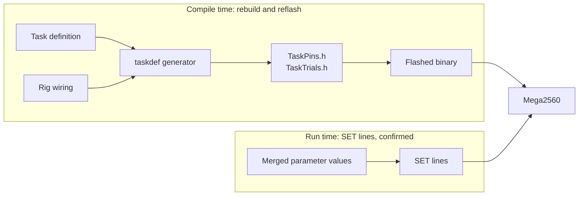

## Firmware

Firmware lives only in `firmware/` ([its README](../firmware/README.md)). `libraries/BehaviorBox/BehaviorBox.h` is the trial runner: serial helpers, `TaskParams` with its wire-key list `TASK_PARAM_LIST`, the selectors and one `runTrial()` loop. Pins in `BoxPins.h` are overridable defaults; strobe codes have none, so a sketch builds only with the generated `TaskPins.h`, included before `<BehaviorBox.h>`.

> [!CAUTION]
> **Each count moves with its key list** (`NUM_STAGES` with `BOX_STAGE_KEY_LIST`; `BOX_MAX_TRIAL_TYPES` with `BOX_POOL_KEY_LIST` and `BOX_REWARD_KEY_LIST`), or a `SET` token writes past an array.

### Selection modes

`BOX_SELECTION_MODE` is compiled in and mirrored by hand in `src/features/tasks/selection.ts`. `BOX_SELECT_ANTIBIAS` draws a side against the animal's recent bias, then a type uniformly; `BOX_SELECT_WEIGHTED` draws the side alike, then a type by `PW<n>`. Both apply correction budgets and abstention escalation, and never present no-go types. `BOX_SELECT_POOL` deals a block-shuffled sequence in exact `PW<n>` proportions per block of `BS`, presents no-go types, and has no side balancing, corrections or escalation.

### Stream grammar

The trial runner frames every trial the same way, so a reader splits rather than pattern-matches. This is grammar 2, announced as `STREAM=2`; a board announcing nothing emits grammar 1, which still decodes ([ANALYTICS.md](../sidecar/ephymeris_sidecar/analytics/ANALYTICS.md#stream-grammar-2)). Between `START_SESSION` and `END_SESSION` each trial is:

- **header**: `TRIAL_START`; `TRIAL_GO_LEFT`, `TRIAL_GO_RIGHT` or `TRIAL_NO_GO`; `TRIAL_TYPE_<n>`, the row's slot;
- **timeline**: `LIGHTS_ON`, `ODOR_POKE`, `ODOR_<n>_ON`, `ODOR_OFF`, `ODOR_UNPOKE`, `LIGHTS_OFF`, `WATER_POKE_*`, `FLUID_*`, `STOP_FLUID_G_*`, `WATER_UNPOKE_*`, as reached;
- **one outcome**: `CORRECT`, `WATER_POKE_ERROR_*`, `WATER_UNPOKE_EARLY_*`, `RESP_OMIT`, `WATER_POKE_NONE` (a withheld no-go), or an abort: `LAZY_RAT`, `ODOR_UNPOKE_EARLY` or `ODOR_UNPOKE_EARLY_SAMPLING`;
- **footer**: `INVALID_TRIAL` if the trial will be re-presented, then `END_TRIAL`.

`test_trial_stream.cpp` and `analytics/tests/test_grammar2.py` hold the reference sequences. A row past the vocabulary's `TRIAL_TYPE_<n>` codes is `TSK115`. A grammar-2 profile on a board announcing no `STREAM` scores no live P(correct) until reflashed.

### Compiling and the host tests

> [!CAUTION]
> **`arduino-cli compile` hides type errors** (`-fpermissive -w`). After a shared-signature change, compile every sketch with `--warnings all` and run the host tests.

The host tests (`extras/host_test/`, against an `Arduino.h` shim) are `run.sh` (the library), `run_box.sh` (the box utility) and `run_stream.sh` (every outcome's [strobe sequence](#stream-grammar)).

## Sketch library

Sketches ship with the app (`discovery.py`), so changing one needs a new build.

### Library roots

The bundled root is `$EPHYMERIS_SKETCH_LIBRARY` (a developer override, deliberately not a setting), else `$EPHYMERIS_BUNDLED_SKETCHES` (an installed build), else `<repo>/firmware`. [Rebuilt sketches](#rebuilt-bundled-sketches) in `<data_dir>/rig/sketches/` then **replace** their bundled entries, and generated tasks in `<data_dir>/tasks/` are **appended**.

### Folder rules

> [!WARNING]
> **A folder is a sketch only if it holds a `.ino` named like the folder** (`GRGL/GRGL.ino`); otherwise it is skipped and reported.

A sketch sits directly inside a category folder, any top-level folder but `libraries/`. The root `libraries/` is the single `--libraries` path: put shared headers directly in it, without symlinks.

### Discovery

The library is rescanned on `settings.push`, `sketches.refresh`, task saves and wiring rebuilds, then `sketches.updated` is broadcast. Every skipped folder is reported with its reason.

<a id="library-states"></a>
`SketchLibraryStatus.state` is `damaged`, `empty` (no valid bundled sketch) or `ok`; anything but `ok` means a broken install.

### Decode-only sketches

`"decodeOnly": true` keeps a sketch so its runs decode, but it never runs: pickers omit it and the sidecar refuses it (`SKETCH_DECODE_ONLY`). The key is outside `profile_hash`. `GRGL_Sim` is the one shipped.

## Task profile

`task.json` sits beside the `.ino`, one per sketch. `parse_profile` (`tasks/profile.py`) is the only enforcement point; a broken file raises `TaskProfileError`.

### Top level keys

`taskName` (required), `kind` (`"behavior"` or `"utility"`), [`config`](#config-fields), [`liveMetrics`](#live-metric-entries), [`controls` and `telemetry`](#utility-controls-and-telemetry), [`identify`](#identify), [`legacyNames`](#legacy-names) and a generated task's [`trialTypes`](#trial-types-in-the-profile). [`strobes`](#strobes) is filled at load. Unknown keys are ignored.

> [!CAUTION]
> **Never add a `states` or `graph` key**: it moves `profile_hash` and splits the sketch's history.

### Config fields

Each field needs `metadataKey` (its key in the run document's `params`, [DATA.md](DATA.md#the-json-document)), `wireKey` (a `SET` token `TASK_PARAM_LIST` parses) and `type` (`int`, `float`, `bool` or `string`), and may give `default`, `label`, `group` (its section, and what diagram nodes are `governedBy`), `unit`, `help`, `min` and `max` (clamped, never rejected), `step` and `advanced`. Every operator-tunable parameter is a field.

> [!CAUTION]
> **Parse-time guards:** no `wireKey` `SEED`, and no duplicate `wireKey` or `metadataKey`; each would write wrong data silently.

> [!CAUTION]
> **A ramped value is declared per stage, never once**: the firmware rewrites ramped values from `stage[]` every trial, overwriting a single field at the first stage boundary.

Ramp row n is `S<n>P` (odor hold), `S<n>H` (well hold), `S<n>W` (response window), `S<n>O` (port timeout) and, after row 0, `S<n>T` (the trial count that engages it).

### Strobes

A profile declares no codes: `load_profile` fills `strobes` with the machine's whole [vocabulary](#strobe-vocabulary) and finds the end-of-session code by the name `END_SESSION`.

> [!IMPORTANT]
> **A session snapshot keeps its own map**: a profile parsed without a vocabulary (embedded in a run, or a `task_profiles` row) reads `strobes` verbatim ([DATA.md](DATA.md#the-embedded-task-profile)).

### Live metric entries

```jsonc
{ "id": "p_correct_1", "label": "P(correct | Odor 1)", "trigger": "ODOR_1_ON",
  "success": "CORRECT", "alternate": ["WATER_POKE_ERROR_L", "WATER_POKE_ERROR_R", "RESP_OMIT"] }
```

`trigger` opens a trial, `success` is a hit and `alternate` (a name or list) a miss; `windowSize` defaults to 20. A no-go condition scores `WATER_POKE_NONE` against `WATER_POKE_ERROR_*`. Names must be live codes; numeric `triggerCode`-style keys still parse and hash the same. Scoring is [ANALYTICS.md](../sidecar/ephymeris_sidecar/analytics/ANALYTICS.md#trials-hits-misses-and-exclusions)'s.

> [!IMPORTANT]
> **`liveMetrics` order is load-bearing, and the array gates which odor codes are drawn as conditions.** One metric per presented condition.

### Utility controls and telemetry

A `"kind": "utility"` profile gives a priming, cleaning or self-test sketch Debug Mode controls over `PASSTHROUGH`, adding no wire commands and storing nothing. A control is a `button`, a `select` or a `grid` (a row per channel with a state lamp, `toggle` and `pulse` commands, and an optional `setting`). A lamp with no `state` stays neutral, and a setting shows what the board reports, never the last choice. `telemetry` parses the newest `STATUS` line's `key=value` pairs, so values hold no spaces.

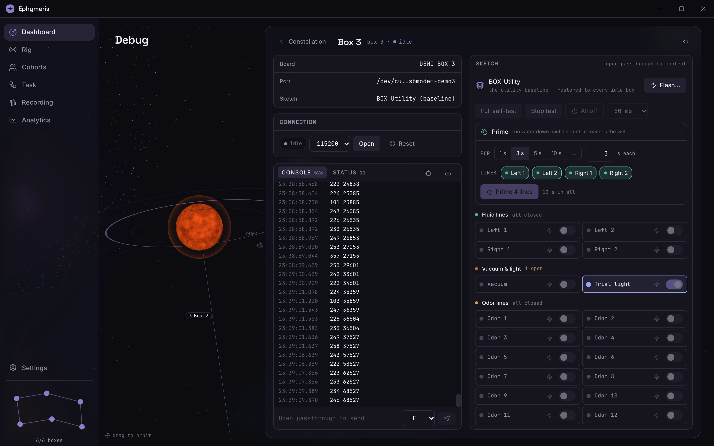

<a id="identify"></a>
**`identify`**, such as `{"on": "ON trial_light", "off": "OFF trial_light"}`, makes a box announce itself for `utility.identify` and the placement walk ([ARCHITECTURE.md](ARCHITECTURE.md#hardware-utility-baseline)). Both halves are required.

### Legacy names

`legacyNames` maps sketch names older software recorded, such as `"Shape - L"`, to this profile for the archive walk ([DATA.md](DATA.md#reading-the-archive)).

> [!CAUTION]
> **Declared, never inferred**: a guessed match decodes real data with the wrong map. Removing a sketch or an entry stops its archived runs decoding with only a warning; `tests/test_bundled_library_covers_archives.py` pins the lab's names.

### Trial types in the profile

`trialTypes` is a generated task's [trial types](#trial-types) in words, one entry per row of the table the board runs (`generate._trial_types`):

```jsonc
{"slot": 1, "name": "GR-Sandalwood", "onset": "ODOR_1_ON", "side": "right",
 "weightKey": "pool_weight_1", "rewardKey": "reward_time_1"}
```

- `slot` is the row's `TRIAL_TYPE_<n>` ([stream grammar](#stream-grammar)), so a row the generator drops has no entry.
- `side` is `left`, `right` or `no_go`, the trial header's words. A no-go row has no `rewardKey`.
- `weightKey` and `rewardKey` are the `metadataKey`s of the row's pool weight and reward.
- A run's [odors table](DATA.md#the-odors-table) is built from it, because the live metrics score `CORRECT` and so name no well.
- **Left out of `profile_hash`**, as `exposed` is: it restates the task and must split no history. A profile without it still parses.

## Task definitions

A **definition** is the operator's document, `<data_dir>/tasks/<id>.json`. From it and the wiring, `taskdef/` generates the sketch folder `<data_dir>/tasks/<category>/<name>/`, rewritten whole. Commands are in [PROTOCOL.md](PROTOCOL.md#task-profiles).

### What a definition holds

`taskdef/model.py`: `trials[]` (each row's odor, response and reward channels, onset strobe from its [line](#onset-codes), `rewardTime`, `weight` and required `label`), `selectionMode`, `stages[]` (the ramp), `params{}`, `exposed[]`, and `id`, `name`, `category`, `legacyNames`, `notes`. It stores **channel and code names, never pins or numbers**; `category` and `name` must be Windows-safe folder names. Reward volume and weight live on the row only. A stored definition with a `spine` key does not parse: it is listed as unreadable, and an [export](#moving-a-task-between-machines) carrying one is refused on import.

> [!CAUTION]
> **`params` holds only divergences from `taskdef/fields.py`'s defaults**, so catalogue fixes reach saved tasks. `fields.py` mirrors `TASK_PARAM_LIST` unenforced: a key the firmware does not parse is silently ignored.

### Diagnostics

`taskdef/validate.py` reports every problem through `tasks.preview`, and `tasks.get` recomputes them, since a rewiring can break a saved task. Diagnostics never block a save or a flash. `TSK101` to `TSK115` cover missing or wrong-kind channels, unknown codes, an unascending ramp, no presentable trial, unnamed conditions and an unscored onset (`TSK112`).

> [!CAUTION]
> **Five produce plausible wrong data, not a failure:** `TSK103` (a reward line serving the other well), `TSK105` (two trial types on one odor line), `TSK109` (all weights zero: a silent uniform draw), `TSK113` (a go condition paying 0 ms) and `TSK114` (an onset code not its line's).

### The rig definition

The [rig definition](../GLOSSARY.md#rig-definition) is the wiring plus the vocabulary in force (`rig/definition.py`, read through `registry.channels()` and `vocabulary()`). Saved tasks are regenerated on save, at every start, and after every wiring or vocabulary edit:

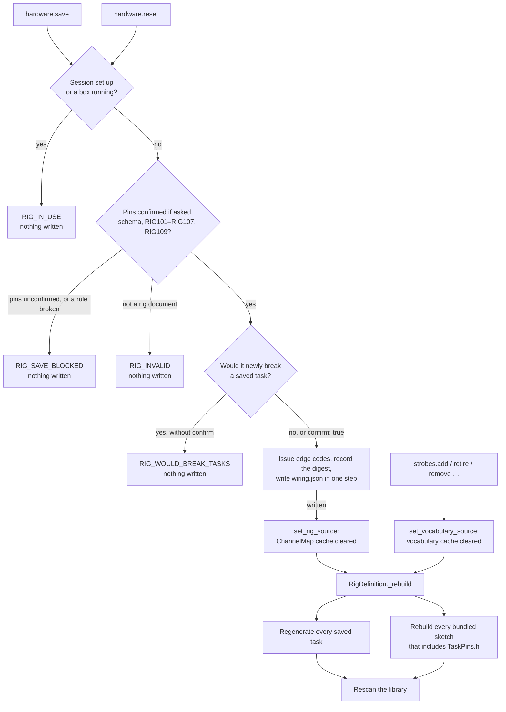

> [!CAUTION]
> **A wiring or vocabulary change must rebuild every saved task AND every bundled sketch** through the one call site `RigDefinition._rebuild`: a stale folder still runs, with the wrong pins or codes.

A preview judges a hypothetical held in a `ContextVar`, `registry.hypothetical` ([ADR 0001](adr/DECISIONS.md#0001-a-hypothetical-rig-definition-is-context-local)). Every write holds `RigDefinition.writing()`; anything using a generated folder (a flash, a start, mapping) holds `reading()`. No write runs while a session is set up or a box runs (`RIG_IN_USE`).

> [!CAUTION]
> **Never preview with `set_rig_source`, `set_vocabulary_source` or a plain thread, never use a generated folder outside `reading()`, and never take either lock inside a write.** The first compiles previewed pins, the second races a rebuild, the third is refused.

### Rebuilt bundled sketches

`taskdef/bundled.py` rebuilds each bundled sketch that includes `TaskPins.h` into `<data_dir>/rig/sketches/` with this rig's pins and codes. If that fails, the bundled one stands and refuses to compile.

### The box utility

`BOX_Utility` is every idle box's firmware and Debug Mode's panel: it switches and pulses outputs, primes lines and runs a self-test. Its logic is `BoxUtility.h`; what the box *is* is generated from the [channel set](#the-channel-set-and-the-pin-map) by `taskdef/utility.py`, so a new channel appears in Debug Mode at once.

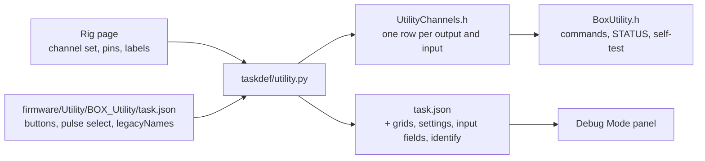

Each output but the sync line becomes a grid row named by its channel (`PULSE fluid_2`); each input a STATUS key and self-test step; the first `cue`-role level line `identify`. A [driven output](#driven-outputs) also gets a `DUTY` or `HZ` setting, which the board holds and reports.

> [!CAUTION]
> **Nothing the utility prints may keep an output on past its time**: a blocking print would lengthen a `PULSE` and miscalibrate reward volume, so all output goes through the non-blocking `say()`.

> [!CAUTION]
> **Nothing in the utility may name a channel**, or a rewired box drives the right pin under the wrong name; `test_box_utility.py` enforces it.

### Order is meaning

- **Odor index**: `Odors[i]` is odor line i+1 in declaration order. Use `ChannelMap.declared_of_kind()`, never `of_kind()` (pin order), or the wrong valve opens while every trial looks correct.
- **Trial-table slot**: slot i is `kTrials[i]`, `PW<i+1>` and `RW<i+1>`, so reordering rows re-weights and re-pays every condition.

### Moving a task between machines

**Export** a task from its Task landing row and **Import task** on the other machine (`taskdef/transfer.py`). The file carries the definition verbatim, the channels it names and the numbers of the codes it strobes. **The import judges only those, never changes the channel set or vocabulary, and refuses whole on any conflict**: a channel missing, different or reordered, a code numbered otherwise, or a taken name. Replacing a same-id task needs `confirm`.

## Rig wiring

The rig's description of itself (`rig/`, `hardware/`; [PROTOCOL.md](PROTOCOL.md#rig-wiring)). Box↔board bindings are separate ([ARCHITECTURE.md](ARCHITECTURE.md#boxes-and-boards)).

### The channel set and the pin map

The shipped `rig/schema/channels.v1.json` and `rig/hardware/<pinout>.json` say what each channel means and where it is. An operator's `<data_dir>/hardware/wiring.json` **replaces** both with two documents in one file: the **channel set** (what each channel is, meant to match across machines) and the **pin map**.

Kinds are `engagement` (exactly one), `response`, `emitter`, `reward`, `cue`, `vacuum` and `sync` (at most one). A channel also declares `type`, `mode`, `role`, an input's `active_level` and `debounce_ms`, a reward line's `serves`, and its [edge codes](#edge-codes).

> [!CAUTION]
> **Stored wiring runs only if it loads and was saved or confirmed on this machine**: torn or copied wiring could record every poke under the wrong port's codes. A save writes the file atomically and records its digest, declaration order included, in `<data_dir>/wiring-confirmed.json`; only a machine's first start seeds that record ([machine marks](DATA.md#machine-marks)). Other stored wiring is **[held](../GLOSSARY.md#held-wiring)** until the operator confirms its pins (RIG108). Meanwhile the shipped pinout is in force and starts and flashes refuse with `RIG_WIRING_UNLOADED` ([ARCHITECTURE.md](ARCHITECTURE.md#unloaded-wiring-holds-it)).

### Registry rules

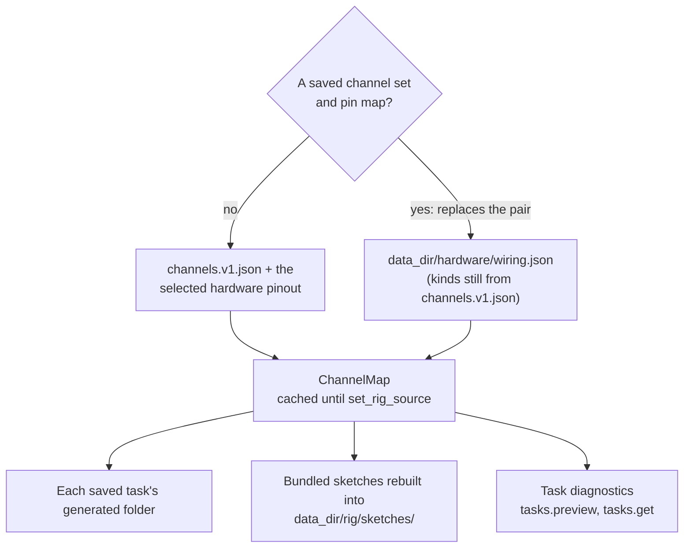

- **`channels()` is cleared only by `set_rig_source`**, never on `settings.push`, which fires on every reconnect.
- **`default_document()` reads the shipped pair**, never the wiring in force, or Reset resets to itself.
- **`ChannelMap.content_hash()`** covers only what changes a compiled byte.
- **`ChannelSet.content_hash()`** covers what each channel is and **its declaration order**, never pins, so two machines can compare.

### The wiring page

`/config/wiring` (`features/hardware/RigWiring.tsx`) edits the wiring. `hardware.preview` returns the codes a save would issue and the saved tasks it would newly break; saving a break needs `confirm`.


*Odor pins are not in line order, so the [odor index](#order-is-meaning) comes from declaration order.*

### Wiring rules

A well-formed document describing an impossible box returns located problems; `RIG_INVALID` is for a non-document. `RIG101`: the halves disagree. `RIG102`: a missing pin, or serial pin 0 or 1. `RIG103`: a shared pin. `RIG104`: a port with no slot. `RIG105`: two sync channels. `RIG106`: a bad [onset code](#onset-codes). `RIG107`: a contradictory type, mode or edge code. `RIG108`: unconfirmed held pins. `RIG109`: a [driven output](#driven-outputs) the board cannot run. `BOX_PIN_SYNC_OUT` is always emitted, `-1` without a sync channel, so no default pin pulses unannounced.

### Driven outputs

A channel's `type` is `digital_in`, `digital_out`, `pwm_out` or `tone_out`; a `digital_out` is a level line, or a pulse train with `mode: "train"`, whose edges are `train_on` and `train_off`. A PWM line, a tone and a train are **driven outputs**, allowed on a `cue`-kind channel only. RIG107 keeps one off every pin the trial runner switches as a level line (`registry.LEVEL_LINES`), where it would hold a train's laser on or put DC on a speaker; RIG109 needs a timer pin for PWM, allows one `tone_out`, and keeps PWM off Timer2 beside it. [BOX_Utility](#the-box-utility) tests each: `DUTY` sets a PWM line's duty, `HZ` a tone's pitch or a test train's rate (5 ms pulses).

### Moving the channel set between machines

Both machines must share one channel set and emit identical codes. **Export** and **Import channel set** on the Wiring page (`rig/transfer.py`) move the channel set and whole vocabulary, never pins. The import keeps every pin, merges the vocabulary and **refuses whole on any conflict**: a vocabulary clash, a channel on one side only, a reordered channel, a broken [wiring rule](#wiring-rules) or a hash mismatch. It writes new codes, then `wiring.json`, then retirements.

> [!WARNING]
> **Never retire before the wiring lands**: a failed write would leave the wiring naming a retired code, failing RIG107 at restart.

#### Adding a channel lab-wide

A channel the file has and this rig lacks needs a pin picked on import, from the plan's `freePins`. Removing a channel lab-wide is not covered.

## Strobe vocabulary

Each machine's `<data_dir>/strobes/vocabulary.json` is **the only place a strobe code is defined**: `TaskPins.h` defines `BF_<NAME>` for every live code, and the page is `/task/strobes`. The first start seeds it from `rig/schema/strobe_vocab.default.json`; later starts only add codes a newer build declares. There is no reset.


### Append only

> [!CAUTION]
> **A code is never renumbered or repurposed, and a name is never reissued with another number**: either would silently merge two event types across recorded data.

A **retired** code (its emitter gone, but recorded) stays reserved and undefined, so firmware emitting it fails to compile. A code can be removed only if no recorded session ever contained it.

### Editing the vocabulary

Every edit is a `strobes.*` command (`strobes/store.py`), refused while a session runs. **Add** needs an unused name and a free number; **Retire** needs `confirm` when a task names it; **Remove** refuses any code a recorded session contains. **Import** is a union, and any name/number conflict refuses it whole.

> [!WARNING]
> **The usage scan sees only this machine.** If a code may have been recorded elsewhere, retire it.

### Onset codes

**An odor line declares its onset code** by name (`onset_strobe: "ODOR_3_ON"`), never derived from its name or position. The editor fills a row's code from its line, so a line carries one trial type; a stored row disagreeing with its line is `TSK114`. A response port declares a `port_slot`, which the vocabulary's `port_slots` maps to its `_L` or `_R` codes.

> [!CAUTION]
> **When `TSK114` appears on a task the lab has run, fix the wiring, not the task**, or that bottle's future sessions split from its archive.

### Edge codes

**Every edge of every channel names its code** (`edges: {"on": "FLUID_2_ON", "off": "FLUID_2_OFF"}`). A save issues `<CHANNEL>_<EDGE>` at the lowest free number for each edge without one (`rig/allocation.py`). Renaming a channel never renames its codes, and a restored channel reuses its own.

## The START line

### Three layer merge

A profile default (`task.json`) yields to the rig default (`settings.taskDefaults`), which yields to the per-box override from the mapping step.

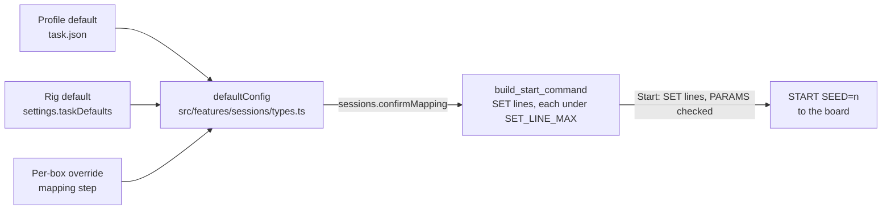

`defaultConfig` **iterates the profile's fields**, so a stale value cannot reach the wire. The mapping step stores only the keys the operator edited.

> [!CAUTION]
> **Never seed a row with the merged config, or detect overrides by comparing against it**: a profile regenerated mid-setup would send its old default as an override nobody chose.

### Building the line

`build_start_command` (`tasks/start_command.py`) renders `<wireKey>=<value>` tokens in `config` order and packs them into `SET` lines. A value the board would not read exactly fails the mapping, and **nothing is swapped for the default**.

### Confirming the parameters

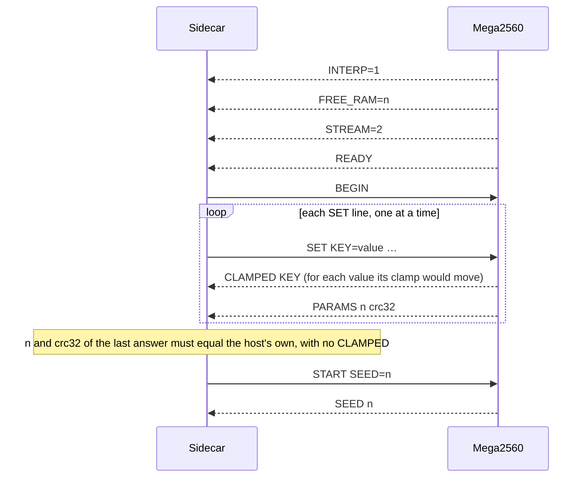

The host sends each `SET` line alone (the Mega's buffer is 64 bytes). `PARAMS <n> <crc32>` counts and hashes (`zlib.crc32`) the tokens exactly as received; `CLAMPED <key>` flags a value the board would clamp or could not parse exactly. `START` goes only on a match with nothing clamped; otherwise the start fails as `PARAMS_MISMATCH`, `PARAMS_CLAMPED` or `FIRMWARE_OUTDATED` (no reply: reflash). The announcements are recorded in the run header ([DATA.md](DATA.md#the-tsv-log)).

> [!CAUTION]
> **A bare `START` still starts a board**, on compiled-in defaults, unconfirmed. The app never sends one unconfirmed.

### The length cap

> [!CAUTION]
> **`SET_LINE_MAX` lives in both `tasks/start_command.py` and `BehaviorBox.h`**; `tasks/tests/test_start_command.py` fails if they differ, since the board truncates silently.

Only a single token too long for a line refuses the mapping (`TASK_PROFILE_INVALID`).

### SEED

`SEED` is reserved. The host draws it from the OS CSPRNG when the operator starts **that box** (`tasks/seed.py`), because a freshly reset Mega has almost no entropy. It is recorded as `host_seed` and the board's echo as `trial_seed`.

## Profile and params hashes

Both are truncated SHA-256 over canonical JSON (`tasks/profile.py`). `profile_hash` covers the serialized profile but not `strobes` or `exposed`; `params_hash` covers one run's merged values.

> [!IMPORTANT]
> **Analytics compares runs by `(profile_hash, params_hash)`.**

**Anything in `to_json` moves `profile_hash`** and permanently splits a task's runs: hence the derived diagram and no casual re-filing of `group` in `fields.py`. `to_json` must round-trip through `parse_profile` byte for byte ([DATA.md](DATA.md#per-animal-files)).

## Derived state machine

The Task tab and Mission Control draw a task's state machine **derived from its profile** (`src/features/tasks/topology.ts`; [ARCHITECTURE.md](ARCHITECTURE.md#live-session-views)). Every sketch shares `runTrial()`, so only which branches exist differs, and the declared names say which.

> [!IMPORTANT]
> **A declared code is not a presented condition.** Conditions and the Withheld outcome are drawn only when a `liveMetrics` entry **scores** them.

The bundled GRGL profile (dashed nodes are aborts):

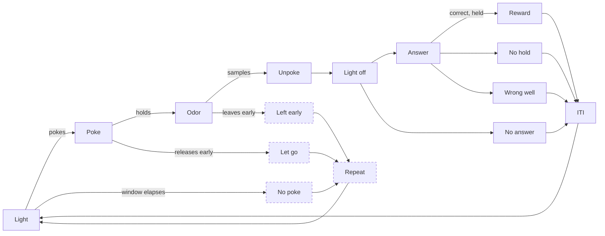

### One condition node

Congruent conditions draw as one node with `variants`; a go/no-go mix falls back to a fan.

> [!CAUTION]
> **`correctWellOf` returns `null` when it cannot prove an answer, and `liveConditionId` never falls back to `conditions[0]`**: either fallback draws a confident wrong condition.

### Live token

`liveNodeId` puts the token on the node whose `entryNames` hold the newest strobe, reading abort and footer codes in their trial's context.


### Layout

> [!CAUTION]
> **Row placement is measured in the renderer (`graphLayout.ts`), never computed in the model**, because the chip count differs by host.

## The Task tab

The Task tab answers *what the animal does*; the Rig tab, *what this box is*.

### Landing

`/task` lists saved tasks with open, **Duplicate**, delete and create. Duplicate **drops `legacyNames`**, which must resolve to one sketch.

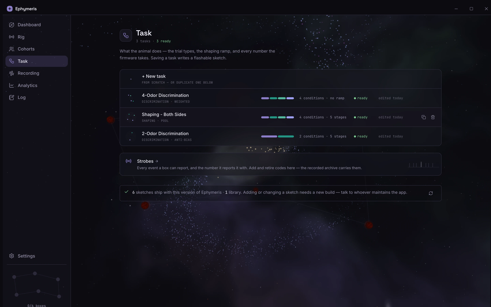

### Editor

`/task/:taskId` shows the derived state machine, trial types, parameters and trial generation in one frame. **Every redraw comes from `tasks.preview`**, since validation needs the wiring.


### Trial types

One row per condition: name, odor line (with its onset code), answer port, reward line, reward, weight. Row order is the [contract](#order-is-meaning), so rows cannot be dragged. Each row spells its contingency in the rig's labels, which catches `TSK103` by eye.

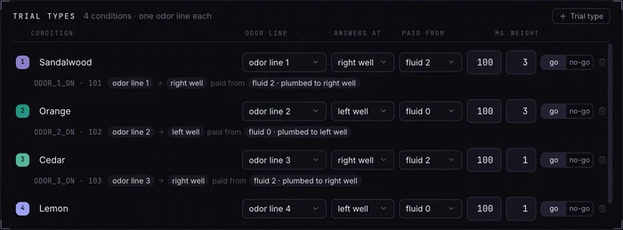

### Trial generation

Picks the [selection mode](#selection-modes) and shows the session it would deal.

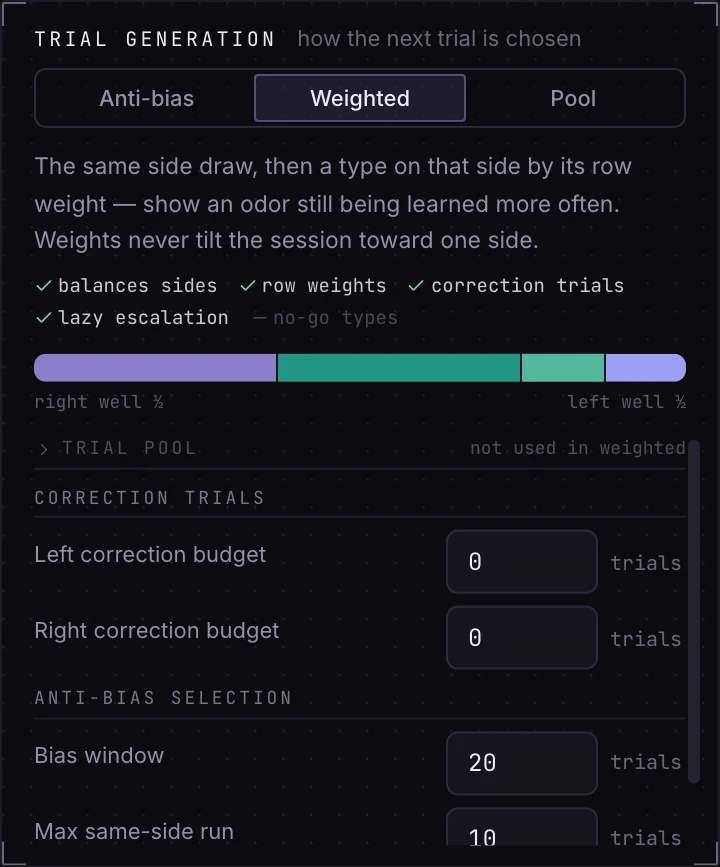

### Parameters

Shows the ramp and only the parameters the task **exposes**; the Start dialog offers the same ones.

> [!IMPORTANT]
> **Exposure and grouping are presentation**: hidden parameters are still sent at their defaults, and neither changes `profile_hash`.

## Simulating a task

**Simulate**, beside **Design** in the editor's header, runs the working definition off the rig (`tasks.simulate`, `simulation/`). Nothing is flashed, recorded or written, and it is refused while a box runs.

> [!IMPORTANT]
> **The firmware runs the task, not a model of it** ([decision 0012](adr/DECISIONS.md#0012-the-firmware-itself-simulates-a-task)). `simulation/host/tasksim.cpp` is `GRGL.ino` and `BehaviorBox.h` compiled for this computer, one executable per [selection mode](#selection-modes), with the board's random generator. The sidecar starts it as it starts a board: the task's `SET` lines, the `PARAMS` check, `START SEED=<n>`, and `STOP` at the time limit.

Its clock moves only when the firmware waits, so a session takes milliseconds. Its strobes go through the run's own scorer ([ANALYTICS.md](../sidecar/ephymeris_sidecar/analytics/ANALYTICS.md#start-here)).

> [!CAUTION]
> **Timestamps are ideal**: no serial or sync-pulse time is spent. Anti-bias draws compare floats, which the host rounds as an AVR may not; neither has been compared with a board.

### The simulated animal

It senses only the trial light, the odor and water, and answers only by breaking beams (`simulation/animal.py`). It reads no strobe and no parameter, so a hold longer than it manages fails as it would in a box. Its randomness is its own, seeded by the trial seed: one seed repeats a session, and the board's draws never depend on the animal.

### Playing a simulation back

A simulation arrives whole and the view cuts it at a playhead (`src/features/simulation/playback.ts`): the [live token](#live-token), the live metrics a running box would have reported at that strobe, the share of trials through each node, and a timeline of one tick per trial with a mark where each ramp row took over.

### The stress test

`tasks.stressTest` runs each preset animal over the same seeds. An animal that ignores the odor yet earns half a trained one's rewards is flagged.

## Writing a new sketch

For a firmware author bundling a sketch with a hand-written profile:

1. Write `<Category>/<Name>/<Name>.ino` in `firmware/`, including `TaskPins.h` before `<BehaviorBox.h>`.
2. Start the profile from `{ "taskName": "My Task" }`.
3. Emit only codes the vocabulary holds; add new ones on the Strobes page first.
4. Declare every tunable in `config`, ramped values per stage, and one `liveMetrics` entry per presented condition.
5. Restart the app, pick the sketch on a mapping step, run the profile tests and the [host tests](#compiling-and-the-host-tests), then flash a box and watch the live token.

### What raises

A broken profile raises `TaskProfileError`, surfaced as `TASK_PROFILE_INVALID` ([PROTOCOL.md](PROTOCOL.md#error-codes)). At mapping a profile that fails to parse is treated as profile-less; only a token too long for a `SET` line refuses ([the length cap](#the-length-cap)).
