# Ephymeris user guide

For the people who run daily behaviour sessions: what to click, what the screen means, and what never to
do. **Bold** words are on-screen labels; terms are in the [Glossary](#glossary). Screenshots come from a
demo rig (cohort *Odor Discrimination 2026*, animals `remy1` to `remy12`).

## Contents

[Before you start](#before-you-start) · [A tour of the app](#a-tour-of-the-app) ·
[Editing a task](#editing-a-task) · [Setting up a cohort](#setting-up-a-cohort) ·
[Running a session](#running-a-session) · [During a session](#during-a-session) ·
[Recording with Intan](#recording-with-intan) · [Checking a box](#checking-a-box) ·
[Looking at results](#looking-at-results) · [Keeping the log](#keeping-the-log) ·
[Updating Ephymeris](#updating-ephymeris) · [Troubleshooting](#troubleshooting) ·
[Rules that protect the data](#rules-that-protect-the-data) · [Glossary](#glossary)

## Before you start

Ephymeris loads each box's task program, starts the boxes, shows live progress, and saves every event to
a file per animal as it happens. The rig has up to six boxes, numbered 1 to 6, each with an Arduino board
on USB; one animal goes in one box. A **session** is one sitting at the rig, named by a **prefix** (the
task's short name, such as `2O-Bdisc`) and a number.

Before your first session, check that:

1. **A cohort exists**, with its animals ([Setting up a cohort](#setting-up-a-cohort)).
2. **The boxes are bound**: on the **Rig** tab each box is linked to its board (usually done once by the
   lab manager).
3. **A task is saved** on the **Task** tab.

## A tour of the app

The sidebar's star figure has one star per box: lit when the board is connected, dim when missing, green
while the box runs (or you are placing an animal in it), red on a fault.

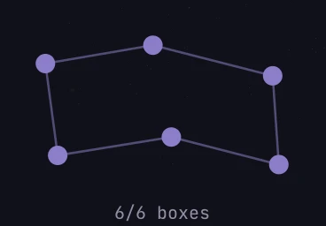

**Dashboard.** **Start a Session** (**Resume Session** while one runs), **Start a Recording**, and the
dock (a running session, a set-up left half-done, a session that ended unexpectedly). **Boxes**, on the
right, lists each box's port and resting program; click a row or star to open the box
([Checking a box](#checking-a-box)), or **Command all boxes** for the whole rig
([Commanding every box](#commanding-every-box)). The **Observatory** lists cohorts and recent sessions.

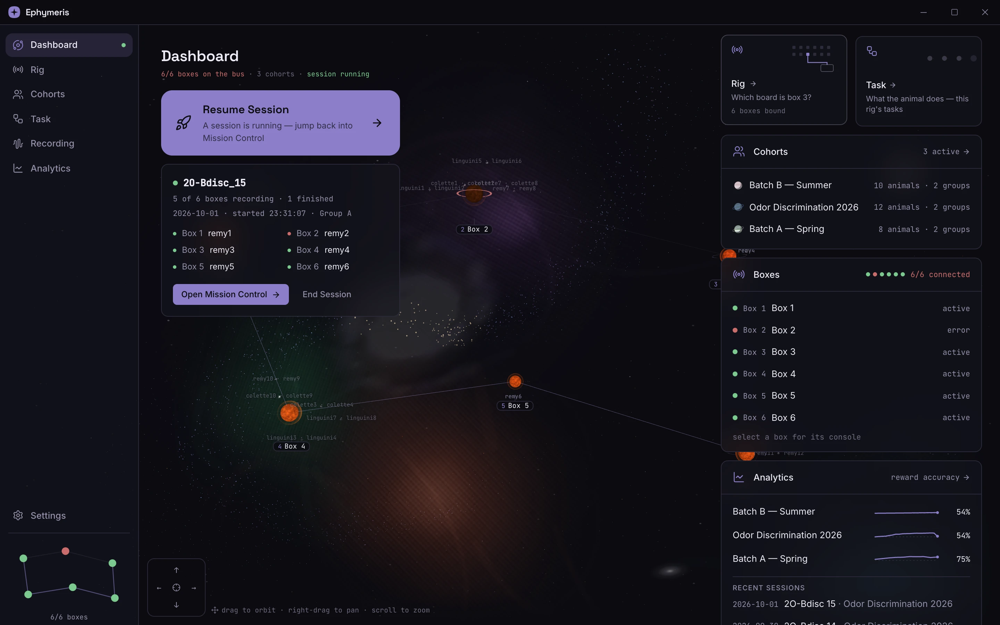

**Rig.** The **Boxes** table gives each box's bound board, **Handshake** and **Test**. **Constellation**
sets how boxes are drawn (drag a box to another star). **Utility baseline** shows a **Ready** chip per box.

**Rig → Wiring** says which pin each channel is on. **Export channel set** and **Import channel set** keep
the two lab computers recording the same events under the same codes; pins stay each computer's own. With
both computers on the same Ephymeris version, export where the channels changed and import on the other:
pick this computer's pin for each channel the other added. Any other disagreement is refused with a list
of differences to fix.

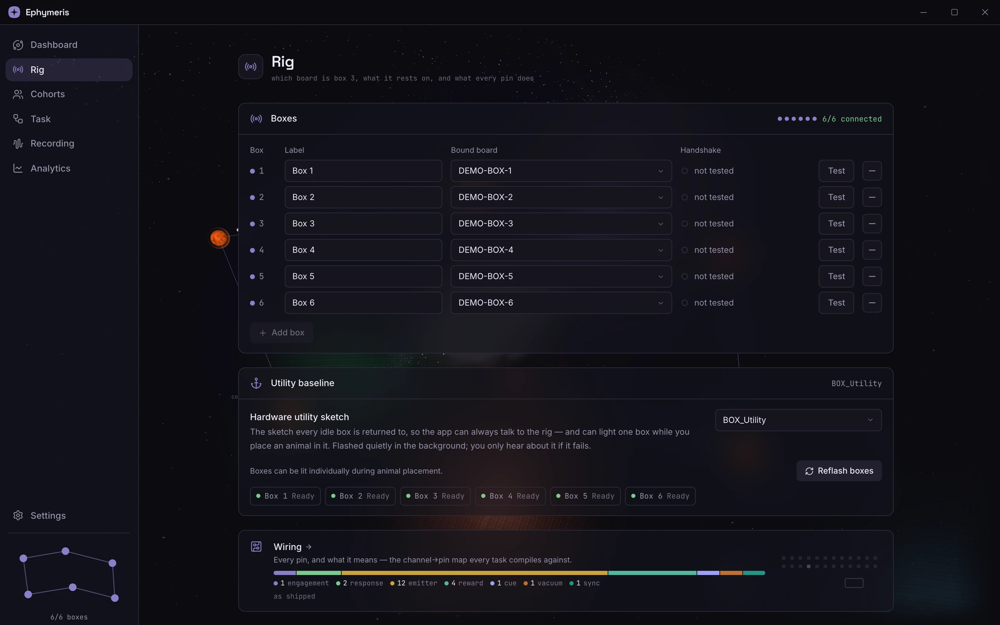

**Cohorts.** Cohorts drawn as planets; click one, or **New cohort**. **Search…** and **Show archived** sit
at the top left.

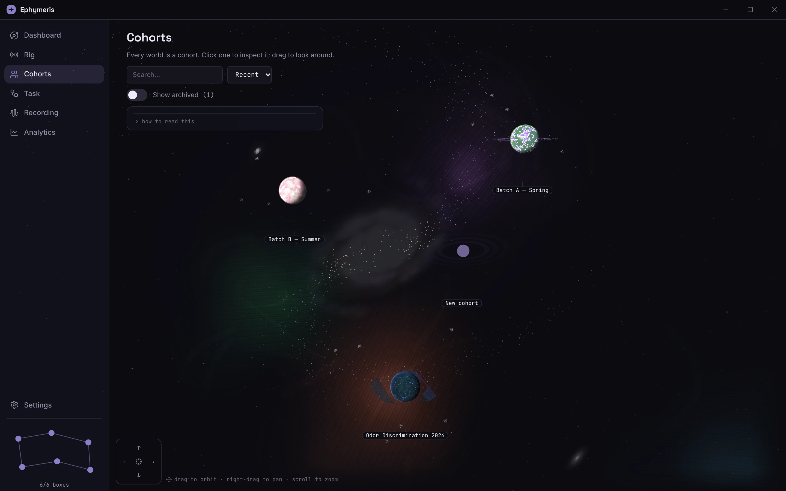

**Task**, **Recording**, **Analytics** and **Log** have their own sections below. **Settings** holds the
**Data directory**, **Backup directory** (warned while unset), **Reduce motion** and **Updates**.

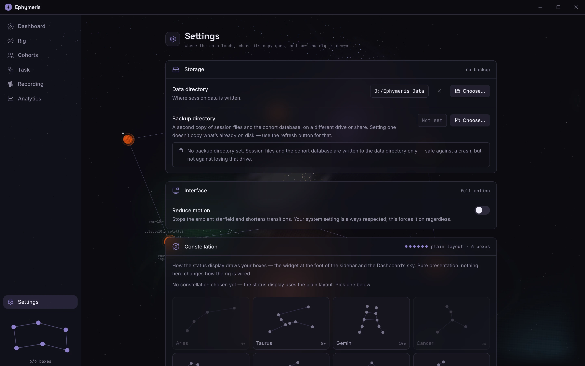

## Editing a task

Usually the lab manager's job. The Task tab lists each saved task and whether it is **ready**; an
unreadable one is listed in red with the reason. Saving builds the sketch a box runs
([TASKS.md](TASKS.md#task-definitions)).

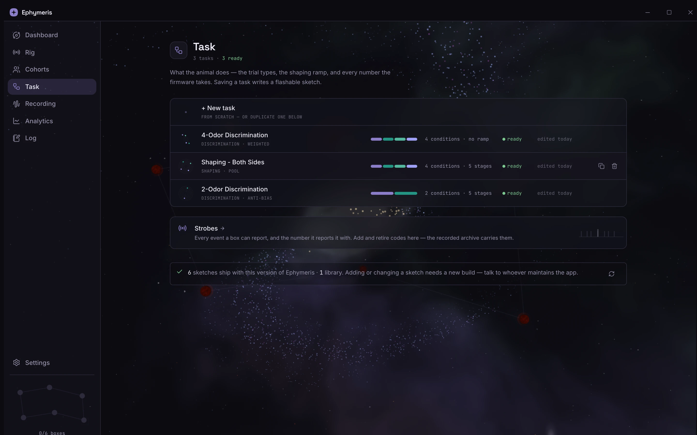

**To the other computer.** Move the channel set first (Rig → Wiring), then **Export** on the task's row and
**Import task** there. The import writes nothing if a channel the task uses is missing, different or in
another order, a code has a different number, or the name is taken; the dialog lists every difference.

**A new task.** **+ New task** starts from a **seed** (2AFC, go/no-go, DNMS, trace, FR/PR):

1. Name each trial type.
2. Pick the channel for each **role** (port, sample, wells, reward line…); **Bind like …** copies the
   previous trial type's choices.
3. Change whatever else differs from the seed.

**New to this? Build a first task step by step** walks through it in eight parts.

**The spine editor** (a task built from a seed):

| Part | What you set |
|---|---|
| **Trial** | The steps, left to right. Click one for **what it does**, **what ends it early**, and the **penalty** after an early end (a wait in place of the ITI). **Add…** / × add and remove settings; **+** / **Remove step** add and remove steps. Inputs are recorded only in steps that list them under **Recorded here** |
| **RAM** | The task's share of the box's 5000 bytes. Red: the box cannot run it |
| **Trial types** | **Wiring** sets each shared role once (**differs here** makes it per row). Each row has a name, reward time, and every answer as an editable sentence |
| **Session** | **One block**, **Reversal**, **Two blocks that alternate** or **Custom**; click a block for its trial types, draw and end. Also **Session cap** and **aborted trials repeat, uncounted** |
| **Simulate** | A whole session against a pretend animal; nothing saved or flashed. The **Seed** reruns it |

Where an outcome is not what it sounds like, its sentence says so: **withheld** counts as a hit, an
**abort** is left out of the share correct, and a trial type that asks nothing (a CS−) is correct on
every trial. Problems show where they are, with a one-click fix where there is one; **Problems** at the
top lists them.
A **Stored** value from an older copy wins until **Use the value here**.

**The odor-table editor** (older tasks): one row per condition with its **odor line**; **Trial generation**
is **Anti-bias**, **Weighted** or **Pool** (the only one with no-go trials); **Add parameter** offers a
setting at session start. It saves even with problems.

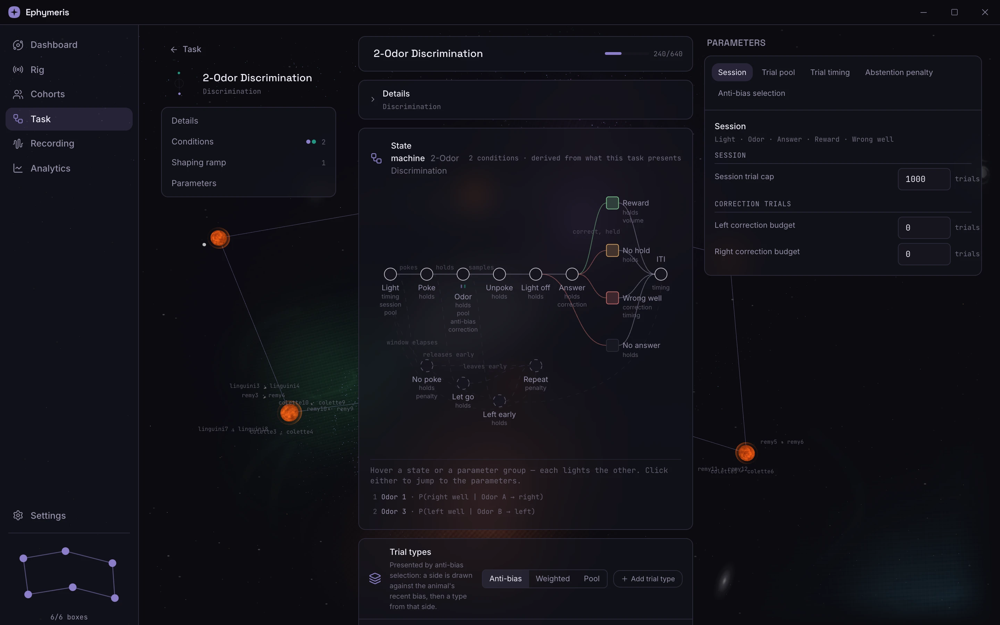

**Strobes.** The **Strobes** tile lists every event code; click one for its meaning and users.
**Add code** takes a free number, the event's for good once recorded; **Retire** keeps it reserved;
**Remove** works only for a code no session on this computer contains. **Export**/**Import** copy codes
to the other computer whenever one is added.

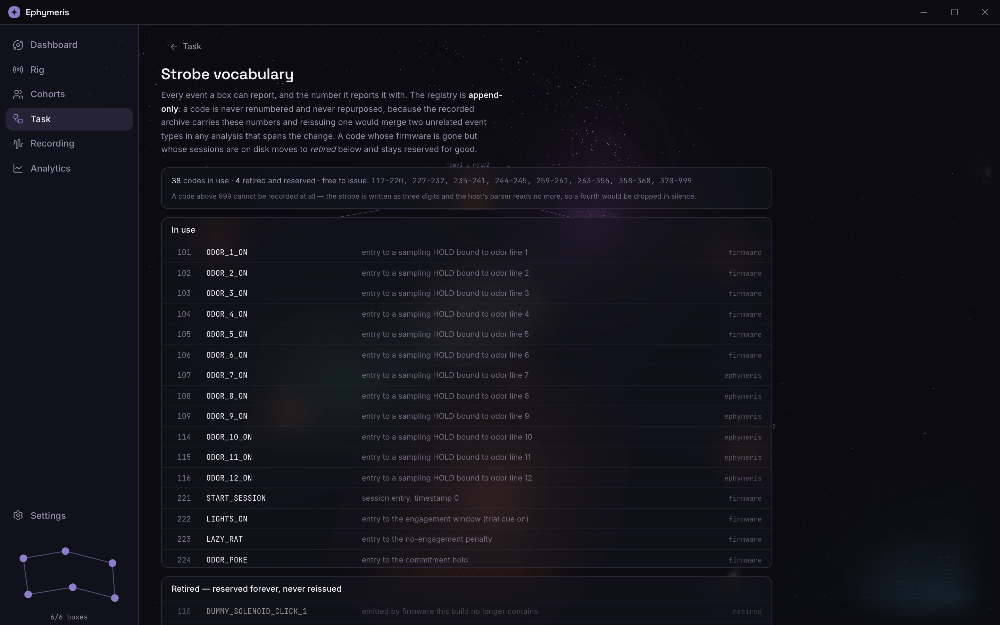

## Setting up a cohort

A **cohort** is a batch of animals trained together.

### Create a cohort

1. On **Cohorts**, click **New cohort** and type a unique **Name**. Its data folder is made in the **Data
   directory** (with none set, the page asks for a **Data folder**).
2. Add **Animals**: paste names (one per line) or type a pattern like `R- × 8` for `R-1` to `R-8`, then
   **Add**. **Sex**, **Usual box**, **ID number** and **Notes** are optional.

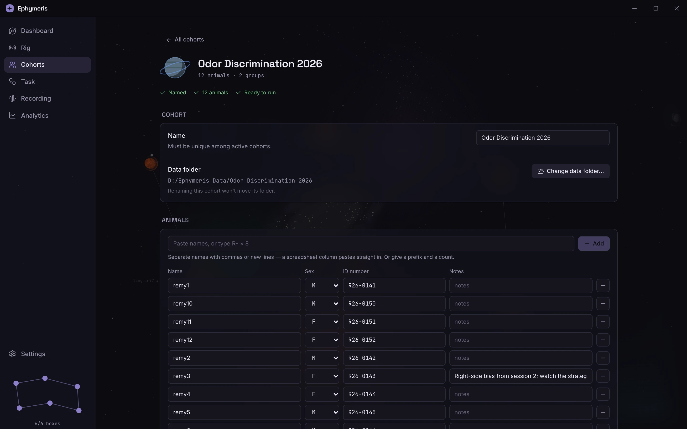

3. Optional: under **Cages & spaceships**, drag cagemates onto one spaceship per home cage.

4. Click **Create cohort** (later, **Save changes**). An unfinished cohort can be saved; the ticks at the
   top show what is missing.

### Usual boxes

An animal's **Usual box** is the box session set-up offers first for it, and nothing more. Animals may
share one, and none is required: which animals run together, and in which boxes, is chosen each time you
set up a [round](#boxes). Only boxes this machine has are offered.

### Removing an animal

**−** on an animal's row removes it on **Save changes**. Its sessions stay: it is listed under **Former
members** and keeps its name in Analytics, the Log and the PDFs. **Restore** puts it back. A reused name
makes a different animal. To give its history to another cohort, [move it](#moving-animals-to-another-cohort).

### Moving animals to another cohort

A move takes an animal's files, sessions and notes to another cohort, so its history continues there.

1. Create the destination cohort if needed.
2. In the **Animals** table, click **⇄** on the animal's row (or **Move history…** under **Former members**).
3. Choose the destination cohort, and check the preview.
4. Click **Move**.

A same-named animal in the destination receives the history. A session shared with animals that stay is
split, each cohort keeping its own runs. The move is refused while a session is running or being set up,
or if a different file of the same name is already there; an interrupted move is finished or undone at
the next start. To repair a split made by removing and re-adding animals, use **Move history…** on each
former member marked **found in files**.

> [!IMPORTANT]
> **Do the same move on the second lab machine before any Rescan there**, or the Rescan drops that
> machine's records. If it lacks the destination cohort, create it and point it at the same folder with
> **Change data folder…**, **Move existing contents** unticked.

### The data folder

Renaming a cohort does not move its folder. **Change data folder…** with **Move existing contents to the
new location** ticked moves the files into an empty folder, and Analytics and the Log follow; unticked, it
only points the cohort at a folder that already holds its data. It waits until no session of the cohort
is set up or running.

### Archive and delete

**Archive** hides a cohort and keeps everything; **Show archived** lists them with **Restore**. **Delete
permanently** (archived cohorts only) **never deletes the data folder**.

## Running a session

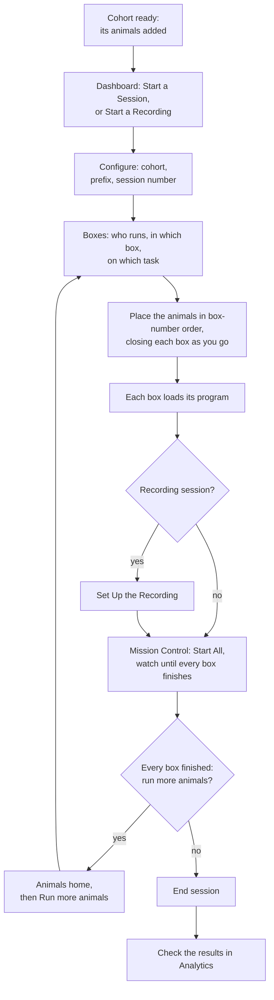

### Configure

1. On the Dashboard, click **Start a Session**.
2. Pick the **Cohort** from the list (**All cohorts** goes back to it). Deal with any note under **Before
   you start**, then **Resolve** it.
3. Pick the **Prefix** (or **Add a prefix**) and check the **Session number**.
4. Optional: a **Time limit** in minutes, counted from each box's own start.
5. Click **Continue**.

A warning that the number already has data today means you would write into the same folder; to run more
animals under today's session, [continue it](#continue-a-session-from-earlier-today) instead.

### Boxes

The Boxes step sets up one **round**: the animals that run together. It lists the rig's six boxes and opens
with each animal that has not run yet today on its usual box.

1. Under **Boxes**, pick the **animal** for each box. Any animal can take any box, for this round only:
   picking an animal that is in another box swaps the two, **— empty —** leaves a box out, and the line under
   the list names who is not running.
2. Pick each box's **task**, or one for all of them under **Every box on**.
3. Click a box to see its animal's parameters in the panel beside the list: **Quick tune** (the values
   usually changed per animal, per day), then **All parameters**. A box with changed values reads **tuned**.
   **Copy to other boxes** gives the same values to every other box on that task.

4. **Acknowledge** any box in error (it blocks the step).
5. Click **Place the animals** (or **They're already in — flash all** if the rig is loaded).

### Place the animals

1. The screen names one box at a time, **in box-number order**; where it can, that box lights up and its
   star turns green. Check the number on the box itself.
2. Put the named animal in and close the box.
3. Click **Enclosure closed**. The box loads its program while you fetch the next animal.
4. Repeat. **Skip this box** passes one; **All animals are in** finishes the walk.

> [!CAUTION]
> **An animal in the wrong box produces a normal-looking file under the wrong name, undetectable later.**
> Follow the box order; trust the number on the box over the light.

When every box has flashed, Mission Control opens (or **Set Up the Recording**,
[below](#recording-with-intan)). A box that fails to flash says why: **Acknowledge**, then **Retry flash**.

### Run

On **Mission Control**, click **Start All**, or **Start** on one box. If a box *has not been flashed* or
*carries* another program, nothing started: **Back to Boxes**, confirm the boxes again, then start.

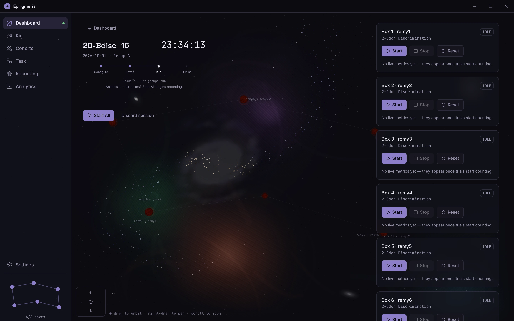

### When a round finishes

When every box has finished, a window asks what happens next.

1. Return each animal to its home cage and tick it (or **All animals are out**).
2. Click **Run more animals** to set up another round under this session, or **End session**. **Not yet**
   closes the window so you can restart a box first.
3. After **Run more animals**, the Boxes step opens with the animals that have not run yet. Running an animal
   again adds new files and overwrites nothing.

**Run more animals** in Mission Control's left column does the same at any time after a box has run.

### Ending the session

**End session** closes the session and opens Analytics on it. In the window, **For the log** takes the
operator, a summary and a last note ([Keeping the log](#keeping-the-log)).

**End Session** in Mission Control works at any time; before any box has run it reads **Discard
session**. Only ending finishes a session; running more animals never does.

> [!IMPORTANT]
> **End Session and Run more animals stop running boxes at once, cutting the current trial short.** For
> complete trials, **Stop** each box and wait for **Finished** first. Recording sessions wait by themselves.

### Leaving set-up and coming back

Leaving a set-up step loses nothing: the sidebar's **Dashboard** row reads **Resume ·** and returns you to
it (after a restart, the dock's **Set-up in progress**). **Cancel**, or **Back** on the first Boxes step,
throws it away.

### Continue a session from earlier today

To run more animals in the same session folder after the app closed or the session ended early: **Start
a Session**, pick the cohort and click **Continue** under **Continue today** (or **Run more animals** on a
dock card marked **Ended unexpectedly**). The Boxes step opens for the next round. Same day only; a round
cannot be resumed mid-run.

## During a session

The session keeps running if you leave Mission Control; **Resume Session** brings you back.

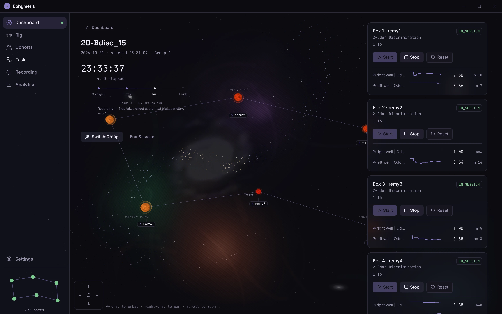

- **Start** resets the board, waits for it, then sends the task.
- **Stop** ends the box **at the end of the current trial**. Wait; do not click again or reset.
- **Reset** restarts a board that is not running, if it will not start.
- **Note** (or **n**) takes a timestamped note. **Resolve** a flag from the last session once dealt with.

### Reading a box tile

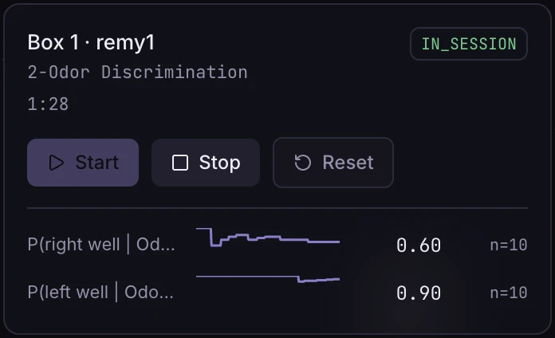

- **The clock** is time since *this* box started (`12:04 / 30:00` with a time limit). *time up* means it
  is finishing its last trial.
- **The state chip**: `IN_SESSION` (green) running, `IDLE` not, `FLASHING`/`RESETTING` brief, `ERROR`
  (red) a fault; hover for why.
- **Live metrics**: rolling accuracy per condition, counted as Analytics will.
- **Finished — …** gives why the run ended: *BF_END_SESSION received* is normal, *board disconnected*
  is [an error](#when-a-box-shows-error-or-a-board-disconnects).

### Reading a progress tab

Beside each tile, a tab shows how far the run has got. **Hide graphs** in the left column puts them away.

- **offered**, **completed** and **correct**: trials that began, those that ended in a scored answer, and
  those answered right (with their share of the completed). The figure at the top right is completed trials
  per minute.
- **The chart** draws completed (grey) and correct (green) against trials offered. The dashed diagonal is
  every trial completed and correct: grey falling below it is trials going unanswered, green falling below
  grey is wrong answers, and a flat stretch is an animal that has stopped working.
- **The bar** divides the trials offered into correct, wrong and no answer.

Click a tile or star for the box's panel (trial flow, outcome mix, recent strobes); Esc returns.
**Diverged** means the box did something its task does not do: everything is recorded but the run will not
be scored. Tell whoever looks after the rig.

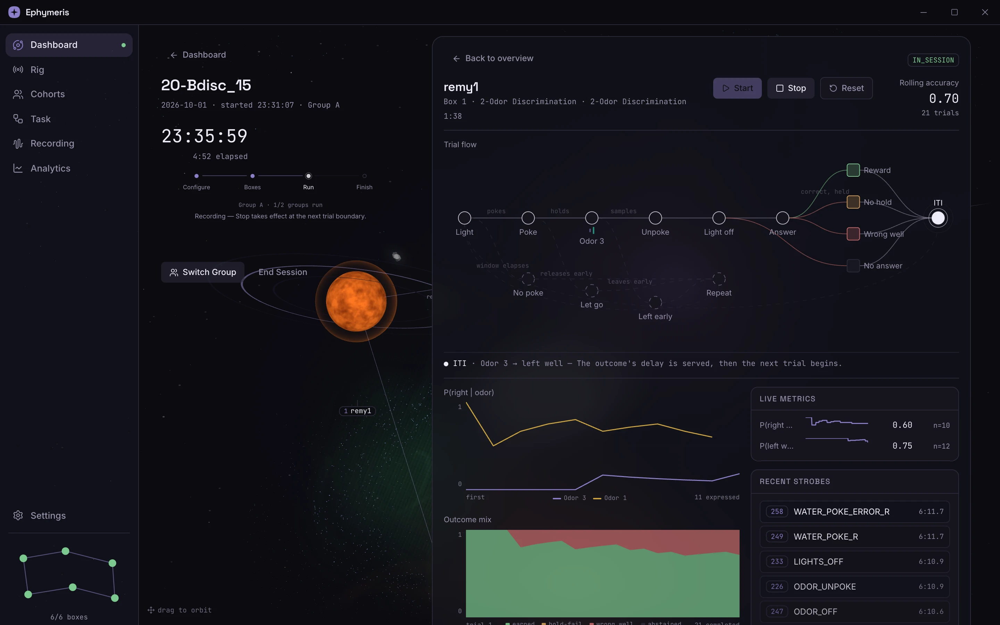

### When a box shows ERROR or a board disconnects

The box's run stops, its star turns red, and its tile says why. Everything recorded is safe; the other
boxes keep running.

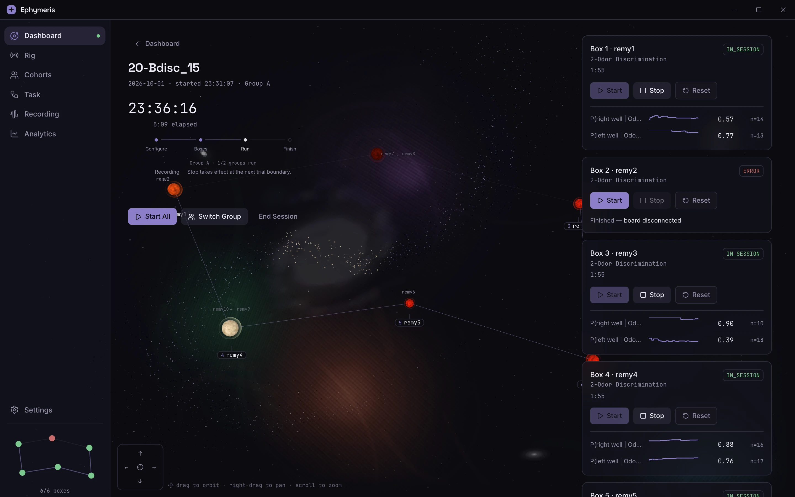

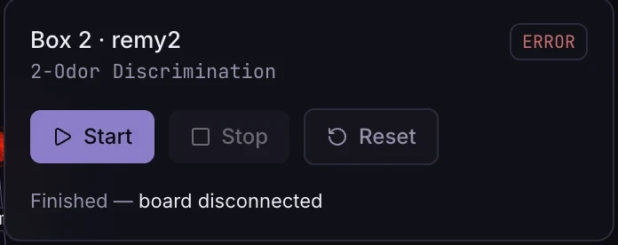

1. Write down the box, the animal and the time.
2. Check the USB cable and the board's lights.
3. On the **Dashboard**, click the box's star, then **Acknowledge** under **Connection**. **Reset** never
   clears an error.
4. Ask the lab manager before restarting that animal; **Start** begins a new file and keeps the old one.

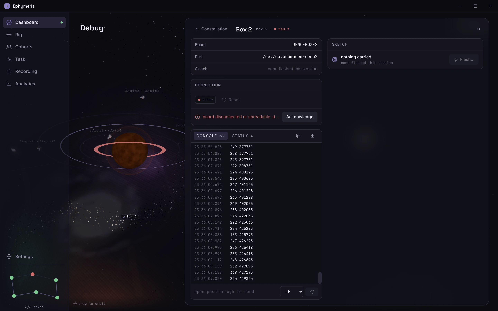

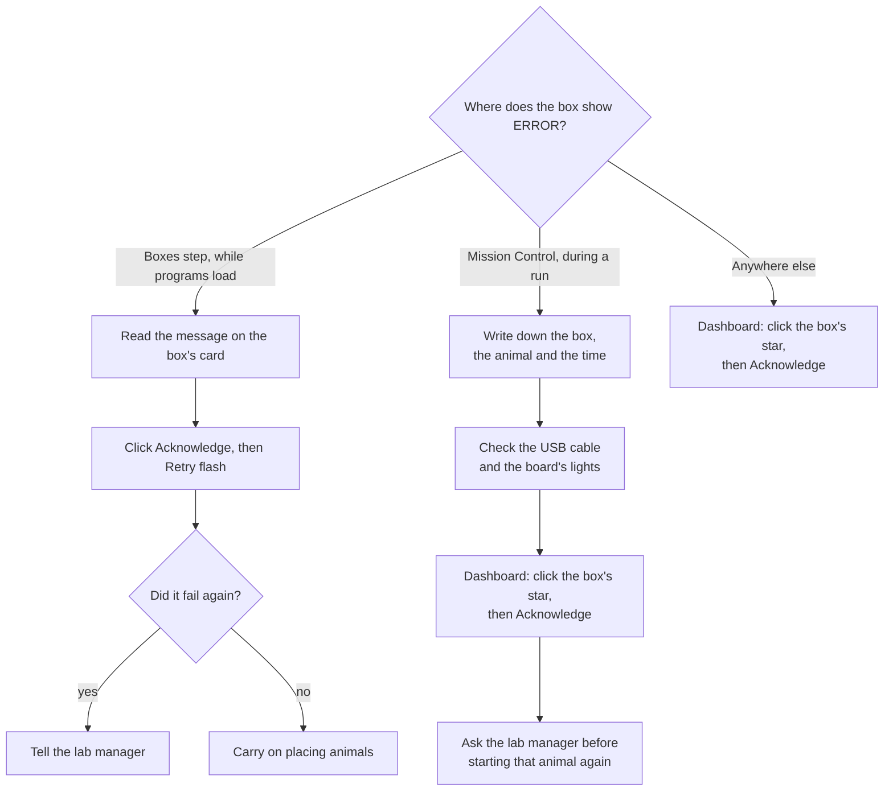

**Box N: session write failed** in red means **that box's data is not being saved** (usually a full or
disconnected drive): tell the lab manager at once. The **backup** pill never affects the session; if it
reads **failing**, or **deferred** for minutes, tell the lab manager afterwards.

## Recording with Intan

A recording session runs the behaviour and an Intan RHX recording together ([RECORDING.md](RECORDING.md)).

**Once, on the Recording tab** (usually the lab manager): **Connection**, with the **TCP ports** left at
RHX's defaults (5000–5002) unless changed in RHX; **Sync inputs**, the RHX **Digital input** each box's
sync cable plugs into (the rig's wiring needs a sync channel); and **Defaults** for saving and spike
thresholds.

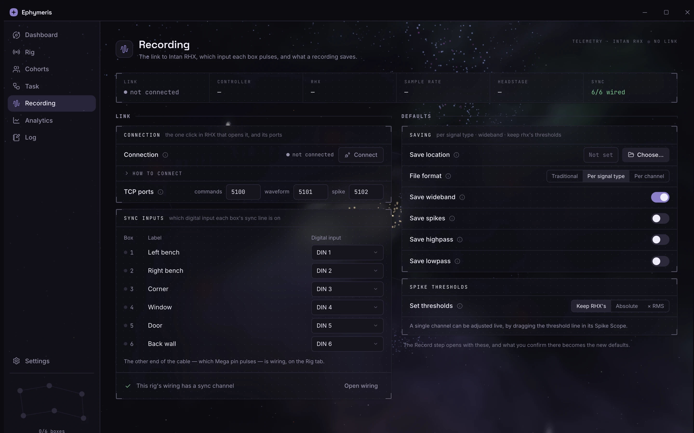

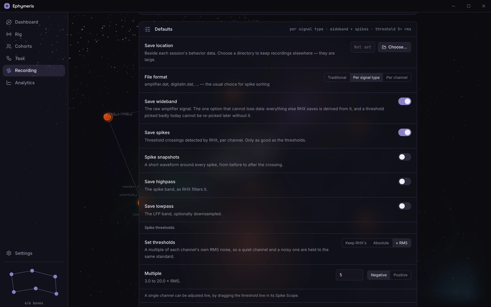

**Each recording session:**

1. In RHX, open **Network → Remote TCP Control** and press **Connect** on the **Commands** tab.
2. In Ephymeris, click **Connect** on the **Recording** tab. Repeat both whenever RHX disconnects.
3. On the Dashboard, click **Start a Recording**.
4. Configure and place the animals as usual. On **Set Up the Recording**, fix anything under
   **Readiness**, check **Saving** (a yellow line warns of a space in the path), and set each box to
   **Record** or **Behavior only** with its port, channels and optional probe map.
   The **Electrodes** tile shows each animal's **active sites** in its recent recordings (e.g.
   `12/16 · 11/16 · 9/16`; a `*` marks a partial or differently-thresholded run). Optionally click
   **Measure impedances**: RHX measures every site (up to a minute), and each animal's values are kept.
   Sites that are open, shorted or changed since that animal's last measurement are listed and outlined
   on its probe map. The bounds are on the Recording tab under **Electrode checks**.
5. Click **Configure RHX and continue**. Nothing reaches RHX before this, except an impedance measurement.

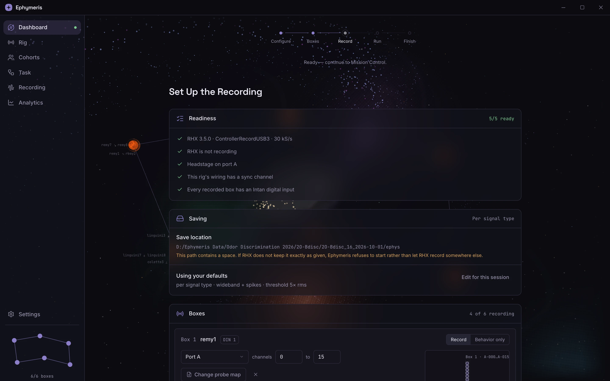

6. **Start All** starts RHX first; if it cannot, no box starts. The **Sync check** counts each box's
   pulses **matched**, **missed** and **stray**; *no pulses arriving* means the sync cable is not reaching RHX.
7. Each recorded box's card shows its probe map, every site flashing as it fires, and how many sites
   are active so far; open a box's panel for a larger one. If a box's sites all go silent or all turn
   noisy for 20 seconds, its card shows a **tether alarm**: check that animal's tether, headstage and
   ground, then click **Acknowledge**. The recording carries on, and the session log notes the time.
   The first two minutes of each box are its baseline, so the alarm watches from then on. For one channel's waveforms, threshold, ISI or PSTH, use RHX's own tools.
8. **End Session** and **Run more animals** let each box finish its trial (up to 45 seconds) under **ENDING**;
   **End now** stops RHX without waiting.

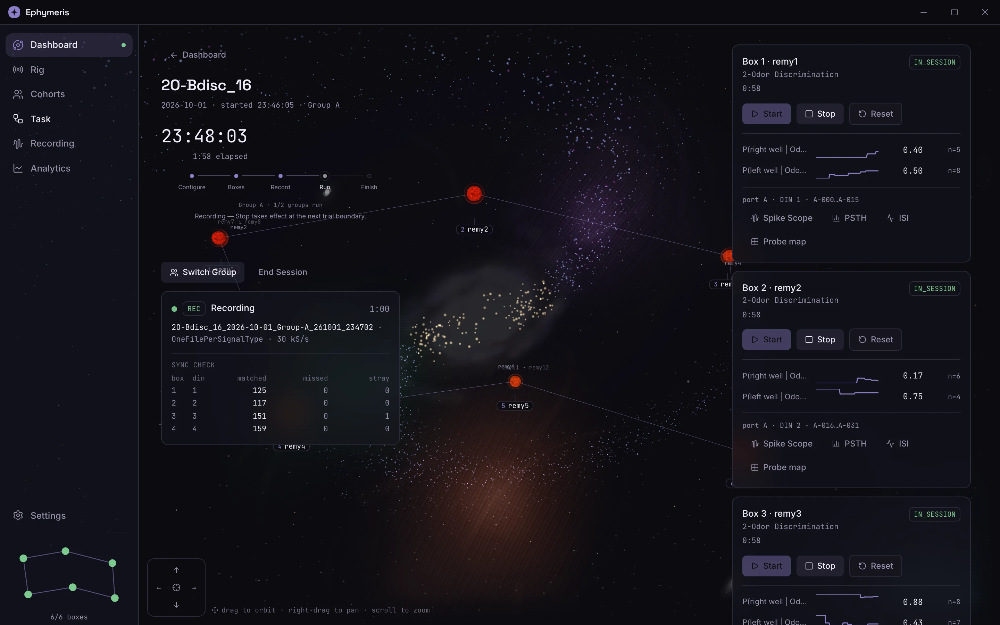

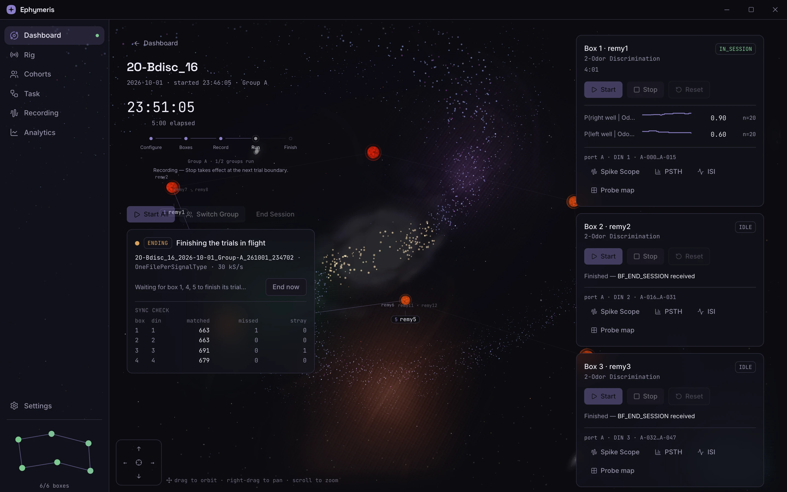

There is one recording per round; the Record step returns for each new round.

## Checking a box

Debug Mode tests a box outside a session; **nothing in it is recorded as data**. Click a box's star or
**Boxes** row on the Dashboard; leave with Esc.

- **Connection**: **Open**/**Close** the console, **Reset**, **Acknowledge** an `ERROR`.
- **Sketch**: **Flash…** puts a program on the box. For a task, **Send START** runs it with live metrics
  and **End** stops it; **Return to baseline** restores the utility sketch.
- **Utility controls** (utility sketch, console open): a switch and pulse per wired channel, **All off**,
  **Full self-test**, and **Prime**, which runs water down the chosen lines for the chosen seconds.
  Lights, speakers and pulse-train lines have a **Duty**, **Pitch** or **Rate** menu; a train line's
  (a laser's) switch fires short test pulses, never a steady beam. Sensors read 1 while blocked or pressed.
- **Console**: everything the board prints; type a command and press Enter.

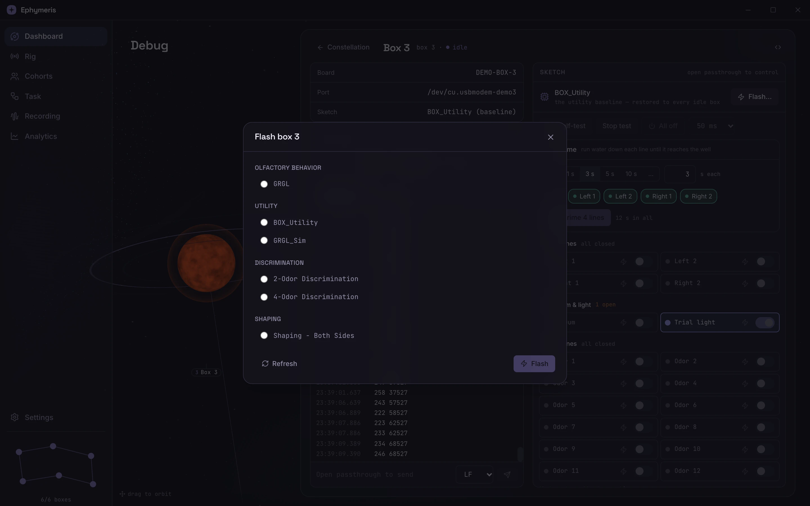

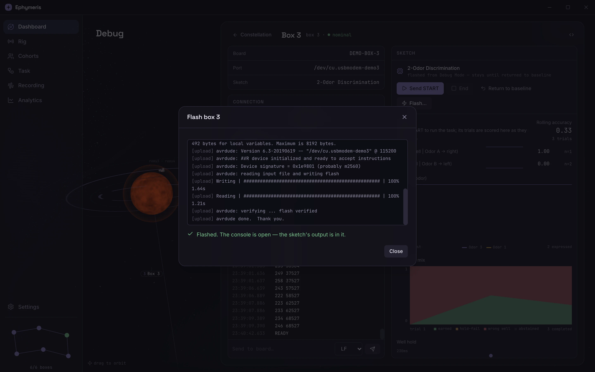

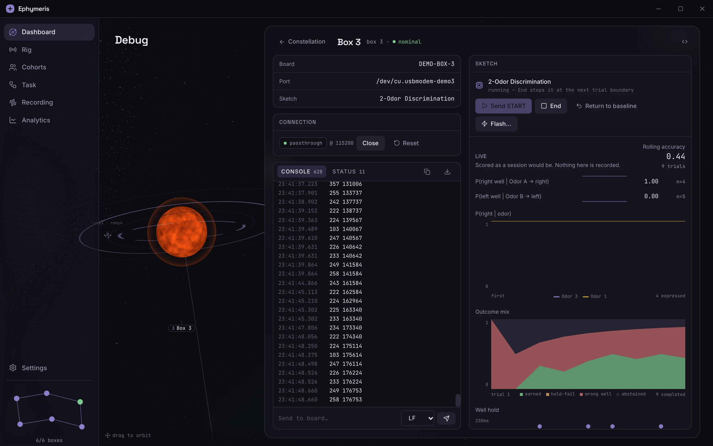

**Which physical box is which:** click **Test** on its **Rig** row; **Handshake** then reads *speaks
Ephymeris — READY received*.

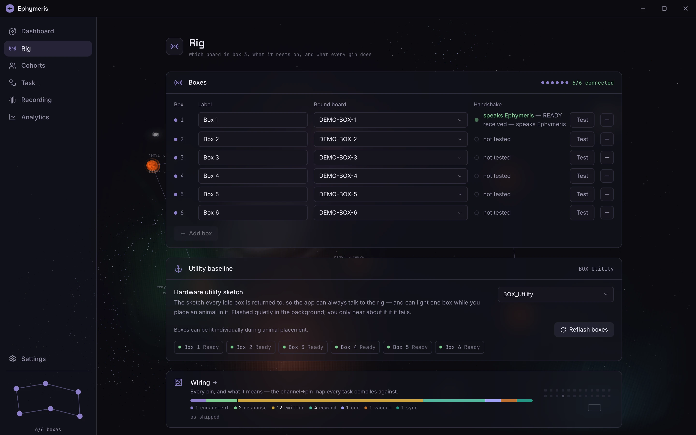

### Commanding every box

**Command all boxes**, under the Dashboard's **Boxes** list, is Debug Mode for the whole rig; **nothing
here is recorded as data**.

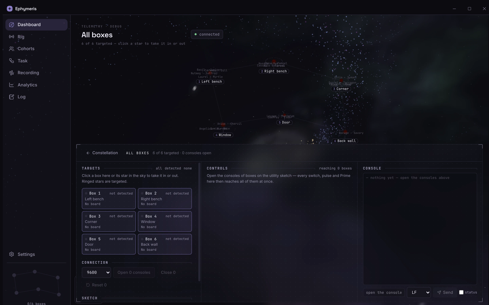

- **Targets**: commands go to the ringed boxes; click a star or card to toggle one.
- **Connection**, **Controls** and **Sketch** work as in one box's panel, on every target at once. A
  control reads *mixed* when boxes differ. **Flash…** flashes the targets in turn; **Stop after this
  box** cancels the rest.
- **Console**: every target's output, marked by box; a typed line goes to every open console.

## Looking at results

### Where files are saved

Each run gives an animal a `.tsv` (written live), a `.json` and a `.mat`, in the cohort's data folder
([DATA.md](DATA.md#directory-layout-and-naming)). Analyse the `.json` or `.mat`; the `.tsv` is the
[crash-safe record](DATA.md#crash-safety). A recording goes in the session folder's `ephys` folder by default.

### Analytics

1. Open **Analytics** and click a cohort.

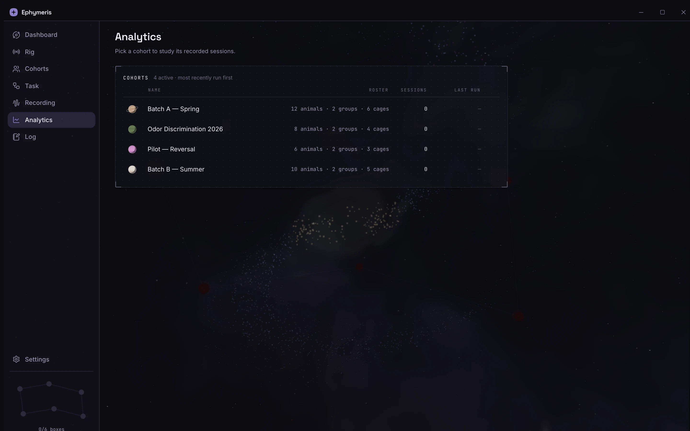

2. The **Sessions** rail is spaced by date. Below it: **Animals**, **Strategy space**, **Accuracy** under a
   **Task** strip, **Effort** and **Outcome mix**. Each chart has a **how to read this** note.
3. Hover an animal to highlight it everywhere; click to keep it.
4. Click a session for its **Session summary**: a row per animal with the share rewarded and trials
   sampled, overall and per condition, then each animal's card. A purple line on a card's **Tape** is a
   [log note](#keeping-the-log). A spine task's card lists every trial under **Trials** and, for a task
   that counts licks, each row's lick rate per phase (grey under 30 trials). A spine run that does not
   replay as the box ran it reads **not scored** and names the first differing strobe; it is still
   recorded in full.
   For a recorded session, **Spikes around an event** shows each animal's sites around a named event
   (pick the event, split by condition or outcome, click a site for its raster). The first look reads the
   whole recording, which can take a minute. Check its header first: missed or stray sync pulses mean the
   events may be misplaced. Each run's events, on the recording's clock, are saved to the session's
   `events` folder for your own analysis.
5. **All cohorts** goes back.

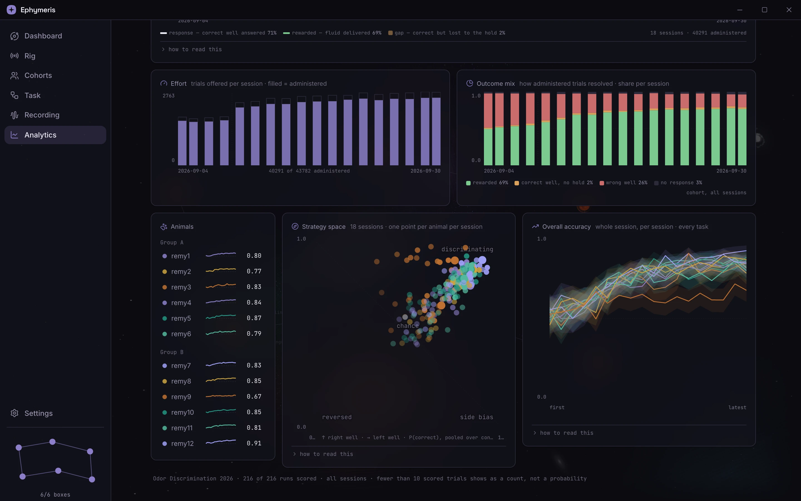

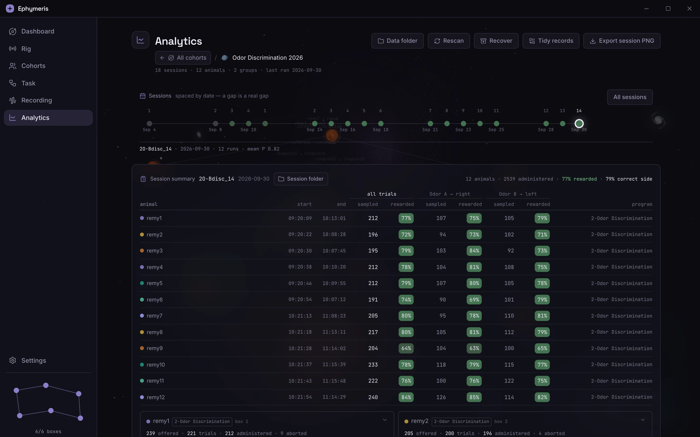

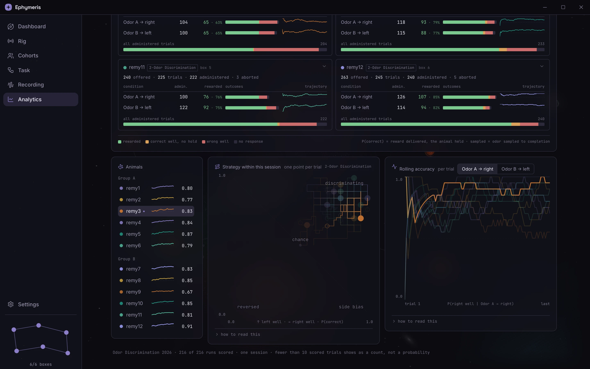

**Accuracy** is pooled across conditions, so an animal that always picks one side sits at chance (0.5).
*Rewarded* accuracy (it earned the water) differs from *response* accuracy (it chose the right side).
Definitions: [ANALYTICS.md](../sidecar/ephymeris_sidecar/analytics/ANALYTICS.md#how-a-strobe-stream-is-scored).

### Restarted runs

A run restarted for the same animal in one session is a **false start** if it got fewer than 10 trials:
listed greyed under **Restarts** and counted nowhere. **Set aside** and **Count it** overrule that; **Use
the rule** restores it.

### Exporting and maintenance

**Export cohort PNG** (or **Export session PNG**) saves the charts as one image; a card at the bottom
right shows progress and where the file went.

At the top of Analytics, all refused while a box is running:

| Button | Use it when |
|---|---|
| **Rescan** | A session is missing or *not indexed*, e.g. from the other lab machine |
| **Recover** | The app or computer crashed during a session: rebuilds `.json`/`.mat` from the `.tsv` |
| **Re-derive** | An update's notes say the trial table changed; strobes are never touched |
| **Tidy records** | One session became two records, or a record has no data. It previews first and never touches a data file |

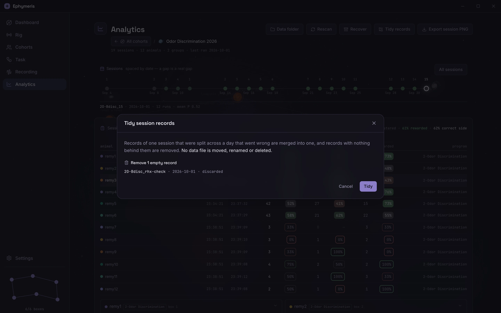

## Keeping the log

The **Log** tab is each cohort's lab notebook: sessions on the left, the selected session's page on the right.

### Moving through sessions

Sessions sit on a timeline, newest first, **spaced by real days**. Scroll or press **j**/**k** to step;
click a session or month to jump. A filled diamond is finished, green **live** running, hollow abandoned
or recovered; a number counts notes, a flag marks a carried-forward note. The page shows **Start** (when
the first round began), **End** and **Elapsed** (**~** when read from files), and **Session folder**
opens the folder.

### Writing notes

Press **n**, or click the note box under **Notes**.

1. Pick a kind: **Observation**, **Intervention**, **Hardware**, **Health** or **Deviation**.
2. Pick what it is about: the session, a box or an animal.
3. Type it (for something earlier, set **At** first); **Ctrl+Enter** saves.

Hover a note to edit or delete it. Notes are copied to the session folder's `notes.md`; edit them in the
app. Turn on **Carry forward to next session** for what the next person must know; the flag shows on the
Log, at **Before you start** and on Mission Control until **Resolve**.

**What changed** lists, per animal, the task, box or settings that differ from its previous session;
**Performance** is the Analytics session table.

### Saving the log as a PDF

**Session PDF** saves the selected page; **Logbook PDF** saves every session, oldest first, after a cover
of open flags. Characters the PDF fonts lack (Chinese, emoji) print as `?`.

## Updating Ephymeris

A dot beside **Settings** means a new version is ready.

1. Open **Settings**; the **Updates** tile names the version.
2. Click **Install and restart** and confirm. Ephymeris reopens within about a minute; data and settings
   are untouched.

The button waits while a session, recording, flash or Debug console is in progress. **couldn't check**
usually means no internet; ask the lab manager for the installer.

## Troubleshooting

| What you see | What to do |
|---|---|
| A box's star is dim or missing | Check its USB cable and power, then its binding on the **Rig** tab |
| A box will not flash | Read its card; **Acknowledge** and retry. If it fails again, tell the lab manager |
| A box is stuck in `ERROR` | Dashboard → its star → **Acknowledge** |
| A box will not start | **Reset**, wait, **Start** |
| Refuses to start: *could not hold a value as chosen* | Nothing was written. **Acknowledge**, set that value inside the box's range at the Boxes step, **Start** |
| Refuses to start: *did not recognise a parameter*, *older sketch*, *received different parameters* | Nothing was written. **Acknowledge**, check the USB cable, flash the task again, **Start**. If it repeats, tell the lab manager |
| **Stop** seems to do nothing | The box stops at the end of the trial. Wait |
| *Waiting for the backend*, *The backend isn't connected*, *sidecar down* | Close Ephymeris and open it again |
| **backup failing** | Tell the lab manager; the refresh button in Settings copies what is missing once the drive is back |
| The dock shows **Ended unexpectedly** | **Run more animals** (same day), **View in Analytics** or **Close out**, then **Recover** in Analytics |
| No box will start, flash or light, and the message is about the rig's wiring | See [below](#when-the-rigs-wiring-does-not-load) |

### When the rig's wiring does not load

Ephymeris uses only wiring **saved or confirmed in the app on this machine**. Wiring copied in, changed by
hand, damaged, or caught by an unfinished save is held, and **no box will start, flash or light** until
someone confirms it. Restarting does not fix it.

Open **Rig → Wiring** and follow the **This rig's wiring** note:

1. Fix any listed problem (a channel without a pin, two channels on one pin).
2. Compare each pin on the board map with the box.
3. Click **I've checked every pin**, then **Save**.

If **Save** is off and there is no stored wiring to repair, click **Reset** and confirm: the shipped
wiring is restored, and you re-enter your rig's changes and **Save**. A file changed while the app ran
takes effect only once checked and saved; **Reset** discards it.

## Rules that protect the data

- **Do not unplug a box or close Ephymeris during a session**: the run stops at once.
- **Do not rename, move, delete or edit anything in the data folder**, and never edit a `.tsv`. To give
  data to another cohort, [move it](#moving-animals-to-another-cohort).
- **Do not save the Rig, Task or strobe codes during a session**; it is refused.
- **Run one copy of Ephymeris per computer.**
- **Place animals in box order** and check each box's number.
- **Add strobe codes on one computer and import them on the other**, never the same event on both.
- **Do not reuse a session number by accident**: heed the Configure warning.

## Glossary

| Term | Meaning |
|---|---|
| **Cohort** | Animals trained together, with their own data folder |
| **Round** | The animals in the boxes at the same time. A session has one or more |
| **Box** | One chamber, numbered 1 to 6 |
| **Sketch** | A program for a box's board; saving a **task** makes one |
| **Prefix** | The task's short name in folder and file names, such as `2O-Bdisc` |
| **Run** | One animal's part in a session, with its own files |
| **Strobe** | One event the board reports, with a code and a time |
| **Condition** | One kind of trial, such as an odor whose answer is the left well |
| **Utility sketch** | The resting program idle boxes run |
