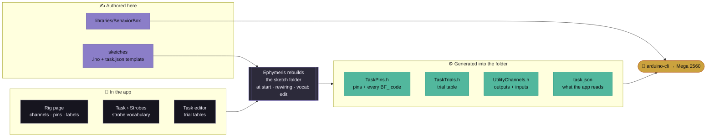
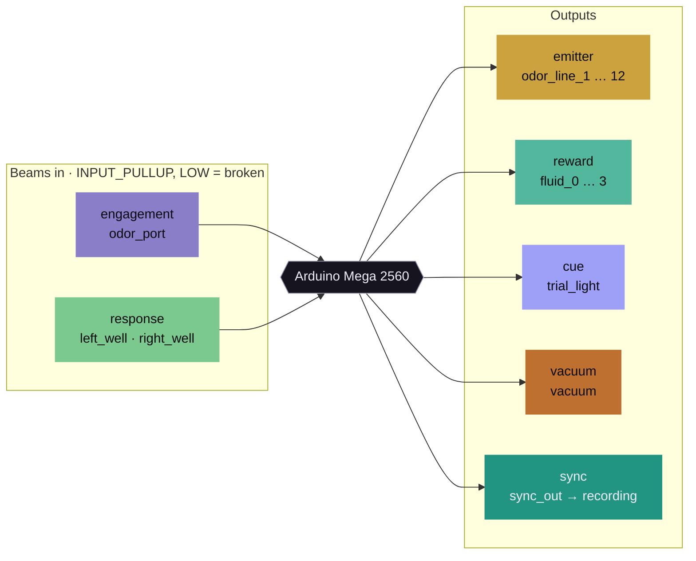

# Ephymeris firmware

The Arduino code that runs on every behavior box: the **BehaviorBox** library and the three
sketches the app ships with.

> [!NOTE]
> **Edit firmware here.** A dev run reads this folder in place and the installer copies it; there is
> no other copy.

```
firmware/
├── Olfactory Behavior/
│   └── GRGL/            the behavior task, and the template every saved task is built from
├── Utility/
│   ├── BOX_Utility/     resting firmware + Debug Mode control panel, generated per rig
│   └── GRGL_Sim/        GRGL with a simulated animal, decode-only
└── libraries/
    └── BehaviorBox/     the shared library every sketch includes
        ├── BehaviorBox.h    serial protocol, START parser, trial primitives, the trial runner
        ├── BoxPins.h        the box as built: guarded pin defaults
        ├── BoxStrobes.h     a guard only: strobe codes are generated
        ├── BoxUtility.h     the box utility's logic, driven by a generated table
        ├── BoxInterp.h      the phase interpreter's pure core
        ├── BoxSpine.h       its hardware layer: the one runner of every spine task
        └── extras/host_test/   off-target tests (never compiled by Arduino)
```

## You never flash these folders directly

None of these sketches compiles as checked in, on purpose. What differs between rigs and machines
is **generated by the app** into each sketch folder before it is built: this rig's wiring (Rig page),
this machine's strobe codes (Task › Strobes), and a saved task's trial table or a spine task's state
table (Task editor). A sketch built bare stops with an `#error` rather than drive undeclared pins or
strobe codes the app would decode under other names.



Generated folders live in the app's data directory (`<app data>/rig/sketches/…` for the three
sketches here, `<app data>/tasks/…` for saved tasks) and are rewritten at every start, wiring change
and strobe-vocabulary edit ([TASKS.md › Rebuilt bundled sketches](../docs/TASKS.md#rebuilt-bundled-sketches)).

## The three sketches

| | Sketch | What it is | Generated into its folder |
|:-:|---|---|---|
| 🟣 | **GRGL** | The olfactory discrimination task; every saved trial-table task is a copy of `GRGL.ino` with its own trial table and parameters | Bundled copy: `TaskPins.h`. A saved task: `TaskPins.h`, `TaskTrials.h`, `task.json` |
| 🟢 | **BOX_Utility** | Resting firmware on every idle box and Debug Mode's control panel: latch, pulse and prime outputs, identify a box, run the self-test | `TaskPins.h`, `UtilityChannels.h`, `task.json` (merged) |
| 🟠 | **GRGL_Sim** | GRGL with a simulated animal. [Decode-only](../docs/TASKS.md#decode-only-sketches): never flashed. Spine tasks use [Simulate](../docs/TASKS.md#simulating-a-spine-task) | `TaskPins.h` |

## The box, as the firmware sees it

Every channel on the Rig page has a **kind**, which decides what the firmware does with it (colours
as in the app).



BOX_Utility reads a channel's role and type, not its kind
([TASKS.md › The box utility](../docs/TASKS.md#the-box-utility)); the last column is what each kind's
default role and type make of it.

| Kind | In a task | In BOX_Utility |
|---|---|---|
| **engagement** | Where a trial starts and the animal samples. Exactly one | An input the self-test checks |
| **response** | A port a trial type can name as correct; its port slot picks its strobe family | An input the self-test checks |
| **emitter** | A stimulus line, the condition a trial presents | A grid row; fires with every routing line on in the self-test |
| **reward** | Delivers the reward; pulse width is the volume | A grid row; what Prime opens |
| **cue** | The trial light: "a trial is available" | A grid row; the first level line is how a box identifies itself |
| **vacuum** | Odor routing with no behavioral meaning | A grid row; on with each stimulus line in the self-test |
| **sync** | One pulse per strobe (per tick that strobes, from a spine task) into a recording controller | Never driven: a pulse there is an edge in a recording |

## The BehaviorBox library

| Header | Holds | Notes |
|---|---|---|
| `BehaviorBox.h` | The serial protocol (`emitStrobe`, the `START` reader, `STOP`, `CommandReader`, `emitStatus`, `applySetLine` and its `PARAMS`/`CLAMPED` answers, `announceReady`); `TaskParams` and `TASK_PARAM_LIST`, the one key list the `SET`/`START` parser is generated from; trial primitives, selection policies, and **one** trial runner | `SET_LINE_MAX` must equal the app's; a test checks it |
| `BoxPins.h` | The box as built, every pin `#ifndef`-guarded | The generated `TaskPins.h` wins wherever it speaks |
| `BoxStrobes.h` | Nothing but a guard | Every `BF_*` code comes from the generated `TaskPins.h` |
| `BoxUtility.h` | The box utility: commands, pulses, `STATUS`, the self-test | Knows no box; reads the generated `UtilityChannels.h` |
| `BoxInterp.h` | The phase interpreter's pure core: a state table walked one 1 ms tick at a time, its blocks (selection, end rules, `next`, correction), the session RNG, a pulse train's shape | No pin, clock or Arduino header. Python port: `analytics/stream/replay.py`, held equal by `run_diff.sh` ([TASKS.md](../docs/TASKS.md#compiling-and-the-host-tests)) |
| `BoxSpine.h` | The core's hardware layer: debounced inputs, a step every millisecond, the outputs (levels, PWM, tone and pulse trains), the strobes, the `SET` handshake over the table's parameters, and the session end rule | Every spine task runs it; the task arrives as the generated `TaskSpine.h` ([TASKS.md › Spine tasks](../docs/TASKS.md#spine-tasks)) |

Include order matters:

```cpp
#include "TaskPins.h"     // GENERATED: this rig's pins and every strobe code. First.
#include <BehaviorBox.h>
#include "TaskTrials.h"   // GENERATED: the trial table. Needs TrialType, so after.
```

### The box utility, in one table

`BOX_Utility.ino` is three includes and two calls; the box arrives as a generated table. Commands
name outputs by Rig channel name, case-insensitively:

| Command | Does |
|---|---|
| `TOGGLE <ch>` · `ON <ch>` · `OFF <ch>` | Latch, open, close one output, e.g. `TOGGLE fluid_2` |
| `PULSE <ch>` | Open it for exactly the pulse width, then close it |
| `DUTY <ch> <n>` · `HZ <ch> <n>` | A PWM line's duty; a tone's pitch or a train's rate. Limits and defaults: [TASKS.md › The box utility](../docs/TASKS.md#the-box-utility) |
| `SET PULSE=<ms>` | Pulse width, 10–5000 ms |
| `ALLOFF` | Close everything; always available |
| `SELFTEST` · `STOP` | Run or abort the hardware self-test |
| `STATUS?` | Ask for a fresh `STATUS` line (one is also sent on every change and every second) |

> [!IMPORTANT]
> **Nothing on BOX_Utility starts on its own.** Animals are placed into boxes while it runs, so a nose
> poke never fires anything; only the app starts things.

## Building and testing

```bash
# Off-target host tests: the strictest type check the firmware gets
sh firmware/libraries/BehaviorBox/extras/host_test/run.sh       # the library
sh firmware/libraries/BehaviorBox/extras/host_test/run_box.sh   # the box utility
sh firmware/libraries/BehaviorBox/extras/host_test/run_stream.sh # every outcome's strobe sequence
sh firmware/libraries/BehaviorBox/extras/host_test/run_interp.sh  # the interpreter core
sh firmware/libraries/BehaviorBox/extras/host_test/run_diff.sh    # the core against the Python replay
sh firmware/libraries/BehaviorBox/extras/host_test/run_spine.sh   # the spine runner around the core

# A real AVR build, from a folder the app generated
arduino-cli compile --fqbn arduino:avr:mega --warnings all \
  --libraries firmware/libraries "<app data>/rig/sketches/Olfactory Behavior/GRGL"
```

The host tests use fixture headers whose strobe codes and box are **deliberately not the lab's**, so
the library is proven to depend only on what it is told. On Windows without clang or gcc, the MSVC
Build Tools compile them unchanged (each script's header carries the `cl` line).

> [!CAUTION]
> **`arduino-cli compile` will not report a type error.** The AVR core builds with `-fpermissive -w`,
> so wrong code (a pointer passed as an `int`) still exits 0. After changing anything shared, compile
> with `--warnings all` **and** run the host tests.

## What the trial runner prints

Every trial is framed as **stream grammar 2** (announced as `STREAM=2` before `READY`): a header naming
the row and the answer it rewards, the timeline, exactly one outcome code, `INVALID_TRIAL` when the same
trial comes back, and `END_TRIAL`. Reference sequences and the outcome set:
[TASKS.md › Stream grammar](../docs/TASKS.md#stream-grammar); `run_stream.sh` holds `runTrial()` to them.

## Adding or changing a sketch

1. **New strobe code?** Add it on **Task › Strobes** first, then emit `BF_<NAME>`; the generated
   header is the only place a code is defined.
2. **New sketch?** Put it in a category folder as `<Name>/<Name>.ino`, `#include "TaskPins.h"`
   before `<BehaviorBox.h>`, and ship a `TaskPins.h` that declares nothing. Describe it to the app
   with a `task.json` ([TASKS.md › Writing a new sketch](../docs/TASKS.md#writing-a-new-sketch)).
3. **Changed the library?** Run the host tests and a `--warnings all` compile, then restart the app.

More: [TASKS.md › Firmware](../docs/TASKS.md#firmware) and
[ARCHITECTURE.md › Hardware utility baseline](../docs/ARCHITECTURE.md#hardware-utility-baseline).
