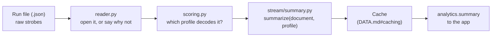
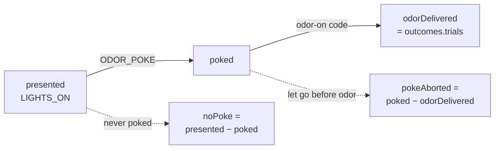
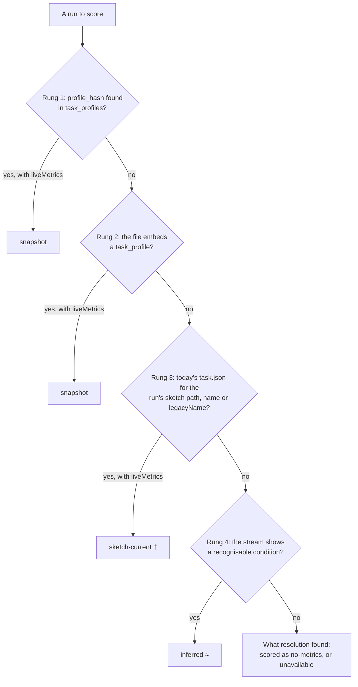

# Analytics

How Ephymeris turns a recorded strobe stream into trials, accuracies and errors, and how far to trust each
number. This file is the specification: its numbers are what a paper would report.

## Start here

1. **Every number is derived from raw strobes at read time.** A run's file holds `[code, timestamp]` pairs. A
   grammar-2 run's file also carries a [trial table](../../../docs/DATA.md#the-trial-table) for
   outside scripts; `reader.py` drops it and Analytics decodes afresh.
2. **A task profile says what the strobes mean**: its conditions and the strobe names marking a trial's start,
   answer and outcome.
3. **One scorer defines a trial**, live in Mission Control and afterwards in Analytics, so they cannot disagree.
4. **Every run becomes one [trial table](#the-trial-table) and every number is read off it**: a
   [stream-grammar-2](#stream-grammar-2) run's from its headers and outcome codes, a grammar-1 run's from the
   [legacy decoder](#how-a-legacy-run-becomes-a-trial-table).
5. **The science is [`stream/`](stream/) alone**: document and profile in, numbers out, no files, database or
   clock (a test enforces it).
6. **Every number carries its sample size and a 95% interval.** Nothing is suppressed; a run with nothing to
   score says why instead of reporting zero.

## The folder at a glance

**The science**, `stream/` (pure):

| File | Answers |
|---|---|
| [`legacy/`](stream/legacy/) | **The legacy decoder**, frozen; the only code that reads meaning from strobe names. `trials.py`: hit, miss or excluded (Mission Control uses it too). `strobes.py`: which strobe settles a trial or opens a presentation. `infer.py`: which conditions ran when no profile says |
| [`grammar2.py`](stream/grammar2.py) | [The grammar-2 decoder](#stream-grammar-2): which grammar a run speaks, its trial table and tallies, and the per-trial rows its files carry |
| [`outcomes.py`](stream/outcomes.py), [`engagement.py`](stream/engagement.py) | A legacy table's outcome tally and tape; its engagement ladder |
| [`summary.py`](stream/summary.py) | One run's whole result (`RunSummary`) and its wire trial table |
| [`curves.py`](stream/curves.py) | Learning curves and the strategy walk |
| [`false_starts.py`](stream/false_starts.py) | Which restarted runs to set aside |
| [`trial_table.py`](stream/trial_table.py), [`table_metrics.py`](stream/table_metrics.py) | [The trial table](#the-trial-table)'s row and outcome classes; its [metrics](#metrics-from-the-trial-table) |
| [`stats.py`](stream/stats.py), [`document.py`](stream/document.py), [`metric_summary.py`](stream/metric_summary.py) | The Wilson interval; reading `ts_data`, and whether the trial runner recorded the run; the shared metric shape |
| [`odors.py`](stream/odors.py) | A run's [odors table](../../../docs/DATA.md#the-odors-table) |

**The plumbing**: [`reader.py`](reader.py) opens run files or says `missing`/`unreadable`;
[`scoring.py`](scoring.py) picks each run's profile ([the ladder](#which-profile-decodes-a-run)), scores and
caches it; [`repository.py`](repository.py) holds profile snapshots and cache tables; [`service.py`](service.py)
serves the `analytics.*` reads; [`archive.py`](archive.py) is a cohort's runs as one locked read and every write
under it ([DATA.md](../../../docs/DATA.md#the-cohort-archive)); [`walk.py`](walk.py) is what a rescan and a tidy
ask the disk.



A run no profile decodes still gets its event count, duration and stop reason, but no accuracies.

## A worked example

GRGL: odor 1 is answered at the right well, odor 3 at the left. Six presentations, by strobe name:

| # | Strobes | P(hit) verdict | Outcome |
|---|---|---|---|
| 1 | `LIGHTS_ON ODOR_POKE ODOR_1_ON ODOR_UNPOKE WATER_POKE_R FLUID_R STOP_FLUID_G_R` | odor 1 **hit** | **rewarded** |
| 2 | `LIGHTS_ON ODOR_POKE ODOR_3_ON ODOR_UNPOKE WATER_POKE_L WATER_UNPOKE_EARLY_L` | odor 3 **hit** | **hold failed** |
| 3 | `LIGHTS_ON ODOR_POKE ODOR_1_ON ODOR_UNPOKE WATER_POKE_L WATER_POKE_ERROR_L` | odor 1 **miss** | **wrong well** |
| 4 | `LIGHTS_ON ODOR_POKE ODOR_3_ON ODOR_UNPOKE` | odor 3 **excluded** | **no response** |
| 5 | `LIGHTS_ON ODOR_POKE ODOR_1_ON ODOR_UNPOKE_EARLY` | odor 1 **excluded** | **aborted** |
| 6 | `LIGHTS_ON LAZY_RAT LIGHTS_OFF` | no trial | never poked |

Trial 4 stays open until `ODOR_1_ON` closes it unanswered ([boundary codes](#boundary-codes)). The run reports:
P(right | odor 1) **0.5** (1/2 counted, 3 triggered); P(left | odor 3) **1.0** (1/1, 2 triggered); overall
**0.67** (2/3); rewarded **0.25** (1/4 administered, trial 5 aborted); response **0.67** (rewarded + hold
failed over 3 answered); side **0.50** (2/4 administered); engagement 6 presented, 5 poked, **pEngaged 0.83**.
Trial 2 is a hit with no water: hence two kinds of accuracy. `test_analytics_derive.py` asserts every number.

## How a strobe stream is scored

Everything is computed at read time from `ts_data` and the profile, through the run's trial table. Offline
scoring **never reimplements [live scoring](#live-scoring)**: both decoders feed the stream through
`MetricAccumulator`, the class Mission Control uses. `RunSummary.status` is `ok`, `no-metrics`, `missing` or
`unreadable` ([why](#why-a-run-has-no-numbers)).

### Trials: hits, misses and exclusions

Each condition (a `liveMetrics` entry) names a `triggerCode` that opens its trials (the odor onset), a
`successCode` and alternate codes (every wrong answer). From each trigger, scan to the next success or
alternate, stopping at the next [boundary code](#boundary-codes):

| Found first | Counts as |
|---|---|
| `successCode` | **hit**: numerator and denominator |
| an alternate | **miss**: denominator only ("went to the other side") |
| neither | **excluded** from both |

A **no-go condition** has `WATER_POKE_NONE` as `successCode` and **every response port**'s enter code as
alternates: a hit when withheld, a miss when answered anywhere. Alternates are `alternateCodes` on the wire
(`alternateCode` repeats the first), in port-slot order. Where a profile is settled for scoring
(`scoring._settle`, or `MetricSet` live and in a debug run), `infer.widen_no_go` widens a no-go metric listing
one alternate to every port; only the scored copy is widened, never the stored snapshot or its `profile_hash`.

The metric is **response-conditional and reward-unconditional**: the well poke is strobed on detection, before
any hold check. The rolling window is the last `windowSize` **counted** trials. A success or alternate code with
no trial open is ignored.

### Boundary codes

A trial ends at the next **boundary code**: any condition's trigger code.

> [!CAUTION]
> **Every scan must get the union of all the profile's trigger codes** (`boundaries_for`, or `MetricSet`
> live). `compute_series(..., boundary_codes=None)` defaults to the metric's own trigger, which silently hands
> an unanswered trial's later response to the abandoned trial.

### Two probabilities per metric

**`pWindow`** is the rolling value at the run's end over `windowSize`, for reconciling with Mission Control.
**`pSession`** is `hits / counted` over the run, and is what **every summary** shows (strategy plane, sparkline,
session summary). Both come from one list of verdicts (`table_metrics.legacy_metrics`).

> [!WARNING]
> **They diverge sharply over the first `windowSize` trials.** Each view states which it reads.

### Trial counts

**`counted`**: trials scored hit or miss (one series entry each). **`hits`**: counted hits, kept as integers so
pooling is exact. **`triggered`**: trigger occurrences, trials presented. **`excluded`** = `triggered −
counted` (lazy, invalid, no response); **surface it**.

> [!CAUTION]
> **`MetricValue.n` (and a series' `n`) is the window length, not a trial count.** Use `counted` as an
> interval's sample size.

### Pooled accuracy

**`overall`** (id `__overall__`) is correct over scored trials across all conditions, and **every per-run
readout's default**. It is pooled by summing hits and counted, never by averaging proportions; its rate pools
only conditions that scored, its counts all of them (so `triggered == counted + excluded`); it is never a
strategy axis or a within-session series.

> [!IMPORTANT]
> **A single condition cannot show a side bias**: an animal poking right every trial scores ~1.0 on
> "P(R | Odor 1)"; pooled, it sits at chance.

### Uncertainty

Every probability carries `counted` and a **95% Wilson score interval** (`stats.wilson_interval`), which stays
inside [0, 1] at small *n* and *p* near 1. **The sidecar never suppresses**: it reports value, count, interval
and `lowConfidence` (`counted < minCountedTrials`, default `DEFAULT_MIN_COUNTED` = 10); the app chooses how to
draw it.

### Rewarded and response accuracy

Hit rates are reward-unconditional, so each run also carries `outcomes` (`TrialOutcomes`), each trial classified
(`legacy.strobes.classify_trials`) by its first outcome code before the next boundary:

| Outcome | Recognised by | Meaning |
|---|---|---|
| **rewarded** | `FLUID_*` | Fluid delivered |
| **hold failed** | `WATER_UNPOKE_EARLY_*` | Correct well, released before the hold |
| **wrong well** | `WATER_POKE_ERROR_*` | Wrong side |
| **no response** | none, `ODOR_UNPOKE` seen | Sampled, never answered |
| **aborted** | none, no `ODOR_UNPOKE` | Left before sampling cleared |

`administered` is every trial but `aborted`, and is the denominator (an unsampled trial says nothing about
discrimination).

- **Rewarded accuracy** `pRewarded` = `rewarded / administered`.
- **Response accuracy** `pResponse` = `(rewarded + holdFailed + unpaid + withheld) / responded`, `responded`
  adding `wrongWell` and `falseAlarm`. It leaves out no response and aborts, as hit rates do, except that a
  legacy no-go withhold sits in no response (so a legacy sparkline plots pooled P(hit)). Always ≥ rewarded.
- **Side accuracy** `pSide` = `(rewarded + holdFailed) / administered`.

Names are matched **anchored, never by code**: `^FLUID(_|$)` so `STOP_FLUID_G_R` is no second reward,
`^ODOR_UNPOKE$` so `ODOR_UNPOKE_EARLY` is not completed sampling. No reward vocabulary gives `outcomes: null`,
not zeros.

> [!WARNING]
> **`trials` counts odor onsets, not trials offered**, so every figure here is conditioned on engagement (see
> the [engagement ladder](#engagement-ladder)). **A legacy no-go trial lands in `no response`**, withheld or
> answered; P(withhold) is unaffected and the trial table [flags it](#how-a-legacy-run-becomes-a-trial-table).

### Per-condition tally

`conditions` is the outcome tally per condition, in `liveMetrics` order, driven off the profile. It partitions
`outcomes` exactly; a condition with no trials is zeroed (rates `null`), not omitted; empty when `outcomes` is
`null`.

### Engagement ladder

Odor onset needs a poke and hold, so an animal skipping most trials can score like one working every trial.
`engagement` (`TrialEngagement`) is delimited on the **trial light**, which comes first and unconditionally:



**`pEngaged = poked / presented`** (Wilson), `pDelivered = odorDelivered / presented`. A ladder, not a
partition: `presented ≥ poked ≥ odorDelivered`, and `odorDelivered == outcomes.trials` (tested).
`pokeAborted` is not `outcomes.aborted`: only the latter smelled anything. `null`, never zero, without a
declared trial light.

> [!CAUTION]
> Matched by **anchored** name: an unanchored match on `LIGHTS_OFF` roughly doubles `presented`, plausibly.

### Per-trial tape

`analytics.series` returns each run's trials as `TrialRecord {index, triggerCode, outcome, atMs, latencyMs}`,
uncached. It is the classification the tallies sum (a test pins tape ≡ `outcomes_of` and, by `triggerCode`,
`conditions_of`). `outcome` is hyphenated (`hold-failed`, `no-response`). `atMs` counts from the **earliest**
timestamp; `latencyMs` is open → settling code, `null` for `no-response`/`aborted`, never negative. Empty when
the profile has no outcomes. Session-log notes are drawn on it (`features/logbook/tapeMarkers.ts`) before the first
trial after them, approximately ([session clock](../../../docs/DATA.md#the-session-clock)).

### Run-level scalars

`totalEvents` = `len(ts_data)` (trust it over `n_events`). `durationMs` = `max − min` of stream timestamps.
Wall duration = `ended_at − started_at`; **report both durations, never reconcile them** (the run record is
stamped before the board's reset and handshake). `clean = stopReason == "BF_END_SESSION received"`. `seed` =
`trial_seed`.

### Live scoring

`sessions/runner.py` offers every strobe to a `MetricSet(profile)` and pushes its values in each
`session.telemetry` event; Debug Mode's Send START uses the **same** `MetricSet` (`debug_run.py`), so never
write a second scorer. `hits_total`/`counted_total` give an exact ratio. A telemetry metric carries `id`,
`value`, `n`, never a label. The within-session [learning curves](../../../docs/DATA.md#learning-curves) and
[strategy plane](../../../docs/DATA.md#strategy-plane) are read off the same accumulators' verdicts.

## The trial table

One row per trial (`stream/trial_table.py`, `ReplayTrial` on the wire), whichever decoder read the run: the
[grammar-2 decoder](#stream-grammar-2) or the [legacy decoder](#how-a-legacy-run-becomes-a-trial-table), each
of which lists how it fills the columns.

| Column | Holds |
|---|---|
| `index`, `atMs` | The trial's place in the run; when it opened, ms from the run's earliest timestamp |
| `row`, `rowName` | The condition (`liveMetrics` entry) whose trigger the trial carries, and its label |
| `response`, `responseMs`, `latencyMs` | The answering strobe's name, its ms, and a latency each decoder defines |
| `outcome`, `outcomeMs` | An **outcome class** (`OUTCOME_CLASSES`): `correct`, `wrong_response`, `hold_broken`, `omission`, `withheld`, `false_alarm`, `abort_before_stimulus`, `abort_during_sampling`; when it was settled |
| `correct` | Right, wrong, or null for a trial no accuracy counts |
| `rewarded`, `rewardLine`, `rewardMs` | Fluid was delivered; the `FLUID_*` name; how long the valve was open |
| `correction` | The trial re-presents an error; null when the run cannot say |
| `complete` | The trial closed |
| `presented`, `scores` | It opens a presentation on the [engagement ladder](#engagement-ladder); `{condition, correct}` for each condition its onset opens |
| `block`, `level`, `responseEdge`, `phaseEntries`, `inputCounts`, `counterN` | Filled by no decoder (null or empty); kept because [derived tables](../../../docs/DATA.md#the-trial-table) on disk carry them |

Outcome classes are append-only: each name is written into derived tables. The wire `TrialTable` adds `kind`
(`legacy` or `grammar2`) and `gaps`, the columns it cannot fill, so an empty column reads as unknown. It rides
on `analytics.series`, never cached ([DATA.md](../../../docs/DATA.md#caching)). Finalization and recovery write
a grammar-2 run's per-trial rows into its `.json` and `.mat`, stamped `trial_table.REPLAY_VERSION`
([DATA.md](../../../docs/DATA.md#the-trial-table)); Analytics never reads that copy.

### Metrics from the trial table

`stream/table_metrics.py` reads two figures off either table, each with a [Wilson interval](#uncertainty):

| Figure | Definition |
|---|---|
| `metrics` | Per condition, P(hit) over its counted trials: each row's verdict under that condition in `scores` ([hits, misses and exclusions](#trials-hits-misses-and-exclusions)), with `pSession` and `pWindow` from [one list](#two-probabilities-per-metric) |
| `overall` | [Pooled](#pooled-accuracy) over conditions |

A row's own `correct` is separate: a grammar-2 row's comes from its outcome class (`trial_table.correct_of`),
a hit in `HITS` (`correct`, `withheld`), null in `EXCLUDED` (both aborts) or with no class, and a miss in any
other class, including one added later.

> [!CAUTION]
> **A withhold is a hit**; counting only `correct` scores a perfect go/no-go session at the go rows' share.

## How a legacy run becomes a trial table

The **legacy decoder** ([`stream/legacy/`](stream/legacy/), `decode.table_of`) is the strobe scorer above,
frozen: it reads strobe names through the profile into [trial-table](#the-trial-table) rows, and every legacy figure is
read off the rows exactly as reported before the table existed (`tests/test_legacy_pin.py`;
`tests/test_legacy_corpus.py` on a real archive named by `EPHYMERIS_CORPUS`). Nothing outside `stream/legacy/`
matches a strobe name.

A row is an **odor-onset trial** (ending at the next boundary) or **a presentation that never reached odor**
(counted only by the engagement ladder).

| Column | Value |
|---|---|
| `row`, `rowName` | The first `liveMetrics` entry whose trigger opened it; null for an odor-less presentation |
| `response`, `responseMs`, `latencyMs` | The strobe that decided the verdict, its ms, ms after onset; null when excluded or withheld |
| `outcome` | rewarded → `correct`, hold failed → `hold_broken`, wrong well → `wrong_response`, no response → `omission`, aborted → `abort_during_sampling`; poked odor-less presentation → `abort_before_stimulus` |
| `correct` | The `MetricAccumulator` verdict over the whole stream, so live ≡ offline |
| `rewardLine` | The `FLUID_*` name |
| `presented` | Opens a presentation: first onset in a trial-light window, or an odor-less presentation |
| `scores` | `{condition, correct}` per condition the onset opens |
| others | `atMs` from the earliest timestamp; `complete` true; `correction` and `rewardMs` null |

**A no-go row has `outcome` null**, never `omission` (withheld and answered look alike), and `gaps` carries
`no-go-outcomes`; its `correct` keeps P(withhold), and an abort keeps its class. `gaps` always has `phase-entries` and `input-counts`, plus
`outcomes` without reward vocabulary and `presentations` without a trial light or odor poke. `metrics`,
`overall`, `outcomes`, `conditions`, engagement and the tape are read off these rows; the strategy trail steps
per settling strobe (`LegacyTable.settled`), as live.

## Stream grammar 2

A board on [stream grammar 2](../../../docs/TASKS.md#stream-grammar) frames each trial: header (`TRIAL_START`,
rewarded side, `TRIAL_TYPE_<n>`), timeline, one outcome code, `INVALID_TRIAL` on a repeat, `END_TRIAL`. The
**grammar-2 decoder** ([`stream/grammar2.py`](stream/grammar2.py)) splits on the header into legacy-shaped rows
(`kind` `grammar2`; `gaps` only `phase-entries` and `input-counts`).

**Which decoder** (`grammar2.grammar_of`): the `stream` the board [announced](../../../docs/DATA.md#the-json-document);
else grammar 1 if grammar 1's terminators (`END_CORRECT_ITI`, `END_INCORRECT_ITI`) appear, grammar 2 if
`TRIAL_START` and `END_TRIAL` do, else grammar 1.

| Column | Value |
|---|---|
| `response`, `latencyMs` | First `WATER_POKE_L/R`; **reaction time** from `ODOR_UNPOKE` |
| `outcome` | The outcome code's [class](#the-trial-table); `false_alarm` is `WATER_POKE_ERROR_*` in a no-go trial; `LAZY_RAT` and `ODOR_UNPOKE_EARLY` are `abort_before_stimulus`, `ODOR_UNPOKE_EARLY_SAMPLING` `abort_during_sampling` |
| `correct` | **From the outcome class** (`trial_table.correct_of`) |
| `rewarded`, `rewardMs` | `CORRECT` with a `FLUID_*`; `STOP_FLUID_G_*` minus `FLUID_*` |
| `correction` | The previous footer had `INVALID_TRIAL` after an error |
| `scores` | The profile's `MetricAccumulator` verdicts |

`answerSide` is the trials' headers' majority; `outcomes` also fill `withheld` and `falseAlarm`, which only a grammar-2 run can tell apart.

**A profile reads the grammar its sketch emits.** A generated profile scores `CORRECT` as the hit
([TASKS.md](../../../docs/TASKS.md#live-metric-entries)). Over a grammar-1 run (a pre-app run resolving to
bundled GRGL via `legacyNames`) it would count nothing, so `grammar2.for_grammar_1` (in `scoring._scorable`)
**re-expresses** each `CORRECT` condition as the first well poked, side [inferred](#which-profile-decodes-a-run)
from the stream; a no-go condition misses at either well.

> [!CAUTION]
> **Grammar-2 and legacy `correct` disagree on a hold failure**: a legacy row's is reward-unconditional (a
> hit), a grammar-2 `hold_broken` a miss. Compare across by `outcome` class.

Inference weighs a withhold vote (`WATER_POKE_NONE`) only against go-only evidence (reward, early release),
since grammar 2 answers a no-go false alarm with the well's error code.

## Which profile decodes a run

`profileSource` says what decoded each run: `snapshot` (the profile the run used, from this database or **the
file's own**; trusted), `sketch-current` (today's `task.json`, flagged `†`), `inferred` (from the strobes,
`≈`), or `unavailable`.



Rungs 1 and 3 resolve before the file opens (`RunScorer._resolve_profile`); rungs 2 ([embedded
profile](../../../docs/DATA.md#the-embedded-task-profile)) and 4 need it (`scoring._settle`). Rung 3 runs only
when rung 1 found no snapshot. Summary and series climb the same ladder. A malformed or metric-less declaration
falls through rather than raising. A run [another firmware interpreter recorded](#why-a-run-has-no-numbers)
climbs no rung: it is never decoded by today's `task.json` or by inference.

> [!CAUTION]
> **The file's snapshot outranks today's `task.json`**: only it is what the run used. Reversed, a same-named
> local task would silently score a visiting file under a `profileHash` claiming comparability.

> [!IMPORTANT]
> **The cache keeps two digests**: `profile_hash` (resolution's, NULL for rungs 2 and 4) and
> `scored_profile_hash`. Grouping on the first drops such runs from their profile group once the cache warms.

**Inference is sound** because all tasks share one firmware lineage and the append-only [strobe
registry](../../../docs/TASKS.md#strobe-vocabulary): `ODOR_n_ON` onsets show the conditions, and `FLUID_x` /
`WATER_UNPOKE_EARLY_x` occur only at the correct well, `WATER_POKE_ERROR_x` only at the wrong one, so the
majority names each side. It uses the same scorer, pinned against declared GRGL by
`analytics/tests/test_analytics_infer.py`. It cannot know unpresented conditions, labels or the window
(`INFERRED_WINDOW`), so a declaration always wins. A never-answered condition keeps its trial boundary, or the others would be mis-scored.

`sketchName` is what the file recorded and what labels print; `sketchPath` is where this install found a
`task.json` (empty for another rig's run). Names resolve at every read, never frozen at adoption.

> [!IMPORTANT]
> **Comparability is `(profileHash, paramsHash)`.** Mixed parameters give one `parameter-mismatch` warning,
> not a split; runs without recorded parameters are ignored.

## Kinds of errors

Keep apart: what the animal did, a run that cannot be scored, a number not fully trusted, a run set aside, and
a refused operation.

| Animal did | Hit rate | Outcome tally |
|---|---|---|
| Wrong well | **miss** | `wrongWell` |
| Hold failed | **hit** | `holdFailed` |
| No response / aborted | **excluded** | `noResponse` / `aborted` |
| Poked, let go before odor / never poked | nothing | `engagement.pokeAborted` / `noPoke` |

### Why a run has no numbers

| Status | Means |
|---|---|
| `ok` | Scored |
| `no-metrics` | Read fine; no profile declares anything to score |
| `missing` | No file recorded, or not on disk (a `.tsv` alone is [recoverable](../../../docs/DATA.md#crash-recovery)) |
| `unreadable` | Not a JSON object, or the path can't be read; or the file says another firmware interpreter recorded the run |

> [!CAUTION]
> **Only the trial runner's runs are decoded.** A run whose own file says otherwise (a header `interp` other
> than 1, or a snapshot with a `spine` key; `document.ran_by_the_trial_runner`) is `unreadable`, with the detail
> "recorded by a firmware interpreter this build does not read". It is never decoded or inferred, since its
> code names would only resemble the trial runner's, and it gets no [derived trial
> table](../../../docs/DATA.md#the-trial-table). A task's name never decides it.

Each has a `detail` saying what to do. A `no-metrics` run and one another interpreter recorded are still listed with
duration, events and stop reason. **A bad file is data, not an error**: none of these raise, and a briefly missing file keeps its last
summary, marked stale. `lowConfidence`, `†`/`≈` sources, `parameter-mismatch` and `excludedByDefault` (utility
profiles, left out of cohort aggregates) mark numbers to trust less.

### Edge cases

| Case | Rule |
|---|---|
| **Zero counted trials** | `null`, **never `0.0`**; no strategy point |
| **Profile-less sketch** | `no-metrics`, **still listed** |
| **Board disconnected mid-run** | `stop_reason: "board disconnected"`; **include it**. Not an `aborted` session (no behavior data) |
| **No file path / file absent** | `missing`; mention a sibling `.tsv` ([recovery](../../../docs/DATA.md#crash-recovery)) |
| **Two runs for one (animal, session)** | Both listed, never silently the last; a short first one is a [false start](#false-starts) |

### False starts

A box started, stopped within a minute and restarted leaves two real files; the first would add a spurious
point, curve and what-changed. So it is **set aside, never hidden** (`stream/false_starts.py`) when **both**:

1. **Restarted:** a later run of the same animal exists in the session, ordered by the start time in its file
   name (`order_key`; recorded runs stamp UTC, adopted ones naive local time).
2. **Short:** fewer than `MAX_TRIALS` (10) odor onsets (`TrialOutcomes.trials`, else summed `triggered`).

An unrestarted run is never one; a run with unknown trials is never set aside.

**People can overrule it**: `analytics.setFalseStart` writes `run_flags` (`true` set aside, `false` restored,
`null` back to the rule), keyed by run id ([orphan adoption](../../../docs/DATA.md#orphan-adoption)). When a
rescan re-adopts a pruned run under a new id, the ruling follows (`_earlier_ids`, `store_adopted`), but never
off an id a row still holds, and only from cohorts a [move](../../../docs/DATA.md#moving-animals-between-cohorts)
brought it from (through every move, even once deleted), never one whose folder still holds the file, and never into a cohort that already holds the run.

In `analytics.summary` a false start sits in `falseStarts`, not `runs`, so every metric, curve and check ignores
it **by construction** (counted only in `counts.falseStarts`). The session table and log list it muted with why;
what-changed compares its restart with the previous session; the session clock keeps its time. The log reads
verdicts from the cache (`CohortArchive.verdicts`).

### Operations refused

**`ArchiveBusy`** (a scan, tidy, relocate, move or recover holds the archive) and **`RigInUse`** (a session is
set up or running) refuse rather than answer from a half-written archive.

## Key functions

`summarize(document, profile)` and `trial_table_of` (`stream/summary.py`) give a run's `RunSummary` and wire
table; `legacy.table_of` and `grammar2.table_of` the two decoders' trial tables; `MetricAccumulator.offer(code)` one
verdict at a time; `boundaries_for(profile)` the boundary codes ([always](#boundary-codes)); `outcomes_of`,
`conditions_of`, `trials_of`, `engagement_of` the legacy tallies; `table_metrics.legacy_metrics` and
`legacy_overall` the hit rates; `infer_profile` and `widen_no_go` the inferred and scored profiles;
`RunScorer.score` / `decode` cached summaries and a decoded run. To score a file by hand:

```python
import json
from ephymeris_sidecar.analytics import stream
from ephymeris_sidecar.rig import registry
from ephymeris_sidecar.tasks.profile import embedded_profile

document = json.load(open("remy1_….json"))
profile = embedded_profile(document)
# Widen as the scorer does, or an old no-go run gets its old, inflated number.
if profile is not None:
    profile = stream.legacy.infer.widen_no_go(profile, registry.vocabulary())
summary = stream.summarize(document, profile)
print(summary.to_json())
```

## Changing the analytics

- **Keep `stream/` pure** (`tests/test_analytics_stream_is_pure.py`) and **always pass `boundaries_for(profile)`**.
- **The cache re-scores itself** when a summary's maths or shape changes: `scoring.current_version` hashes
  answers for canary runs. If `test_the_score_version_pins_every_input` fails, the change is real (every machine
  re-reads its archive once); update `CANARY`. A change the canary cannot see needs a `SCORE_VERSION` bump or a
  new canary ([caching](../../../docs/DATA.md#caching)).
- **The legacy decoder is frozen**: `test_legacy_pin.py` must pass unchanged, and its fixtures are never
  regenerated from the code under test.
- **Science tests** in `analytics/tests/`, `tasks/tests/` and `sidecar/tests/`: `test_analytics_derive.py`, `test_analytics_infer.py`,
  `test_task_profiles.py`, `test_false_starts.py`, `test_grammar2.py`, `test_legacy_trial_table.py`,
  `test_legacy_pin.py`, `test_legacy_corpus.py`.
