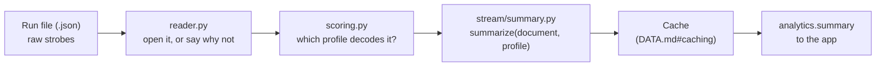
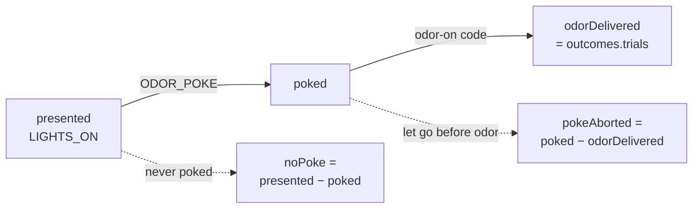
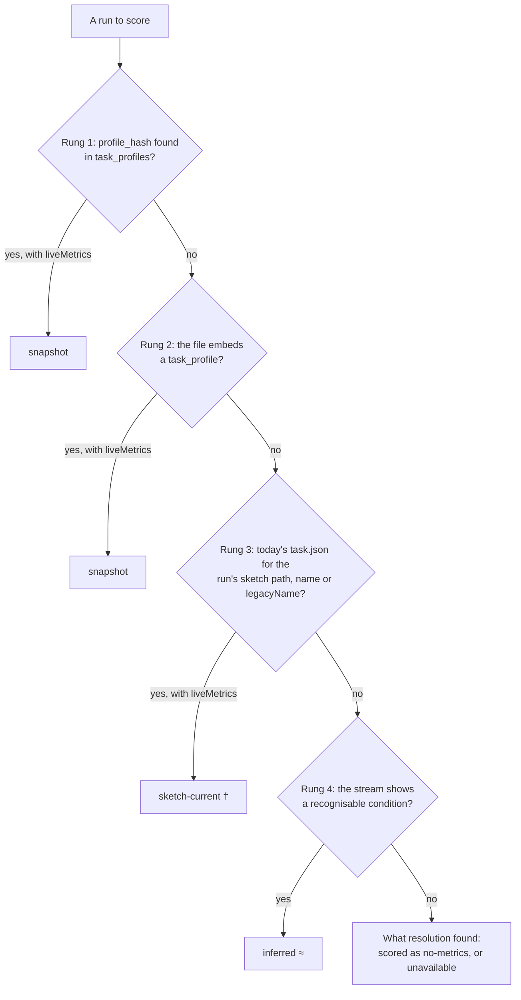

# Analytics

How Ephymeris turns a recorded strobe stream into trials, accuracies and errors, and how far to trust each
number. This file is the specification: its numbers are what a paper would report.

## Start here

1. **Every number is derived from raw strobes at read time.** A run's file holds `[code, timestamp]` pairs. A
   spine run's file also carries a [trial table](../../../docs/DATA.md#the-trial-table) for
   outside scripts; `reader.py` drops it and Analytics replays.
2. **A task profile says what the strobes mean**: its conditions and the strobe names marking a trial's start,
   answer and outcome. A [spine task](../../../docs/TASKS.md#spine-tasks)'s profile carries its state table,
   and its trials come from [replay](#how-a-spine-run-is-scored).
3. **One scorer defines a trial**, live in Mission Control and afterwards in Analytics, so they cannot disagree.
4. **Every run becomes one trial table and every number is read off it**: a spine run's from replay, a legacy
   run's from the [legacy decoder](#how-a-legacy-run-becomes-a-trial-table).
5. **The science is [`stream/`](stream/) alone**: document and profile in, numbers out, no files, database or
   clock (a test enforces it).
6. **Every number carries its sample size and a 95% interval.** Nothing is suppressed; a run with nothing to
   score says why instead of reporting zero.

## The folder at a glance

**The science**, `stream/` (pure):

| File | Answers |
|---|---|
| [`legacy/`](stream/legacy/) | **The legacy decoder**, frozen; the only code that reads meaning from strobe names. `trials.py`: hit, miss or excluded (Mission Control uses it too). `strobes.py`: which strobe settles a trial or opens a presentation. `infer.py`: which conditions ran when no profile says |
| [`outcomes.py`](stream/outcomes.py), [`engagement.py`](stream/engagement.py) | A legacy table's outcome tally and tape; its engagement ladder |
| [`summary.py`](stream/summary.py) | One run's whole result (`RunSummary`) and its wire trial table |
| [`curves.py`](stream/curves.py) | Learning curves and the strategy walk |
| [`false_starts.py`](stream/false_starts.py) | Which restarted runs to set aside |
| [`replay.py`](stream/replay.py) | Python port of the firmware interpreter ([ADR 0003](../../../docs/adr/0003-phase-spine-task-model.md)): actions per tick; a [train](../../../docs/TASKS.md#driven-outputs)'s pulses |
| [`spine.py`](stream/spine.py) | Whether a spine run's board sent what replay predicts from its [snapshot](../../../docs/TASKS.md#the-snapshot) and inputs; else its trial table |
| [`trial_table.py`](stream/trial_table.py), [`table_metrics.py`](stream/table_metrics.py) | [The trial table](#the-trial-table); its [metrics](#metrics-from-the-trial-table) |
| [`live.py`](stream/live.py), [`rates.py`](stream/rates.py) | [Live scoring](#live-scoring) of a spine run; [phase-window rates](#phase-window-rates) |
| [`stats.py`](stream/stats.py), [`document.py`](stream/document.py), [`metric_summary.py`](stream/metric_summary.py) | Wilson and t intervals; reading `ts_data`; the shared metric shape |
| [`odors.py`](stream/odors.py) | A run's [odors table](../../../docs/DATA.md#the-odors-table) |

**The plumbing**: [`reader.py`](reader.py) opens run files or says `missing`/`unreadable`;
[`scoring.py`](scoring.py) picks each run's profile ([the ladder](#which-profile-decodes-a-run)), scores and
caches it; [`repository.py`](repository.py) holds profile snapshots and cache tables; [`service.py`](service.py)
serves the `analytics.*` reads; [`archive.py`](archive.py) is a cohort's runs as one locked read and every write
under it ([DATA.md](../../../docs/DATA.md#the-cohort-archive)); [`walk.py`](walk.py) is what a rescan and a tidy
ask the disk.



A run no profile decodes still gets its event count, duration and stop reason, but no accuracies.

## A worked example

GRGL: odor 1 is answered at the right well, odor 3 at the left. Six presentations, by strobe name:

| # | Strobes | P(hit) verdict | Outcome |
|---|---|---|---|
| 1 | `LIGHTS_ON ODOR_POKE ODOR_1_ON ODOR_UNPOKE WATER_POKE_R FLUID_R STOP_FLUID_G_R` | odor 1 **hit** | **rewarded** |
| 2 | `LIGHTS_ON ODOR_POKE ODOR_3_ON ODOR_UNPOKE WATER_POKE_L WATER_UNPOKE_EARLY_L` | odor 3 **hit** | **hold failed** |
| 3 | `LIGHTS_ON ODOR_POKE ODOR_1_ON ODOR_UNPOKE WATER_POKE_L WATER_POKE_ERROR_L` | odor 1 **miss** | **wrong well** |
| 4 | `LIGHTS_ON ODOR_POKE ODOR_3_ON ODOR_UNPOKE` | odor 3 **excluded** | **no response** |
| 5 | `LIGHTS_ON ODOR_POKE ODOR_1_ON ODOR_UNPOKE_EARLY` | odor 1 **excluded** | **aborted** |
| 6 | `LIGHTS_ON LAZY_RAT LIGHTS_OFF` | no trial | never poked |

Trial 4 stays open until `ODOR_1_ON` closes it unanswered ([boundary codes](#boundary-codes)). The run reports:
P(right | odor 1) **0.5** (1/2 counted, 3 triggered); P(left | odor 3) **1.0** (1/1, 2 triggered); overall
**0.67** (2/3); rewarded **0.25** (1/4 administered, trial 5 aborted); response **0.67** (rewarded + hold
failed over 3 answered); side **0.50** (2/4 administered); engagement 6 presented, 5 poked, **pEngaged 0.83**.
Trial 2 is a hit with no water: hence two kinds of accuracy. `test_analytics_derive.py` asserts every number.

## How a strobe stream is scored

Everything is computed at read time from `ts_data` and the profile, through the run's trial table. Offline
scoring **never reimplements the live scorer**: the legacy decoder feeds the stream through
`MetricAccumulator`, the class Mission Control uses. `RunSummary.status` is `ok`, `no-metrics`, `missing` or
`unreadable`, and for a spine run also `diverged` or `unreplayable`.

### Trials: hits, misses and exclusions

Each condition (a `liveMetrics` entry) names a `triggerCode` that opens its trials (the odor onset), a
`successCode` and alternate codes (every wrong answer). From each trigger, scan to the next success or
alternate, stopping at the next [boundary code](#boundary-codes):

| Found first | Counts as |
|---|---|
| `successCode` | **hit**: numerator and denominator |
| an alternate | **miss**: denominator only ("went to the other side") |
| neither | **excluded** from both |

A **no-go condition** has `WATER_POKE_NONE` as `successCode` and **every response port**'s enter code as
alternates: a hit when withheld, a miss when answered anywhere. Alternates are `alternateCodes` on the wire
(`alternateCode` repeats the first), in port-slot order. Where a profile is settled for scoring
(`scoring._settle`, or `MetricSet` live and in a debug run), `infer.widen_no_go` widens a no-go metric listing
one alternate to every port; only the scored copy is widened, never the stored snapshot or its `profile_hash`.

The metric is **response-conditional and reward-unconditional**: the well poke is strobed on detection, before
any hold check. The rolling window is the last `windowSize` **counted** trials. A success or alternate code with
no trial open is ignored.

### Boundary codes

A trial ends at the next **boundary code**: any condition's trigger code.

> [!CAUTION]
> **Every scan must get the union of all the profile's trigger codes** (`boundaries_for`, or `MetricSet`
> live). `compute_series(..., boundary_codes=None)` defaults to the metric's own trigger, which silently hands
> an unanswered trial's later response to the abandoned trial.

### Two probabilities per metric

**`pWindow`** is the rolling value at the run's end over `windowSize`, for reconciling with Mission Control.
**`pSession`** is `hits / counted` over the run, and is what **every summary** shows (strategy plane, sparkline,
session summary). Both come from one list of verdicts (`table_metrics.legacy_metrics`).

> [!WARNING]
> **They diverge sharply over the first `windowSize` trials.** Each view states which it reads.

### Trial counts

**`counted`**: trials scored hit or miss (one series entry each). **`hits`**: counted hits, kept as integers so
pooling is exact. **`triggered`**: trigger occurrences, trials presented. **`excluded`** = `triggered −
counted` (lazy, invalid, no response); **surface it**.

> [!CAUTION]
> **`MetricValue.n` (and a series' `n`) is the window length, not a trial count.** Use `counted` as an
> interval's sample size.

### Pooled accuracy

**`overall`** (id `__overall__`) is correct over scored trials across all conditions, and **every per-run
readout's default**. It is pooled by summing hits and counted, never by averaging proportions; its rate pools
only conditions that scored, its counts all of them (so `triggered == counted + excluded`); it is never a
strategy axis or a within-session series.

> [!IMPORTANT]
> **A single condition cannot show a side bias**: an animal poking right every trial scores ~1.0 on
> "P(R | Odor 1)"; pooled, it sits at chance.

### Uncertainty

Every probability carries `counted` and a **95% Wilson score interval** (`stats.wilson_interval`), which stays
inside [0, 1] at small *n* and *p* near 1. **The sidecar never suppresses**: it reports value, count, interval
and `lowConfidence` (`counted < minCountedTrials`, default `DEFAULT_MIN_COUNTED` = 10); the app chooses how to
draw it.

**A rate is not a probability.** A [phase-window rate](#phase-window-rates) is a mean of per-trial rates with a
**Student-t interval over trials** (`stats.mean_interval`); one trial gives no interval. Licks are bursty, so a
Poisson interval on pooled counts would be falsely narrow.

> [!CAUTION]
> **A rate's interval under-covers**: about 78% at 5 trials and 90% from 30 in simulation
> (`test_phase_rates.py`'s `coverage`); the paired difference holds ~91% from 5. A rate on fewer than
> `rates.RATE_MIN_TRIALS` (30) trials is `lowConfidence` whatever `minCountedTrials` says.

### Rewarded and response accuracy

Hit rates are reward-unconditional, so each run also carries `outcomes` (`TrialOutcomes`), each trial classified
(`legacy.strobes.classify_trials`) by its first outcome code before the next boundary:

| Outcome | Recognised by | Meaning |
|---|---|---|
| **rewarded** | `FLUID_*` | Fluid delivered |
| **hold failed** | `WATER_UNPOKE_EARLY_*` | Correct well, released before the hold |
| **wrong well** | `WATER_POKE_ERROR_*` | Wrong side |
| **no response** | none, `ODOR_UNPOKE` seen | Sampled, never answered |
| **aborted** | none, no `ODOR_UNPOKE` | Left before sampling cleared |

`administered` is every trial but `aborted`, and is the denominator (an unsampled trial says nothing about
discrimination).

- **Rewarded accuracy** `pRewarded` = `rewarded / administered`.
- **Response accuracy** `pResponse` = `(rewarded + holdFailed + unpaid + withheld) / responded`, `responded`
  adding `wrongWell` and `falseAlarm`. It leaves out no response and aborts, as hit rates do, except that a
  legacy no-go withhold sits in no response (so a legacy sparkline plots pooled P(hit)). Always ≥ rewarded.
- **Side accuracy** `pSide` = `(rewarded + holdFailed) / administered`.

Names are matched **anchored, never by code**: `^FLUID(_|$)` so `STOP_FLUID_G_R` is no second reward,
`^ODOR_UNPOKE$` so `ODOR_UNPOKE_EARLY` is not completed sampling. No reward vocabulary gives `outcomes: null`,
not zeros.

> [!WARNING]
> **`trials` counts odor onsets, not trials offered**, so every figure here is conditioned on engagement (see
> the [engagement ladder](#engagement-ladder)). **A legacy no-go trial lands in `no response`**, withheld or
> answered; P(withhold) is unaffected and the trial table [flags it](#how-a-legacy-run-becomes-a-trial-table).

### A spine run on the cross-session panels

`stream/crossover.py` fills a spine run's `outcomes`, `conditions` and `engagement` from its [trial
table](#the-trial-table) and snapshot. A trial is **right** when its `response` is the row's one response mapped
`correct`; a row with none or several is read by its class.

| Trial | Bucket |
|---|---|
| `correct`, right, paid / not paid | rewarded / **unpaid** |
| `hold_broken`, right | hold failed |
| `hold_broken` or `correct` at the wrong well, `wrong_response` | wrong well |
| `omission` | no response |
| `withheld` / `false_alarm` | **withheld** (a hit) / **false alarm** (a miss) |
| `abort_during_sampling` | aborted |
| `abort_before_stimulus` | engagement only |

Only a spine with a Response window has `outcomes` and `conditions` (else `null` and empty). `conditions` are
the rows (`replay:<row id>:correct`, `triggerCode` null, `answerSide` from the right answer's `port_slot`: 1
`left`, 2 `right`). In `engagement`, `presented` is every complete trial; `poked`, each entering a phase after
the engaging Wait (the first, before the first Present) and before the ITI; `odorDelivered`, each entering the
first Present or later before the ITI. Early ends and penalties are ITI copies, so a timed-out Wait is never
poked; null without such a Wait and Present.

> [!CAUTION]
> **Spine engagement reads phase position**, the only metric outside the table's own that does: a lazy no-poke
> and a release before odor are both `abort_before_stimulus`.

### Per-condition tally

`conditions` is the outcome tally per condition, in `liveMetrics` order, driven off the profile. It partitions
`outcomes` exactly; a condition with no trials is zeroed (rates `null`), not omitted; empty when `outcomes` is
`null`.

### Engagement ladder

Odor onset needs a poke and hold, so an animal skipping most trials can score like one working every trial.
`engagement` (`TrialEngagement`) is delimited on the **trial light**, which comes first and unconditionally:



**`pEngaged = poked / presented`** (Wilson), `pDelivered = odorDelivered / presented`. A ladder, not a
partition: `presented ≥ poked ≥ odorDelivered`, and `odorDelivered == outcomes.trials` (tested).
`pokeAborted` is not `outcomes.aborted`: only the latter smelled anything. `null`, never zero, without a
declared trial light.

> [!CAUTION]
> Matched by **anchored** name: an unanchored match on `LIGHTS_OFF` roughly doubles `presented`, plausibly.

### Per-trial tape

`analytics.series` returns each run's trials as `TrialRecord {index, triggerCode, outcome, atMs, latencyMs}`,
uncached. It is the classification the tallies sum (a test pins tape ≡ `outcomes_of` and, by `triggerCode`,
`conditions_of`). `outcome` is hyphenated (`hold-failed`, `no-response`). `atMs` counts from the **earliest**
timestamp; `latencyMs` is open → settling code, `null` for `no-response`/`aborted`, never negative. Empty when
the profile has no outcomes. Session-log notes are drawn on it (`lib/logbook/tapeMarkers.ts`) before the first
trial after them, approximately ([session clock](../../../docs/DATA.md#the-session-clock)).

### Run-level scalars

`totalEvents` = `len(ts_data)` (trust it over `n_events`). `durationMs` = `max − min` of stream timestamps.
Wall duration = `ended_at − started_at`; **report both durations, never reconcile them** (the run record is
stamped before the board's reset and handshake). `clean = stopReason == "BF_END_SESSION received"`. `seed` =
`trial_seed`.

### Live scoring

`sessions/runner.py` offers every strobe to a `MetricSet(profile)` and pushes its values in each
`session.telemetry` event; Debug Mode's Send START uses the **same** `MetricSet` (`debug_run.py`), so never
write a second scorer. `hits_total`/`counted_total` give an exact ratio. A telemetry metric carries `id`,
`value`, `n`, never a label. The within-session [learning curves](../../../docs/DATA.md#learning-curves) and
[strategy plane](../../../docs/DATA.md#strategy-plane) replay the stream the same way.

**A [spine run](#how-a-spine-run-is-scored) is scored live by the same replay** (`stream/live.py`, fed by
`sessions/live_replay.py` after each fsync'd strobe), reported as `session.replay`:

- **State.** `LiveReplay.feed` holds an input edge until its tick closes (a later tick's strobe, or a non-input
  strobe at that tick, since inputs strobe first), runs the timers due, then steps the tick with all its edges,
  so its state equals offline replay's (`test_live_replay.py`). Between strobes, `at(tick)` runs timers from an
  estimated tick, `provisional` and never committed.
- **Numbers.** `live.scored` runs `spine.replayed` on the stream so far plus `summary.summarize`'s
  `table_metrics` calls (an open trial is incomplete, out of the metrics), so at `END_SESSION` they equal
  Analytics'. It runs at each trial start, `TRIAL_START` and `END_SESSION` in the [live
  scorer](../../../docs/ARCHITECTURE.md#the-live-scorer), one at a time per box; with it down the numbers are
  unavailable, never stale.
- **Divergence**: the first unpredicted strobe makes the box `diverged` live, with no numbers.

Nothing here reads a code's name. A spine task's `MetricSet` scores nothing; Debug Mode runs no live replay.

## How a spine run is scored

A [spine task](../../../docs/TASKS.md#spine-tasks)'s file records what the board observed and did (from
`INTERP` 8, each trial's outcome code too, checked and never read) and its [snapshot](../../../docs/TASKS.md#the-snapshot):
state table, parameters, seed. Analytics **replays** it through `stream/replay.py` ([ADR
0003](../../../docs/adr/0003-phase-spine-task-model.md#replay-and-analytics)); one `spine.replayed` gives:

1. **The check.** Every output, `START_SESSION`, `TRIAL_START`, `END_SESSION` and outcome code is predicted and
   must match the recording strobe for strobe, or the run is [diverged](#diverged-and-unreplayable-runs).
2. **The trial table**, of which every number is a function.

A spine run is recognised by its file (a snapshot `spine` key, or header `interp` other than `1`), never by task
name or inference. [Simulate](../../../docs/TASKS.md#simulating-a-spine-task) scores through the same calls.

> [!CAUTION]
> **Read a trial off the table's own fields, never a phase kind or code name** (except to find the Response
> window, and for spine engagement). `test_replay_trial_table.py` feeds an unused outcome number to prove a new
> class scores unchanged.

### The trial table

One row per trial (`stream/trial_table.py`, `ReplayTrial` on the wire):

| Column | Read from |
|---|---|
| `index`, `atMs` | Each entry into a `STARTS_TRIAL` state (a tick ending one trial and starting the next is split there); the trial start the session ends on is not a trial |
| `block` | The core's `Actions.block` at the trial start, named by `blocks[].id` ([blocks](../../../docs/TASKS.md#blocks)); else the only block; else null |
| `row`, `rowName`, `level` | `table.rows`; else the only row; else null |
| `phaseEntries` | First tick in each phase by `table.phases`, or by a re-lowered map only if it reproduces the recorded table; else empty |
| `outcome` | Class of the **last** outcome-bearing state entered (`taskdef/lowering.py`'s `OUTCOME_CLASSES`, else `outcome_<n>`); null when none, as for an abort in a table lowered before INTERP 4 |
| `response`, `responseEdge`, `responseMs`, `latencyMs` | First edge exit out of a **Response window** phase (and its hold), timed from the window's entry; null for a timer-decided trial. Without a phase map: the last edge exit out of a deciding state (two or more exits, able to reach an outcome) before the first outcome state, traced back to the first edge exit of that visit |
| `rewarded`, `rewardLine`, `rewardMs` | The `on_hit` branch of an outcome-bearing chance state; the outputs only `on_hit` drives; ticks in it |
| `outcomeMs` | Entry into the outcome state |
| `correct` | `outcome` in `table_metrics.HITS` → true; other class → false; none or `EXCLUDED` → null |
| `correction` | `ACT_CORRECTION` at the trial start; false without blocks |
| `inputCounts` | Each watched input's rises per phase, attributed to the state held before the tick; non-zero only |
| `counterN` | The N the first counter-state entry drew (`Actions.drawn`), reached or not; null without a counter. `inputCounts` sums every visit and input, so compare it with care |
| `complete` | The next trial started or the session ended at a trial start |
| `presented`, `scores` | True and empty (legacy-only fields) |

The wire `TrialTable` adds `kind` (`replay`) and `gaps`, the columns it cannot fill, so an empty column reads as
unknown. It rides on `analytics.series`, never cached ([DATA.md](../../../docs/DATA.md#caching)). Finalization and
recovery mirror it into the run's `.json` and `.mat` in snake_case, stamped `spine.REPLAY_VERSION`
([DATA.md](../../../docs/DATA.md#the-trial-table)); Analytics never reads that copy.

### Metrics from the trial table

Over **complete** trials (`stream/table_metrics.py`), each with a [Wilson interval](#uncertainty):

| Figure | Definition |
|---|---|
| `replay.classes`, `replay.rows` | n and share per outcome class, overall and per row; with `replay.unclassified` they partition the trials |
| `replay.rewarded` | Trials whose reward line opened / trials |
| `metrics` | Per row, **P(correct \| row)**: hits are `HITS` (`correct`, `withheld`); other classified trials are misses; unclassified and `EXCLUDED` (both aborts) are excluded |
| `overall` | [Pooled](#pooled-accuracy) over rows |
| `replay.rates` | Each row's [phase-window rates](#phase-window-rates) |

> [!CAUTION]
> **A withhold is a hit**; counting only `correct` scores a perfect go/no-go session at the go rows' share. Any
> other class, including a new one, is a miss until `HITS` says otherwise.

`metrics` and `overall` keep the legacy shape, so a spine run shows everywhere a legacy run does. A trial can be
`correct` and not `rewarded` when the reward probability is below 1000‰.

### Phase-window rates

A **rate window** is a phase that counts an input it never acts on (its `watch`;
[TASKS.md](../../../docs/TASKS.md#pavlovian-conditioning)). `rates.rate_windows` finds them **per row** from the
table: (row, phase, channel) where a state of that phase watches the channel and none has an edge row on it. A
Pavlovian baseline, CS, trace and US on the lick sensor are windows; a Wait's port or a Response window's wells
are not. A row is scored only on its own windows; with no `table.rows` and several rows, there are none.

Per row and window (`rates.window_rates`), over the trials P(correct) counts, where the window was entered with a known span above zero:

| Figure | Definition |
|---|---|
| a trial's rate | `inputCounts` × 1000 / span (events/s); span from its `phaseEntries` tick to the next phase or the next trial's `atMs` |
| `rate` | Mean of trial rates, [t interval](#uncertainty), clamped at 0 |
| `reference` | The row's first window on the channel (the baseline) |
| `versus` | Each trial's rate minus its own reference, paired: **anticipatory** licking |
| `lowConfidence` | min(`rate.n`, `versus.n`) below `minCountedTrials` or `RATE_MIN_TRIALS` |

> [!CAUTION]
> **A window's span comes from the table, not its parameter**: block `phaseMs`, per-box overrides and paying
> Outcomes change it, so dividing by the configured `ms` silently misstates the rate.

### Diverged and unreplayable runs

**`diverged`**: `divergence` names the first unpredicted strobe (position, predicted vs recorded as
`CODE_NAME@ms`); a stream replay cannot be fed is diverged too. No metrics and no table: they would describe a
session that did not happen. **`unreplayable`**: an `INTERP` not in `replay.INTERP_VERSIONS`, no table, or a
malformed snapshot; an unknown `INTERP` is **never replayed**. Each read writes the verdict to
`session_animal_runs.diverged` ([DATA.md](../../../docs/DATA.md#run-records)).

## How a legacy run becomes a trial table

The **legacy decoder** ([`stream/legacy/`](stream/legacy/), `decode.table_of`) is the strobe scorer above,
frozen: it reads strobe names through the profile into the spine run's row shape, and every legacy figure is
read off the rows exactly as reported before the table existed (`tests/test_legacy_pin.py`;
`tests/test_legacy_corpus.py` on a real archive named by `EPHYMERIS_CORPUS`). Nothing outside `stream/legacy/`
matches a strobe name.

A row is an **odor-onset trial** (ending at the next boundary) or **a presentation that never reached odor**
(counted only by the engagement ladder).

| Column | Value |
|---|---|
| `row`, `rowName` | The first `liveMetrics` entry whose trigger opened it; null for an odor-less presentation |
| `phaseEntries`, `inputCounts` | **Empty, not zero** |
| `response`, `responseMs`, `latencyMs` | The strobe that decided the verdict, its ms, ms after onset; null when excluded or withheld |
| `outcome` | rewarded → `correct`, hold failed → `hold_broken`, wrong well → `wrong_response`, no response → `omission`, aborted → `abort_during_sampling`; poked odor-less presentation → `abort_before_stimulus` |
| `correct` | The `MetricAccumulator` verdict over the whole stream, so live ≡ offline |
| `rewardLine` | The `FLUID_*` name |
| `presented` | Opens a presentation: first onset in a trial-light window, or an odor-less presentation |
| `scores` | `{condition, correct}` per condition the onset opens |
| others | `atMs` from the earliest timestamp; `complete` true; `block`, `level`, `correction`, `counterN`, `responseEdge`, `rewardMs` null |

**A no-go row has `outcome` null**, never `omission` (withheld and answered look alike), and `gaps` carries
`no-go-outcomes`; its `correct` keeps P(withhold), and an abort keeps its class. `gaps` always has `phase-entries` and `input-counts`, plus
`outcomes` without reward vocabulary and `presentations` without a trial light or odor poke. `metrics`,
`overall`, `outcomes`, `conditions`, engagement and the tape are read off these rows; the strategy trail steps
per settling strobe (`LegacyTable.settled`), as live. A spine run's curves give one `series` per row and no
trail.

> [!CAUTION]
> **A legacy `correct` is reward-unconditional and a spine one is not**: a legacy hold failure is a hit, a
> spine `hold_broken` a miss, with the same `outcome`. Compare across the cutover by `outcome` class.

## Stream grammar 2

A board on [stream grammar 2](../../../docs/TASKS.md#stream-grammar) frames each trial: header (`TRIAL_START`,
rewarded side, `TRIAL_TYPE_<n>`), timeline, one outcome code, `INVALID_TRIAL` on a repeat, `END_TRIAL`. The
**grammar-2 decoder** ([`stream/grammar2.py`](stream/grammar2.py)) splits on the header into legacy-shaped rows
(`kind` `grammar2`; `gaps` only `phase-entries` and `input-counts`).

**Which decoder** (`grammar2.grammar_of`): the `stream` the board [announced](../../../docs/DATA.md#the-json-document);
else grammar 1 if grammar 1's terminators (`END_CORRECT_ITI`, `END_INCORRECT_ITI`) appear, grammar 2 if
`TRIAL_START` and `END_TRIAL` do, else grammar 1.

| Column | Value |
|---|---|
| `response`, `latencyMs` | First `WATER_POKE_L/R`; **reaction time** from `ODOR_UNPOKE` |
| `outcome` | The outcome code as a spine class; `false_alarm` is `WATER_POKE_ERROR_*` in a no-go trial; `LAZY_RAT` and `ODOR_UNPOKE_EARLY` are `abort_before_stimulus`, `ODOR_UNPOKE_EARLY_SAMPLING` `abort_during_sampling` |
| `correct` | **From the outcome**, as a spine row's |
| `rewarded`, `rewardMs` | `CORRECT` with a `FLUID_*`; `STOP_FLUID_G_*` minus `FLUID_*` |
| `correction` | The previous footer had `INVALID_TRIAL` after an error |
| `scores` | The profile's `MetricAccumulator` verdicts |

`answerSide` is the trials' headers' majority; `outcomes` use the spine buckets (`withheld`, `false_alarm`).

**A profile reads the grammar its sketch emits.** A generated profile scores `CORRECT` as the hit
([TASKS.md](../../../docs/TASKS.md#live-metric-entries)). Over a grammar-1 run (a pre-app run resolving to
bundled GRGL via `legacyNames`) it would count nothing, so `grammar2.for_grammar_1` (in `scoring._scorable`)
**re-expresses** each `CORRECT` condition as the first well poked, side [inferred](#which-profile-decodes-a-run)
from the stream; a no-go condition misses at either well.

> [!CAUTION]
> **Grammar-2 and legacy `correct` disagree on a hold failure**: compare across by `outcome` class.

Inference weighs a withhold vote (`WATER_POKE_NONE`) only against go-only evidence (reward, early release),
since grammar 2 answers a no-go false alarm with the well's error code.

## Which profile decodes a run

`profileSource` says what decoded each run: `snapshot` (the profile the run used, from this database or **the
file's own**; trusted), `sketch-current` (today's `task.json`, flagged `†`), `inferred` (from the strobes,
`≈`), or `unavailable`.



Rungs 1 and 3 resolve before the file opens (`RunScorer._resolve_profile`); rungs 2 ([embedded
profile](../../../docs/DATA.md#the-embedded-task-profile)) and 4 need it (`scoring._settle`). Rung 3 runs only
when rung 1 found no snapshot. Summary and series climb the same ladder. A malformed or metric-less declaration
falls through rather than raising. A **spine run** uses its own snapshot or nothing.

> [!CAUTION]
> **The file's snapshot outranks today's `task.json`**: only it is what the run used. Reversed, a same-named
> local task would silently score a visiting file under a `profileHash` claiming comparability.

> [!IMPORTANT]
> **The cache keeps two digests**: `profile_hash` (resolution's, NULL for rungs 2 and 4) and
> `scored_profile_hash`. Grouping on the first drops such runs from their profile group once the cache warms.

**Inference is sound** because all tasks share one firmware lineage and the append-only [strobe
registry](../../../docs/TASKS.md#strobe-vocabulary): `ODOR_n_ON` onsets show the conditions, and `FLUID_x` /
`WATER_UNPOKE_EARLY_x` occur only at the correct well, `WATER_POKE_ERROR_x` only at the wrong one, so the
majority names each side. It uses the same scorer, pinned against declared GRGL by
`tests/test_analytics_infer.py`. It cannot know unpresented conditions, labels or the window
(`INFERRED_WINDOW`), so a declaration always wins. A never-answered condition keeps its trial boundary, or the others would be mis-scored.

`sketchName` is what the file recorded and what labels print; `sketchPath` is where this install found a
`task.json` (empty for another rig's run). Names resolve at every read, never frozen at adoption.

> [!IMPORTANT]
> **Comparability is `(profileHash, paramsHash)`.** Mixed parameters give one `parameter-mismatch` warning,
> not a split; runs without recorded parameters are ignored.

## Kinds of errors

Keep apart: what the animal did, a run that cannot be scored, a number not fully trusted, a run set aside, and
a refused operation.

| Animal did | Hit rate | Outcome tally |
|---|---|---|
| Wrong well | **miss** | `wrongWell` |
| Hold failed | **hit** | `holdFailed` |
| No response / aborted | **excluded** | `noResponse` / `aborted` |
| Poked, let go before odor / never poked | nothing | `engagement.pokeAborted` / `noPoke` |

### Why a run has no numbers

| Status | Means |
|---|---|
| `ok` | Scored |
| `no-metrics` | Read fine; no profile declares anything to score |
| `diverged` | A [spine run](#how-a-spine-run-is-scored) whose outputs differ from replay; never scored |
| `unreplayable` | Replay cannot start; never replayed or inferred |
| `missing` | No file recorded, or not on disk (a `.tsv` alone is [recoverable](../../../docs/DATA.md#crash-recovery)) |
| `unreadable` | Not a JSON object, or the path can't be read |

Each has a `detail` saying what to do. `no-metrics`, `diverged` and `unreplayable` runs are still listed with
duration, events and stop reason. **A bad file is data, not an error**: none of these raise, and a briefly missing file keeps its last
summary, marked stale. `lowConfidence`, `†`/`≈` sources, `parameter-mismatch` and `excludedByDefault` (utility
profiles, left out of cohort aggregates) mark numbers to trust less.

### Edge cases

| Case | Rule |
|---|---|
| **Zero counted trials** | `null`, **never `0.0`**; no strategy point |
| **Profile-less sketch** | `no-metrics`, **still listed** |
| **Board disconnected mid-run** | `stop_reason: "board disconnected"`; **include it**. Not an `aborted` session (no behavior data) |
| **No file path / file absent** | `missing`; mention a sibling `.tsv` ([recovery](../../../docs/DATA.md#crash-recovery)) |
| **Two runs for one (animal, session)** | Both listed, never silently the last; a short first one is a [false start](#false-starts) |

### False starts

A box started, stopped within a minute and restarted leaves two real files; the first would add a spurious
point, curve and what-changed. So it is **set aside, never hidden** (`stream/false_starts.py`) when **both**:

1. **Restarted:** a later run of the same animal exists in the session, ordered by the start time in its file
   name (`order_key`; recorded runs stamp UTC, adopted ones naive local time).
2. **Short:** fewer than `MAX_TRIALS` (10) odor onsets (`TrialOutcomes.trials`, else summed `triggered`).

An unrestarted run is never one; a run with unknown trials is never set aside.

**People can overrule it**: `analytics.setFalseStart` writes `run_flags` (`true` set aside, `false` restored,
`null` back to the rule), keyed by run id ([orphan adoption](../../../docs/DATA.md#orphan-adoption)). When a
rescan re-adopts a pruned run under a new id, the ruling follows (`_earlier_ids`, `store_adopted`), but never
off an id a row still holds, and only from cohorts a [move](../../../docs/DATA.md#moving-animals-between-cohorts)
brought it from (through every move, even once deleted), never one whose folder still holds the file, and never into a cohort that already holds the run.

In `analytics.summary` a false start sits in `falseStarts`, not `runs`, so every metric, curve and check ignores
it **by construction** (counted only in `counts.falseStarts`). The session table and log list it muted with why;
what-changed compares its restart with the previous session; the session clock keeps its time. The log reads
verdicts from the cache (`CohortArchive.verdicts`).

### Operations refused

**`ArchiveBusy`** (a scan, tidy, relocate, move or recover holds the archive) and **`RigInUse`** (a session is
set up or running) refuse rather than answer from a half-written archive.

## Key functions

`summarize(document, profile)` and `trial_table_of` (`stream/summary.py`) give a run's `RunSummary` and wire
table; `legacy.table_of` and `spine.replayed` the two kinds of trial table; `MetricAccumulator.offer(code)` one
verdict at a time; `boundaries_for(profile)` the boundary codes ([always](#boundary-codes)); `outcomes_of`,
`conditions_of`, `trials_of`, `engagement_of` the legacy tallies; `table_metrics.score` a `ReplayScore`;
`rates.window_rates` the rates; `infer_profile` and `widen_no_go` the inferred and scored profiles;
`RunScorer.score` / `decode` cached summaries and a decoded run. To score a file by hand:

```python
import json
from ephymeris_sidecar.analytics import stream
from ephymeris_sidecar.rig import registry
from ephymeris_sidecar.tasks.profile import embedded_profile

document = json.load(open("remy1_….json"))
profile = embedded_profile(document)
# Widen as the scorer does, or an old no-go run gets its old, inflated number.
if profile is not None:
    profile = stream.legacy.infer.widen_no_go(profile, registry.vocabulary())
summary = stream.summarize(document, profile)
print(summary.to_json())
```

## Changing the analytics

- **Keep `stream/` pure** (`tests/test_analytics_stream_is_pure.py`) and **always pass `boundaries_for(profile)`**.
- **The cache re-scores itself** when a summary's maths or shape changes: `scoring.current_version` hashes
  answers for canary runs. If `test_the_score_version_pins_every_input` fails, the change is real (every machine
  re-reads its archive once); update `CANARY`. A change the canary cannot see needs a `SCORE_VERSION` bump or a
  new canary ([caching](../../../docs/DATA.md#caching)).
- **The legacy decoder is frozen**: `test_legacy_pin.py` must pass unchanged, and its fixtures are never
  regenerated from the code under test.
- **Science tests** in `sidecar/tests/`: `test_analytics_derive.py`, `test_analytics_infer.py`,
  `test_task_profiles.py`, `test_false_starts.py`, `test_replay_trial_table.py`, `test_spine_analytics.py`,
  `test_phase_rates.py`, `test_pavlovian.py`, `test_legacy_trial_table.py`, `test_legacy_corpus.py`.
