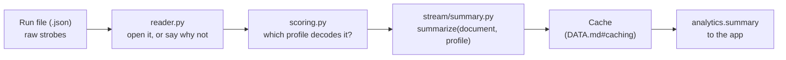
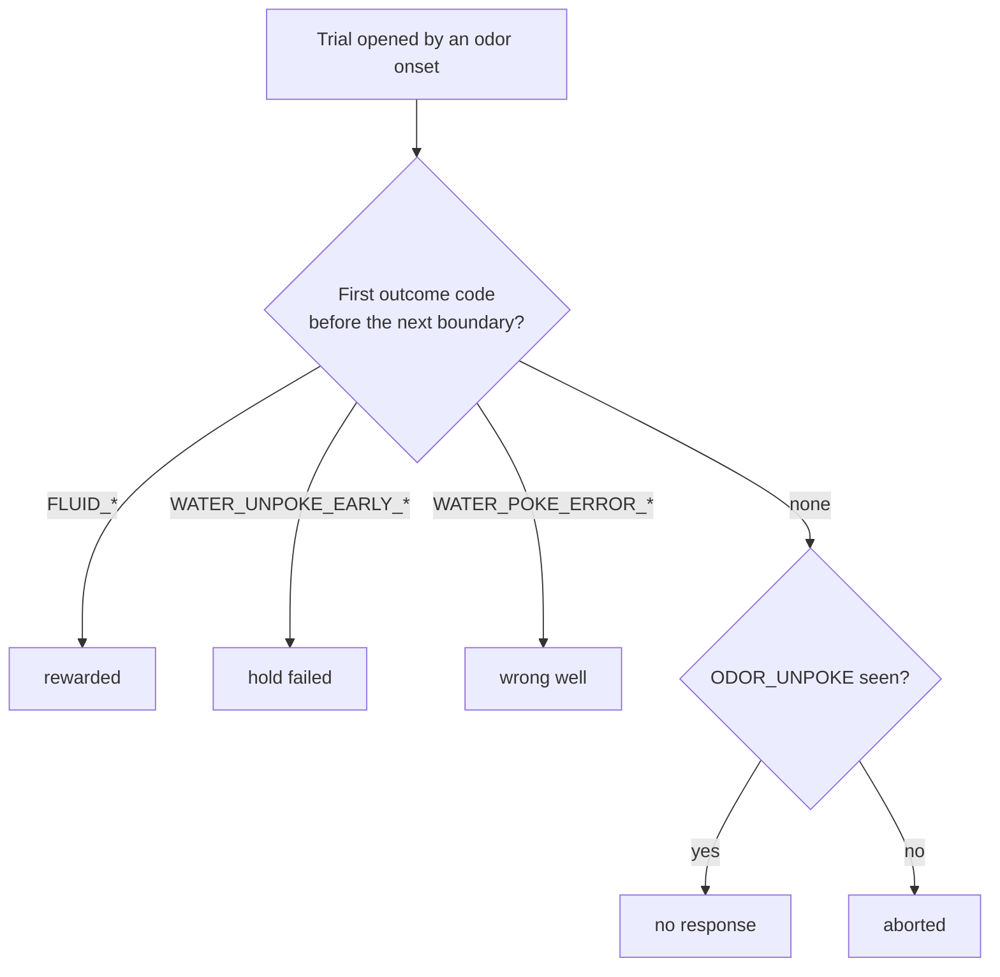
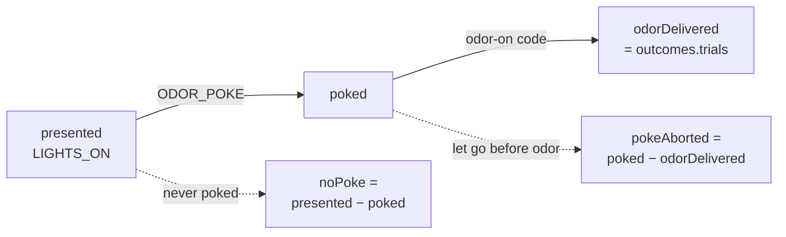
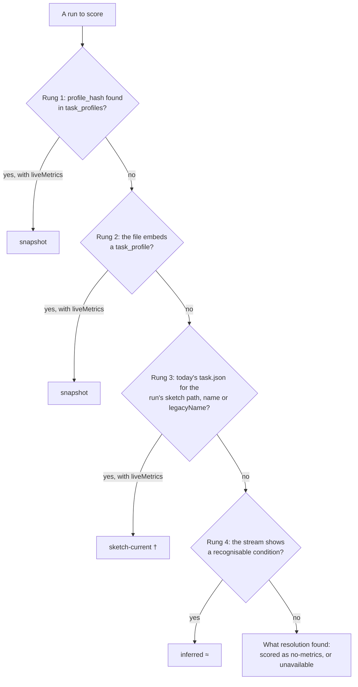

# Analytics

How Ephymeris turns a recorded strobe stream into trials, accuracies and the errors an animal made, and how
far to trust each number. This file is the specification: the numbers defined here are what a paper would
report.

## Start here

1. **The app never reads the derived trial table.** A run's file holds raw strobes: `[code, timestamp]` pairs, in the
   order the box sent them. Every trial, accuracy and count is derived from them each time they are read. A
   spine run's file also carries its [derived trial table](../../../docs/DATA.md#the-derived-trial-table) for
   the lab's own scripts; `reader.py` drops it, and Analytics replays.
2. **A task profile says what the strobes mean.** It lists the conditions (for example odor 1, answered at
   the right well), and the strobe names that mark a trial's start, its answer and its outcome. A
   [spine task](../../../docs/TASKS.md#spine-tasks)'s profile carries its state table instead, and its
   trials are read out of a replay of that table ([how](#how-a-spine-run-is-scored)).
3. **One scorer defines a trial**, and the same code scores a session live in Mission Control and
   afterwards in Analytics, so the two cannot disagree.
4. **To check the science, read [`stream/`](stream/) and nothing else.** It is pure: a document and a
   profile in, numbers out, with no files, database or clock. A test keeps it that way.
5. **Every number travels with its sample size and a 95% interval.** Nothing is suppressed. A run with
   nothing to score says why, instead of reporting zero.

The [worked example](#a-worked-example) shows all of it on thirty strobes.

## The folder at a glance

**The science**: `stream/`, pure functions.

| File | Answers | In → out |
|---|---|---|
| [`stream/trials.py`](stream/trials.py) | Is this trial a hit, a miss, or excluded? (Mission Control scores with it too) | strobes + one condition → rolling P(hit) |
| [`stream/outcomes.py`](stream/outcomes.py) | Was it rewarded, a hold failure, the wrong well, unanswered or aborted? | strobes + profile → `TrialOutcomes`, per-trial tape |
| [`stream/engagement.py`](stream/engagement.py) | How many trials were offered, poked, and given odor? | strobes + profile → `TrialEngagement` |
| [`stream/summary.py`](stream/summary.py) | One run's whole result | document + profile → `RunSummary` |
| [`stream/curves.py`](stream/curves.py) | The run trial by trial: learning curves, strategy walk | document + profile → series |
| [`stream/infer.py`](stream/infer.py) | Which conditions ran, when no profile says | strobes → a `TaskProfile` |
| [`stream/false_starts.py`](stream/false_starts.py) | Which restarted runs to set aside | run facts → verdicts |
| [`stream/replay.py`](stream/replay.py) | What did the board do at each tick? The Python port of the firmware's interpreter ([ADR 0003](../../../docs/adr/0003-phase-spine-task-model.md)) | state table + params + seed + input edges → actions per tick |
| [`stream/spine.py`](stream/spine.py) | What must a spine run's board have sent, and did it? Reads the table, parameters, seed and input edges out of the run's own document ([TASKS.md](../../../docs/TASKS.md#the-snapshot)), predicts every strobe from the inputs alone, and compares | a spine run's document → its divergence, or its trial table |
| [`stream/trial_table.py`](stream/trial_table.py) | What happened in each trial of a spine run? ([the trial table](#the-trial-table)) | state table + replayed actions → one row per trial |
| [`stream/table_metrics.py`](stream/table_metrics.py) | A spine run's numbers ([metrics](#metrics-from-the-trial-table)) | trial table → outcome tallies, P(correct \| row), rewarded |
| [`stream/stats.py`](stream/stats.py), [`stream/document.py`](stream/document.py), [`stream/metric_summary.py`](stream/metric_summary.py) | The Wilson interval; reading `ts_data` out of a file; the one metric shape both scorers build | |

**The plumbing**: files, cache and commands. You need these only to change how runs are found or stored.

| File | Does |
|---|---|
| [`reader.py`](reader.py) | Finds and opens run files; decides `missing` or `unreadable` |
| [`scoring.py`](scoring.py) | Picks the profile for each run ([the ladder](#which-profile-decodes-a-run)), scores it, and caches the result |
| [`repository.py`](repository.py) | The profile snapshots and the cache tables |
| [`service.py`](service.py) | The `analytics.*` commands the app calls |
| [`archive.py`](archive.py) | A cohort's sessions and runs as one read, and the lock that guards it ([DATA.md](../../../docs/DATA.md#the-cohort-archive)) |

## From a session file to a number



A run that cannot be opened stops at `reader.py` with a status ([why a run has no
numbers](#why-a-run-has-no-numbers)). A run with no profile to decode it still gets a summary, with its
event count, duration and stop reason, but no accuracies.

## A worked example

A GRGL session in which odor 1 is answered at the right well and odor 3 at the left. Six presentations, as
the box strobed them (by name; the codes live only in the [strobe
vocabulary](../../../docs/TASKS.md#strobe-vocabulary)):

| # | Strobes | Trial (P(hit)) | Outcome |
|---|---|---|---|
| 1 | `LIGHTS_ON ODOR_POKE ODOR_1_ON ODOR_UNPOKE WATER_POKE_R FLUID_R STOP_FLUID_G_R` | odor 1: **hit** | **rewarded** |
| 2 | `LIGHTS_ON ODOR_POKE ODOR_3_ON ODOR_UNPOKE WATER_POKE_L WATER_UNPOKE_EARLY_L` | odor 3: **hit** | **hold failed**: right well, left too soon, no water |
| 3 | `LIGHTS_ON ODOR_POKE ODOR_1_ON ODOR_UNPOKE WATER_POKE_L WATER_POKE_ERROR_L` | odor 1: **miss** | **wrong well** |
| 4 | `LIGHTS_ON ODOR_POKE ODOR_3_ON ODOR_UNPOKE` | odor 3: **excluded** | **no response**: smelled the odor, never answered |
| 5 | `LIGHTS_ON ODOR_POKE ODOR_1_ON ODOR_UNPOKE_EARLY` | odor 1: **excluded** | **aborted**: left before sampling finished |
| 6 | `LIGHTS_ON LAZY_RAT LIGHTS_OFF` | no trial | never poked (shows only in engagement) |

Trial 4 stays open until the next odor onset (`ODOR_1_ON` in presentation 5) closes it unanswered. That is
what [boundary codes](#boundary-codes) are for.

What the run reports:

| Figure | Value | Why |
|---|---|---|
| P(right \| odor 1) | **0.5**: 1 hit / 2 counted, 3 triggered, 1 excluded | trials 1, 3 counted; 5 excluded |
| P(left \| odor 3) | **1.0**: 1 / 1, 2 triggered, 1 excluded | trial 2 counted; 4 excluded |
| Overall accuracy | **0.67**: 2 / 3, 5 triggered, 2 excluded | the two conditions pooled over integers |
| Rewarded accuracy | **0.25**: 1 rewarded / 4 administered | trial 5 aborted, so it is not administered |
| Response accuracy | **0.50**: (1 rewarded + 1 hold failed) / 4 | the right side was chosen, water or not |
| Engagement | 6 presented, 5 poked, 5 given odor: **pEngaged 0.83** | presentation 6 was never poked |

Trial 2 shows why there are two kinds of accuracy: the hit counts toward P(hit), but no water was
delivered. `test_analytics_derive.py` scores this exact stream and asserts every number in the table.

## How a strobe stream is scored

Everything here is computed from `ts_data`. All of it is derived at read time from the raw codes plus the
profile that decodes them. Offline scoring **never reimplements the live scorer**: it replays the stream
through `stream/trials.py`'s `MetricAccumulator`, the same class Mission Control uses. A run's result is a
`RunSummary`, and its `status` is `ok`, `no-metrics`, `missing` or `unreadable`; a spine run is scored by
[replay](#how-a-spine-run-is-scored) instead, and can also be `diverged` or `unreplayable`.

### Trials: hits, misses and exclusions

> [!IMPORTANT]
> This is scientific output, not a UI detail. Implemented in [`stream/trials.py`](stream/trials.py).

Each condition the profile declares (a `liveMetrics` entry) names a `triggerCode` that opens its trials
(the odor onset), a `successCode` (the correct answer) and one or more alternate codes (every wrong
one). For each `triggerCode` in an animal's strobe stream, scan forward for the next `successCode` or
alternate, stopping at the next trial-boundary code:

| Found first | Counts as |
|---|---|
| `successCode` | **hit**: numerator and denominator |
| any alternate | **miss**: denominator only ("went to the other side", not "didn't respond") |
| neither, before a boundary | **excluded** from both |

A go condition has one alternate, the other well. A **no-go condition** has `WATER_POKE_NONE` as its
`successCode` (the withhold) and the enter code of **every response port** as its alternates, because
a poke at any port is the wrong answer. A no-go trial is therefore a hit when withheld, a miss when
answered at any port, and excluded only when nothing resolves it before the next boundary. Alternates
are `alternateCodes` on the wire, with `alternateCode` repeating the first; a generated and an inferred
profile list the same ports in the same order (port-slot order, [inference](#which-profile-decodes-a-run)).

> [!NOTE]
> **A profile that lists one alternate for a no-go metric still scores at every port.** That covers a run
> recorded before metrics listed every port and a hand-written `task.json`. Scoring widens any metric whose
> success code is `WATER_POKE_NONE` (retired or not) and which lists one alternate to the enter code of every
> response port (`infer.widen_no_go`), once, where a profile is settled for scoring: `scoring._settle` for the
> archive and `MetricSet` for a live session and a debug run. Only the scored copy is widened: the stored
> snapshot, its `to_json` and its `profile_hash` stay as recorded, and Mission Control and Analytics show
> the same figure.

The metric is **response-conditional and reward-unconditional**: the firmware strobes the well poke the
instant it is detected, before any hold check. The rolling window is the last `windowSize` **counted**
trials, so `n` legitimately lags the trial count (`n=14` after 20 triggers means six unanswered trials).
A success or alternate code with no trial open is ignored.

### Boundary codes

A trial ends at the next **boundary code**: any condition's trigger code. That is how an odor-3 onset
closes an unresolved odor-1 trial.

> [!CAUTION]
> **Boundary codes are the easiest thing here to get silently wrong.** Every scan must be given the
> **union of every trigger code in the profile**, exactly as the live runner does. `MetricSet` builds that
> union live, and `boundaries_for` builds it offline: use it. `compute_series(metric, stream,
> boundary_codes=None)` **defaults to only that metric's own trigger**, and for any profile with more than
> one condition that differs. A trial where odor 1 fires, the animal does not respond, and odor 3 fires next
> is **excluded** by the live path and **mis-scored** by the default, which hands the later response to the
> abandoned trial. Every unanswered trial scores wrongly, silently.

### Two probabilities per metric

| | Definition | Used by |
|---|---|---|
| **`pWindow`** | The rolling value at the end of the run, over the authored `windowSize` | Reconciling a run against the last number Mission Control showed |
| **`pSession`** | `hits / counted` over every trial the same accumulator scored | **Every summary**: strategy plane, cross-session curves, session summary |

Both come from **one replay through one accumulator** (`_summarize_metric`), so they differ *only* in
averaging window and cannot disagree on how a trial was classified.

> [!WARNING]
> **The two diverge sharply over the first `windowSize` trials. They are not interchangeable.** Two panels
> using different ones under the same axis label is an invisible error. Each view states which it reads.

`pSession` is the summary statistic wherever a summary is shown: less noisy, and the only one with a
defensible sample size.

### Trial counts

| Count | Definition |
|---|---|
| **`counted`** | Trials scored as hit or miss. A series has one entry per counted trial |
| **`hits`** | Counted trials scored as hits, carried so pooling stays exact over integers |
| **`triggered`** | Occurrences of the condition's `triggerCode`: trials presented |
| **`excluded`** | `triggered − counted`: lazy, invalid and no-response trials |

`excluded` is scientifically meaningful: 200 triggers with 90 counted is a different session from 200
with 195 at the same P(correct). **Surface it.** A session's last trial is usually unresolved when the board
ends, and correctly lands in `excluded`.

> [!CAUTION]
> **`MetricValue.n` (and a series' `n`) is the window length, capped at `windowSize`, not a trial count.**
> Using it as the sample size for an interval on `pSession` is wrong by an order of magnitude. **`counted`
> is the count.**

### Pooled accuracy

Each run also carries **`overall`** (id `__overall__`): correct trials over scored trials, pooled across
every condition. **It is every per-run readout's default**; the animal rail and the session rail read it.

> [!IMPORTANT]
> **A single condition cannot show a side bias.** An animal that pokes right on every trial scores ~1.0 on
> "P(R | Odor 1)" and ~0.0 on "P(L | Odor 3)", so any readout keyed on one condition paints a completely
> bias-locked animal as one of the best in the cohort. Pooled, it sits at chance, which is the truth. This
> was found on real output, where a deliberately non-learning animal read 0.72–0.84.

- **Pooled by summing hits and counted**, never by averaging proportions, so a session with 90 trials of
  one condition and 10 of another is weighted as it ran.
- **The rate pools only conditions that scored; the counts pool all of them**, so a condition fired twenty
  times and never answered still appears in `triggered`/`excluded`, and `triggered == counted + excluded`
  holds on the pooled row.
- **It is a summary, not a condition**: never a strategy axis, and no within-session series (the
  conditions interleave and the live path has no pooled accumulator).

### Uncertainty

Every probability carries `counted` and a **95% Wilson score interval** (`stats.wilson_interval`). Wilson,
not the normal approximation, because this data lives at small *n* **and** at *p* near 1 (a trained animal
sits near 0.95), which is exactly where the normal interval runs past 1.0. It is a few lines over
`math.sqrt`, cheaper than importing `scipy.stats` for it ([dependency
policy](../../../docs/ARCHITECTURE.md#dependency-policy)).

**The sidecar never suppresses.** It reports value, count, interval and a `lowConfidence` flag
(`counted < minCountedTrials`, default `DEFAULT_MIN_COUNTED` = 10). Suppression is a presentation choice
made in the app: a learning curve draws a widening band, a strategy point draws hollow and smaller, and a
session-summary chip drops to an outline. Keeping the value preserves the difference between *"cut short
after three trials"* and *"never happened"*.

### Rewarded and response accuracy

The conditions' hit rates are **reward-unconditional**: `WATER_POKE_L/R` scores the instant the poke is
seen, so reaching the correct well and releasing early still scores a hit. That is right for a live
discrimination readout, but it is not "how often did this animal earn water". So each run also carries
`outcomes` (`TrialOutcomes`), classified per trial from the profile's own strobe names:

| Outcome | Recognised by | Meaning |
|---|---|---|
| **rewarded** | `FLUID_*` | Fluid delivered |
| **hold failed** | `WATER_UNPOKE_EARLY_*` | Correct well, released before the hold: no drop |
| **wrong well** | `WATER_POKE_ERROR_*` | Wrong side |
| **no response** | administered, none of the above | Sampled, never answered |
| **aborted** | no `ODOR_UNPOKE` | Odor delivered, left before sampling cleared |

How one trial is classified (`outcomes._classify_trials`). A trial runs from its onset to the next boundary
code, and the first outcome code inside it decides; only a trial with none falls through to the sampling
check:



`administered` (odor sampled to completion: every trial but `aborted`) is the denominator:

- **Rewarded accuracy** (`pRewarded`) = `rewarded / administered`. Conservative.
- **Response accuracy** (`pSide` on the wire) = `(rewarded + holdFailed) / administered`: the correct side
  was chosen, held or not. **Always ≥ rewarded accuracy; the gap is the consummatory hold-failure rate**,
  a real behaviour.

Each has its own Wilson interval. Three deliberate choices:

- **Administered, not trials, is the denominator**: an unsampled trial is not evidence about
  discrimination.
- **Matched by anchored name, never by code number.** `^FLUID(_|$)`, so `STOP_FLUID_G_R` (delivery
  *ending*) is not a second reward; `^ODOR_UNPOKE$`, so `ODOR_UNPOKE_EARLY` cannot satisfy completed
  sampling.
- **A task declaring no reward vocabulary reports `outcomes: null`**, not zeros: "no notion of a reward"
  and "earned nothing" are different claims.

> [!WARNING]
> Two limits invisible in the numbers:
>
> - **`trials` counts odor onsets, not trials offered.** The firmware strobes odor-on only after the animal
>   has poked and held, so an ignored trial produces no boundary and appears nowhere, not even as
>   `aborted`. **Every figure here is conditioned on engagement**; the [engagement
>   ladder](#engagement-ladder) measures it.
> - **A no-go trial, withheld or answered, lands in `no response`** in the outcome tally: the correct
>   answer looks exactly like a non-response from the strobes, a false alarm at a port has no fluid or
>   error evidence, and `stream/outcomes.py` has no withheld or false-alarm bucket. P(withhold) is not
>   affected, because it is a per-condition metric ([above](#trials-hits-misses-and-exclusions)) that
>   scores a withhold as a hit and a poke at any port as a miss.

### Per-condition tally

`conditions` is the same tally restricted to the trials each condition opened. The pooled figure cannot
show a rat at 95% on one odor and 25% on the other.

- **Driven off the profile, never off a task's vocabulary.** Five declared conditions, five entries.
- **Authored `liveMetrics` order**, so it lines up with the strategy plane.
- **A partition**: every trial belongs to exactly one condition and the entries sum to `outcomes`
  field-for-field, because one classification pass produces both.
- **A condition with no trials is zeroed, not omitted** (its rates stay `null`).
- **Empty, not `null`, when `outcomes` is `null`.**

### Engagement ladder

Everything above is delimited on odor onset, which the firmware reaches only after the animal has poked
and held. So **two animals with identical accuracy, one working every trial and one skipping four fifths,
produce identical numbers** everywhere above. `engagement` (`TrialEngagement`) is delimited on the **trial
light** instead: `LIGHTS_ON` happens first and unconditionally, before the animal can do anything.

| Rung | Reached when | Meaning |
|---|---|---|
| `presented` | `LIGHTS_ON` | The box offered a trial |
| `poked` | `ODOR_POKE` within that presentation | The animal engaged the odor port |
| `odorDelivered` | An odor-on code within it | The pre-odor hold cleared and odor was delivered |

**`pEngaged = poked / presented`** (with a Wilson interval) and `pDelivered = odorDelivered / presented`.
The gaps are reported as `noPoke` and `pokeAborted`.



- **A ladder, not a partition**: each rung counts presentations reaching that stage, so
  `presented ≥ poked ≥ odorDelivered` by construction and no gap is negative.
- **`pokeAborted` is not `outcomes.aborted`**: both let go of the port, but only the latter had smelled
  anything.
- **`odorDelivered` should equal `outcomes.trials`**: the same trials counted from opposite ends. The tests
  assert it.
- **`null`, never zeroed, when the profile declares no trial light.**

> [!CAUTION]
> Matched by **anchored** name: `LIGHTS_OFF` is the same word and the opposite edge, and an unanchored
> match would roughly **double `presented`** while still looking plausible.

### Per-trial tape

The tallies say *how often*; the tape says *when* (streaks, bias episodes, the moment an animal stopped).
`analytics.series` returns each run's trials as `TrialRecord {index, triggerCode, outcome, atMs,
latencyMs}` in stream order.

- **The tape is the same classification the tallies are summed from**: `_classify_trials` yields it and
  `_tally` consumes it. A test pins that tallying the tape reproduces `outcomes_of`, and grouping it by
  `triggerCode` reproduces `conditions_of`.
- `outcome` uses hyphenated wire spellings (`hold-failed`, `no-response`, …).
- `atMs` is ms from the run's **earliest** timestamp (not first, for `durationMs`'s reason). `latencyMs`
  is open → settling code; `null` for `no-response`/`aborted`, and nulled rather than negative on a
  disordered file.
- Empty, not `null`, when the profile can't express outcomes.
- Carried on `analytics.series` because the file is already open there; uncached, like the series.
- **Session-log notes are drawn on it** (`lib/logbook/tapeMarkers.ts`): a note marks every run if it is
  session-wide, otherwise only its animal's or box's run, and only if it falls within the run (a minute's
  slack at either end). It sits before the first trial that opened after it, approximate to a few
  seconds for [the session clock's](../../../docs/DATA.md#the-session-clock) reason, and its hover text
  says so.

### Run-level scalars

- **`totalEvents`** = `len(ts_data)`. Trust `ts_data` over the document's `n_events`; a mismatch means a
  hand-edited or recovered file.
- **`durationMs`** = `max − min` of the stream's timestamps: stream-relative, and `max − min` rather than
  `last − first` so a disordered file can never yield a negative duration.
- **Wall duration** = `ended_at − started_at` from the run record.
- **`stopReason`**, and `clean = stopReason == "BF_END_SESSION received"`.
- **`seed`** = the document's `trial_seed`.

> [!NOTE]
> **Report both durations and do not reconcile them.** `started_at` is stamped when the runner creates the
> run; stream `t=0` is the board's own start, after the DTR reset and `READY` handshake.

### Live scoring

`sessions/runner.py` creates a `MetricSet(profile)` at box start and offers it every strobe, pushing all
metric values in each `session.telemetry` event. Debug Mode's Send START scores through the **same**
`MetricSet` (`debug_run.py`); don't write a second scorer. `hits_total`/`counted_total` give Analytics an
exact integer ratio. A telemetry metric carries `id`, `value` and `n`, never its label: renderers resolve
the label from the profile (`useTaskProfiles`, `metricLabels`), or a row reads `p_correct_2`.

The within-session curves (`stream/curves.py`) replay the stream the same way; the panels that draw them
are [learning curves](../../../docs/DATA.md#learning-curves) and the [strategy
plane](../../../docs/DATA.md#strategy-plane).

## How a spine run is scored

A [spine task](../../../docs/TASKS.md#spine-tasks)'s run records only what the board observed and what it
did, so nothing in its strobes says what a trial was. Instead its file carries its state table, parameters
and seed ([the snapshot](../../../docs/TASKS.md#the-snapshot)), and Analytics **replays** it: the input
edges drive `stream/replay.py`, the port of the board's interpreter, which says what the board did at every
tick ([ADR 0003](../../../docs/adr/0003-phase-spine-task-model.md#replay-and-analytics)). One replay
gives two things (`spine.replayed`, which replays the run once):

1. **The check.** Every output, `START_SESSION`, `TRIAL_START` and `END_SESSION` the board strobed is
   predicted, and must equal what was recorded, strobe for strobe. A run where it does not is
   [diverged](#diverged-and-unreplayable-runs), and is not scored.
2. **The trial table**, read off the same replay, and every number a function of it.

A spine run is recognised by its own file: its snapshot's `spine` key, or a header `interp` other than the
trial runner's `1`. Never by a task name, and never by inference, which its edge code names would only fool.
A legacy run (`interp` absent or `1`) is scored exactly as the rest of this file describes.

> [!CAUTION]
> **Read a trial off the table's own fields, never a phase kind or a code name.** The one exception is
> finding the Response window a response is read from. A phase or an outcome class added later must score
> with no change here, and `test_replay_trial_table.py` feeds a table with an
> outcome number no task has used to prove it. A scorer that matched `"outcome"` phases or `FLUID_*` codes
> would silently miss the first new one.

### The trial table

One row per trial (`stream/trial_table.py`, `ReplayTrial` on the wire). Columns, and where each is read:

| Column | Read from |
|---|---|
| `index`, `atMs` | Each tick a state flagged `STARTS_TRIAL` is entered. A tick that finishes one trial and starts the next (a chance state missing straight back to the start) is split there: the hops before the flagged state are the old trial's. The trial start the session ends on (trial NT+1, the one where the last block ends, or the first after `STOP`) is not a trial |
| `block` | The block the core reports running at the trial's start tick (`Actions.block`, from INTERP 5), named by the snapshot's `blocks[].id` ([TASKS.md](../../../docs/TASKS.md#blocks)); for an older table, the task's only block when it has exactly one; otherwise null. Never read from a phase's name |
| `row`, `rowName`, `level` | The snapshot's `table.rows` (each state's row index) when it carries one; otherwise the task's only row, when it has exactly one; otherwise null |
| `phaseEntries` | The first tick the trial entered a state of each phase, by the snapshot's `table.phases` (each state's phase index, null for a state in no phase such as a pick). A snapshot without it is lowered again from its own definition, and that map is used only if it gives back exactly the recorded table; otherwise the column is empty |
| `outcome` | The outcome class of the **last** outcome-bearing state (`outcome` ≠ 0) the trial entered, named by `taskdef/lowering.py`'s `OUTCOME_CLASSES`, or `outcome_<n>` for a number this build has no name for. Null when it entered none, as an abort in a table lowered before INTERP 4 does; from INTERP 4 every early exit marks its class at its end ([TASKS.md](../../../docs/TASKS.md#lowering)) |
| `response`, `responseEdge`, `responseMs`, `latencyMs` | When the snapshot maps states to phases (`table.phases`, or the re-lowered map): the first edge exit the trial took out of a **Response window** phase's states, the window and the hold after it, with its latency from the trial's first entry into that phase. So a held response, kept or broken, is the window's edge timed from the window opening, whatever phases lie between it and the Outcome. Null for a trial a timer decided (an omission, a withhold), and in a spine with no window (the tracer). This is the one column that reads a phase kind, and only to find the window. **Without a phase map**, the fallback is structural: an edge exit out of a *deciding* state, one with two or more exits (edge rows and timer) that can reach an outcome-bearing state before the next trial starts. The last such exit before the trial's first outcome-bearing state is taken, then traced back to the first edge exit of its state's visit |
| `rewarded`, `rewardLine`, `rewardMs` | The trial took the `on_hit` branch of a chance state that bears an outcome. The line is the outputs `on_hit` drives and `on_miss` does not; the time is the ticks actually spent in `on_hit` |
| `correction` | The core reported `ACT_CORRECTION` at the trial's start: its block's correction rule repeated the last trial's row ([TASKS.md](../../../docs/TASKS.md#blocks)). False for a table without blocks |
| `inputCounts` | Each watched input's rises per phase, attributed to the state held before the tick, as the interpreter attributes them. Non-zero counts only |
| `complete` | The next trial started, or the session ended at a trial start. Only a crashed run's last trial is incomplete |

The table rides on `analytics.series` (`RunSeries.trialTable`), computed from the file on each request and
never cached, like every per-trial series ([DATA.md](../../../docs/DATA.md#caching)). Finalization and
recovery write the same table into the run's `.json` and `.mat` under snake_case names, stamped with
`spine.REPLAY_VERSION`, which moves with any change to what a run's table holds
([DATA.md](../../../docs/DATA.md#the-derived-trial-table)). That copy is for scripts outside the app:
Analytics never reads it.

### Metrics from the trial table

Over **complete** trials only (`stream/table_metrics.py`), each proportion with its [Wilson
interval](#uncertainty):

| Figure | Definition |
|---|---|
| `replay.classes` | For each outcome class, n and n / trials. With `replay.unclassified` (trials that reached no outcome-bearing state) they partition the trials |
| `replay.rows` | The same per row: P(outcome \| row) |
| `replay.rewarded` | Trials whose reward line opened / trials |
| `metrics` | One per row, **P(correct \| row)**: hits are its trials whose class is in `table_metrics.HITS`, `correct` or `withheld`; counted are its classified ones outside `table_metrics.EXCLUDED`; its unclassified and aborted ones (`abort_before_stimulus`, `abort_during_sampling`) are excluded, as an unanswered or aborted trial is on a legacy run. An abort still counts in its class tally ([trials](#trials-hits-misses-and-exclusions)) |
| `overall` | P(correct) pooled over every row, by summing counts ([pooled accuracy](#pooled-accuracy)) |

> [!CAUTION]
> **A withhold is a hit.** It is a no-go row's correct answer, so counting only `correct` would score a
> perfect go/no-go session at the go rows' share. `false_alarm`, `wrong_response`, `omission`,
> `hold_broken` and any class added later are misses until `HITS` says otherwise. The two abort
> classes are excluded instead (`EXCLUDED`): the animal quit before it was asked, as an aborted
> legacy trial is excluded.

Because `metrics` and `overall` keep the legacy shape, a spine run appears in the session table, the cards
and the cohort trends like any run. P(correct | row) and `replay.classes` answer different questions: the
first leaves out trials with no class, the second keeps them in the denominator.

The tracer's Outcome records `correct` before it draws the reward, so a trial can be `correct` and not
`rewarded` when the reward probability is below 1000‰.

### Diverged and unreplayable runs

- **`diverged`**: replay ran, and the first recorded strobe it did not predict is named in `divergence`
  (its position, and what replay predicts there and what the file records, each as `CODE_NAME@ms`). A recorded stream that cannot be
  fed to replay at all (strobes out of order, an edge after the end) is diverged too. A diverged run has no
  metrics and no trial table: its outputs are not what this table, seed and inputs produce, so any number
  read from it would describe a session that did not happen.
- **`unreplayable`**: replay cannot start. Its `INTERP` is not one `replay.INTERP_VERSIONS` knows, its
  snapshot carries no table, or the snapshot is malformed. An unknown `INTERP` is **never replayed**:
  running a table under the wrong interpreter's rules would score a session that did not happen.

Each read of a run with a run record also writes its verdict to `session_animal_runs.diverged`
([DATA.md](../../../docs/DATA.md#run-records)).

## Which profile decodes a run

`profileSource` on each run says which declaration decoded it:

| Source | Meaning | Shown as |
|---|---|---|
| `snapshot` | The profile the run actually used: this database's snapshot, or **the file's own** | Trusted, unmarked |
| `sketch-current` | Today's `task.json` for the recorded sketch | Flagged `†`: may have changed since |
| `inferred` | No declaration resolved; conditions read from the strobes (`stream/infer.py`) | Flagged `≈`: scored from the strobes alone |
| `unavailable` | Nothing resolves and the stream shows no recognisable condition (a utility log, an empty file) | Flagged: cannot decode |

The ladder has four rungs:

1. **the database snapshot** (`profile_hash` → `task_profiles`);
2. **the file's own snapshot** ([embedded profile](../../../docs/DATA.md#the-embedded-task-profile)),
   reported as `snapshot`;
3. **today's `task.json`** for the recorded sketch name, including a saved task whose `legacyNames` claim a
   historical name;
4. **inference** from the stream.

Rungs 1 and 3 are *resolution* and run before any file is opened (`RunScorer._resolve_profile`); rungs 2
and 4 need the file open and live in `scoring._settle`. `analytics.summary` (`RunScorer.score`) and
`analytics.series` (`RunScorer.decode`) climb the same ladder, so a chart draws the trials the summary
counted. A malformed `task.json` or a damaged embedded snapshot degrades to the next rung rather than
raising: a file with a broken declaration is still a file full of real strobes. So does a declaration with
no `liveMetrics`: a rung is taken only if its profile declares something to score. A **spine run** climbs no
ladder: it decodes by its own snapshot, or by nothing, and is [scored by
replay](#how-a-spine-run-is-scored).



Each "no" also covers a rung whose profile exists but declares no `liveMetrics`, with one wrinkle: rung 3
is consulted only when rung 1 found no snapshot at all, so a metric-less database snapshot goes from rung
2 straight to inference.

> [!CAUTION]
> **The file's snapshot outranks today's `task.json`, deliberately.** Both are "a declaration for this
> sketch"; only one is the declaration this run used. Ranked the other way, a rig holding a same-named task
> would score a visiting file against its own edit of it, silently, under a `profileHash` asserting the two
> are comparable.

> [!IMPORTANT]
> **The digest a run is *scored* with is not the digest *resolution* reached, and the cache keeps both.**
> Rungs 2 and 4 are reached after resolution found nothing, so the cache key's `profile_hash` is NULL for
> them by definition. Storing only that column made such a run report its hash on the pass that computed it
> and NULL on every cached pass after, silently dropping it out of its own profile group, the strategy
> plane, the learning curves and the parameter-mismatch check once the cache warmed.
> `scored_profile_hash` is the second column.

**Why inference is sound, and its limits.** Every behaviour task this lab runs shares one firmware lineage
and the append-only strobe registry ([TASKS.md](../../../docs/TASKS.md#strobe-vocabulary)), so a code means
the same thing in every file. The stream says which conditions ran (the `ODOR_n_ON`-shaped onsets present)
and which answer was correct: `checkResponse()` reaches `FLUID_x` / `WATER_UNPOKE_EARLY_x` only at the
*correct* well and `WATER_POKE_ERROR_x` only at the wrong one, so any settled trial names the side; the
majority wins across the session. The inferred profile goes through the **same scorer** as a declared one,
and `tests/test_analytics_infer.py` pins identical counted/hits/pooled figures against the declared GRGL
profile over the same stream; extend that pin before touching either side. Inference cannot know
conditions never presented, the operator's labels, or the authored window (it uses `INFERRED_WINDOW`), so
the declared path always wins. A condition never answered all session keeps its trial boundary (or other
conditions would be mis-scored) with a deterministic, inert orientation.

**What a run ran and what decoded it are separate fields.** `sketchName` is what the file itself recorded
(its `sketch`, else the last path segment) and is what every task label prints. `sketchPath` is where *this
install* found a `task.json`, legitimately empty for a session recorded on another rig. Showing such runs
as "unknown sketch" would claim the record is silent when the file says exactly what it ran; the missing
profile costs decoding fidelity, carried by `profileSource`.

**A sketch name is resolved when a run is read, never frozen at adoption.** The stored `sketch_path` is a
cache of the lookup. Since the sketch library ships with the app, the failure mode is a sketch dropped from
the bundle, which `tests/test_bundled_library_covers_archives.py` guards.

> [!IMPORTANT]
> **Comparability is the pair `(profileHash, paramsHash)`, not the profile hash alone.** A profile hash
> covers the declaration, identical across every run of a task however it was tuned: a 10 ms poke hold and
> a 500 ms one share it. A comparability set holding more than one parameter set gets **one
> `parameter-mismatch` warning** rather than a split. Splitting would fragment a cohort's history the
> first time someone nudged a timeout, and whether it matters is the reader's call. Runs with no recorded
> parameters (they ran on firmware constants) are ignored, not treated as their own set.

## Kinds of errors

"Error" means five different things here, and they must not be mixed: something the animal did, a run that
cannot be scored, a number that cannot be fully trusted, a run set aside, and an operation the app refused.

### What the animal did

Per trial, from the [worked example](#a-worked-example)'s vocabulary. The first two columns are the same
trial seen two ways: by the condition's hit rate, and by what actually happened at the well.

| Error | Hit rate sees | Outcome tally sees | Means |
|---|---|---|---|
| Wrong well | **miss** | `wrongWell` | Chose the wrong side |
| Hold failed | **hit** | `holdFailed` | Right side, released before the water |
| No response | **excluded** | `noResponse` | Sampled the odor, never answered |
| Aborted | **excluded** | `aborted` | Left the odor port before sampling finished |
| Poke aborted | nothing | nothing (`engagement.pokeAborted`) | Poked, let go before any odor |
| Never poked | nothing | nothing (`engagement.noPoke`) | Ignored the trial (`LAZY_RAT`) |

The last two never reach an odor onset, so only the [engagement ladder](#engagement-ladder) counts them.

### Why a run has no numbers

A run's `status` (with a `detail` that says what to do):

| Status | Means | Typical `detail` |
|---|---|---|
| `ok` | Scored | |
| `no-metrics` | Read fine, but no profile declares anything to score. Still listed with duration, events and stop reason | Why no profile resolved, for example the sketch name matched nothing |
| `diverged` | A [spine run](#how-a-spine-run-is-scored) whose recorded outputs are not what replay predicts. Flagged, never scored. Still listed with duration, events and stop reason | Which strobe first differs, and what replay predicted there |
| `unreplayable` | A spine run replay cannot start: an unknown `INTERP`, no table in its snapshot, or a malformed one. Never replayed and never inferred. Still listed with duration, events and stop reason | Why, for example "the header says INTERP 99, not a version this replay knows" |
| `missing` | No file was recorded, or it is not on disk | "the .tsv is on disk but the .json was never written — the data is recoverable" ([crash recovery](../../../docs/DATA.md#crash-recovery)) |
| `unreadable` | The file is there but is not a JSON object, or the path can't be read | The parser's message |

**A bad file is data, not an error**: one unreadable file must not blank a year of history, so none of
these raise. A file that briefly disappears (an unreachable network share) keeps its last good summary,
marked stale, rather than vanishing from the charts.

### How far to trust a number

| Flag | Means |
|---|---|
| `profileSource` `sketch-current` (`†`) | Decoded with today's `task.json`, which may have changed since the run |
| `profileSource` `inferred` (`≈`) | Decoded from the strobes alone ([why that is sound](#which-profile-decodes-a-run)) |
| `profileSource` `unavailable` | Nothing could decode it |
| `lowConfidence` | Fewer than `minCountedTrials` (default 10) counted trials behind the figure |
| `parameter-mismatch` warning | Runs being compared ran the same task with different parameters |
| `excludedByDefault` | A utility-kind profile: scored, but left out of cohort aggregates |

### Edge cases

| Case | Rule |
|---|---|
| **Zero counted trials** | `null`, **never `0.0`**. Zero percent and "no trials" are opposite claims. No strategy point is placed |
| **Profile-less sketch** | `no-metrics`, no metrics invented. **The run is still listed**: it has a real duration, event count and stop reason |
| **Utility-kind profile** | Scored if it declares metrics, but `excludedByDefault` from cohort aggregates |
| **Board disconnected mid-run** | Finalized with `stop_reason: "board disconnected"`. **Include it**, show the reason; a drop at trial 180 of 200 is good data. Distinct from an `aborted` session, which ran no box and wrote no behavior data |
| **No file path recorded** | The writer never opened (handshake failed, or the exclusive open collided): `missing` |
| **Path recorded, file absent** | `missing`, and if the sibling `.tsv` exists, say so: that is the disk-full case [recovery](../../../docs/DATA.md#crash-recovery) fixes |
| **Two runs for one (animal, session)** | Real (a restart after a board drop, a same-day prefix+number reuse). Both are runs and both are listed; no view may silently keep whichever came last. A short first run is a [false start](#false-starts): still listed, but counted nowhere |

### False starts

A box is started, something is wrong, it is stopped within a minute and started again. Both runs are real
files, but counting the first adds a second strategy point, a second learning curve, a session mean dragged
by a run of three trials, and a what-changed that compares the real run with the aborted one and calls it
unchanged. So a false start is **set aside, never hidden** (`stream/false_starts.py`).

**The rule needs both conditions:**

1. **Restarted:** a later run of the same animal exists in the same session. Order is by the start time in
   each run's file name (`order_key`), because a recorded run stamps UTC and an adopted one a naive local
   time, and a session can hold both.
2. **Short:** fewer than `MAX_TRIALS` (10) trials, counted as odor onsets (`TrialOutcomes.trials`, or the
   conditions' `triggered` counts summed when the profile cannot tally outcomes).

A run nobody restarted is never a false start, however short; an animal that quit after four trials is
data. A run whose trials are unknown, because no profile could score it or the index has not read it yet,
is never set aside by the rule: "couldn't tell" fails toward counting.

**A person can overrule it either way.** `analytics.setFalseStart` writes `run_flags`: `true` sets a run
aside, `false` counts it whatever the rule says ("restored"), `null` hands it back to the rule. Overrides
are keyed by run id, which for an adopted run is the id its cohort holds it under ([Orphan
adoption](../../../docs/DATA.md#orphan-adoption)), so a decision survives a rescan. When a rescan prunes a
run's row and adopts the run afresh under a new id (its file refiled, and the row held under its stem-only
id or under the id of the cohort a [move](../../../docs/DATA.md#moving-animals-between-cohorts) brought it
from) the ruling moves to the new row (`_earlier_ids`, `store_adopted`). It never moves off an id a row
still holds, and a cohort reading a run it already holds never takes another cohort's ruling.

| Where | What a false start does there |
|---|---|
| `analytics.summary` | Moved from `runs` to `falseStarts`, so every metric, curve, strategy point, profile group and parameter check ignores it **by construction**. Counted in `counts.falseStarts` and in none of the other counts |
| Session table, log readout, printed log | Listed below the session's runs, muted, labelled *false start* with why (rule or marked by hand) |
| What changed | Compared with nothing and nobody's previous run: the run that restarted it is compared with the animal's previous session (`diff.compare` takes the verdicts). Listed under the changes as set aside |
| The session clock | Unchanged: the time it took is real elapsed time |

The log computes the same verdicts from the analytics cache (`CohortArchive.verdicts`), never from the
files, so the two agree once Analytics has read the session.

### Operations refused

Two refusals reach the operator as a message instead of a number. Both refuse rather than risk answering
from a half-written archive:

- **`ArchiveBusy`**: a scan, tidy, relocate, move or recover already holds the archive. Try again when it
  finishes.
- **`RigInUse`**: a session is set up or running, and the operation would rewrite files under it. Finish
  the session first.

## Key functions

| Function | File | In → out |
|---|---|---|
| `summarize(document, profile)` | `stream/summary.py` | a run's document → `RunSummary`: every number in this file |
| `MetricAccumulator.offer(code)` | `stream/trials.py` | one strobe at a time → hit, miss or excluded |
| `boundaries_for(profile)` | `stream/trials.py` | profile → the trial-boundary codes ([always use it](#boundary-codes)) |
| `outcomes_of(codes, profile)` | `stream/outcomes.py` | strobes → `TrialOutcomes` |
| `conditions_of(codes, profile)` | `stream/outcomes.py` | strobes → one `TrialOutcomes` per condition |
| `trials_of(document, profile)` | `stream/outcomes.py` | a run's document → the per-trial tape |
| `engagement_of(codes, profile)` | `stream/engagement.py` | strobes → `TrialEngagement` |
| `series(document, profile)` | `stream/curves.py` | a run's document → P(hit) after each counted trial |
| `strategy_trail(document, profile)` | `stream/curves.py` | a run's document → the within-session strategy walk |
| `wilson_interval(hits, n)` | `stream/stats.py` | counts → 95% interval |
| `infer_profile(codes)` | `stream/infer.py` | strobes → a profile, when none is declared |
| `widen_no_go(profile, vocabulary)` | `stream/infer.py` | a profile → the copy scored, with every no-go metric missing at every port |
| `false_starts.classify(facts)` | `stream/false_starts.py` | runs → which are set aside |
| `spine.replayed(document)` | `stream/spine.py` | a spine run's document → its divergence, or its trial table |
| `trial_table.trials_of(table, actions, end=…)` | `stream/trial_table.py` | a replay's actions → one `Trial` per trial |
| `table_metrics.score(trials, rows=…)` | `stream/table_metrics.py` | a trial table → `ReplayScore` |
| `reader.read_run(path)` | `reader.py` | a path → the document, or `missing`/`unreadable` |
| `RunScorer.score(runs)` / `decode(run)` | `scoring.py` | runs → cached summaries / one decoded run for a chart |

To score a file by hand:

```python
import json
from ephymeris_sidecar.analytics import stream
from ephymeris_sidecar.rig import registry
from ephymeris_sidecar.tasks.profile import embedded_profile

document = json.load(open("remy1_….json"))
profile = embedded_profile(document)
# Widen as the scorer does, or an old no-go run gets its old, inflated number.
if profile is not None:
    profile = stream.infer.widen_no_go(profile, registry.vocabulary())
summary = stream.summarize(document, profile)
print(summary.to_json())
```

## Changing the analytics

- **Keep `stream/` pure.** No file, database, clock or logging; `tests/test_analytics_stream_is_pure.py`
  fails on the import.
- **Always pass `boundaries_for(profile)`** when replaying a stream ([why](#boundary-codes)).
- **The cache re-scores by itself** when a summary's maths or shape changes: `scoring.current_version`
  hashes what the code answers for a set of canary runs. If `test_the_score_version_pins_every_input`
  fails, the change is real and every machine re-reads its archive once; update its `CANARY`. A change the
  canary cannot see needs a `SCORE_VERSION` bump or a new canary case
  ([caching](../../../docs/DATA.md#caching)).
- **Tests that pin the science**, in `sidecar/tests/`:
  - `test_analytics_derive.py`: every figure here, including live ≡ offline (`live_equivalent`), tape ≡
    tallies, and the worked example.
  - `test_analytics_infer.py`: an inferred profile scores identically to the declared one.
  - `test_task_profiles.py`: the trial definition and boundary codes.
  - `test_false_starts.py`: the false-start rule.
  - `test_replay_trial_table.py`: every trial-table column read off the table's own fields, including an
    outcome class no task has used, and the metrics as functions of the table.
  - `test_spine_analytics.py`: a spine run scored, diverged and unreplayable through `analytics.summary`.
